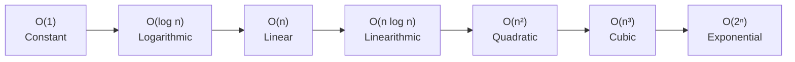

# Big-O and Algorithmic Complexity: Time Analysis

[Back to Module 01](../README.md) · [Back to the master roadmap](../../README.md)

**Session date:** 2026-10-23 · **Module:** 01 — Python Fundamentals & Algorithmic Thinking  
**Format:** Guided reading, executable notebooks, formal proofs, and empirical complexity labs

## Overview

In software engineering and machine learning, programs operate on datasets ranging from a few kilobytes to gigabytes and terabytes. A naive implementation that runs in 2 milliseconds on a developer laptop with 10 records might take 3 weeks or run out of memory when deployed on a million records. 

To design scalable systems, engineers require a mathematical framework that predicts how execution time and resource utilization scale with input size, independent of the underlying computer hardware, operating system, or compiler.

This session develops **asymptotic analysis** from first principles:

1. **Computational models.** We introduce the **Random Access Machine (RAM)** model, examining why physical wall-clock benchmarks fluctuate and why analytical operation counts provide an invariant measure of algorithmic performance.
2. **Primitive operations.** We classify the 7 primitive operations executed by digital computers and construct line-by-line cost-and-frequency tables ($c_i \times \text{times}_i$) to derive exact operational polynomials $f(n)$.
3. **The seven fundamental growth functions.** We analyze constant, logarithmic, linear, linearithmic, quadratic, cubic, and exponential growth, exploring their mathematical properties, scaling behavior, and visualization.
4. **Asymptotic notations.** We define **Big-O** ($O$), **Big-Omega** ($\Omega$), and **Big-Theta** ($\Theta$), and provide step-by-step formal bounding proofs finding concrete constants $c$ and thresholds $n_0$.
5. **Loop complexity patterns.** We dissect common loop architectures: single linear loops, geometric stepping loops ($i \times 2, i \times 3$), nested rectangular loops, and nested triangular loops governed by arithmetic series ($\sum_{i=1}^n i = \frac{n(n+1)}{2}$).
6. **Case analysis and algorithmic dominance.** We contrast **Linear Search** with **Binary Search** across best, average, and worst cases, and demonstrate that algorithmic order dwarfs both hardware upgrades and low-level code optimizations.

## Learning outcomes

By the end of this session, you should be able to:

- Formulate algorithms in terms of the Random Access Machine (RAM) computational model.
- Identify the 7 primitive operations in Python programs and count them across straight-line code, conditionals, and loops.
- Set up line-by-line cost-and-frequency tables and extract closed-form operational polynomials $f(n)$.
- Compare the growth rates of the seven core asymptotic functions: $1$, $\log n$, $n$, $n \log n$, $n^2$, $n^3$, and $2^n$.
- State the formal definitions of Big-O ($O$), Big-Omega ($\Omega$), and Big-Theta ($\Theta$).
- Construct step-by-step bounding proofs by identifying constants $c > 0$ and $n_0 \ge 1$.
- Apply logarithmic identities, including the change-of-base formula, to show that logarithmic base does not alter asymptotic order.
- Determine the iteration counts of single, multiplicative, rectangular, and triangular loops.
- Analyze best-case, average-case, and worst-case execution paths for search algorithms.
- Explain quantitatively why algorithmic order dominates hardware speed and programmer optimization.
- Profile Python execution times empirically with `time.perf_counter()` and verify theoretical scaling orders via log-log regression.

## Session map

| Notebook | Focus | Key Topics |
| :--- | :--- | :--- |
| [01 — Primitive operations](notebooks/01-primitive-operations-and-counting.ipynb) | RAM Model & Operation Counting | Wall-clock limits, 7 primitive operations, line-by-line cost-frequency tables, instrumented step counters |
| [02 — Growth functions](notebooks/02-growth-functions-and-scaling.ipynb) | The 7 Core Growth Functions | Constant, log, linear, n-log-n, quadratic, cubic, exponential, log laws, scaling tables, Matplotlib visualization |
| [03 — Asymptotic notations](notebooks/03-asymptotic-notations-and-proofs.ipynb) | Big-O, Big-$\Omega$, Big-$\Theta$ & Proofs | Formal definitions, step-by-step bounding proofs finding $(c, n_0)$, asymptotic properties, ranking functions |
| [04 — Loop complexity](notebooks/04-loop-complexity-patterns.ipynb) | Loop Patterns & Iteration Analysis | Unit steps, geometric progression loops ($i \times 2, i \times 3$), nested rectangular and triangular loops, arithmetic series |
| [05 — Search & case analysis](notebooks/05-search-algorithms-and-case-analysis.ipynb) | Linear vs. Binary Search | Best/average/worst cases, loop invariants, empirical benchmarking, hardware vs. algorithm simulation |
| [06 — Practice lab](notebooks/06-practice-lab.ipynb) | Algorithmic Optimization Lab | Two-Sum optimization ($O(n^2) \to O(n)$), prefix sum range queries ($O(n) \to O(1)$), log-log empirical slope fitting |

---

## 1. Programs, Data Structures, and Computational Models

### 1.1 The Classical Equation: Program = Data Structure + Algorithm

In 1976, computer scientist Niklaus Wirth titled his seminal textbook *Algorithms + Data Structures = Programs*. This decomposition remains foundational:

- A **data structure** is an organized scheme for storing, organizing, and accessing data in memory (e.g., contiguous arrays, linked nodes, hash tables, trees).
- An **algorithm** is a finite, well-defined sequence of computational steps that transforms an admissible input into a required output.

```text
+--------------------------------------------------------------+
|                           PROGRAM                            |
+--------------------------------------------------------------+
                               |
        +----------------------+----------------------+
        |                                             |
        v                                             v
+-------------------------------+             +---------------+
|        DATA STRUCTURE         |             |   ALGORITHM   |
| (Organization & Storage)      |             | (Computation) |
| - Contiguous memory (Array)   |             | - Sequence    |
| - Key-value map (Hash Table)  |             | - Selection   |
| - Pointer graphs (Trees)      |             | - Iteration   |
+-------------------------------+             +---------------+
```

When evaluating an algorithm, two fundamental questions arise:
1. **Correctness:** Does the algorithm terminate and produce the desired result for every valid input? (Proven via mathematical induction, loop invariants, or structural recursion).
2. **Efficiency:** How many computational resources (time and memory) does the algorithm consume as the input size $n$ grows?

### 1.2 The Random Access Machine (RAM) Model

In real-world computers, physical runtime depends heavily on microarchitectural variables:
- Clock frequency and multi-core thread scheduling.
- Dynamic frequency scaling (Intel Turbo Boost, AMD Precision Boost).
- Memory hierarchies: L1 ($~1 \text{ ns}$), L2 ($~4 \text{ ns}$), L3 ($~10 \text{ ns}$), and DRAM ($~60-100 \text{ ns}$).
- Branch predictors, speculative execution, and cache line prefetchers.
- Operating system background tasks and context switches.

To evaluate algorithms independently of physical machine configurations, computer scientists analyze algorithms under the **Random Access Machine (RAM)** model:

1. **Sequential execution:** Instructions are executed sequentially, one after another, with no concurrent hardware execution.
2. **Uniform memory access:** Memory consists of an unbounded array of cells. Reading from or writing to any memory address takes constant time ($O(1)$), regardless of location.
3. **Unit-cost primitive operations:** Basic instructions (arithmetic, comparison, variable assignment, pointer dereferencing) each require one unit of time.

> [!NOTE]
> Parallel systems are analyzed using the **Parallel Random Access Machine (PRAM)** model, which models multiple processing elements accessing a shared memory address space simultaneously (classified into EREW, CREW, and CRCW models). In this foundational module, we focus exclusively on sequential execution under the standard RAM model.

### 1.3 Why Wall-Clock Profiling is Insufficient

Measuring wall-clock duration with Python's `time.perf_counter()` or the `time` module is indispensable for software profiling and identifying system bottlenecks. However, wall-clock timing cannot serve as the formal theoretical definition of algorithmic efficiency:

```text
Wall-Clock Time = f(Algorithm, Hardware, CPU Load, OS Scheduler, Cache State, Compiler/Runtime)
Theoretical Complexity = f(Algorithm, Input Size n)
```

If Algorithm $A$ runs in 15 milliseconds on an Intel i9 workstation and Algorithm $B$ runs in 25 milliseconds on a low-power ARM Raspberry Pi, we cannot deduce which algorithm is more scalable. If Algorithm $A$ is $O(n^2)$ and Algorithm $B$ is $O(n \log n)$, Algorithm $B$ will inevitably outperform Algorithm $A$ by orders of magnitude once the input size scales, regardless of which machine executes the code.

---

## 2. Primitive Operations and Cost-Frequency Models

### 2.1 The Seven Primitive Operations

Under the RAM computational model, any high-level programming language construct (such as a list comprehension, loop, or method call) decomposes into basic machine-level instructions. We identify **seven primitive operations** that execute in constant time $O(1)$:

1. **Assigning an identifier to an object:** Binding a variable name to a value in the local namespace (e.g., `x = 10`).
2. **Determining the object associated with an identifier:** Looking up a variable name in the environment frame (e.g., evaluating `x`).
3. **Performing an arithmetic operation:** Primitive arithmetic operations on fixed-precision numerical scalars (e.g., `a + b`, `a * b`, `a - b`, `a // b`, `a % b`).
4. **Comparing two numbers or objects:** Evaluating relational predicates (e.g., `a < b`, `a <= b`, `a == b`, `a >= b`, `a != b`).
5. **Accessing a single element of an indexed collection:** Dereferencing an array or list element by offset in constant time (e.g., `arr[idx]`).
6. **Calling a function:** Invocation overhead, establishing a new call stack frame, and parameter binding (excluding instructions inside the function body).
7. **Returning from a function:** Passing the return value back to the caller and tearing down the activation record (e.g., `return result`).

### 2.2 Line-by-Line Cost-and-Frequency Analysis

To determine the exact total operational cost $T(n)$ of an algorithm, we construct a **cost-frequency table**:
- Each line of code $i$ is assigned a constant unit cost $c_i > 0$.
- We calculate the exact number of times $\text{times}_i(n)$ line $i$ is executed as a function of the input parameter $n$.
- The total operational cost is the dot product:
  $$T(n) = \sum_{i} c_i \times \text{times}_i(n)$$

#### Example 1: Straight-Line Code

```python
number_a = 10  # Line 1: c1 = 1 assign
number_b = number_a  # Line 2: c2 = 1 lookup + 1 assign
total = number_a + number_b  # Line 3: c3 = 2 lookups + 1 add + 1 assign
is_greater = number_a > number_b  # Line 4: c4 = 2 lookups + 1 comp + 1 assign
```

- Line 1: $1 \times 1 = 1$ operation.
- Line 2: $2 \times 1 = 2$ operations.
- Line 3: $4 \times 1 = 4$ operations.
- Line 4: $4 \times 1 = 4$ operations.
- **Total operational cost:** $T = 1 + 2 + 4 + 4 = 11$ operations ($O(1)$ constant time).

#### Example 2: Branching Conditionals

```python
def find_maximum(a: float, b: float) -> float:
    number_max = 0.0  # Line 1: c1
    if a > b:  # Line 2: c2
        number_max = a  # Line 3: c3
    else:
        number_max = b  # Line 4: c4
    return number_max  # Line 5: c5
```

- Function call setup: 1 op.
- Line 1: 1 assignment $\implies 1$ op.
- Line 2: 2 lookups + 1 comparison $\implies 3$ ops.
- If $a > b$: Line 3 executes (1 lookup + 1 assign $\implies 2$ ops). Line 4 is skipped.
- If $a \le b$: Line 3 is skipped. Line 4 executes (1 lookup + 1 assign $\implies 2$ ops).
- Line 5: 1 lookup + 1 return $\implies 2$ ops.
- **Total cost:** $1 + 1 + 3 + 2 + 2 = 9$ primitive operations across all execution branches.

#### Example 3: While Loop Accumulator

Consider a loop that counts from $0$ to $n$:

```python
i = 0
while i < n:
    i = i + 1
```

Let us tabulate the exact frequency of each statement:

| Statement | Primitive Operations ($c_k$) | Execution Frequency ($\text{times}_k$) | Total Line Cost |
| :--- | :---: | :---: | :--- |
| `i = 0` | $c_0$ (1 assign) | $1$ | $c_0$ |
| `while i < n:` | $c_1$ (2 lookups + 1 comp = 3 ops) | $n + 1$ | $c_1 (n + 1)$ |
| `i = i + 1` | $c_2$ (1 lookup + 1 add + 1 assign = 3 ops) | $n$ | $c_2 n$ |

> [!IMPORTANT]
> A loop condition `while i < n` executes **$n + 1$ times**, not $n$ times. The condition evaluates to `True` for $i = 0, 1, 2, \dots, n - 1$ ($n$ successful iterations), and evaluates to `False` once when $i = n$, which terminates the loop.

Summing the line contributions:
$$T(n) = c_0 + c_1(n + 1) + c_2 n = (c_1 + c_2)n + (c_0 + c_1)$$

Assigning the explicit operation costs ($c_0 = 1, c_1 = 3, c_2 = 3$):
$$T(n) = 1 + 3(n + 1) + 3n = 6n + 4$$

For $n = 5$: $T(5) = 6(5) + 4 = 34$ primitive operations.  
For $n = 10$: $T(10) = 6(10) + 4 = 64$ primitive operations.

The operation count is an exact linear polynomial in $n$.

---

## 3. The Seven Fundamental Growth Functions

When analyzing the asymptotic complexity of computer algorithms, seven mathematical functions characterize virtually all practical algorithms:

```text
Asymptotic Order of Growth (from slowest to fastest):

   O(1)  <  O(log n)  <  O(n)  <  O(n log n)  <  O(n^2)  <  O(n^3)  <  O(2^n)
 Constant  Logarithmic  Linear   Linearithmic   Quadratic   Cubic    Exponential
```



### 3.1 Mathematical Definitions and Characteristics

#### 1. The Constant Function: $f(n) = c$
- Growth is completely independent of input size $n$.
- Doubling $n$ has zero effect on operational cost.
- *Examples:* Accessing an array element by index (`arr[0]`), push/pop on a stack, hash map lookup (average case).

#### 2. The Logarithmic Function: $f(n) = \log_b n$
- Growth increases by an additive constant each time input size $n$ is multiplied by $b$:
  $$\log_b(b \cdot n) = \log_b n + 1$$
- In computer science, logarithms default to base $2$ ($\lg n = \log_2 n$) because binary branching algorithms repeatedly divide the problem space in half.
- *Examples:* Binary search in a sorted array, search/insert in balanced search trees (AVL, Red-Black).

#### 3. The Linear Function: $f(n) = n$
- Growth is directly proportional to input size. Doubling $n$ doubles the running time.
- Represents the theoretical lower bound for any algorithm that must read or examine every element of its input.
- *Examples:* Linear search, finding the minimum/maximum in an unsorted list, computing array sum.

#### 4. The Linearithmic (N-Log-N) Function: $f(n) = n \log_b n$
- Grows slightly faster than linear, but significantly slower than quadratic.
- Represents the proven mathematical lower bound for comparison-based sorting of $n$ elements ($\Omega(n \log n)$).
- *Examples:* Merge Sort, Quicksort (average case), Heapsort, Fast Fourier Transform (FFT).

#### 5. The Quadratic Function: $f(n) = n^2$
- Growth is proportional to the square of input size. Doubling $n$ quadruples running time ($2^2 = 4$).
- Characterized by algorithms that compare or evaluate every pair of elements.
- *Examples:* Nested loops, Bubble Sort, Selection Sort, Insertion Sort, brute-force pair comparison.

#### 6. The Cubic Function: $f(n) = n^3$
- Doubling $n$ increases running time by a factor of eight ($2^3 = 8$).
- Occurs in algorithms that evaluate all triplets of elements or perform 3-dimensional tensor operations.
- *Examples:* Standard naive matrix multiplication, Floyd-Warshall all-pairs shortest paths.

#### 7. The Exponential Function: $f(n) = b^n$ ($b > 1$)
- Adding one single element to the input multiplies the total work by $b$.
- Algorithms with exponential complexity become computationally intractable for inputs larger than $n \approx 40-50$.
- *Examples:* Generating all subsets (power set: $2^n$), brute-force traveling salesperson ($O(n!)$ or $O(n^2 2^n)$), recursive Fibonacci without memoization ($O(2^n)$).

### 3.2 Properties of Logarithms in Computer Science

Logarithms satisfy the following algebraic laws for all real numbers $a > 0, b > 1, c > 0$:

1. **Product rule:** $\log_b(a \cdot c) = \log_b a + \log_b c$
2. **Quotient rule:** $\log_b(a / c) = \log_b a - \log_b c$
3. **Power rule:** $\log_b(a^k) = k \cdot \log_b a$
4. **Identity:** $b^{\log_b a} = a$
5. **Change of base formula:**
   $$\log_b a = \frac{\log_c a}{\log_c b}$$

> [!TIP]
> **Why Base Does Not Matter in Big-O:**  
> By the change-of-base formula, $\log_2 n = \frac{\log_{10} n}{\log_{10} 2} = \left(\frac{1}{\log_{10} 2}\right) \log_{10} n \approx 3.3219 \cdot \log_{10} n$.  
> Because $\frac{1}{\log_{10} 2}$ is a constant scalar multiplier, constant factors are absorbed in asymptotic notation:
> $$O(\log_2 n) = O(\log_{10} n) = O(\ln n) = O(\log n)$$

### 3.3 Concrete Numerical Scaling Table

To appreciate the vast divergence between these growth rates, examine the number of operations required for increasing values of $n$:

| Function | $n = 10$ | $n = 100$ | $n = 1,000$ | $n = 10^6$ (1 Million) | $n = 10^9$ (1 Billion) |
| :--- | :---: | :---: | :---: | :---: | :---: |
| **$O(1)$** | $1$ | $1$ | $1$ | $1$ | $1$ |
| **$O(\log_2 n)$** | $\approx 3.32$ | $\approx 6.64$ | $\approx 9.97$ | $\approx 19.93$ | $\approx 29.90$ |
| **$O(n)$** | $10$ | $100$ | $1,000$ | $10^6$ | $10^9$ |
| **$O(n \log_2 n)$** | $\approx 33$ | $\approx 664$ | $\approx 9,966$ | $\approx 1.99 \times 10^7$ | $\approx 2.99 \times 10^{10}$ |
| **$O(n^2)$** | $100$ | $10,000$ | $10^6$ | $10^{12}$ | $10^{18}$ |
| **$O(n^3)$** | $1,000$ | $10^6$ | $10^9$ | $10^{18}$ | $10^{27}$ |
| **$O(2^n)$** | $1,024$ | $\approx 1.27 \times 10^{30}$ | $\approx 1.07 \times 10^{301}$ | Incalculable | Incalculable |

At $10^9$ operations per second (a 1 GHz CPU core):
- An $O(\log_2 n)$ algorithm on $n = 10^9$ elements finishes in **30 nanoseconds**.
- An $O(n)$ algorithm on $n = 10^9$ elements finishes in **1 second**.
- An $O(n \log_2 n)$ algorithm on $n = 10^9$ elements finishes in **30 seconds**.
- An $O(n^2)$ algorithm on $n = 10^9$ elements requires $10^{18}$ operations = **$10^9$ seconds $\approx 31.7$ years**!

---

## 4. Asymptotic Notations and Formal Bounding Proofs

Asymptotic notation describes the limiting behavior of an algorithm's resource consumption as the input size $n$ approaches infinity ($n \to \infty$).

```text
        f(n) <= c * g(n)                     f(n) >= c * g(n)                  c1 * g(n) <= f(n) <= c2 * g(n)
        for all n >= n0                       for all n >= n0                          for all n >= n0
   +-----------------------+             +-----------------------+             +-------------------------------+
   |   Big-O: O(g(n))      |             |   Big-Omega: Ω(g(n))  |             |      Big-Theta: Θ(g(n))       |
   | Asymptotic Upper Bound|             | Asymptotic Lower Bound|             |   Asymptotically Tight Bound  |
   +-----------------------+             +-----------------------+             +-------------------------------+
```

### 4.1 Formal Definitions

#### 1. Big-O Notation ($O$): Asymptotic Upper Bound
Let $f(n)$ and $g(n)$ be non-negative functions defined on non-negative integers. We write:
$$f(n) \in O(g(n))$$
if and only if there exist a real constant $c > 0$ and an integer constant $n_0 \ge 1$ such that:
$$f(n) \le c \cdot g(n), \quad \forall n \ge n_0$$

Big-O provides a formal upper bound on growth. It guarantees that for all sufficiently large inputs ($n \ge n_0$), $f(n)$ will grow no faster than $g(n)$ scaled by constant factor $c$.

#### 2. Big-Omega Notation ($\Omega$): Asymptotic Lower Bound
$$f(n) \in \Omega(g(n))$$
if and only if there exist a real constant $c > 0$ and an integer constant $n_0 \ge 1$ such that:
$$f(n) \ge c \cdot g(n), \quad \forall n \ge n_0$$

Big-Omega provides a formal lower bound on growth. It guarantees that an algorithm requires at least $c \cdot g(n)$ computational work for all sufficiently large inputs.

#### 3. Big-Theta Notation ($\Theta$): Asymptotically Tight Bound
$$f(n) \in \Theta(g(n))$$
if and only if there exist real constants $c_1 > 0, c_2 > 0$ and an integer constant $n_0 \ge 1$ such that:
$$c_1 \cdot g(n) \le f(n) \le c_2 \cdot g(n), \quad \forall n \ge n_0$$

Equivalently:
$$f(n) \in \Theta(g(n)) \iff f(n) \in O(g(n)) \quad \text{and} \quad f(n) \in \Omega(g(n))$$

Big-Theta indicates that $f(n)$ and $g(n)$ have the identical asymptotic rate of growth within constant factor envelopes.

---

### 4.2 Step-by-Step Formal Proofs

A formal proof of asymptotic membership requires explicitly deriving and stating the witnesses $c$ and $n_0$.

#### Proof 1: Show that $f(n) = 8n + 5 \in O(n)$
*Goal:* Find $c > 0$ and $n_0 \ge 1$ such that $8n + 5 \le c \cdot n$ for all $n \ge n_0$.

*Derivation:*  
For any integer $n \ge 1$, we observe that $5 \le 5n$. Therefore:
$$8n + 5 \le 8n + 5n = 13n$$
Comparing this with $c \cdot n$, we set:
$$c = 13, \quad n_0 = 1$$
*Verification:* For all $n \ge 1$:
$$8n + 5 \le 13n \iff 5 \le 5n \quad \text{(True for all } n \ge 1\text{)}$$
Hence, $8n + 5 \in O(n)$. $\blacksquare$

#### Proof 2: Show that $f(n) = (n + 1)^5 \in O(n^5)$
*Goal:* Find $c > 0$ and $n_0 \ge 1$ such that $(n + 1)^5 \le c \cdot n^5$ for all $n \ge n_0$.

*Derivation:*  
Expanding $(n + 1)^5$ by the Binomial Theorem:
$$(n + 1)^5 = \sum_{k=0}^5 \binom{5}{k} n^{5-k} = n^5 + 5n^4 + 10n^3 + 10n^2 + 5n + 1$$
For all integers $n \ge 1$, we know that $n^k \le n^5$ for any $0 \le k \le 5$. Thus:
$$n^5 + 5n^4 + 10n^3 + 10n^2 + 5n + 1 \le (1 + 5 + 10 + 10 + 5 + 1)n^5 = 32 n^5$$
Choose:
$$c = 32, \quad n_0 = 1$$
*Verification:* For all $n \ge 1$, $(n + 1)^5 \le 32 n^5$.  
Hence, $(n + 1)^5 \in O(n^5)$. $\blacksquare$

#### Proof 3: Show that $f(n) = 2^{n+1} \in O(2^n)$
*Derivation:*  
Using the laws of exponents:
$$2^{n+1} = 2^1 \cdot 2^n = 2 \cdot 2^n$$
Set $c = 2$ and $n_0 = 1$. Then:
$$2^{n+1} \le 2 \cdot 2^n, \quad \forall n \ge 1$$
Holds with exact equality. Hence, $2^{n+1} \in O(2^n)$. $\blacksquare$

#### Proof 4: Show that $f(n) = 5n^2 + 3n\log_2 n + 2n + 5 \in O(n^2)$
*Derivation:*  
For all $n \ge 1$, $\log_2 n < n \implies n\log_2 n < n^2$.  
Furthermore, $2n \le 2n^2$ and $5 \le 5n^2$. Therefore:
$$5n^2 + 3n\log_2 n + 2n + 5 \le 5n^2 + 3n^2 + 2n^2 + 5n^2 = (5 + 3 + 2 + 5)n^2 = 15n^2$$
Choose:
$$c = 15, \quad n_0 = 1$$
Hence, $5n^2 + 3n\log_2 n + 2n + 5 \in O(n^2)$. $\blacksquare$

#### Proof 5: Show that $f(n) = 3\log_2 n + 2 \in O(\log_2 n)$
*Derivation:*  
For $n \ge 2$, $\log_2 n \ge \log_2 2 = 1$.  
Therefore, $2 \le 2 \log_2 n$ for all $n \ge 2$.  
Adding terms:
$$3\log_2 n + 2 \le 3\log_2 n + 2\log_2 n = 5\log_2 n$$
Choose:
$$c = 5, \quad n_0 = 2$$
Hence, $3\log_2 n + 2 \in O(\log_2 n)$. $\blacksquare$

#### Proof 6: Show that $f(n) = 3n\log_2 n - 2n \in \Omega(n\log_2 n)$
*Goal:* Find $c > 0$ and $n_0 \ge 1$ such that $3n\log_2 n - 2n \ge c \cdot n\log_2 n$ for all $n \ge n_0$.

*Derivation:*  
Rewrite the expression:
$$3n\log_2 n - 2n = n\log_2 n + 2n(\log_2 n - 1)$$
For $n \ge 2$, $\log_2 n \ge 1 \implies \log_2 n - 1 \ge 0$.  
Since $n \ge 2 > 0$ and $(\log_2 n - 1) \ge 0$, the second term $2n(\log_2 n - 1) \ge 0$.  
Therefore:
$$3n\log_2 n - 2n \ge n\log_2 n = 1 \cdot n\log_2 n, \quad \forall n \ge 2$$
Choose:
$$c = 1, \quad n_0 = 2$$
Hence, $3n\log_2 n - 2n \in \Omega(n\log_2 n)$. $\blacksquare$

#### Proof 7: Show that $f(n) = 3n\log_2 n + 4n + 5\log_2 n \in \Theta(n\log_2 n)$
*Derivation:*  
We establish both Big-$\Omega$ and Big-$O$ bounds for $n \ge 2$:
1. **Lower Bound ($c_1$):**  
   For $n \ge 2$, all terms are positive ($4n > 0$, $5\log_2 n > 0$). Thus:
   $$3n\log_2 n + 4n + 5\log_2 n \ge 3n\log_2 n$$
   This establishes $c_1 = 3, n_0 = 2$.
2. **Upper Bound ($c_2$):**  
   For $n \ge 2$, $\log_2 n \ge 1 \implies 4n \le 4n\log_2 n$.  
   Also, $5\log_2 n \le 5n\log_2 n$.  
   Therefore:
   $$3n\log_2 n + 4n + 5\log_2 n \le 3n\log_2 n + 4n\log_2 n + 5n\log_2 n = 12 n\log_2 n$$
   This establishes $c_2 = 12, n_0 = 2$.

Combining both inequalities:
$$3 \cdot n\log_2 n \le 3n\log_2 n + 4n + 5\log_2 n \le 12 \cdot n\log_2 n, \quad \forall n \ge 2$$
With $c_1 = 3, c_2 = 12, n_0 = 2$, we conclude:
$$3n\log_2 n + 4n + 5\log_2 n \in \Theta(n\log_2 n) \quad \blacksquare$$

---

### 4.3 General Asymptotic Properties

1. **Polynomials:** If $P(n) = a_d n^d + a_{d-1} n^{d-1} + \dots + a_1 n + a_0$ is a polynomial of degree $d$ with $a_d > 0$, then:
   $$P(n) \in \Theta(n^d)$$
2. **Dropping constant multipliers:** If $f(n) \in O(g(n))$, then for any constant $k > 0$, $k \cdot f(n) \in O(g(n))$.
3. **Dropping lower-order terms:** If $f(n) = g(n) + h(n)$ where $h(n) \in O(g(n))$, then $f(n) \in \Theta(g(n))$.
4. **Sum rule:**
   $$O(f(n)) + O(g(n)) = O(\max(f(n), g(n)))$$
5. **Product rule:**
   $$O(f(n)) \times O(g(n)) = O(f(n) \times g(n))$$
6. **Transitivity:**
   $$f(n) \in O(g(n)) \quad \text{and} \quad g(n) \in O(h(n)) \implies f(n) \in O(h(n))$$

---

## 5. Loop Complexity and Step Counting Patterns

### 5.1 Single Loops: Unit Step vs. Multiplicative Step

#### Linear Progression ($O(n)$)
```python
for i in range(n):
    total += i
```
- Initial step: $i = 0$.
- Step update: $i \leftarrow i + 1$.
- Termination condition: $i = n$.
- Total iterations: $n \implies O(n)$.

#### Multiplicative Logarithmic Progression ($O(\log n)$)
```python
def step_example_base2(n: int) -> int:
    i = 1
    count = 0
    while i < n:
        i *= 2
        count += 1
    return count
```

Let us trace the values taken by the control variable $i$:
$$i_0 = 1, \quad i_1 = 2, \quad i_2 = 4, \quad i_3 = 8, \quad \dots, \quad i_k = 2^k$$

The loop terminates as soon as:
$$i_k \ge n \iff 2^k \ge n \iff k \ge \log_2 n$$
Since $k$ must be an integer, the exact number of iterations executed is:
$$k = \lceil \log_2 n \rceil$$

For $n = 8$: $k = \lceil \log_2 8 \rceil = 3$ iterations ($i = 1, 2, 4$).  
For $n = 100$: $k = \lceil \log_2 100 \rceil = 7$ iterations.  
The algorithm executes in **$\Theta(\log_2 n)$** time.

Similarly, if the step is $i \leftarrow i \times 3$:
$$i_k = 3^k \ge n \iff k = \lceil \log_3 n \rceil \implies \Theta(\log_3 n) = \Theta(\log n)$$

```text
Step Pattern Table:
------------------------------------------------------------------------
Pattern                  Step Update        Iterations         Big-O
------------------------------------------------------------------------
Linear Loop              i = i + 1          n                  O(n)
Linear Stride Loop       i = i + k          ceil(n / k)        O(n)
Geometric Doubling       i = i * 2          ceil(log2 n)       O(log n)
Geometric Tripling       i = i * 3          ceil(log3 n)       O(log n)
------------------------------------------------------------------------
```

---

### 5.2 Nested Rectangular Loops ($O(n \times m)$)

When loops are independent:

```python
for i in range(n):
    for j in range(m):
        total += matrix[i][j]
```

Total iterations:
$$\sum_{i=0}^{n-1} \sum_{j=0}^{m-1} 1 = \sum_{i=0}^{n-1} m = n \times m$$
If $m = n$, total iterations equal $n^2 \implies \Theta(n^2)$.

---

### 5.3 Nested Triangular Loops: Arithmetic Series ($\Theta(n^2)$)

When the inner loop boundary depends on the outer loop index:

```python
def sum_triangular(arr: list[int]) -> int:
    n = len(arr)
    total = 0
    for i in range(n):
        for j in range(i + 1):
            total += arr[j]
    return total
```

Trace the inner loop executions for each outer step $i$:
- When $i = 0$, inner loop runs $j = 0$ ($1$ time).
- When $i = 1$, inner loop runs $j = 0, 1$ ($2$ times).
- When $i = 2$, inner loop runs $j = 0, 1, 2$ ($3$ times).
- ...
- When $i = n - 1$, inner loop runs $j = 0, 1, \dots, n - 1$ ($n$ times).

Total inner loop executions:
$$S(n) = 1 + 2 + 3 + \dots + n = \sum_{k=1}^n k$$

Using the Gauss arithmetic summation formula:
$$S(n) = \frac{n(n + 1)}{2} = \frac{1}{2}n^2 + \frac{1}{2}n$$

Because the highest-order term is $\frac{1}{2}n^2$, we conclude:
$$S(n) \in \Theta(n^2)$$

Even though the inner loop runs only half as many times on average as a full rectangular loop, its asymptotic complexity is still **quadratic**: $\Theta(n^2)$.

---

## 6. Algorithm Efficiency and Case Analysis

### 6.1 Best-Case, Worst-Case, and Average-Case

For a given input size $n$, the running time of an algorithm can vary depending on the particular configuration of the input:

- **Best-case complexity $T_{\text{best}}(n)$:** The minimum number of steps required across any valid input of size $n$.
- **Worst-case complexity $T_{\text{worst}}(n)$:** The maximum number of steps required across any valid input of size $n$.
- **Average-case complexity $T_{\text{avg}}(n)$:** The expected number of steps assuming an input probability distribution $P(I)$:
  $$T_{\text{avg}}(n) = \sum_{I \in \text{Inputs}(n)} P(I) \cdot T(I)$$

> [!IMPORTANT]
> **Why Worst-Case Analysis is the Standard in Software Engineering:**  
> 1. **Upper bound guarantee:** The worst case guarantees that the program will never take longer than $T_{\text{worst}}(n)$, providing reliability for mission-critical and real-time systems.
> 2. **Frequent occurrence:** For many algorithms (such as searching a database for an item that is missing), the worst-case scenario occurs routinely.
> 3. **Mathematical tractability:** Calculating the average case requires modeling the exact probability distribution of all real-world inputs, which is often unknown or unrealistic.

---

### 6.2 Case Study: Linear Search vs. Binary Search

#### Linear Search
```python
def linear_search(arr: list[int], key: int) -> int:
    for idx in range(len(arr)):
        if arr[idx] == key:
            return idx
    return -1
```

- **Best case:** The key is at index `0`. Requires $1$ comparison:
  $$T_{\text{best}}(n) = O(1)$$
- **Worst case:** The key is at index `n - 1` or not in the array. Requires $n$ comparisons:
  $$T_{\text{worst}}(n) = O(n)$$
- **Average case:** Assuming the key is equally likely to be at any index $0 \le i < n$ with probability $\frac{1}{n}$:
  $$T_{\text{avg}}(n) = \sum_{i=1}^n \frac{1}{n} \cdot i = \frac{1}{n} \frac{n(n + 1)}{2} = \frac{n + 1}{2} = O(n)$$

#### Binary Search
Binary search assumes the input array is already sorted:

```python
def binary_search(arr: list[int], key: int) -> int:
    low = 0
    high = len(arr) - 1
    while low <= high:
        mid = low + (high - low) // 2
        if arr[mid] == key:
            return mid
        elif arr[mid] < key:
            low = mid + 1
        else:
            high = mid - 1
    return -1
```

- **Loop invariant:** If `key` is present in `arr`, it must lie within the sub-array `arr[low..high]`.
- **Interval reduction:** At each step, the search window size $L = (\text{high} - \text{low} + 1)$ is halved:
  $$L_0 = n \implies L_1 \approx \frac{n}{2} \implies L_2 \approx \frac{n}{4} \implies \dots \implies L_k \approx \frac{n}{2^k}$$
- Halts when $L_k \le 1 \iff k = \lfloor \log_2 n \rfloor + 1$.
- **Best case:** `key` is located at the exact initial midpoint:
  $$T_{\text{best}}(n) = O(1)$$
- **Worst case:** `key` is at the leaves of the bisection or absent:
  $$T_{\text{worst}}(n) = \lfloor \log_2 n \rfloor + 1 = O(\log n)$$
- **Average case:**
  $$T_{\text{avg}}(n) = O(\log n)$$

---

### 6.3 The Hardware vs. Algorithm Experiment

To prove that asymptotic order dominates both computer hardware speed and low-level code tuning, consider the case study from the lecture slides:

Searching across a database of **$n = 10^{10}$ integer keys** ($\approx 10$ billion records).
- Linear Search: $T_1(n) = c_1 \cdot n$ operations.
- Binary Search: $T_2(n) = c_2 \cdot \log_2 n$ operations, where $\log_2(10^{10}) \approx 33.22$ operations.

We compare four real-world scenarios:

#### Case 1: Identical Programmer, Identical Supercomputer
- Both algorithms written with equal skill ($c_1 = c_2 = 1$).
- Executed on a modern computer processing $10^9$ instructions per second (1 GHz effective throughput).

$$\text{Linear Search:} \quad \frac{1 \times 10^{10} \text{ instructions}}{10^9 \text{ instructions/sec}} = 10 \text{ seconds}$$
$$\text{Binary Search:} \quad \frac{1 \times 33.22 \text{ instructions}}{10^9 \text{ instructions/sec}} \approx 3.32 \times 10^{-8} \text{ seconds} = 33.2 \text{ nanoseconds}$$

#### Case 2: Best Linear Programmer vs. Sloppy Binary Programmer
- The linear search is written by an expert assembly optimizer with zero overhead ($c_1 = 1$).
- The binary search is written by a novice programmer with bloated code ($c_2 = 50$, 50x instruction overhead).
- Same computer ($10^9$ instructions/sec).

$$\text{Linear Search:} \quad \frac{1 \times 10^{10}}{10^9} = 10 \text{ seconds}$$
$$\text{Binary Search:} \quad \frac{50 \times 33.22}{10^9} \approx 1.66 \times 10^{-6} \text{ seconds} = 1.66 \text{ microseconds}$$

*Result:* Despite 50x sloppier code, binary search is **6,000,000 times faster**.

#### Case 3: Fast Machine (Linear) vs. 100x Slower Machine (Binary)
- Same programmer skill ($c_1 = c_2 = 1$).
- Linear search runs on a high-performance cluster ($10^9$ ops/sec).
- Binary search runs on a legacy microcontroller running 100 times slower ($10^7$ ops/sec = 10 MHz).

$$\text{Linear Search (Supercomputer):} \quad \frac{1 \times 10^{10}}{10^9} = 10 \text{ seconds}$$
$$\text{Binary Search (Microcontroller):} \quad \frac{1 \times 33.22}{10^7} \approx 3.32 \times 10^{-6} \text{ seconds} = 3.32 \text{ microseconds}$$

*Result:* Binary search on the 100x slower computer is **3,000,000 times faster**.

#### Case 4: The Ultimate Asymmetric Test
- **System A:** Expert programmer ($c_1 = 1$) running Linear Search on a 1 GHz supercomputer ($10^9$ ops/sec).
- **System B:** Sloppy programmer ($c_2 = 50$) running Binary Search on a 10 MHz microcontroller ($10^7$ ops/sec).

$$\text{System A (Linear):} \quad \frac{1 \times 10^{10}}{10^9} = 10 \text{ seconds}$$
$$\text{System B (Binary):} \quad \frac{50 \times 33.22}{10^7} \approx 1.66 \times 10^{-4} \text{ seconds} = 0.166 \text{ milliseconds}$$

$$\text{Speedup Ratio} = \frac{10 \text{ seconds}}{0.000166 \text{ seconds}} \approx 60,240\times$$

```text
================================================================================
Hardware vs. Algorithm Case Comparison (n = 10^10 elements)
================================================================================
Case   Configuration                               Linear Search  Binary Search
--------------------------------------------------------------------------------
1      Same code, 1 GHz computer                   10 seconds     33.2 ns
2      Best linear code vs. 50x sloppy binary      10 seconds     1.66 µs
3      1 GHz linear vs. 10 MHz binary (100x slower)10 seconds     3.32 µs
4      Best code on 1 GHz vs. Sloppy on 10 MHz     10 seconds     166 µs (60,000x faster!)
================================================================================
```

> [!CAUTION]
> **Takeaway:**  
> Algorithmic order ($O(\log n)$ vs $O(n)$) dominates both hardware upgrades and low-level code optimizations. You cannot solve an exponential or quadratic algorithm bottleneck simply by purchasing faster hardware.

---

## 7. Practical Profiling and Empirical Scaling

### 7.1 High-Resolution Benchmarking with `time.perf_counter`

To benchmark code empirically in Python:
- Use `time.perf_counter()`, which accesses the CPU's highest-resolution hardware clock.
- Perform warm-up runs to prime instruction caches and memory allocators.
- Take multiple trials and report the minimum or median elapsed time to eliminate OS jitter:

```python
import time


def benchmark(fn, *args, repeat: int = 5) -> float:
    # Warm-up run
    fn(*args)

    times = []
    for _ in range(repeat):
        start = time.perf_counter()
        fn(*args)
        times.append(time.perf_counter() - start)
    return min(times)
```

### 7.2 Log-Log Regression for Empirical Degree Estimation

Suppose an algorithm has an unknown polynomial running time:
$$T(n) = c \cdot n^k$$
Taking the natural logarithm of both sides:
$$\ln T(n) = \ln(c \cdot n^k) = \ln c + k \cdot \ln n$$

This is the equation of a straight line $y = m x + b$ where:
- Independent variable: $x = \ln n$
- Dependent variable: $y = \ln T(n)$
- Slope: $m = k$ (the polynomial degree!)
- Y-intercept: $b = \ln c$

By recording $(n_i, T(n_i))$ across multiple orders of magnitude, we can fit a linear regression line to $(\ln n, \ln T)$. The resulting slope $m$ gives the empirical exponent:
- If $m \approx 1.0 \implies$ Algorithm is empirically $O(n)$.
- If $m \approx 2.0 \implies$ Algorithm is empirically $O(n^2)$.
- If $m \approx 3.0 \implies$ Algorithm is empirically $O(n^3)$.

---

## 8. Summary and References

### Core Concepts Review

| Concept | Meaning | Practical Implication |
| :--- | :--- | :--- |
| **RAM Model** | Uniform memory access, sequential unit-cost primitive steps | Permits machine-independent algorithm analysis |
| **Primitive Operations** | Assignment, lookup, math, comparison, indexing, call, return | Building blocks for deriving exact polynomial $T(n)$ |
| **Cost-Frequency Table** | $\sum c_i \times \text{times}_i(n)$ | Rigorous mathematical accounting of executed instructions |
| **Big-O ($O$)** | $f(n) \le c \cdot g(n)$ for $n \ge n_0$ | Formal asymptotic upper bound (worst-case guarantee) |
| **Big-$\Omega$ ($\Omega$)** | $f(n) \ge c \cdot g(n)$ for $n \ge n_0$ | Formal asymptotic lower bound (intrinsic problem difficulty) |
| **Big-$\Theta$ ($\Theta$)** | $c_1 g(n) \le f(n) \le c_2 g(n)$ for $n \ge n_0$ | Asymptotically tight bound |
| **Triangular Loop** | Inner loop $j \in [0..i]$ | $\sum_{i=1}^n i = \frac{n(n+1)}{2} \implies \Theta(n^2)$ |
| **Geometric Loop** | Stride $i \leftarrow i \times 2$ | Halts in $\lceil \log_2 n \rceil \implies \Theta(\log n)$ |
| **Linear vs Binary** | $O(n)$ sequential vs $O(\log n)$ bisection | $O(\log n)$ on slow CPU crushes $O(n)$ on supercomputer |

### Self-Study Checklist

- [x] Run `01-primitive-operations-and-counting.ipynb` to trace RAM step counters.
- [x] Plot the 7 growth functions in `02-growth-functions-and-scaling.ipynb`.
- [x] Verify Big-O, Big-$\Omega$, and Big-$\Theta$ mathematical bounding proofs in `03-asymptotic-notations-and-proofs.ipynb`.
- [x] Analyze single, geometric, rectangular, and triangular loops in `04-loop-complexity-patterns.ipynb`.
- [x] Benchmark linear search vs binary search in `05-search-algorithms-and-case-analysis.ipynb`.
- [x] Complete optimization and empirical slope-fitting challenges in `06-practice-lab.ipynb`.

### Academic References

1. **Cormen, T. H., Leiserson, C. E., Rivest, R. L., & Stein, C.** (2009). *Introduction to Algorithms* (3rd ed.). MIT Press. Chapter 3: "Growth of Functions", Chapter 2: "Getting Started".
2. **Goodrich, M. T., Tamassia, R., & Goldwasser, M. H.** (2013). *Data Structures and Algorithms in Python*. John Wiley & Sons. Chapter 3: "Algorithm Analysis".
3. **Sedgewick, R., & Wayne, K.** (2011). *Algorithms* (4th ed.). Addison-Wesley Professional. Chapter 1.4: "Analysis of Algorithms".
