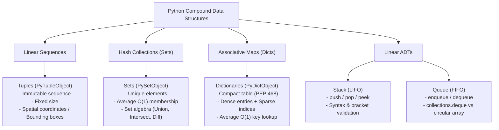
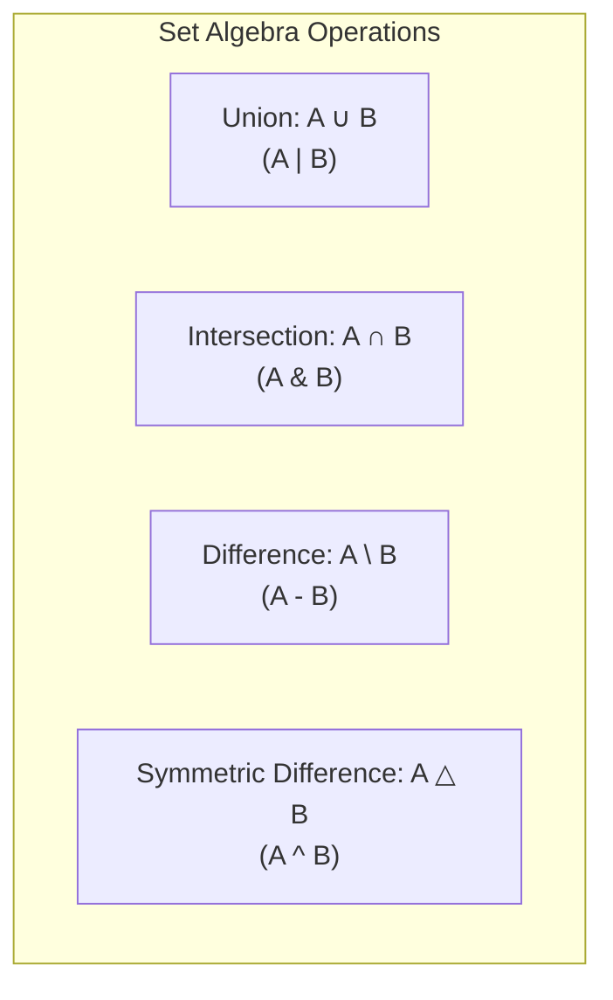
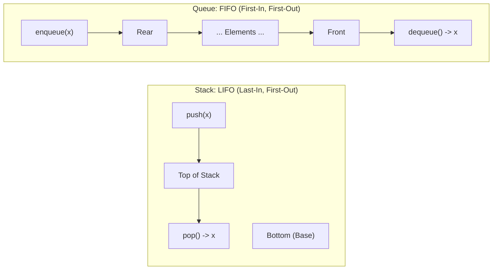
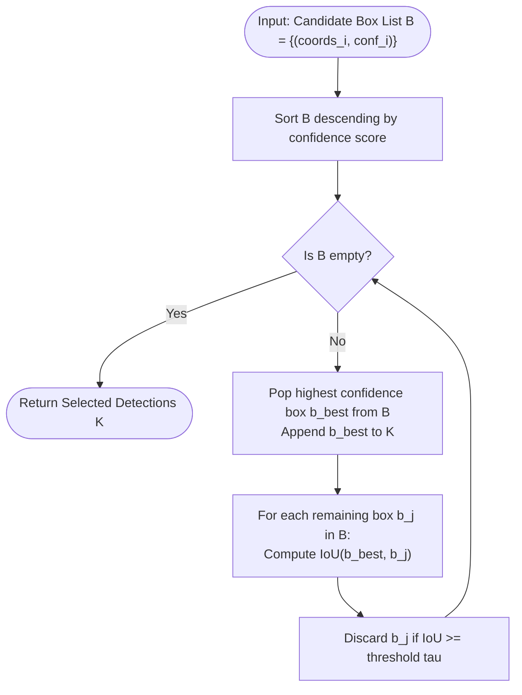

# Data Structures: Tuples, Sets, Dictionaries, and Linear Abstract Data Types

[Back to Module 01](../README.md) · [Back to the master roadmap](../../README.md)

**Session date:** 2026-10-27 · **Module:** 01 — Python Fundamentals & Algorithmic Thinking  
**Format:** Comprehensive study guide, mathematical foundations, memory diagrams, and executable practice notebooks

---

## Overview

In the architecture of modern software engineering and artificial intelligence systems, selecting the appropriate data representation is as crucial as designing the optimization objective itself. As formulated by Niklaus Wirth's classic computational axiom:

$$\text{Algorithms} + \text{Data Structures} = \text{Programs}$$

While linear indexed sequences such as dynamic arrays (Python lists) provide ordered access, real-world machine learning systems demand diverse memory and operational models:
1. **Immutable Invariant Records (Tuples):** Critical constants, coordinate geometry, bounding boxes $(x_{\min}, y_{\min}, x_{\max}, y_{\max})$, and spatial features must remain safe against accidental side-effect mutations across deep call stacks.
2. **Hash-Based Associative Sets (Sets):** Uniqueness constraints, vocabulary deduplication in NLP tokenizers, and fast $O(1)$ membership testing require hash tables without value payloads.
3. **Associative Mapping Tables (Dictionaries):** High-dimensional sparse embeddings, hyperparameter management, JSON model configurations, and frequency accumulators rely on fast $O(1)$ average-time associative mapping.
4. **Constrained Linear Abstract Data Types (Stacks & Queues):** Backtracking, depth-first search (DFS), breadth-first search (BFS), expression parsing, and asynchronous task scheduling require strict operational contracts (LIFO and FIFO).
5. **Modern Syntactic & Functional Primitives (Lambdas, Walrus Operator, Type Hints):** Clean inline transformations, multi-attribute sorting criteria, assignment expressions, and static typing clarify complex tensor manipulations.

This study guide develops the theoretical, mathematical, and algorithmic foundations of compound data structures in Python, connects them to CPython virtual machine internals, and demonstrates their real-world application in computer vision: **Intersection over Union (IoU)**, **Greedy Non-Maximum Suppression (NMS)**, and **2D Image Pixel Intensity Histograms**.



---

## Learning outcomes

By completing this session and its accompanying laboratory notebooks, you will be able to:

- Classify Python compound data structures into sequence types, hash-based sets, associative mappings, and linear abstract data types.
- Explain the physical memory layout and allocation mechanics of `PyTupleObject`, `PySetObject`, and `PyDictObject` in CPython.
- Formulate the mathematical and operational guarantees of **immutability** in tuples, contrast shallow vs. deep immutability, and evaluate why tuples exhibit lower memory overhead than dynamic lists.
- Model spatial coordinate geometry (points, bounding boxes, color channels) using immutable tuples and solve quadratic equations returning structured solution sets.
- Derive the **Intersection over Union (IoU)** metric for axis-aligned bounding boxes from set-theoretic principles.
- Define the **Hashability Contract** (`__hash__` and `__eq__`) in Python and prove why mutable containers cannot serve as set members or dictionary keys.
- Perform algebraic set operations (Union, Intersection, Difference, Symmetric Difference, Subsets) using both mathematical operator syntax and object methods.
- Implement tokenization, text normalization, and $O(n)$ unique vocabulary extraction for Natural Language Processing (NLP).
- Explain the internal architecture of CPython's **compact dictionary** (PEP 468 / PEP 509), including the separation of sparse index tables and dense key-value entry arrays.
- Apply safe dictionary idioms (`get()`, `setdefault()`, `popitem()`), manage JSON configurations, and merge mappings with PEP 584 operators (`|`, `|=`).
- Implement the **Stack ADT** (LIFO) and **Queue ADT** (FIFO) using dynamic arrays, singly linked lists, `collections.deque`, and circular buffers.
- Construct a deterministic delimiter and bracket validator algorithm using stack state tracking.
- Author inline anonymous functions (`lambda`), multi-attribute sorting criteria using `key` callables, and optimize stream processing with the **Walrus operator** (`:=`, PEP 572).
- Implement the greedy **Non-Maximum Suppression (NMS)** algorithm in both pure Python and vectorized NumPy to eliminate redundant detection proposals.
- Construct discrete 2D pixel intensity frequency histograms using pure Python dictionary accumulators.

---

## 1. Computational Memory Models: Mutability vs. Immutability

In the CPython runtime, every variable identifier is a pointer referencing an underlying `PyObject` structure residing in heap memory. Understanding the classification of data structures into **mutable** and **immutable** paradigms is foundational to avoiding subtle side-effect bugs:

| Category | Built-in Types | Modifiable In-Place? | Identity (`id()`) Constant? | Thread Safety / Reentrancy | Hashable (Can be Key/Set Elem)? |
| :--- | :--- | :---: | :---: | :---: | :---: |
| **Immutable** | `int`, `float`, `str`, `tuple`, `frozenset`, `bytes` | No | Yes | High (read-only sharing) | Yes (if all components are hashable) |
| **Mutable** | `list`, `dict`, `set`, `bytearray` | Yes | Yes (during mutation) | Low (requires synchronization) | No (unhashable, raises `TypeError`) |

### Shallow Immutability of Tuples

A frequent misconception is that a tuple renders all contained data strictly immutable. In CPython, a `PyTupleObject` maintains a fixed-length array of `PyObject*` pointers:

$$\text{tuple} = [ \ \&\text{obj}_0, \ \&\text{obj}_1, \ \dots, \ \&\text{obj}_{k-1} \ ]$$

While the **pointers** $\&\text{obj}_i$ cannot be overwritten, reassigned, or removed, if any referenced object $\text{obj}_i$ is itself mutable (such as a nested `list` or `dict`), the internal state of that referenced object can be modified:

```python
compound_tuple = (1, "alpha", [10, 20])
# compound_tuple[0] = 2  # Raises TypeError: 'tuple' object does not support item assignment
compound_tuple[2].append(30)  # Valid! Mutates the inner list in-place
print(compound_tuple)  # Output: (1, 'alpha', [10, 20, 30])
```

> [!WARNING]
> A tuple containing any mutable element is **not hashable** (`hash(compound_tuple)` raises `TypeError: unhashable type: 'list'`) and cannot be placed inside a `set` or used as a `dict` key. A tuple is only hashable if every single element within it is recursively hashable.

---

## 2. Tuples as Immutable Structured Records

### Mathematical Formalization

Mathematically, a tuple of length $k$ ($k$-tuple) is an element of the Cartesian product of $k$ sets:

$$(x_1, x_2, \dots, x_k) \in S_1 \times S_2 \times \dots \times S_k$$

Whereas a Python `list` represents an open sequence of homogeneous items, a `tuple` typically represents a heterogeneous record with positional semantics. For example:
- A spatial coordinate: $(x, y, z) \in \mathbb{R}^3$
- A bounding box detection: $(\text{label}, \text{confidence}, x_1, y_1, x_2, y_2) \in \Sigma^* \times [0, 1] \times \mathbb{R}^4$
- An RGB color code: $(r, g, b) \in [0, 255]^3$

### CPython Optimization: Zero Over-Allocation and Free Lists

Dynamic arrays (`list`) over-allocate memory to achieve amortized $O(1)$ append operations. In contrast, tuples have fixed lengths known at instantiation:
1. **Zero Over-Allocation:** `PyTupleObject` allocates exactly the memory needed for its header plus $k$ object pointers.
2. **Small Tuple Free List:** CPython maintains an internal free list array (`free_list`) for deallocated tuples of lengths 1 to 20. Reallocating a small tuple reuses an existing struct without invoking the system allocator (`malloc`).

```text
PyListObject:
  [ PyObject_VAR_HEAD | ob_item -> [ ptr0 | ptr1 | ptr2 | ptr3 | <empty> | <empty> ] | allocated: 6 | size: 4 ]

PyTupleObject:
  [ PyObject_VAR_HEAD | ob_item:   [ ptr0 | ptr1 | ptr2 | ptr3 ] | size: 4 ]
```

### Unpacking and Swapping

Python supports pattern-matching assignment via tuple unpacking:

```python
# Unpacking
point = (1920, 1080)
width, height = point

# Starred unpacking for variable-length records
record = ("car", 0.98, 12, 45, 120, 180)
class_name, confidence, *coordinates = record

# Atomic variable swap without temporary variable
x, y = 10, 20
x, y = y, x  # Evaluates right-hand tuple (20, 10), then unpacks into x, y
```

---

## 3. Mathematical Sets and Hash Set Theory

### Discrete Foundations

A **set** is an unordered collection of distinct elements. Its foundational characteristic is that duplicates are mathematically impossible:

$$S = \{ x_1, x_2, \dots, x_n \}, \quad x_i \neq x_j \quad \forall i \neq j$$

The characteristic function $\chi_S(x)$ denotes membership:

$$\chi_S(x) = \begin{cases} 1 & \text{if } x \in S \\ 0 & \text{if } x \notin S \end{cases}$$

### The Hash Table Architecture (`PySetObject`)

In CPython, a `set` is implemented as an open-addressing hash table where each table bucket stores:
- `me_hash`: The cached 64-bit integer hash of the element.
- `me_key`: A pointer to the key `PyObject*`.

When checking membership (`x in S`) or inserting (`S.add(x)`):
1. Compute the integer hash: $h = \text{hash}(x)$.
2. Calculate the initial table bucket index: $i = h \pmod{\text{capacity}}$.
3. If bucket $i$ is empty, the element is absent.
4. If bucket $i$ matches in hash and equality ($h == \text{bucket.hash}$ and $x == \text{bucket.key}$), the element is present.
5. If bucket $i$ is occupied by a different key, resolve the collision using CPython's perturbation probing sequence:
   $$j = (5j + 1 + \text{perturb}) \pmod{\text{capacity}}$$

Because the average probe length in a hash table with load factor $\alpha \le 0.66$ is near $1$, sets achieve **average $O(1)$ time complexity** for membership checks, insertions, and deletions, compared to $O(n)$ in lists.

### Set Algebra Operations

Python sets implement complete algebraic operations with dual operator and method interfaces:



| Mathematical Operation | Set Notation | Operator | Method Syntax | In-Place Mutation |
| :--- | :---: | :---: | :--- | :--- |
| **Union** | $A \cup B$ | `A \| B` | `A.union(B)` | `A \|= B` (`A.update(B)`) |
| **Intersection** | $A \cap B$ | `A & B` | `A.intersection(B)` | `A &= B` (`A.intersection_update(B)`) |
| **Difference** | $A \setminus B$ | `A - B` | `A.difference(B)` | `A -= B` (`A.difference_update(B)`) |
| **Symmetric Difference** | $A \triangle B$ | `A ^ B` | `A.symmetric_difference(B)` | `A ^= B` (`A.symmetric_difference_update(B)`) |
| **Subset Test** | $A \subseteq B$ | `A <= B` | `A.issubset(B)` | — |
| **Proper Subset** | $A \subset B$ | `A < B` | — | — |
| **Disjoint Test** | $A \cap B = \emptyset$ | — | `A.isdisjoint(B)` | — |

> [!NOTE]
> Operators (`|`, `&`, `-`, `^`) require both operands to be `set` objects. Methods (`union()`, `intersection()`, etc.) accept any iterable (lists, tuples, generators) as arguments.

---

## 4. Dictionaries and Associative Hash Tables

### Theoretical Foundations

A **dictionary** (associative array or map) models a mathematical function from a finite domain of unique keys $K$ to an arbitrary codomain of values $V$:

$$f: K \to V, \quad \text{where } |K| < \infty$$

### CPython Compact Dictionary Architecture (PEP 468 & PEP 509)

Prior to Python 3.6, CPython dictionaries allocated an 8-entry minimum array of 24-byte structs `(hash, key, value)` in which approximately one-third of rows remained empty (load factor $< 0.66$).

Python 3.6+ replaced this with the **compact dictionary** memory model:

```text
Indices Array (Sparse hash table):
  [ None, 1, None, 0, None, 2, None, None ]
           |            |         |
           |            +---------+--------------------+
           v                                           v
Entries Array (Dense insertion-ordered array):
  Index 0: hash=512837, key="learning_rate", value=0.01
  Index 1: hash=192842, key="optimizer",     value="Adam"
  Index 2: hash=884910, key="batch_size",    value=64
```

1. **Indices Array:** A sparse array of integers (int8, int16, or int32 depending on table capacity) storing indices into the entries array.
2. **Entries Array:** A dense array of structs `(hash, key, value)` stored strictly in chronological insertion order.

This architectural shift achieved:
- **20% to 25% memory savings:** The sparse hash table contains only compact integer bytes rather than full 24-byte entry structs.
- **Deterministic Insertion-Order Preservation:** Traversing `.keys()`, `.values()`, or `.items()` is guaranteed to follow insertion order.

### Dictionary Querying Idioms

```python
config = {"lr": 0.001, "optimizer": "Adam"}

# 1. Defensive lookup with fallback
momentum = config.get("momentum", 0.9)  # Returns 0.9, does not mutate config

# 2. Lookup with automatic initialization
decay = config.setdefault("decay", 1e-4)  # Inserts 'decay': 1e-4 if absent

# 3. Safe deletion with pop
removed_lr = config.pop("lr", None)  # Returns 0.001, evicts 'lr'

# 4. Modern merging (PEP 584)
defaults = {"epochs": 10, "lr": 0.01}
overrides = {"lr": 0.005, "device": "cuda"}
active_config = defaults | overrides  # {'epochs': 10, 'lr': 0.005, 'device': 'cuda'}
```

---

## 5. Linear Abstract Data Types: Stacks and Queues

Linear abstract data types constrain element insertion and deletion to enforce strict operational disciplines:



### Computational Complexity Comparison

| Abstract Data Type | Concrete Implementation | Push / Enqueue | Pop / Dequeue | Peek / Front | Space Overhead | Notes |
| :--- | :--- | :---: | :---: | :---: | :---: | :--- |
| **Stack** | Python `list` | $O(1)^*$ | $O(1)^*$ | $O(1)$ | Low | Optimal for general stack applications. |
| **Stack** | Singly Linked List | $O(1)$ | $O(1)$ | $O(1)$ | Medium | Strict worst-case $O(1)$, node pointer overhead. |
| **Queue** | Naive Python `list` | $O(1)^*$ | $\mathbf{O(n)}$ | $O(1)$ | Low | `pop(0)` triggers memory shift bottleneck! |
| **Queue** | `collections.deque` | $O(1)$ | $O(1)$ | $O(1)$ | Low | Doubly linked blocks; optimal FIFO queue. |
| **Queue** | Circular Ring Buffer | $O(1)$ | $O(1)$ | $O(1)$ | Minimal | Fixed-capacity; zero reallocation overhead. |

$^*$Amortized time complexity.

### Algorithmic Application: Delimiter Balance Verification

In compilers and formula parsers, verifying matched brackets (`()`, `[]`, `{}`) requires LIFO state tracking:
1. When encountering an opening delimiter, push onto the stack.
2. When encountering a closing delimiter:
   - If the stack is empty $\implies$ **Unmatched closing bracket** (Syntax Error).
   - If the popped delimiter does not match $\implies$ **Mismatched nesting** (Syntax Error).
3. If the stack is non-empty at EOF $\implies$ **Unclosed opening bracket** (Syntax Error).

---

## 6. Modern Python Language Features

### Lambda Expressions (Anonymous Callables)

Derived from Alonzo Church's $\lambda$-calculus, Python's `lambda` syntax constructs anonymous function objects:

$$\text{lambda } x_1, x_2, \dots, x_k : \text{expression}$$

Key rules:
- Must consist of a single expression whose evaluated value is implicitly returned.
- Cannot contain assignments or statements (`return`, `raise`, `while`, `pass`).
- Best utilized as short callables passed to higher-order functions (`sorted`, `min`, `max`).

### Multi-Attribute Sorting with Key Functions

Python's `sorted()` function implements **Timsort** (an adaptive, stable merge-insertion hybrid with $O(n \log n)$ worst-case time). When sorting records with multiple attributes:

```python
# Models: (name, accuracy, latency_ms)
models = [("M1", 0.92, 45), ("M2", 0.95, 120), ("M3", 0.95, 80)]

# Sort primarily by accuracy DESCENDING (-accuracy), secondary by latency ASCENDING (+latency)
ranked = sorted(models, key=lambda m: (-m[1], m[2]))
# Result: [('M3', 0.95, 80), ('M2', 0.95, 120), ('M1', 0.92, 45)]
```

### The Walrus Operator (`:=` — Assignment Expressions, PEP 572)

The walrus operator enables assigning values to identifiers inside expressions, preventing redundant computation:

```python
# Filter and transform simultaneously in list comprehension
raw_tokens = ["convolution", "ai", "transformer", "nlp"]
long_upper = [u for tok in raw_tokens if len(u := tok.upper()) > 3]
# 'u' is computed once during the condition and reused in the yield expression
```

---

## 7. Applied Case Studies in Computer Vision

### Case Study 1: Intersection over Union (IoU)

In object detection and localization benchmarks (COCO, Pascal VOC), candidate bounding boxes are predicted with spatial coordinates:

$$B = (x_{\min}, y_{\min}, x_{\max}, y_{\max})$$

Given ground-truth box $A$ and prediction box $B$, the **Intersection over Union (IoU)** metric measures overlap:

$$\text{IoU}(A, B) = \frac{\text{Area}(A \cap B)}{\text{Area}(A \cup B)} = \frac{\text{Area}(A \cap B)}{\text{Area}(A) + \text{Area}(B) - \text{Area}(A \cap B)}$$

```text
  (x_min_A, y_min_A)
         +-----------------------+
         | Box A                 |
         |         (x_A, y_A)    |
         |              +--------+--------------+
         |              | Intersection          |
         +--------------+--------+              |
                        (x_B, y_B)              |
                                 |        Box B |
                                 +--------------+
                                         (x_max_B, y_max_B)
```

The intersection coordinates $(x_A, y_A, x_B, y_B)$ are formulated as:

$$x_A = \max(x_{\min}^A, x_{\min}^B), \quad y_A = \max(y_{\min}^A, y_{\min}^B)$$
$$x_B = \min(x_{\max}^A, x_{\max}^B), \quad y_B = \min(y_{\max}^A, y_{\max}^B)$$
$$\text{Width}_{\cap} = \max(0, x_B - x_A), \quad \text{Height}_{\cap} = \max(0, y_B - y_A)$$
$$\text{Area}(A \cap B) = \text{Width}_{\cap} \times \text{Height}_{\cap}$$

### Case Study 2: Greedy Non-Maximum Suppression (NMS)

Dense object detectors generate numerous overlapping anchor proposals around a single object. Non-Maximum Suppression prunes redundant detections:



### Case Study 3: 2D Image Pixel Intensity Histograms

An 8-bit grayscale image is a 2D matrix $I \in \{0, 1, \dots, 255\}^{H \times W}$. An intensity histogram maps each pixel value $v \in [0, 255]$ to its total frequency count:

$$H(v) = \sum_{r=0}^{H-1} \sum_{c=0}^{W-1} \mathbb{I}(I[r, c] == v)$$

Using a Python dictionary accumulator, this runs in $O(H \times W)$ time with $O(U)$ auxiliary space where $U \le 256$ is the number of unique intensity levels.

---

## Session Map

| Notebook | Focus | Key Topics |
| :--- | :--- | :--- |
| [01 — Tuples & Spatial Coordinates](notebooks/01-tuples-immutability-and-spatial-coordinates.ipynb) | Immutability & Coordinates | Cartesian products, shallow vs. deep immutability, `PyTupleObject` memory comparison with lists, unpacking protocols, atomic variable swapping, quadratic equation solver, bounding box coordinates, IoU formulation |
| [02 — Sets & Set Algebra](notebooks/02-sets-hash-tables-and-set-algebra.ipynb) | Hash Sets & Set Algebra | `PySetObject` hash table mechanics, the Hashability Contract (`__hash__`, `__eq__`), unhashable type errors, set mutations, dual operator/method set algebra (Union, Intersection, Difference, Symmetric Difference, Subsets), set comprehensions, text tokenization and NLP vocabulary extraction from `data/data.txt` |
| [03 — Dictionaries & Hash Tables](notebooks/03-dictionaries-associative-mapping-and-hashing.ipynb) | Associative Hash Maps | CPython compact dictionary architecture (PEP 468, PEP 509), dense entries vs. sparse indices, deterministic ordering, safe querying (`get()`, `setdefault()`, `popitem()`), dynamic views, PEP 584 merging (`\|`, `\|=`), JSON deserialization and persistence (`data/data.json`), Bag-of-Words term frequency analysis |
| [04 — Stacks & Queues ADTs](notebooks/04-stacks-queues-and-linear-abstract-data-types.ipynb) | Linear Abstract Data Types | LIFO and FIFO operational contracts, algorithmic trade-offs (Python list vs. singly linked list vs. `collections.deque` vs. circular array), custom OOP classes with full error handling, bracket and syntax delimiter balancer algorithm |
| [05 — Lambdas, Walrus & Sorting](notebooks/05-functional-features-lambdas-walrus-and-custom-sorting.ipynb) | Modern Python Primitives | Anonymous functions (`lambda`), polynomial closures, Timsort stability, multi-criteria record ranking with compound tuples, sorting dictionary items by values, assignment expressions (Walrus operator `:=` PEP 572), PEP 585 static type annotations |
| [06 — Applied Case Studies](notebooks/06-applied-case-studies-iou-nms-and-image-histograms.ipynb) | Computer Vision Integration | End-to-end Intersection over Union (IoU) calculation engine, greedy Non-Maximum Suppression (NMS) in pure Python and vectorized NumPy, discrete 2D pixel intensity frequency histograms on `data/binary_cat.png`, matplotlib visualization |

---

## Exercises and Self-Assessment

1. **Tuple Immutability Proof:** Write a test verifying that attempting to assign `t[0] = 10` on a tuple raises `TypeError`, while appending an element to a list contained inside the tuple succeeds. Explain why this happens in terms of CPython pointers.
2. **Set Algebra Equivalence:** Prove computationally that for any two sets $A$ and $B$, the symmetric difference $A \triangle B$ is strictly equivalent to $(A \cup B) \setminus (A \cap B)$.
3. **Dictionary Default Accumulator:** Compare the execution runtime of building a character frequency histogram over a $100{,}000$-character string using:
   - `if char in counts: counts[char] += 1 else: counts[char] = 1`
   - `counts[char] = counts.get(char, 0) + 1`
   - `collections.defaultdict(int)`
4. **Queue Performance Experiment:** Benchmark enqueuing and dequeuing $50{,}000$ integers using `list.pop(0)` versus `collections.deque.popleft()`. Measure the time difference and explain why the list version slows down quadratically.
5. **NMS Edge Cases:** In your NMS implementation, test what happens when:
   - Two bounding boxes have identical coordinates and identical confidence scores.
   - All candidate boxes have zero spatial overlap ($\text{IoU} = 0$).
   - A box has zero width or zero height ($\text{Area} = 0$).

---

## References and Further Reading

- Python Software Foundation. *Built-in Types: Tuples, Sets, and Dictionaries*. [Python Documentation](https://docs.python.org/3/library/stdtypes.html).
- Python Enhancement Proposal 468. *Preserving the Order of `**kwargs` in a Function*. [PEP 468](https://peps.python.org/pep-0468/).
- Python Enhancement Proposal 572. *Assignment Expressions (The Walrus Operator)*. [PEP 572](https://peps.python.org/pep-0572/).
- Python Enhancement Proposal 584. *Add Union Operators To `dict`*. [PEP 584](https://peps.python.org/pep-0584/).
- CPython Internal Source. `Objects/dictobject.c`, `Objects/setobject.c`, and `Objects/tupleobject.c`.
- Neubeck, A., & Van Gool, L. (2006). *Efficient Non-Maximum Suppression*. International Conference on Pattern Recognition (ICPR).
