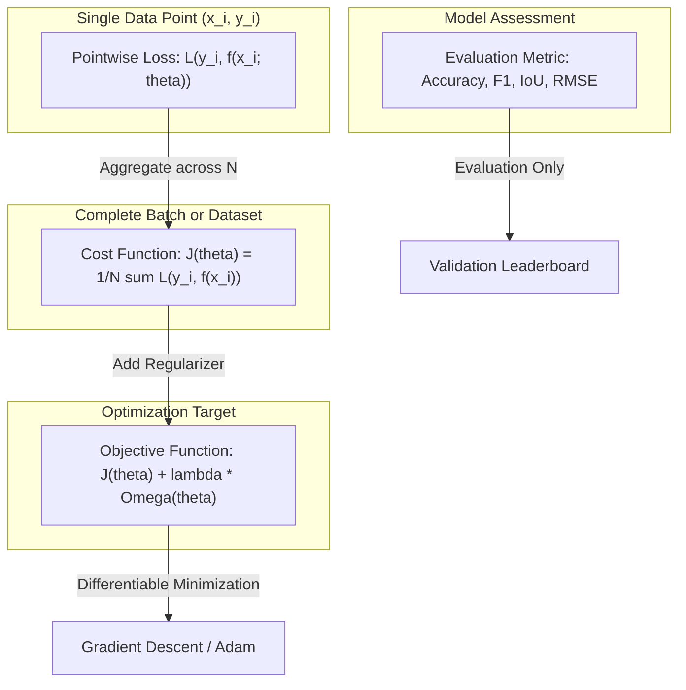

# Competition Tasks, Data Pipelines, and Evaluation Metrics

[Back to Module 01](../README.md) · [Back to the master roadmap](../../README.md)

**Session date:** 2026-10-31 · **Module:** 01 — Python Fundamentals & Algorithmic Thinking  
**Format:** Theoretical exposition, mathematical derivations, ASCII/Mermaid system architectures, executable notebooks, and end-to-end evaluation pipelines

---

## Overview

In practical data science and competitive machine learning, model development does not begin with importing neural network layers or hyperparameter search algorithms. It begins with understanding the **computational environment**, **structuring data pipelines without information leakage**, and rigorously defining the mathematical criteria used to quantify success: **loss functions, cost functions, objective functions, and evaluation metrics**.

A common pitfall among practitioners is treating machine learning as pure script execution while overlooking the fundamental mechanics of evaluation. When an optimization objective fails to align with the competition or business metric, or when subtle data leakage contaminates the validation split, models exhibit artificially inflated validation scores that collapse upon deployment or during private leaderboard evaluation—an effect known as **leaderboard shakeup**.

This session establishes a textbook-grade, first-principles foundation in competitive machine learning tasks and evaluation mechanics:

1. **Computational Workbenches & Reproducibility:** We examine the architectural anatomy of interactive notebooks and cloud runtimes (CPU, GPU, and TPU architectures; ephemeral vs. persistent storage; memory boundaries). We implement deterministic execution protocols by fixing global pseudo-random number generator (PRNG) seeds across standard libraries (`random`, `numpy`), profile memory allocations with `tracemalloc`, and orchestrate script pipelines with `subprocess`.
2. **Data Organization & Leak-Free Partitioning:** We define canonical file system topologies for machine learning projects, examine computer vision ingestion with OpenCV (`cv2`), demystify the historical BGR vs. RGB channel conventions, and construct batch image pipelines. We formalize the roles of **Training**, **Validation**, and **Test** sets, build stratified partitioning algorithms for class-imbalanced targets from scratch, and audit pipelines against data leakage vectors.
3. **The Optimization vs. Evaluation Dichotomy:** We resolve the terminological conflation between **Loss Functions** $\mathcal{L}$, **Cost Functions** $J(\theta)$, **Objective Functions** $\mathcal{J}(\theta)$, and **Evaluation Metrics** $M$. We mathematically prove why non-differentiable step metrics (such as 0-1 misclassification loss, Accuracy, IoU, and F1) cannot be optimized directly via gradient descent, requiring smooth, differentiable **surrogate losses**.
4. **Regression Metrics & Error Profiles:** We dissect continuous response estimation across **Mean Squared Error (MSE)**, **Root Mean Squared Error (RMSE)**, **Mean Absolute Error (MAE)**, **Mean Absolute Percentage Error (MAPE)**, and the **Coefficient of Determination ($R^2$)**. We mathematically contrast the quadratic outlier penalty profile of MSE with the robust median-seeking linear profile of MAE, and analyze the adaptive properties of the **Huber Loss (Smooth L1)**.
5. **Classification Metrics & The Imbalance Paradox:** We demonstrate the catastrophic failure modes of naive Accuracy on imbalanced datasets (the *Accuracy Paradox*). We derive and construct the complete **Confusion Matrix** from first principles, formulate **Precision**, **Recall (Sensitivity)**, **Specificity**, and **F1-Score**, and formalize multi-class aggregation schemes (**Macro**, **Micro**, and **Weighted** averaging) alongside categorical **Log Loss (Cross-Entropy)**.
6. **Object Detection Metrics & Spatial Localization:** We bridge continuous spatial localization with discrete classification. We define bounding box coordinate topologies (Pascal VOC, COCO, and YOLO), derive the geometry of **Intersection over Union (IoU)**, vectorize batch bounding box overlap matrices via NumPy broadcasting, match proposals using confidence ranking, and compute **Average Precision (AP)** using both 11-point interpolation and continuous Area Under the Precision-Recall Curve (AUC).

---

## Learning outcomes

By the end of this session, you should be able to:

- Inspect runtime hardware capabilities, Python interpreter environments, and logical CPU threads programmatically.
- Implement a unified reproducibility protocol (`seed_everything`) across `random`, `os.environ`, and `numpy` to eliminate stochastic run-to-run drift.
- Profile execution wall-clock time with `time.perf_counter()` and track peak heap memory allocation using Python's built-in `tracemalloc` module.
- Structure machine learning workspaces following canonical topologies separating raw immutable assets, processed features, metadata manifests, and submissions.
- Ingest image datasets using OpenCV (`cv2.imread`), diagnose and correct color channel inversions (BGR to RGB), resize, normalize, and visualize image batches in Matplotlib.
- Articulate the operational differences between Training, Validation, and Test partitions and construct deterministic splitters from scratch.
- Implement Stratified Splitting to preserve minority class distributions across cross-validation folds.
- Identify and eliminate data leakage vectors, including temporal lookahead, target leakage, and preprocessor fit contamination.
- Differentiate mathematically between Pointwise Loss $\mathcal{L}(y_i, \hat{y}_i)$, Aggregate Cost $J(\theta)$, Regularized Objective $\mathcal{J}(\theta)$, and Evaluation Metric $M(y, \hat{y})$.
- Explain why non-differentiable evaluation metrics cannot guide gradient-based optimization algorithms and identify their smooth surrogate losses.
- Implement, interpret, and compute MSE, RMSE, MAE, MAPE, $R^2$, and Huber Loss from first principles.
- Analyze residual distributions ($e_i = y_i - \hat{y}_i$) to diagnose model bias, heteroscedasticity, and outlier vulnerability.
- Construct multi-class confusion matrices from scratch and derive True Positives (TP), False Positives (FP), True Negatives (TN), and False Negatives (FN).
- Compute Precision, Recall, Specificity, F1-Score, and $F_\beta$-Score and explain the harmonic mean weighting mechanism.
- Differentiate and implement Macro-averaging, Micro-averaging, and Weighted-averaging across multi-class datasets.
- Implement numerically stable Binary and Categorical Cross-Entropy Log Loss with epsilon probability bounding.
- Convert bounding boxes across Pascal VOC `[xmin, ymin, xmax, ymax]`, COCO `[xmin, ymin, w, h]`, and normalized YOLO formats.
- Derive and implement vectorized Intersection over Union (IoU) matrices for $N \times M$ proposal-target pairs.
- Match candidate object proposals to ground truth boxes using IoU thresholding ($\alpha = 0.50$) and confidence ranking.
- Construct Precision-Recall curves and calculate Average Precision (AP) via 11-point interpolation and all-point Area Under Curve (AUC).

---

## Session map

| Notebook | Focus | Key Topics |
| :--- | :--- | :--- |
| [01 — ML Workbenches](notebooks/01-workbench-environment-and-execution.ipynb) | Environment Inspection & Execution | Host inspection, PRNG seeding, `subprocess` workflows, `time.perf_counter()` timing, `tracemalloc` memory tracking, `@dataclass` experiment configuration |
| [02 — Data Organization](notebooks/02-organizing-data-and-cv-splits.ipynb) | Dataset Topologies & Splits | Project layouts, OpenCV BGR vs RGB channel handling, batch resizing, normalization, train/val/test splitting, stratified splitting, leak prevention |
| [03 — Loss vs Metric](notebooks/03-loss-cost-and-objective-functions.ipynb) | Optimization Foundations | 0-1 misclassification loss, empirical risk cost, surrogate loss functions, MSE cost, numerically stable Cross-Entropy, L1/L2 regularized objectives |
| [04 — Regression Metrics](notebooks/04-regression-evaluation-metrics.ipynb) | Continuous Performance Evaluation | MSE, RMSE, MAE, MAPE, $R^2$ derivation, quadratic vs linear outlier sensitivity, Huber loss (Smooth L1), residual distribution analysis |
| [05 — Classification Metrics](notebooks/05-classification-evaluation-metrics.ipynb) | Categorical Diagnostics & Imbalance | Accuracy paradox, confusion matrix from scratch, precision, recall, specificity, F1-score, macro/micro/weighted averaging, multi-class Log Loss |
| [06 — Object Detection](notebooks/06-object-detection-metrics-and-iou.ipynb) | Spatial Localization & IoU | Bounding box formats (VOC, COCO, YOLO), IoU geometry derivation, vectorized pairwise IoU, proposal matching, Precision-Recall curves, 11-point & all-point AP |

---

## 1. Machine Learning Workbenches: Architecture & Execution Models

Competitive machine learning workflows take place across diverse computational substrates: local developer workstations, remote GPU clusters, and managed cloud interactive workbenches (such as Kaggle Kernels or JupyterLab instances). Navigating these platforms effectively requires understanding how computational hardware, memory limits, and storage lifecycles interact.

### 1.1 Compute Substrates & Resource Characteristics

Modern machine learning workloads run on three primary processor architectures:

```text
+-----------------------------------------------------------------------------------+
|                        COMPUTATIONAL HARDWARE PROFILES                            |
+---------------------+-------------------------------+-----------------------------+
| Architecture        | Parallel Execution Units      | Primary Workload Domain     |
+---------------------+-------------------------------+-----------------------------+
| CPU (Central Proc)  | 2 - 64 high-frequency cores   | Data parsing, preprocessing,|
|                     | Low latency, complex logic    | feature engineering, trees  |
+---------------------+-------------------------------+-----------------------------+
| GPU (Graphics Proc) | Thousands of tensor cores     | Matrix multiplications,     |
|                     | Massive SIMD throughput       | deep learning, dense CNNs   |
+---------------------+-------------------------------+-----------------------------+
| TPU (Tensor Proc)   | Systolic matrix units (MXUs)  | Large batch tensor ops,     |
|                     | Dedicated bfloat16 pipelines  | large language models, ViTs |
+---------------------+-------------------------------+-----------------------------+
```

Cloud workbenches typically partition storage into two distinct layers:
1. **Persistent Workspace Storage:** Tied to the user's project or notebook. Files saved within this designated directory survive across session restarts and kernel shutdowns.
2. **Ephemeral Scratch Storage:** Temporary scratch disks (often mounted under `/tmp` or virtual scratch drives) that provide high write speeds but are completely erased when the runtime session terminates.

### 1.2 The Deterministic Execution Protocol

In competitive data science, reproducibility is mandatory. If an engineer changes a hyperparameter and observes a $+0.004$ validation score improvement, that delta must be attributable to the algorithmic adjustment rather than stochastic variance in dataset shuffling or weight initialization.

To establish deterministic pipelines in Python, pseudo-random number generator (PRNG) seeds must be synchronized across all active layers:

```python
import os
import random
import numpy as np


def seed_everything(seed: int = 42) -> None:
    """Synchronize PRNG state across Python standard library and NumPy."""
    random.seed(seed)
    os.environ["PYTHONHASHSEED"] = str(seed)
    np.random.seed(seed)
```

### 1.3 Memory Profiling with Tracemalloc

When operating under strict memory constraints (such as a 16 GB RAM ceiling), large tabular joins or batch image conversions can trigger Out-Of-Memory (`OOM`) process termination. Python's `tracemalloc` module enables granular auditing of heap allocations:

```python
import tracemalloc


def monitor_memory_consumption():
    tracemalloc.start()
    # Execute memory-intensive transformation
    large_array = [float(i) for i in range(1_000_000)]
    current_bytes, peak_bytes = tracemalloc.get_traced_memory()
    tracemalloc.stop()
    print(f"Current Heap: {current_bytes / (1024**2):.2f} MB")
    print(f"Peak Heap:    {peak_bytes / (1024**2):.2f} MB")
```

---

## 2. Data Engineering & Structuring for Machine Learning

A clean directory structure enforces separation of concerns, guarantees reproducibility, and prevents catastrophic data leaks.

### 2.1 Canonical Project Topology

A standard, production-ready machine learning workspace organizes assets hierarchically:

```text
project_root/
├── data/
│   ├── raw/                 # Read-only, immutable raw inputs (never modified)
│   ├── interim/             # Intermediate staged tables or cached preprocessed tensors
│   ├── processed/           # Final training-ready feature matrices and labels
│   └── manifests/           # Partition splits (train.csv, val.csv, test.csv)
├── notebooks/               # Numbered exploratory and pedagogical notebooks
├── src/                     # Reusable Python modules and library packages
│   ├── data_loader.py       # Input ingestion and dataset classes
│   ├── features.py          # Feature transformation pipelines
│   ├── models.py            # Model definitions and architectures
│   └── metrics.py           # Custom competition metric evaluators
├── tests/                   # Automated unit and integration test suites
└── submissions/             # Out-of-fold validation scores and formatted submission files
```

### 2.2 Computer Vision Ingestion: OpenCV and Channel Ordering

When reading image files with OpenCV (`cv2.imread`), the library historically loads pixel arrays in **BGR** (Blue, Green, Red) channel order. However, plotting libraries (such as Matplotlib) and modern deep learning frameworks assume standard **RGB** (Red, Green, Blue) order.

```text
BGR Pixel Array:  [ Channel 0: Blue  | Channel 1: Green | Channel 2: Red  ]
RGB Representation:[ Channel 0: Red   | Channel 1: Green | Channel 2: Blue ]
```

Displaying a raw BGR image in Matplotlib causes skin tones to appear blue and skies to render orange. The practitioner must explicitly convert color spaces:

```python
import cv2

# Read raw image array (H x W x 3, uint8 in [0, 255])
bgr_image = cv2.imread("data/sample_images/cat_01.png")

# Transform BGR to standard RGB
rgb_image = cv2.cvtColor(bgr_image, cv2.COLOR_BGR2RGB)

# Resize to standard spatial dimensions
resized_image = cv2.resize(rgb_image, (64, 64), interpolation=cv2.INTER_AREA)

# Normalize intensity range to [0.0, 1.0]
normalized_image = resized_image.astype("float32") / 255.0
```

### 2.3 Partitioning Schemes: Train, Validation, and Test Sets

In supervised learning, the total dataset $\mathcal{D}$ is partitioned into three disjoint subsets:

```text
+-----------------------------------------------------------------------------------+
|                        DATASET PARTITIONING LIFECYCLE                             |
+-----------------------------------------------------------------------------------+
| Total Dataset D: N Samples                                                        |
+------------------------------------+-----------------------+----------------------+
| Training Set D_train (60% - 80%)   | Validation Set D_val  | Test Set D_test      |
| Used by optimizer to update theta  | Used for tuning &     | Kept in a vault;     |
| min_{theta} J(theta; D_train)      | model selection       | final unbiasing eval |
+------------------------------------+-----------------------+----------------------+
```

The analogy to academic examination clarifies these roles:
- **Training Set $\mathcal{D}_{\text{train}}$:** Course textbooks and classroom practice problems. The student (model) studies these to learn concepts.
- **Validation Set $\mathcal{D}_{\text{val}}$:** Practice mock exams. The instructor uses scores to decide study techniques (hyperparameters) or select the best student (model architecture).
- **Test Set $\mathcal{D}_{\text{test}}$:** The final standardized board exam. Administered once at the end; answers are never revealed during training.

### 2.4 Stratified Partitioning for Imbalanced Classes

When target distributions are heavily skewed (e.g., 95% Class 0 and 5% Class 1), naive uniform random splitting can easily construct validation folds containing zero positive samples, rendering validation metrics meaningless.

**Stratified Sampling** guarantees that each partition inherits the exact marginal class distribution of the parent dataset:

$$\frac{N_{k, \text{train}}}{N_{\text{train}}} = \frac{N_{k, \text{val}}}{N_{\text{val}}} = \frac{N_k}{N} \quad \forall k \in \{1, \dots, K\}$$

```python
from collections import defaultdict
from typing import Sequence, Tuple, TypeVar
import numpy as np

T = TypeVar("T")


def stratified_split(
    items: Sequence[T],
    labels: Sequence[int],
    train_ratio: float = 0.75,
    seed: int = 42,
) -> Tuple[list[T], list[T]]:
    """Partition items into train and val while preserving class distribution."""
    rng = np.random.default_rng(seed)
    class_indices = defaultdict(list)
    for idx, label in enumerate(labels):
        class_indices[label].append(idx)

    train_indices, val_indices = [], []
    for label, idxs in class_indices.items():
        arr = np.array(idxs)
        rng.shuffle(arr)
        split_point = int(len(arr) * train_ratio)
        train_indices.extend(arr[:split_point])
        val_indices.extend(arr[split_point:])

    train_items = [items[i] for i in sorted(train_indices)]
    val_items = [items[i] for i in sorted(val_indices)]
    return train_items, val_items
```

### 2.5 The Data Leakage Taxonomy

Data leakage occurs when information from outside the training dataset is inadvertently used to train the model, resulting in overly optimistic validation scores that do not generalize.

```text
+-----------------------------------------------------------------------------------+
|                           COMMON DATA LEAKAGE VECTORS                             |
+---------------------+-----------------------------+-------------------------------+
| Leakage Type        | Mechanism                   | Prevention Strategy           |
+---------------------+-----------------------------+-------------------------------+
| Preprocessor Fit    | Computing mean/std on all D | Call .fit() ONLY on D_train;  |
| Contamination       | before partitioning         | apply .transform() to D_val   |
+---------------------+-----------------------------+-------------------------------+
| Temporal Lookahead  | Using future data to predict| Use TimeSeriesSplit; enforce  |
| Leakage             | past events in time series  | strict chronological cutoff   |
+---------------------+-----------------------------+-------------------------------+
| Group / Patient     | Samples from same patient   | Use GroupKFold; ensure all    |
| Overlap Leakage     | split across train and val  | patient records share a fold  |
+---------------------+-----------------------------+-------------------------------+
| Target Leakage      | Including features created  | Remove any feature collected  |
|                     | after outcome has occurred  | downstream of target event    |
+---------------------+-----------------------------+-------------------------------+
```

---

## 3. The Theoretical Taxonomy: Loss vs. Cost vs. Objective vs. Metric

Machine learning practitioners frequently use the terms *loss*, *cost*, *objective*, and *metric* interchangeably. In rigorous statistical learning theory, each represents a distinct mathematical entity:



### 3.1 Mathematical Formalism

1. **Loss Function $\mathcal{L}(y_i, \hat{y}_i)$:** A mapping $\mathbb{R} \times \mathbb{R} \to \mathbb{R}_{\ge 0}$ quantifying the disagreement between a single ground-truth target $y_i$ and prediction $\hat{y}_i$.
2. **Cost Function $J(\theta)$:** The empirical average or sum of pointwise losses evaluated over a sample collection of cardinality $N$:
   $$J(\theta) = \frac{1}{N} \sum_{i=1}^N \mathcal{L}(y_i, f(x_i; \theta))$$
3. **Objective Function $\mathcal{J}(\theta)$:** The complete mathematical function passed to the optimizer. In Empirical Risk Minimization with Structural Regularization, this includes penalty terms $\Omega(\theta)$ discouraging model complexity:
   $$\mathcal{J}(\theta) = J(\theta) + \lambda \Omega(\theta)$$
4. **Evaluation Metric $M(y, \hat{y})$:** A task-specific, human-interpretable performance measure used to rank models, declare competition winners, or assess clinical utility.

### 3.2 The Surrogate Loss Dilemma

Why can we not simply set the objective function equal to the evaluation metric?

Consider the fundamental classification evaluation metric, **0-1 Misclassification Error**:

$$\mathcal{L}_{0-1}(y_i, \hat{y}_i) = \mathbb{I}(y_i \ne \hat{y}_i) = \begin{cases} 0 & \text{if } y_i = \hat{y}_i \\ 1 & \text{if } y_i \ne \hat{y}_i \end{cases}$$

If $\hat{y}_i = \text{sign}(w^T x_i)$, the gradient of $\mathcal{L}_{0-1}$ with respect to the parameter vector $w$ is:

$$\nabla_w \mathcal{L}_{0-1} = 0 \quad \text{for all } w^T x_i \ne 0$$

Because the gradient is zero almost everywhere and undefined at the boundary, gradient descent cannot make progress. Optimization algorithms therefore require a smooth, differentiable, convex **surrogate loss** $\mathcal{L}_{\text{surrogate}}$ whose minimization indirectly minimizes the target metric.

| Evaluation Metric | Mathematical Property | Smooth Differentiable Surrogate Loss |
| :--- | :--- | :--- |
| **Accuracy / 0-1 Error** | Step function, $\nabla_\theta = 0$ almost everywhere | **Binary / Categorical Cross-Entropy** |
| **F1-Score / Dice** | Non-convex harmonic ratio of sums | **Soft Dice Loss / Focal Cross-Entropy** |
| **IoU (Jaccard)** | Combinatorial intersection ratio | **Lovász-Softmax / GIoU Loss** |
| **Ranking Metric (AUC)** | Pairwise step indicators | **Logistic Loss / Pairwise Margin Loss** |

---

## 4. Regression Evaluation Metrics: Mathematical Foundations & Error Profiles

In regression tasks, the target variable $y \in \mathbb{R}$ is continuous. Different evaluation metrics penalize residual deviations $e_i = y_i - \hat{y}_i$ according to distinct mathematical profiles.

```text
+-----------------------------------------------------------------------------------+
|                        REGRESSION METRICS COMPARISON                              |
+---------------------+---------------------------------------+---------------------+
| Metric              | Mathematical Formula                  | Scale / Units       |
+---------------------+---------------------------------------+---------------------+
| Mean Squared        | MSE = (1/n) * sum (y_i - y_hat_i)^2   | Units squared       |
| Error (MSE)         |                                       | (Outlier sensitive) |
+---------------------+---------------------------------------+---------------------+
| Root Mean Squared   | RMSE = sqrt(MSE)                      | Target units        |
| Error (RMSE)        |                                       | (Directly intuitive)|
+---------------------+---------------------------------------+---------------------+
| Mean Absolute       | MAE = (1/n) * sum |y_i - y_hat_i|     | Target units        |
| Error (MAE)         |                                       | (Robust to outliers)|
+---------------------+---------------------------------------+---------------------+
| Mean Absolute Pct   | MAPE = (100%/n) * sum |(y-y_hat)/y|   | Percentage (%)      |
| Error (MAPE)        |                                       | (Relative error)    |
+---------------------+---------------------------------------+---------------------+
| Coefficient of      | R^2 = 1 - (SS_res / SS_tot)           | Dimensionless       |
| Determination (R^2) |                                       | (-inf to 1.0)       |
+---------------------+---------------------------------------+---------------------+
```

### 4.1 Mean Squared Error (MSE) & Root Mean Squared Error (RMSE)

$$\text{MSE} = \frac{1}{N} \sum_{i=1}^N (y_i - \hat{y}_i)^2$$

$$\text{RMSE} = \sqrt{\text{MSE}} = \sqrt{\frac{1}{N} \sum_{i=1}^N (y_i - \hat{y}_i)^2}$$

- **Quadratic Sensitivity:** Because residuals are squared, an error of $10$ units contributes $100$ to the sum, whereas an error of $1$ unit contributes only $1$. This causes the optimal model under MSE to predict the **conditional expectation (mean)** $\mathbb{E}[Y|X]$.
- **Scale:** MSE operates in squared units (e.g., $\text{dollars}^2$). RMSE restores the scale to original units ($\text{dollars}$), enabling direct domain interpretation.

### 4.2 Mean Absolute Error (MAE)

$$\text{MAE} = \frac{1}{N} \sum_{i=1}^N |y_i - \hat{y}_i|$$

- **Linear Penalty:** MAE weights all residual magnitudes linearly. As a result, the optimal model under MAE predicts the **conditional median** $\text{Median}(Y|X)$.
- **Outlier Robustness:** A single corrupted sensor reading with $e_i = 1000$ increases the total sum by $1000$ in MAE, but by $1{,}000{,}000$ in MSE.

### 4.3 Outlier Sensitivity: Mathematical Demonstration

Suppose we have $N = 5$ observations where four errors are $1.0$ and the fifth error is $10.0$ (an outlier):

$$\text{MAE} = \frac{1 + 1 + 1 + 1 + 10}{5} = \frac{14}{5} = 2.80$$

$$\text{MSE} = \frac{1^2 + 1^2 + 1^2 + 1^2 + 10^2}{5} = \frac{1 + 1 + 1 + 1 + 100}{5} = \frac{104}{5} = 20.80$$

$$\text{RMSE} = \sqrt{20.80} \approx 4.56$$

Notice that the outlier accounts for $\frac{100}{104} \approx 96.2\%$ of the total MSE, completely dominating the score.

### 4.4 Huber Loss: The Adaptive Smooth L1 Hybrid

To combine the optimization efficiency of MSE for small residuals with the outlier robustness of MAE for large residuals, Peter Huber introduced the **Huber Loss**:

$$L_\delta(y, \hat{y}) = \begin{cases} \frac{1}{2}(y - \hat{y})^2 & \text{for } |y - \hat{y}| \le \delta \\ \delta |y - \hat{y}| - \frac{1}{2}\delta^2 & \text{for } |y - \hat{y}| > \delta \end{cases}$$

```text
Huber Loss Profile (delta = 1.0):
      Loss L(e)
         ^
         |        / (Linear for |e| > delta)
         |       /
         |     .'   (Quadratic for |e| <= delta)
         |   .'
         +--+-----+-----> Residual e
           -delta delta
```

### 4.5 Coefficient of Determination ($R^2$)

$$R^2 = 1 - \frac{\text{SS}_{\text{res}}}{\text{SS}_{\text{tot}}} = 1 - \frac{\sum_{i=1}^N (y_i - \hat{y}_i)^2}{\sum_{i=1}^N (y_i - \bar{y})^2}$$

where $\bar{y} = \frac{1}{N}\sum_{i=1}^N y_i$ is the empirical sample mean.
- $R^2 = 1.0$: Perfect predictions ($\text{SS}_{\text{res}} = 0$).
- $R^2 = 0.0$: The model performs identically to predicting the constant mean $\bar{y}$ for all inputs.
- $R^2 < 0.0$: The model performs **worse** than predicting the sample mean, indicating severe miscalibration or overfitting.

---

## 5. Classification Evaluation Metrics & The Imbalance Paradox

In classification, models predict discrete class assignments $\hat{y} \in \{1, \dots, K\}$ or calibrated posterior probabilities $p_k = P(Y=k|X)$.

### 5.1 The Accuracy Paradox

**Accuracy** is defined as the proportion of correct predictions over the total evaluation set:

$$\text{Accuracy} = \frac{\sum_{i=1}^N \mathbb{I}(y_i = \hat{y}_i)}{N}$$

In heavily imbalanced scenarios, Accuracy is deceptive. Consider a medical screening dataset with $N = 10{,}000$ patients where $9{,}900$ are healthy ($y=0$) and $100$ have a malignant condition ($y=1$).

A trivial classifier that unconditionally predicts $\hat{y} = 0$ for every patient achieves:

$$\text{Accuracy} = \frac{9{,}900}{10{,}000} = 99.0\%$$

Despite a stellar 99.0% accuracy score, the classifier detects **zero** malignant cases ($0/100$), resulting in fatal diagnostic failure.

### 5.2 The Binary Confusion Matrix

To reveal the complete diagnostic behavior of a classifier, predictions are organized into a $2 \times 2$ matrix:

```text
                        PREDICTED CLASS
                     Negative (0)    Positive (1)
ACTUAL   Negative (0)     TN              FP
CLASS    Positive (1)     FN              TP
```

- **True Positives (TP):** Ground truth is positive, and model predicts positive.
- **False Positives (FP):** Ground truth is negative, but model predicts positive (Type I error).
- **True Negatives (TN):** Ground truth is negative, and model predicts negative.
- **False Negatives (FN):** Ground truth is positive, but model predicts negative (Type II error).

### 5.3 Derived Diagnostic Metrics

$$\text{Precision (Positive Predictive Value)} = \frac{\text{TP}}{\text{TP} + \text{FP}}$$

$$\text{Recall / Sensitivity (True Positive Rate)} = \frac{\text{TP}}{\text{TP} + \text{FN}}$$

$$\text{Specificity (True Negative Rate)} = \frac{\text{TN}}{\text{TN} + \text{FP}}$$

$$\text{F1-Score} = 2 \times \frac{\text{Precision} \times \text{Recall}}{\text{Precision} + \text{Recall}} = \frac{2 \text{TP}}{2 \text{TP} + \text{FP} + \text{FN}}$$

Why use the **harmonic mean** for F1 rather than the arithmetic mean?

If $\text{Precision} = 1.0$ and $\text{Recall} = 0.0$:
- Arithmetic Mean: $\frac{1.0 + 0.0}{2} = 0.50$ (suggesting moderate performance).
- Harmonic Mean: $\frac{2 \times 1.0 \times 0.0}{1.0 + 0.0} = 0.0$ (correctly reflecting complete failure).

The harmonic mean severely penalizes extreme divergence between precision and recall, rewarding models only when both metrics remain balanced.

The generalized $F_\beta$ score allows custom weighting of recall versus precision:

$$F_\beta = (1 + \beta^2) \frac{\text{Precision} \times \text{Recall}}{\beta^2 \text{Precision} + \text{Recall}}$$

- $\beta = 1$: Standard balanced F1-score.
- $\beta = 2$: $F_2$-score weights Recall twice as heavily as Precision (standard in medical screening and search queries).
- $\beta = 0.5$: $F_{0.5}$-score weights Precision twice as heavily as Recall (standard in fraud detection and customer spam filtering).

### 5.4 Multi-Class Averaging Schemes

For problems with $K > 2$ classes, performance is aggregated across individual class diagnostics:

1. **Macro-Average:** The unweighted arithmetic mean across all per-class metrics:
   $$\text{Metric}_{\text{macro}} = \frac{1}{K} \sum_{k=1}^K \text{Metric}_k$$
   *Characteristics:* Treats every class equally, highlighting poor performance on minority classes.
2. **Micro-Average:** Computes the metric globally by summing all TP, FP, and FN across the entire dataset:
   $$\text{Precision}_{\text{micro}} = \frac{\sum_k \text{TP}_k}{\sum_k \text{TP}_k + \sum_k \text{FP}_k}$$
   *Characteristics:* Dominated by majority classes; mathematically equivalent to overall Accuracy.
3. **Weighted-Average:** Weights each class metric by its true support $N_k$:
   $$\text{Metric}_{\text{weighted}} = \sum_{k=1}^K \left( \frac{N_k}{N} \right) \text{Metric}_k$$

---

## 6. Computer Vision & Object Detection Metrics: Bounding Box Geometry & IoU

Object detection combines **localization** (finding object coordinates) with **classification** (identifying object categories). Standard classification metrics cannot evaluate spatial bounding boxes directly.

### 6.1 Bounding Box Coordinate Topologies

Three primary bounding box conventions are used across the computer vision literature:

```text
1. Pascal VOC Format:
   [xmin, ymin, xmax, ymax] (Absolute pixel coordinates of top-left and bottom-right corners)

2. COCO Format:
   [xmin, ymin, width, height] (Top-left corner plus spatial dimensions)

3. YOLO Format:
   [x_center, y_center, width, height] (Normalized by image width and height to [0.0, 1.0])
```

```python
def voc_to_coco(box: list[float]) -> list[float]:
    xmin, ymin, xmax, ymax = box
    return [xmin, ymin, xmax - xmin, ymax - ymin]


def voc_to_yolo(box: list[float], img_w: float, img_h: float) -> list[float]:
    xmin, ymin, xmax, ymax = box
    xc = (xmin + xmax) / (2.0 * img_w)
    yc = (ymin + ymax) / (2.0 * img_h)
    w = (xmax - xmin) / img_w
    h = (ymax - ymin) / img_h
    return [xc, yc, w, h]
```

### 6.2 Intersection over Union (IoU) Geometric Derivation

Given candidate box $A = [x_1^A, y_1^A, x_2^A, y_2^A]$ and ground truth box $B = [x_1^B, y_1^B, x_2^B, y_2^B]$:

```text
       +-------------------+ box A
       |                   |
       |         +---------+---------+ box B
       |         |/////////|         |
       +---------+---------+         |
                 |                   |
                 +-------------------+
                   /////// = Intersection
```

1. **Intersection Coordinates:**
   $$x_1^I = \max(x_1^A, x_1^B), \quad y_1^I = \max(y_1^A, y_1^B)$$
   $$x_2^I = \min(x_2^A, x_2^B), \quad y_2^I = \min(y_2^A, y_2^B)$$
2. **Intersection Area:**
   $$w_I = \max(0, x_2^I - x_1^I), \quad h_I = \max(0, y_2^I - y_1^I)$$
   $$\text{Area}_I = w_I \times h_I$$
3. **Union Area:**
   $$\text{Area}_U = \text{Area}_A + \text{Area}_B - \text{Area}_I$$
4. **IoU Ratio:**
   $$\text{IoU} = \frac{\text{Area}_I}{\text{Area}_U}$$

### 6.3 Vectorized Pairwise IoU Calculation

In object detection systems, $N$ predicted proposals must be evaluated against $M$ ground-truth targets. Sequential loops require $O(NM)$ Python operations. Using NumPy broadcasting computes the entire matrix in vectorized C routines:

```python
import numpy as np


def batch_iou(boxes_a: np.ndarray, boxes_b: np.ndarray) -> np.ndarray:
    """Compute N x M IoU matrix using NumPy broadcasting.

    boxes_a: shape (N, 4) in [xmin, ymin, xmax, ymax]
    boxes_b: shape (M, 4) in [xmin, ymin, xmax, ymax]
    """
    # Top-left and bottom-right bounds of intersection
    tl = np.maximum(boxes_a[:, None, :2], boxes_b[None, :, :2])  # (N, M, 2)
    br = np.minimum(boxes_a[:, None, 2:], boxes_b[None, :, 2:])  # (N, M, 2)

    wh = np.clip(br - tl, 0.0, None)
    intersection = wh[:, :, 0] * wh[:, :, 1]  # (N, M)

    area_a = (boxes_a[:, 2] - boxes_a[:, 0]) * (boxes_a[:, 3] - boxes_a[:, 1])  # (N,)
    area_b = (boxes_b[:, 2] - boxes_b[:, 0]) * (boxes_b[:, 3] - boxes_b[:, 1])  # (M,)
    union = area_a[:, None] + area_b[None, :] - intersection  # (N, M)

    return np.where(union > 0, intersection / union, 0.0)
```

### 6.4 Average Precision (AP) & Mean Average Precision (mAP)

To compute Average Precision (AP) for a specific object category:

1. **Confidence Ranking:** Sort all candidate bounding box predictions across all evaluation images in descending order of detector confidence score $s_i$.
2. **IoU Thresholding Matching:** For each candidate prediction:
   - Identify the ground-truth box with the highest IoU overlap.
   - If $\text{IoU} \ge \alpha$ (typically $\alpha = 0.50$) and that ground-truth box has not yet been claimed by a higher-confidence prediction, assign the prediction as **True Positive (TP)**.
   - If $\text{IoU} < \alpha$ or the ground truth has already been matched, assign as **False Positive (FP)**.
3. **Precision-Recall Trajectory:** Compute cumulative True Positives $\text{cumTP}$ and cumulative False Positives $\text{cumFP}$:
   $$\text{Precision}(k) = \frac{\text{cumTP}(k)}{\text{cumTP}(k) + \text{cumFP}(k)}, \quad \text{Recall}(k) = \frac{\text{cumTP}(k)}{N_{\text{total\_gt}}}$$
4. **Area Under Curve (AP):**
   - **11-Point Interpolated AP (PASCAL VOC 2007):** Sample precision at 11 equidistant recall thresholds $r \in \{0.0, 0.1, \dots, 1.0\}$ using monotonic smoothing:
     $$p_{\text{interp}}(r) = \max_{\tilde{r} \ge r} p(\tilde{r}), \quad \text{AP}_{11} = \frac{1}{11} \sum_{r \in \{0.0, \dots, 1.0\}} p_{\text{interp}}(r)$$
   - **All-Point Area Under Curve (PASCAL VOC 2010+ / COCO):** Compute the exact numerical integral under the smoothed envelope across all discrete recall change points.

$$\text{Mean Average Precision (mAP)} = \frac{1}{C} \sum_{c=1}^C \text{AP}_c$$

- **mAP@50:** PASCAL VOC standard using IoU threshold $\alpha = 0.50$.
- **mAP@[.50:.05:.95]:** COCO benchmark averaging mAP across 10 distinct IoU thresholds from $0.50$ to $0.95$ with step $0.05$.

---

## 7. Hands-on Practice Problems with Complete Solutions

### Problem 1: Deterministic Train-Test Splitting with Stratification

**Task:** You are provided with a tabular dataset of 100 customer transactions where 90 are authentic ($y=0$) and 10 are fraudulent ($y=1$). Implement a pure-Python function that performs an 80/20 train-test split that guarantees exactly 8 fraud cases in the train split and exactly 2 fraud cases in the test split.

```python
from collections import defaultdict
import numpy as np


def balanced_fraud_split(records, labels, seed=42):
    rng = np.random.default_rng(seed)
    class_map = defaultdict(list)
    for idx, y in enumerate(labels):
        class_map[y].append(idx)

    train_indices, test_indices = [], []
    for cls, idxs in class_map.items():
        arr = np.array(idxs)
        rng.shuffle(arr)
        split = int(round(len(arr) * 0.8))
        train_indices.extend(arr[:split])
        test_indices.extend(arr[split:])

    return [records[i] for i in train_indices], [records[i] for i in test_indices]


# Verification
labels = [0] * 90 + [1] * 10
records = [f"rec_{i}" for i in range(100)]
train, test = balanced_fraud_split(records, labels)
train_labels = [labels[int(x.split("_")[1])] for x in train]
test_labels = [labels[int(x.split("_")[1])] for x in test]

assert train_labels.count(1) == 8
assert test_labels.count(1) == 2
print(
    f"Verification passed: Train fraud={train_labels.count(1)}, Test fraud={test_labels.count(1)}"
)
```

### Problem 2: Outlier Influence Profiling on Housing Price Predictions

**Task:** Given ground-truth housing prices $y = [250, 310, 420, 500, 620]$ (in thousands of dollars) and baseline predictions $\hat{y} = [245, 315, 410, 510, 615]$, compute MSE, RMSE, and MAE. Then introduce a data entry error where observation 5 is corrupted to $\hat{y}_5 = 1615$ (a 1,000k error). Compute the amplification percentage for MAE versus MSE.

```python
import numpy as np

y = np.array([250.0, 310.0, 420.0, 500.0, 620.0])
y_hat_clean = np.array([245.0, 315.0, 410.0, 510.0, 615.0])
y_hat_dirty = np.array([245.0, 315.0, 410.0, 510.0, 1615.0])

mae_clean = np.mean(np.abs(y - y_hat_clean))
mse_clean = np.mean((y - y_hat_clean) ** 2)

mae_dirty = np.mean(np.abs(y - y_hat_dirty))
mse_dirty = np.mean((y - y_hat_dirty) ** 2)

print(f"Clean  -> MAE: {mae_clean:.2f} | MSE: {mse_clean:.2f} | RMSE: {np.sqrt(mse_clean):.2f}")
print(f"Dirty  -> MAE: {mae_dirty:.2f} | MSE: {mse_dirty:.2f} | RMSE: {np.sqrt(mse_dirty):.2f}")
print(f"MAE Increase: {((mae_dirty / mae_clean) - 1) * 100:.1f}%")
print(f"MSE Increase: {((mse_dirty / mse_clean) - 1) * 100:.1f}%")
```

### Problem 3: Vectorized Bounding Box Intersection over Union

**Task:** Implement a vectorized function that accepts two arrays of bounding boxes in VOC format and returns the $N \times M$ matrix of pairwise IoU values without using any Python `for` loops.

```python
import numpy as np


def fast_iou_matrix(a: np.ndarray, b: np.ndarray) -> np.ndarray:
    tl = np.maximum(a[:, None, :2], b[None, :, :2])
    br = np.minimum(a[:, None, 2:], b[None, :, 2:])
    wh = np.clip(br - tl, 0.0, None)
    intersection = wh[:, :, 0] * wh[:, :, 1]
    area_a = (a[:, 2] - a[:, 0]) * (a[:, 3] - a[:, 1])
    area_b = (b[:, 2] - b[:, 0]) * (b[:, 3] - b[:, 1])
    union = area_a[:, None] + area_b[None, :] - intersection
    return np.where(union > 0, intersection / union, 0.0)


# Test with 2 proposals and 2 targets
props = np.array([[50, 50, 100, 100], [200, 200, 300, 300]], dtype=float)
tgts = np.array([[50, 50, 100, 100], [60, 60, 110, 110]], dtype=float)

iou_result = fast_iou_matrix(props, tgts)
print("Pairwise IoU Matrix:")
print(iou_result.round(4))
```

---

## 8. Summary & Next Steps

In this session, we transformed raw lecture slides into a comprehensive, textbook-grade study of competitive machine learning tasks, data engineering pipelines, and evaluation metrics:

- We mastered **workbench environments**, hardware profiles, and memory tracking with `tracemalloc`.
- We constructed **leak-free data topologies**, image loaders with OpenCV BGR-to-RGB conversion, and stratified dataset partitioning algorithms.
- We formalized the distinction between **Loss Functions**, **Cost Functions**, **Objective Functions**, and **Evaluation Metrics**, proving why smooth surrogate losses are necessary for gradient-based optimization.
- We analyzed **Regression Metrics** (MSE, RMSE, MAE, MAPE, $R^2$, Huber Loss) and their outlier sensitivity profiles.
- We dissected **Classification Diagnostics**, the Accuracy Paradox, confusion matrices, precision-recall-specificity trade-offs, and multi-class macro/micro/weighted averaging.
- We derived the geometry of **Intersection over Union (IoU)**, vectorized bounding box comparisons, and computed Average Precision (AP) for object detection.

In the next session, we advance into object-oriented design patterns, recursion, and search strategies applied to algorithmic machine learning problems.
