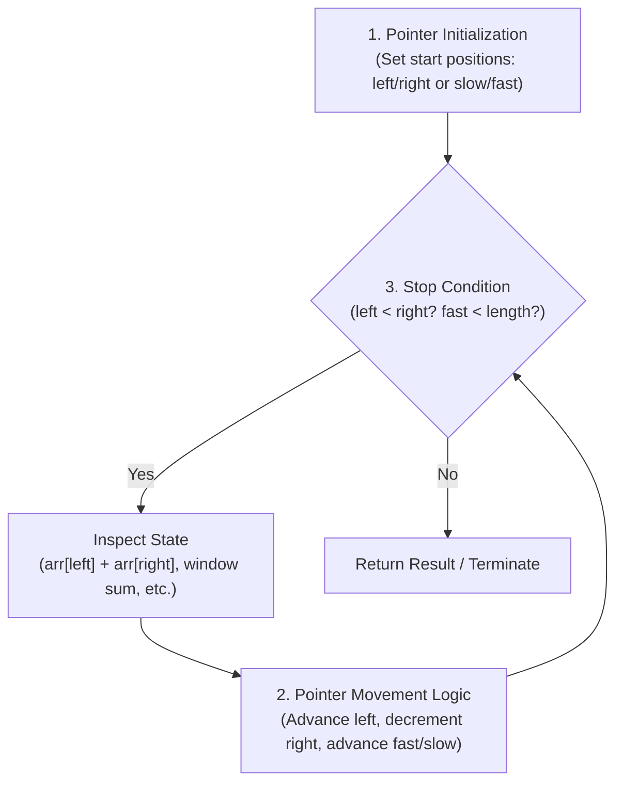

# Recursion and Two-Pointer Algorithms

[Back to Module 01](../README.md) · [Back to the master roadmap](../../README.md)

**Session date:** 2026-11-02 · **Module:** 01 · Python Fundamentals & Algorithmic Thinking  
**Format:** Textbook study guide, executable notebooks, call stack traces, and algorithmic optimization labs

---

## Overview

In algorithmic problem solving, software engineering, and machine learning pipelines, two foundational paradigms bridge simple procedural loops and advanced algorithmic design: **Recursion** and the **Two Pointers Technique**.

- **Recursion** decomposes a problem into strictly smaller instances of the same problem. Rather than iteratively mutating an external accumulator, a recursive procedure relies on the runtime call stack to maintain execution context across self-referential invocations until reaching a base condition. Recursion provides the natural blueprint for divide-and-conquer algorithms (such as Merge Sort and Quick Sort), combinatorial backtracking, and hierarchical tree traversals (such as Decision Tree induction in machine learning).
- **Two Pointers** is an optimization strategy that maintains two distinct index markers across an ordered sequence (such as a string, list, or matrix). By exploiting ordering, symmetry, or monotonicity, two-pointer algorithms prune large regions of the search space, transforming quadratic $O(n^2)$ nested-loop scans into single-pass $O(n)$ linear traversals with $O(1)$ auxiliary memory.

This session develops the complete mathematical, architectural, and practical foundations of both paradigms:
1. **Recursion Foundations & Call Stack Mechanics:** We dissect activation records, stack frames, stack depth limits (`sys.getrecursionlimit()`), and the hidden quadratic cost of list slicing versus index-pointer passing.
2. **Linear and Tree Recursion:** We analyze linear recursion through array summation and factorial computation, trace binary recursion trees in the Fibonacci sequence, derive the exponential scaling barrier $O(2^n)$ / $\Theta(\phi^n)$, and resolve it using top-down memoization and bottom-up iteration. We solve the lecture's Fibonacci Word sequence problem without allocating gigantic strings.
3. **Convergent Two Pointers (Opposite Ends):** We examine dual indexing in Python, in-place string and sequence reversal (LeetCode 344), robust alphanumeric palindrome verification (LeetCode 125), and sorted Two Sum search (LeetCode 167), extending to 3Sum (LeetCode 15) and 3Sum Closest (LeetCode 16).
4. **Same-Direction Two Pointers (Sliding Window):** We formalize the non-negative Subarray Sum Equals K problem (LeetCode 560), reconstruct the exact 18-step lecture execution trace, explain why monotonicity is required, and contrast the sliding window with Prefix Sum hash maps for arbitrary signed arrays.
5. **Applied Machine Learning & Advanced Patterns:** We implement fast-slow pointer deduplication (LeetCode 26), 2D matrix transposition, recursive CART decision tree building from scratch, and two-pointer sorted inverted-index posting intersection.

---

## Learning outcomes

By the end of this session, you should be able to:

- Formulate recursive algorithms with mathematically rigorous base cases and recursive decomposition steps.
- Explain the physical anatomy of the runtime call stack, including activation records, stack frames, return addresses, and local namespaces.
- Contrast list-slicing recursion ($O(n^2)$ time due to memory churn) with index-passing recursion ($O(n)$ time and $O(n)$ stack space).
- Calculate exact asymptotic time and space complexities for linear recursive relations ($T(n) = T(n-1) + O(1)$) and binary recursive relations ($T(n) = 2T(n-1) + O(1)$).
- Construct recurrence trees to visualize call branching and identify overlapping subproblems in naive Fibonacci evaluation.
- Implement top-down dynamic programming (memoization) using Python dictionaries and `@functools.lru_cache`, reducing exponential complexity to $O(n)$.
- Implement bottom-up iterative DP to achieve optimal $O(n)$ runtime and $O(1)$ auxiliary space.
- Solve the Fibonacci Word sequence query problem recursively in $O(n)$ time without generating exponential-length strings.
- Leverage positive and negative list indexing to manipulate sequence boundaries symmetrically.
- Implement in-place string and array reversals using convergent two pointers in $O(n)$ time and $O(1)$ auxiliary space.
- Prove the correctness of the Two Sum algorithm on sorted sequences based on monotonic sum boundaries.
- Formulate the sliding window pattern for contiguous subarray problems, tracking window expansion and window contraction.
- Reconstruct the step-by-step state transition table for Subarray Sum Equals K on non-negative arrays.
- Explain why sliding windows fail in the presence of negative numbers and implement the Prefix Sum + Hash Map solution.
- Apply fast-slow pointer traversal to deduplicate sorted collections in-place.
- Implement recursive tree algorithms from first principles, including a toy CART decision tree classifier using Gini impurity.
- Apply two pointers to streaming data pipelines, including the $O(n + m)$ intersection of inverted index posting lists.

---

## Session map

| Notebook | Focus | Key Topics |
| :--- | :--- | :--- |
| [01 · Recursion Foundations](notebooks/01-recursion-foundations-and-call-stack.ipynb) | Call Stack Mechanics & Linear Recursion | Activation records, stack frames, base cases, list slicing overhead vs index pointer, recursion limit, recursion tracer |
| [02 · Fibonacci & Memoization](notebooks/02-fibonacci-recursion-trees-and-memoization.ipynb) | Tree Recursion & Dynamic Programming | Binary branching, Golden Ratio $\phi^n$, overlapping subproblems, top-down memoization, bottom-up DP, Fibonacci Word query |
| [03 · Convergent Two Pointers](notebooks/03-two-pointers-convergent-and-reversal.ipynb) | Opposite-Ends Pointers & Reversals | List indexing, in-place string reversal, alphanumeric palindrome verification, sorted Two Sum monotonicity proof |
| [04 · Sliding Window Subarrays](notebooks/04-two-pointers-sliding-window-and-subarrays.ipynb) | Same-Direction Pointers & Subarray Sums | Subarray definition, sliding window expansion/contraction, step-by-step trace table, non-negativity constraint, prefix sum hash map |
| [05 · Advanced Patterns](notebooks/05-advanced-two-pointer-patterns-and-drills.ipynb) | Multi-Pointer Expansion & 2D Transforms | Fast-slow deduplication (LeetCode 26), 3Sum and 3Sum Closest via sorting, matrix transposition in-place |
| [06 · ML Applications](notebooks/06-algorithmic-lab-and-ml-applications.ipynb) | Applied Recursive Trees & Streaming Pipelines | Recursive CART decision tree from scratch, Gini impurity, inverted index posting intersection ($O(n+m)$), unit test suite |

---

## 1. Theoretical Foundations of Recursion

### 1.1 The Recursive Paradigm

Recursion is a programming and mathematical technique in which a solution to a problem depends on solutions to smaller instances of the same problem. Rather than executing explicit loop constructs (`for`, `while`), a recursive function achieves iteration by invoking itself with modified parameters.

Formally, a problem $P$ of size $n$, denoted $P(n)$, is solved recursively by expressing $P(n)$ as a function of one or more subproblems $P(n_1), P(n_2), \dots, P(n_k)$ where each $n_i < n$:
$$P(n) = g(P(n_1), P(n_2), \dots, P(n_k))$$

The process terminates when the instance size reaches a threshold $n_0$ where the solution is known directly:
$$P(n_0) = c$$

### 1.2 Mathematical Induction vs Recursion

Recursion is the computational dual of **mathematical induction**:
- **Mathematical Induction:** Proves a property $P(n)$ holds for all integers $n \ge 0$ by showing:
  1. *Base step:* Prove $P(0)$ is true.
  2. *Inductive step:* Assume $P(k)$ is true (inductive hypothesis), and prove that $P(k) \implies P(k+1)$.
- **Recursive Programming:** Computes a result for an input of size $n$ by:
  1. *Base case:* Providing a direct solution when $n$ is minimal (e.g., $n = 0$ or $n = 1$).
  2. *Recursive step:* Assuming the function correctly computes the solution for inputs of size $< n$, and using those smaller solutions to construct the answer for $n$.

### 1.3 The Two Pillars of a Valid Recursive Procedure

Every well-formed recursive procedure must satisfy two mandatory criteria:

1. **Base Case (Terminal Condition):**
   - Must evaluate without making any further recursive calls.
   - Prevents infinite recursion, resource exhaustion, and runtime crashes.
   - A function may have multiple base cases (e.g., $F(0) = 0$ and $F(1) = 1$ in Fibonacci).

2. **Recursive Case (Inductive Step):**
   - Must decompose the problem into strictly smaller or simpler sub-instances.
   - Must guarantee monotonic progression toward the base case under all valid inputs.
   - Combines the return values of subproblems to form the final result.

```python
def recursive_template(instance):
    # 1. Base case: directly solvable condition
    if is_base_case(instance):
        return direct_solution(instance)

    # 2. Recursive case: reduce size and solve subproblem
    smaller_instance = reduce_problem_size(instance)
    subproblem_result = recursive_template(smaller_instance)

    # 3. Combine results
    return combine(instance, subproblem_result)
```

---

## 2. Call Stack Mechanics and Memory Models

### 2.1 The Runtime Stack Frame (Activation Record)

When a program executes a function call, the runtime environment allocates an **activation record** (commonly referred to as a **stack frame**) on the call stack. The call stack operates on a strict Last-In, First-Out (LIFO) discipline.

A stack frame contains:
- **Parameters:** Arguments passed to the function call.
- **Local Variables:** Identifiers bound within the function's local scope.
- **Return Address:** Instruction pointer indicating where execution should resume in the caller once the callee returns.
- **Saved Frame Pointer:** Reference to the caller's stack frame.

```text
High Memory
+------------------------------------+
|  factorial(4)                      |  <- Caller frame (n=4, waits for child return)
|  - Parameters: n = 4               |
|  - Return address: main()          |
+------------------------------------+
|  factorial(3)                      |  <- Suspended frame (n=3, waits for child)
|  - Parameters: n = 3               |
|  - Return address: factorial(4)    |
+------------------------------------+
|  factorial(2)                      |  <- Suspended frame (n=2, waits for child)
|  - Parameters: n = 2               |
|  - Return address: factorial(3)    |
+------------------------------------+
|  factorial(1)                      |  <- Suspended frame (n=1, waits for child)
|  - Parameters: n = 1               |
|  - Return address: factorial(2)    |
+------------------------------------+
|  factorial(0)                      |  <- Active top frame (Base case! returns 1)
|  - Parameters: n = 0               |
|  - Return address: factorial(1)    |
+------------------------------------+
Low Memory (Stack grows downward)
```

### 2.2 Slicing vs Pointer Passing: Hidden $O(n^2)$ Complexity

In introductory Python materials, recursive array processing is frequently illustrated using list slicing:

```python
def sum_recursion_slicing(arr: list[int]) -> int:
    if not arr:
        return 0
    return arr[0] + sum_recursion_slicing(arr[1:])
```

While syntactically concise, this implementation suffers from severe performance degradation. In Python, slicing a list `arr[1:]` allocates a brand-new list in heap memory and copies all $k - 1$ elements from index $1$ to $k - 1$.

Across $n$ recursive steps, the total memory copied is:
$$\sum_{k=1}^{n} (k - 1) = \frac{(n - 1)n}{2} = \Theta(n^2)$$

Thus, what appears to be an $O(n)$ linear recursion algorithm degenerates into **$\Theta(n^2)$ quadratic time complexity** with substantial garbage collection pressure.

**Optimal Pointer Approach:**
By passing the sequence reference and an integer index pointer $i$, no list allocations occur:

```python
from collections.abc import Sequence


def sum_recursion_indexed(arr: Sequence[int], index: int = 0) -> int:
    if index == len(arr):
        return 0
    return arr[index] + sum_recursion_indexed(arr, index + 1)
```

This restores true **$\Theta(n)$ time complexity** and consumes exactly $O(n)$ stack frames without heap allocations.

### 2.3 Python's Recursion Limit

Unlike languages with compiler-level Tail Call Optimization (TCO) such as Scheme or Haskell, standard CPython does not optimize tail-recursive calls. Every call pushes a C stack frame.

To prevent C-level stack overflows that could crash the operating system process, Python enforces a strict limit:

```python
import sys

print(sys.getrecursionlimit())  # Typically 1000
```

If the recursion depth exceeds this threshold, Python raises `RecursionError: maximum recursion depth exceeded`. For algorithms requiring deeper recursion (e.g., traversing long trees or graphs), either the limit must be adjusted via `sys.setrecursionlimit(new_limit)` or the algorithm must be refactored into an iterative loop with an explicit heap-allocated stack.

---

## 3. Linear Recursion Case Studies

### 3.1 Linear Iteration vs Linear Recursion: Sum Function

Let $A = \langle a_0, a_1, \dots, a_{n-1} \rangle$ be a sequence of $n$ numbers. The problem is to evaluate:
$$S = \sum_{i=0}^{n-1} a_i$$

#### Iterative Formulation
An accumulator variable `total` starts at 0 and adds elements sequentially:

```python
def sum_list_iterative(arr: list[int]) -> int:
    total = 0
    n = len(arr)
    for i in range(n):
        total += arr[i]
    return total
```

Line-by-line cost and frequency analysis:
- Initialization `total = 0`: 1 operation.
- Loop condition and index increment: $n + 1$ evaluations.
- Accumulation `total += arr[i]`: $n$ additions.
- Return statement: 1 operation.
- Total time complexity: $\Theta(n)$. Auxiliary space: $\Theta(1)$.

#### Recursive Formulation
Expressed mathematically:
$$\text{Sum}(A) = \begin{cases} 0 & \text{if } A = \langle \rangle \\ a_0 + \text{Sum}(\langle a_1, \dots, a_{n-1} \rangle) & \text{if } A \ne \langle \rangle \end{cases}$$

Recurrence relation:
$$T(n) = \begin{cases} c_0 & \text{if } n = 0 \\ T(n - 1) + c_1 & \text{if } n \ge 1 \end{cases}$$

Expanding the recurrence:
$$T(n) = T(n - 1) + c_1 = T(n - 2) + 2c_1 = \dots = T(0) + n c_1 = c_0 + n c_1 = \Theta(n)$$

Auxiliary space is $\Theta(n)$ because $n + 1$ stack frames reside concurrently in memory at maximum depth.

---

### 3.2 The Factorial Function ($n!$)

The factorial of a non-negative integer $n$ is the product of all positive integers less than or equal to $n$:
$$n! = \prod_{i=1}^{n} i = n \times (n - 1) \times (n - 2) \times \dots \times 2 \times 1$$
with $0! = 1$ by convention.

```python
def factorial(n: int) -> int:
    if n < 0:
        raise ValueError("Factorial is undefined for negative integers.")
    if n == 0:
        return 1
    return n * factorial(n - 1)
```

#### Detailed Execution Trace for `factorial(4)`

```text
[CALL PHASE - Pushing frames]
factorial(4)
  |-> 4 * factorial(3)
        |-> 3 * factorial(2)
              |-> 2 * factorial(1)
                    |-> 1 * factorial(0)
                          |-> BASE CASE: factorial(0) = 1

[RETURN / UNWINDING PHASE - Popping frames]
factorial(0) returns 1
factorial(1) evaluates 1 * 1 = 1, returns 1
factorial(2) evaluates 2 * 1 = 2, returns 2
factorial(3) evaluates 3 * 2 = 6, returns 6
factorial(4) evaluates 4 * 6 = 24, returns 24
```

- Total recursive calls: $n + 1 = 5$.
- Time Complexity: $\Theta(n)$ multiplications and comparisons.
- Space Complexity: $\Theta(n)$ stack depth.

---

## 4. Tree Recursion, Fibonacci Numbers, and Dynamic Programming

### 4.1 The Fibonacci Sequence

The Fibonacci sequence is defined by the linear second-order recurrence relation:
$$F(0) = 0$$
$$F(1) = 1$$
$$F(n) = F(n-1) + F(n-2) \quad \text{for } n \ge 2$$

Sequence values: $0, 1, 1, 2, 3, 5, 8, 13, 21, 34, 55, 89, \dots$

### 4.2 Naive Binary Recursion and the Call Tree

```python
def fibonacci_naive(n: int) -> int:
    if n == 0:
        return 0
    elif n == 1:
        return 1
    return fibonacci_naive(n - 1) + fibonacci_naive(n - 2)
```

In linear recursion, each activation record spawns at most one sub-call. In Fibonacci, each non-base activation record spawns **two** sub-calls, generating a **binary recursion tree**:

```text
                           F(4)
                        /        \
                     F(3)          F(2)
                    /    \        /    \
                 F(2)    F(1)   F(1)   F(0)
                /    \    (1)    (1)    (0)
             F(1)    F(0)
              (1)     (0)
```

#### Computational Redundancy
Notice the duplication across the call tree:
- $F(2)$ is evaluated **2 separate times**.
- $F(1)$ is evaluated **3 separate times**.
- $F(0)$ is evaluated **2 separate times**.

As $n$ increases, the number of redundant computations compounds exponentially.

### 4.3 Complexity Derivation: The Golden Ratio $\phi$

The runtime recurrence is:
$$T(n) = T(n-1) + T(n-2) + c \quad \text{for } n \ge 2$$
$$T(0) = d_0, \quad T(1) = d_1$$

The characteristic equation for the homogeneous part $T(n) - T(n-1) - T(n-2) = 0$ is:
$$r^2 - r - 1 = 0$$

Roots of the characteristic polynomial:
$$r_1 = \frac{1 + \sqrt{5}}{2} = \phi \approx 1.6180339887 \dots \quad \text{(The Golden Ratio)}$$
$$r_2 = \frac{1 - \sqrt{5}}{2} = \hat{\phi} \approx -0.6180339887 \dots$$

By Binet's formula, the exact number of operations is:
$$T(n) = \Theta\left(\phi^n\right) \approx \Theta(1.618^n)$$

Because $\phi < 2$, this is upper-bounded by $O(2^n)$. An algorithm scaling as $O(1.618^n)$ hits a hard computational barrier very early:
- $n = 10 \implies \approx 177$ operations (instantaneous)
- $n = 30 \implies \approx 2.6 \times 10^6$ operations
- $n = 50 \implies \approx 4.0 \times 10^{10}$ operations (seconds to minutes)
- $n = 100 \implies \approx 1.1 \times 10^{21}$ operations (centuries)

### 4.4 Resolving the Explosion: Memoization and Iteration

#### Approach 1: Top-Down Dynamic Programming (Memoization)
Memoization caches the results of function calls keyed by their arguments. When a subproblem is encountered a second time, its solution is retrieved in $O(1)$ time rather than recomputed:

```python
from functools import lru_cache


@lru_cache(maxsize=None)
def fibonacci_memo(n: int) -> int:
    if n == 0:
        return 0
    if n == 1:
        return 1
    return fibonacci_memo(n - 1) + fibonacci_memo(n - 2)
```

The recursion tree collapses into a directed acyclic graph (DAG) containing only $n + 1$ unique states.
- Time Complexity: $\Theta(n)$.
- Space Complexity: $\Theta(n)$ for the cache plus $\Theta(n)$ stack frames.

#### Approach 2: Bottom-Up Dynamic Programming (Iteration)
We can eliminate the call stack entirely by evaluating states in topological order from $F(0)$ up to $F(n)$, retaining only the two most recent values:

```python
def fibonacci_iterative(n: int) -> int:
    if n == 0:
        return 0
    prev, curr = 0, 1
    for _ in range(2, n + 1):
        prev, curr = curr, prev + curr
    return curr
```

- Time Complexity: $\Theta(n)$.
- Auxiliary Space Complexity: $\Theta(1)$ constant space.

---

### 4.5 The Fibonacci Word Sequence (Slide 64)

The **Fibonacci Word sequence** generates words over the alphabet $\{A, B\}$ by recursive concatenation:
$$F(0) = \text{"A"}$$
$$F(1) = \text{"B"}$$
$$F(n) = F(n-1) + F(n-2) \quad \text{for } n \ge 2$$

Sequence generation:
- $F(0) = \text{"A"}$ ($\text{length } 1$)
- $F(1) = \text{"B"}$ ($\text{length } 1$)
- $F(2) = F(1) + F(0) = \text{"BA"}$ ($\text{length } 2$)
- $F(3) = F(2) + F(1) = \text{"BAB"}$ ($\text{length } 3$)
- $F(4) = F(3) + F(2) = \text{"BABBA"}$ ($\text{length } 5$)
- $F(5) = F(4) + F(3) = \text{"BABBABAB"}$ ($\text{length } 8$)
- $F(6) = F(5) + F(4) = \text{"BABBABABBABBA"}$ ($\text{length } 13$)

Notice that the lengths of the words follow the standard Fibonacci sequence: $|F(n)| = F_{\text{std}}(n+1)$.

#### The Lecture Query Problem (Slide 64)
*Given an integer `target`, return the character indexed at `(target - 1)` in string $F(n)$, where $n$ is the smallest integer such that $|F(n)| \ge \text{target}$.*

If `target = 4`:
1. Find smallest $n$ such that $|F(n)| \ge 4$:
   - $|F(0)| = 1 < 4$
   - $|F(1)| = 1 < 4$
   - $|F(2)| = 2 < 4$
   - $|F(3)| = 3 < 4$
   - $|F(4)| = 5 \ge 4 \implies n = 4$.
2. Inspect index $\text{target} - 1 = 4 - 1 = 3$:
   - $F(4) = \text{"BABBA"}$.
   - Indices: $F(4)[0] = \text{'B'}, F(4)[1] = \text{'A'}, F(4)[2] = \text{'B'}, F(4)[3] = \text{'B'}, F(4)[4] = \text{'A'}$.
   - Result: $F(4)[3] = \text{'B'}$.

#### Efficient Recursive Querying ($O(n)$ Time, $O(1)$ String Memory)
If `target` is large (e.g., $10^9$), generating the string $F(n)$ directly would consume gigabytes of RAM. Instead, because $F(n) = F(n-1) + F(n-2)$, the first $|F(n-1)|$ characters belong to $F(n-1)$, and the subsequent characters belong to $F(n-2)$.

We can navigate down the recurrence hierarchy:
- If $\text{idx} < |F(n-1)|$, recurse to `query(n - 1, idx)`.
- If $\text{idx} \ge |F(n-1)|$, recurse to `query(n - 2, idx - |F(n-1)|)`.

This resolves the query in $O(n)$ time using only $O(n)$ stack space, requiring zero string allocations!

---

## 5. The Two Pointers Design Paradigm

### 5.1 Intuition and Core Principles

The **Two Pointers** technique is an algorithmic pattern where two indices traverse a linear data structure simultaneously. The central motto highlighted in the lecture slides is:

> *"Two are better than one if they act as one."*

In naive algorithm design, inspecting pairs of elements in an array requires two nested loops, yielding $O(n^2)$ time complexity. When the underlying data structure satisfies certain properties (such as sorted order, structural symmetry, or contiguous range constraints), the position of one pointer provides information that strictly restricts where the other pointer can be. By synchronizing their movement, the two pointers traverse the entire structure in $O(n)$ linear time.

### 5.2 Anatomy of a Two-Pointer Algorithm

Every two-pointer implementation is defined by three core mechanics:



1. **Pointer Initialization:**
   - Convergent / Opposite Ends: `left = 0`, `right = len(arr) - 1`.
   - Sliding Window / Same Direction: `start = 0`, `end = 0`.
   - Fast-Slow / Tortoise-Hare: `slow = 0`, `fast = 1`.
2. **Pointer Movement:**
   - Update pointers conditionally based on comparison predicates ($<, >, ==$).
3. **Stop Condition:**
   - Guard condition terminating the loop (`while left < right`, `while end < n`, etc.).

---

## 6. Convergent Pointers: Symmetry, Reversal, and Monotonic Search

### 6.1 In-Place String and Array Reversal (LeetCode 344)

The goal is to invert a sequence $\langle a_0, a_1, \dots, a_{n-1} \rangle$ to $\langle a_{n-1}, a_{n-2}, \dots, a_0 \rangle$.

#### Iterative Backward Accumulation
A simple approach scans backwards and builds a new sequence:

```python
def reverse_string_for_loop(s: str) -> str:
    tg_s = ""
    n = len(s)
    for i in range(n - 1, -1, -1):
        tg_s += s[i]
    return tg_s
```

Because Python strings are immutable, each `tg_s += s[i]` allocates a new string of growing length $k$, resulting in $O(n^2)$ copying overhead unless collected in a list and joined.

#### Convergent Two-Pointer In-Place Swap
Convert the string to a mutable list of characters, place `i = 0` at the start and `j = n - 1` at the end, and swap elements while advancing toward the center:

```python
def reverse_string_two_pointers(s: str) -> str:
    s_list = list(s)
    i = 0
    j = len(s_list) - 1
    while i < j:
        s_list[i], s_list[j] = s_list[j], s_list[i]
        i += 1
        j -= 1
    return "".join(s_list)
```

#### Step Trace for `"hello"` ($n = 5$)

```text
Initial:   [ 'h', 'e', 'l', 'l', 'o' ], i = 0, j = 4
Swap 0,4:  [ 'o', 'e', 'l', 'l', 'h' ], i = 1, j = 3
Swap 1,3:  [ 'o', 'l', 'l', 'e', 'h' ], i = 2, j = 2
Stop:      i == j (2 == 2), loop terminates.
Result:    "olleh"
```

- Total swaps: $\lfloor n / 2 \rfloor = 2$.
- Time Complexity: $\Theta(n)$.
- Auxiliary Space: $O(1)$ in-place on mutable buffers.

---

### 6.2 Palindrome Verification (LeetCode 125)

A string is a palindrome if it reads identically forward and backward. In real-world data, strings contain whitespace, uppercase/lowercase variations, and punctuation.

Convergent two pointers allow skipping non-alphanumeric characters without allocating a secondary filtered string:

```python
def is_palindrome_two_pointers(s: str) -> bool:
    left = 0
    right = len(s) - 1
    while left < right:
        while left < right and not s[left].isalnum():
            left += 1
        while left < right and not s[right].isalnum():
            right -= 1
        if s[left].lower() != s[right].lower():
            return False
        left += 1
        right -= 1
    return True
```

- Time Complexity: $\Theta(n)$ because each pointer advances at most $n$ times.
- Auxiliary Space: $\Theta(1)$ constant space.

---

### 6.3 Two Sum on a Sorted Array (LeetCode 167)

Given a sorted array of integers `nums` and an integer `target`, determine whether there exists a pair $(i, j)$ with $i < j$ such that `nums[i] + nums[j] == target`.

#### Exhaustive Brute Force ($O(n^2)$)
Examine all $\frac{n(n-1)}{2}$ index pairs.

#### Convergent Two Pointers ($O(n)$)
Initialize `left = 0` and `right = n - 1`. Compute $S = \text{nums}[\text{left}] + \text{nums}[\text{right}]$:
- If $S == \text{target}$: Pair found. Return `(left, right)`.
- If $S < \text{target}$: Since the array is sorted in non-decreasing order, pairing `nums[left]` with any element to the left of `right` will produce an even smaller sum:
  $$\forall k \le \text{right}, \quad \text{nums}[\text{left}] + \text{nums}[k] \le \text{nums}[\text{left}] + \text{nums}[\text{right}] < \text{target}$$
  Therefore, `nums[left]` cannot possibly participate in any valid solution. We safely prune it by advancing `left += 1`.
- If $S > \text{target}$: Symmetrically, pairing `nums[right]` with any element to the right of `left` produces an even larger sum:
  $$\forall k \ge \text{left}, \quad \text{nums}[k] + \text{nums}[\text{right}] \ge \text{nums}[\text{left}] + \text{nums}[\text{right}] > \text{target}$$
  Therefore, `nums[right]` cannot participate in any valid solution. We safely prune it by decrementing `right -= 1`.

Because every step permanently eliminates either `nums[left]` or `nums[right]`, the loop executes at most $n$ times:
- Time Complexity: $\Theta(n)$.
- Auxiliary Space: $\Theta(1)$.

---

## 7. Same-Direction Pointers: Sliding Window and Subarray Sums

### 7.1 Problem Definition: Subarray Sum Equals K

A **subarray** is defined as a contiguous non-empty sequence of elements within an array.

Given an array of integers `nums` where $a_i \ge 0$ and an integer `key`, return the total number of contiguous subarrays whose elements sum to `key`.

#### Brute Force Nested Loops ($O(n^2)$)

```python
def subarray_sum_brute_force(nums: list[int], key: int) -> int:
    n = len(nums)
    count = 0
    for i in range(n):
        total = 0
        for j in range(i, n):
            total += nums[j]
            if total == key:
                count += 1
    return count
```

This tests all $O(n^2)$ contiguous subarrays directly.

---

### 7.2 The Sliding Window Algorithm for Non-Negative Arrays

When all elements are non-negative ($a_i \ge 0$), the cumulative sum possesses **monotonicity**:
- Extending the right pointer $i$ monotonically increases the sum.
- Contracting the left pointer $j$ monotonically decreases the sum.

This allows us to maintain the running sum of a dynamic contiguous window $[j, i)$:

```python
def subarray_sum_two_pointer(nums: list[int], key: int) -> int:
    i = 0  # Leading right pointer (expansion)
    j = 0  # Trailing left pointer (contraction)
    count = 0
    total = 0
    n = len(nums)

    while i < n and j < n:
        if total + nums[i] < key:
            total += nums[i]
            i += 1
        elif total + nums[i] > key:
            total -= nums[j]
            j += 1
        else:
            count += 1
            total += nums[i]
            i += 1
    return count
```

---

### 7.3 Detailed Lecture Execution Trace

Consider the benchmark from Slides 43–61: `nums = [1, 2, 3, 5, 6]`, `key = 5`, $n = 5$.

| Step | Page | $i$ | $j$ | `total` | `nums[i]` | `total + nums[i]` | Condition vs `key` (5) | Action Taken | Updated State | `count` |
| :---: | :---: | :---: | :---: | :---: | :---: | :---: | :---: | :---: | :---: | :---: |
| 1 | P44 | 0 | 0 | 0 | 1 | $0 + 1 = 1$ | $1 < 5$ | `total += 1`, $i \leftarrow 1$ | `total = 1`, $i = 1$ | 0 |
| 2 | P46 | 1 | 0 | 1 | 2 | $1 + 2 = 3$ | $3 < 5$ | `total += 2`, $i \leftarrow 2$ | `total = 3`, $i = 2$ | 0 |
| 3 | P48 | 2 | 0 | 3 | 3 | $3 + 3 = 6$ | $6 > 5$ | `total -= nums[0] (1)`, $j \leftarrow 1$ | `total = 2`, $j = 1$ | 0 |
| 4 | P50 | 2 | 1 | 2 | 3 | $2 + 3 = 5$ | $5 == 5$ | `count += 1`, `total += 3`, $i \leftarrow 3$ | `total = 5`, $i = 3$ | **1** |
| 5 | P52 | 3 | 1 | 5 | 5 | $5 + 5 = 10$ | $10 > 5$ | `total -= nums[1] (2)`, $j \leftarrow 2$ | `total = 3`, $j = 2$ | 1 |
| 6 | P54 | 3 | 2 | 3 | 5 | $3 + 5 = 8$ | $8 > 5$ | `total -= nums[2] (3)`, $j \leftarrow 3$ | `total = 0`, $j = 3$ | 1 |
| 7 | P56 | 3 | 3 | 0 | 5 | $0 + 5 = 5$ | $5 == 5$ | `count += 1`, `total += 5`, $i \leftarrow 4$ | `total = 5`, $i = 4$ | **2** |
| 8 | P58 | 4 | 3 | 5 | 6 | $5 + 6 = 11$ | $11 > 5$ | `total -= nums[3] (5)`, $j \leftarrow 4$ | `total = 0`, $j = 4$ | 2 |
| 9 | P60 | 4 | 4 | 0 | 6 | $0 + 6 = 6$ | $6 > 5$ | `total -= nums[4] (6)`, $j \leftarrow 5$ | `total = -6`, $j = 5$ | 2 |
| End | P61 | 4 | 5 | - | - | - | $j \ge n$ ($5 \ge 5$) | Loop terminates | Final answer: **2** | **2** |

The two matching contiguous subarrays discovered are:
1. `nums[1..2] = [2, 3]` (sum = 5)
2. `nums[3..3] = [5]` (sum = 5)

Complexity: Both $i$ and $j$ increment at most $n$ times. Total time complexity is $\Theta(n)$ with $\Theta(1)$ auxiliary memory.

---

### 7.4 The Non-Negativity Invariant and Negative Numbers

> [!WARNING]
> The two-pointer sliding window algorithm for subarray sum relies fundamentally on the assumption that all elements are non-negative ($a_i \ge 0$). If the array contains negative numbers, the monotonicity invariant is broken: advancing $i$ can decrease the sum, and advancing $j$ can increase the sum.

#### The General Solution: Prefix Sums + Hash Map ($O(n)$ Time, $O(n)$ Space)
For arrays containing arbitrary signed integers (positive, zero, and negative), we reformulate using prefix sums:
- Define prefix sum $P[k] = \sum_{m=0}^{k-1} a_m$ with $P[0] = 0$.
- The sum of subarray $a[j \dots i-1]$ is $P[i] - P[j]$.
- We seek $P[i] - P[j] = \text{key} \implies P[j] = P[i] - \text{key}$.

By recording the frequency of seen prefix sums in a hash map as we scan the array from left to right, we identify every valid subarray in a single linear pass:

```python
from collections import defaultdict


def subarray_sum_general(nums: list[int], key: int) -> int:
    prefix_counts = defaultdict(int)
    prefix_counts[0] = 1  # Base prefix before processing elements
    current_sum = 0
    count = 0

    for num in nums:
        current_sum += num
        count += prefix_counts[current_sum - key]
        prefix_counts[current_sum] += 1

    return count
```

- Time Complexity: $O(n)$ average across all integer domains.
- Space Complexity: $O(n)$ for the hash map.

---

## 8. Advanced Patterns & Machine Learning Applications

### 8.1 Fast-Slow Pointer Traversal (Tortoise and Hare)

In the **Fast-Slow Pointer** pattern, both pointers start at the beginning of the sequence but advance at different rates or under different triggering events.

#### In-Place Deduplication of Sorted Sequences (LeetCode 26)
Given a sorted array `nums`, remove duplicate values in-place so that each unique value appears once, returning the count $k$ of unique elements:

```python
def remove_duplicates_sorted(nums: list[int]) -> int:
    if not nums:
        return 0
    slow = 0  # Write pointer for unique elements
    for fast in range(1, len(nums)):
        if nums[fast] != nums[slow]:
            slow += 1
            nums[slow] = nums[fast]
    return slow + 1
```

- `slow` advances only when a novel value is encountered.
- Operates in $\Theta(n)$ time and $\Theta(1)$ memory without creating secondary sets or lists.

---

### 8.2 Multi-Pointer Search: 3Sum (LeetCode 15)

Given an array `nums`, find all unique triplets $[a, b, c]$ such that $a + b + c = 0$.

A naive brute-force search over all triplets takes $O(n^3)$ cubic time. By sorting the array and fixing the first element $i$, we reduce the problem to Two Sum on the sorted suffix:

1. Sort array in $O(n \log n)$ time.
2. Iterate $i$ from $0$ to $n-3$. If $i > 0$ and $\text{nums}[i] == \text{nums}[i-1]$, skip to eliminate duplicate triplets.
3. Target sum for the remaining pair is $-\text{nums}[i]$.
4. Initialize convergent pointers $\text{left} = i + 1$ and $\text{right} = n - 1$, scanning inward in $O(n)$ time.
5. Total Time Complexity: $O(n \log n) + O(n^2) = O(n^2)$.
6. Auxiliary Space Complexity: $O(1)$ auxiliary space.

---

### 8.3 Matrix Transposition (Slide 63)

The transpose of matrix $A \in \mathbb{R}^{m \times n}$ is matrix $A^T \in \mathbb{R}^{n \times m}$ where $(A^T)_{j, i} = A_{i, j}$.

For a square matrix ($n \times n$), transposition can be executed strictly in-place with zero memory allocation by swapping symmetric coordinate pairs across the principal diagonal:

$$\forall i \in [0, n-1], \quad \forall j \in [i+1, n-1]: \quad \text{swap}(A_{i, j}, A_{j, i})$$

```python
def transpose_square_in_place(matrix: list[list[int]]) -> None:
    n = len(matrix)
    for i in range(n):
        for j in range(i + 1, n):
            matrix[i][j], matrix[j][i] = matrix[j][i], matrix[i][j]
```

- Total swaps executed: $\frac{n(n-1)}{2}$.
- Time Complexity: $\Theta(n^2)$ matrix elements.
- Auxiliary Space: $\Theta(1)$ in-place.

---

### 8.4 Recursive Divide-and-Conquer in Machine Learning: CART Decision Trees

Decision tree algorithms (such as CART, ID3, and C4.5) are recursive space-partitioning algorithms. At each node in the tree:
1. **Base Case:** If all training examples belong to the same class (purity), or if the tree has reached maximum depth ($d \ge d_{\max}$), stop and return a leaf node predicting the majority label.
2. **Recursive Step:**
   - Scan across all features $f$ and candidate thresholds $\theta$.
   - Compute the weighted Gini impurity:
     $$I_G(S) = 1 - \sum_{k=1}^{C} p_k^2$$
     $$\Delta I_G = I_G(S) - \left( \frac{|S_L|}{|S|} I_G(S_L) + \frac{|S_R|}{|S|} I_G(S_R) \right)$$
   - Partition $S$ into $S_L = \{x \mid x_f \le \theta\}$ and $S_R = \{x \mid x_f > \theta\}$.
   - Recursively construct `left_child = build_tree(S_L)` and `right_child = build_tree(S_R)`.

This mirrors the binary recursive branching structure of Fibonacci, but with divide-and-conquer problem size reduction: each branch operates on a strictly smaller sub-dataset until base cases terminate execution.

---

### 8.5 Two-Pointer Streaming Merge and Inverted Index Intersection

In information retrieval systems and Large Language Model RAG (Retrieval-Augmented Generation) architectures, inverted index postings (lists of document IDs matching specific tokens) are stored in sorted order.

To compute the Boolean AND query for two terms $A$ and $B$, the system must compute the set intersection $P_A \cap P_B$. Using two pointers:

```python
def intersect_sorted_postings(postings_a: list[int], postings_b: list[int]) -> list[int]:
    i, j = 0, 0
    common = []
    while i < len(postings_a) and j < len(postings_b):
        if postings_a[i] == postings_b[j]:
            common.append(postings_a[i])
            i += 1
            j += 1
        elif postings_a[i] < postings_b[j]:
            i += 1
        else:
            j += 1
    return common
```

Because both pointers move monotonically forward, the intersection executes in $\Theta(|P_A| + |P_B|)$ time, avoiding an expensive $O(|P_A| \cdot |P_B|)$ nested scan or $O(N \log N)$ set conversion.

---

## 9. Algorithmic Trade-offs and Paradigm Selection Guide

| Paradigm / Algorithm | Primary Mechanism | Time Complexity | Auxiliary Space | Key Precondition / Invariant | Typical Failure Mode |
| :--- | :--- | :--- | :--- | :--- | :--- |
| **Linear Recursion (Indexed)** | State reduced by $1$ per call frame | $\Theta(n)$ | $\Theta(n)$ (stack) | Well-defined base condition | Exceeding `sys.getrecursionlimit()` |
| **Linear Recursion (Slicing)** | `arr[1:]` slice copies per call frame | $\Theta(n^2)$ | $\Theta(n^2)$ (heap) | None | Severe memory churn & quadratic slowdown |
| **Naive Tree Recursion (Fibonacci)** | Binary branching per node | $\Theta(\phi^n) \approx O(2^n)$ | $\Theta(n)$ (stack) | None | Exponential runtime explosion for $n > 35$ |
| **Memoized Recursion (Top-Down)** | Cache subproblem results | $\Theta(n)$ | $\Theta(n)$ (cache + stack) | Subproblem recurrence overlap | Hash table memory overhead |
| **Iterative DP (Bottom-Up)** | Sequential accumulation from base | $\Theta(n)$ | $\Theta(1)$ | Topological state dependency | State space must be strictly sequential |
| **Convergent Two Pointers** | Pointers move inward from ends | $\Theta(n)$ | $\Theta(1)$ | Sequence symmetry or sorted order | Applying to unsorted arrays |
| **Sliding Window Two Pointers** | Pointers advance in same direction | $\Theta(n)$ | $\Theta(1)$ | Monotonicity (non-negative elements) | Fails in presence of negative numbers |
| **Prefix Sum + Hash Map** | $P[j] = P[i] - \text{key}$ lookup | $\Theta(n)$ | $\Theta(n)$ | None (handles arbitrary numbers) | Memory allocation for prefix dictionary |
| **Fast-Slow Two Pointers** | Different advance rates | $\Theta(n)$ | $\Theta(1)$ | Ordered or stream representation | Requires in-place mutability |

---

## References

1. **Cormen, T. H., Leiserson, C. E., Rivest, R. L., & Stein, C.** (2009). *Introduction to Algorithms* (3rd ed.). The MIT Press. Chapter 4 (Divide-and-Conquer) & Chapter 2 (Getting Started).
2. **Goodrich, M. T., Tamassia, R., & Goldwasser, M. H.** (2013). *Data Structures and Algorithms in Python*. John Wiley & Sons. Chapter 5 (Array-Based Sequences) & Chapter 4 (Recursion).
3. **Sedgewick, R., & Wayne, K.** (2011). *Algorithms* (4th ed.). Addison-Wesley Professional. Section 1.1 (Basic Programming Model) & Section 1.4 (Analysis of Algorithms).
4. **LeetCode Curated Problem Library:**
   - LeetCode 344: *Reverse String* (Two Pointers convergent pattern).
   - LeetCode 125: *Valid Palindrome* (In-place alphanumeric pointer scanning).
   - LeetCode 167: *Two Sum II - Input Array Is Sorted* (Monotonic boundary pruning).
   - LeetCode 560: *Subarray Sum Equals K* (Sliding window on non-negatives vs prefix sum hash table).
   - LeetCode 26: *Remove Duplicates from Sorted Array* (Fast-slow pointer compaction).
   - LeetCode 15: *3Sum* (Sorted two-pointer sweep).
