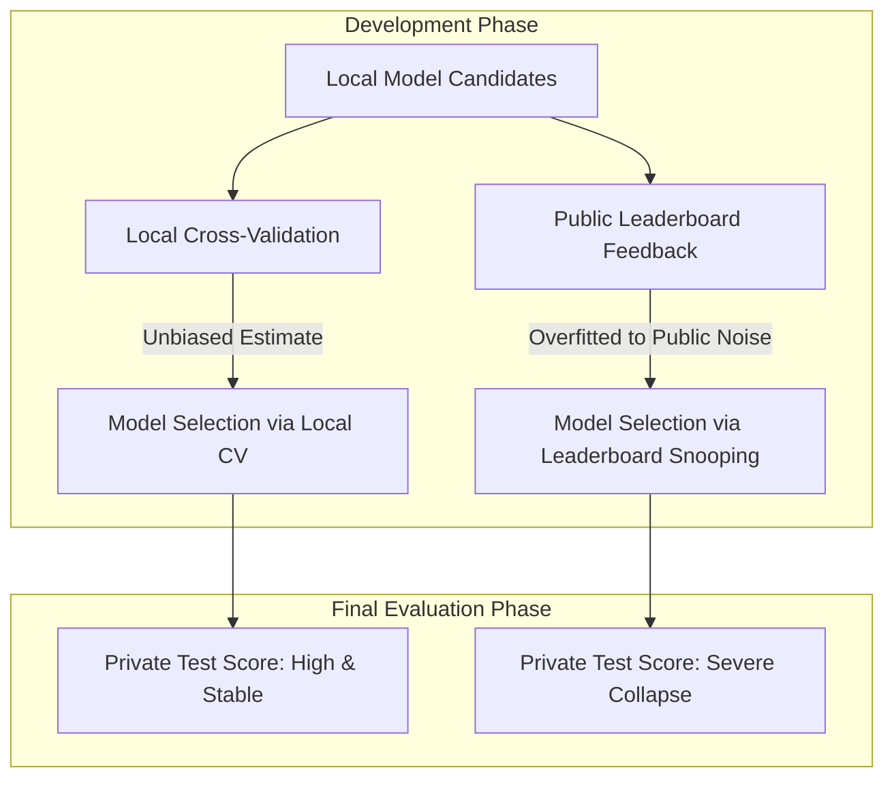
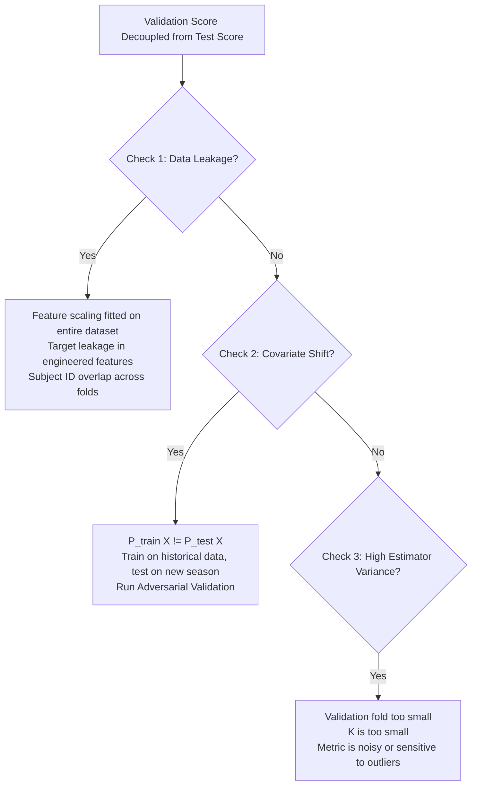

# Designing Good Validation Systems: Resampling, Bias-Variance Decomposition, and Deep Learning Validation Pipelines

[Back to Module 01](../README.md) · [Back to the master roadmap](../../README.md)

**Session date:** 2026-11-06 · **Module:** 01 — Python Fundamentals & Algorithmic Thinking  
**Format:** Theoretical exposition, mathematical proofs, ASCII/Mermaid architectural topologies, executable notebooks, and end-to-end evaluation pipelines

---

## Overview

In machine learning and competitive data science, the single most critical determinant of real-world success is not the choice of neural network architecture or hyperparameter search algorithm. It is the **design and integrity of the validation system**.

A machine learning model evaluated on arbitrary random splits frequently exhibits strong apparent accuracy during development, only to suffer catastrophic performance degradation upon deployment or evaluation on private test sets. This failure mode—widely known as **leaderboard shake-up** in competitions and **generalization collapse** in production systems—stems from a fundamental breakdown in validation discipline: **snooping on test sets**, **data leakage across observation boundaries**, **covariate shift between training and evaluation distributions**, or **uncontrolled estimator variance**.

This session establishes a comprehensive, first-principles foundation for designing, auditing, and executing industrial-grade validation systems:

1. **Snooping on the Leaderboard & Benchmark Topologies:** We dissect the structural anatomy of competitive and production benchmark platforms, formalize the statistical distinction between Public and Private evaluation splits, analyze the mathematical dynamics of leaderboard probing, and formulate rigorous submission protocols that prevent decision-rule overfitting.
2. **Mathematical Decomposition of Generalization Error:** We derive the classical **Bias-Variance-Noise Decomposition** of Expected Prediction Error (EPE) from first principles under squared error loss. We analyze the trade-off spectrum across model capacity, characterize the multi-level taxonomy of overfitting (from training set memorization to private leaderboard collapse), and empirically quantify bias and variance via Monte Carlo simulations.
3. **Splitting Paradigms & Resampling Architectures:** We examine the theoretical properties, failure modes, and implementation mechanics of core resampling strategies: simple Holdout, $K$-Fold Cross-Validation, Stratified $K$-Fold for class-imbalanced targets, GroupKFold for clustered/longitudinal entities, TimeSeriesSplit (walk-forward) for temporal causal ordering, and Leave-One-Out Cross-Validation (LOOCV).
4. **Tuning and Auditing Validation Systems:** We formulate diagnostic protocols to detect validation failure, distinguish Covariate Shift ($P_{\text{train}}(X) \neq P_{\text{test}}(X)$) from Concept Drift ($P_{\text{train}}(Y|X) \neq P_{\text{test}}(Y|X)$), construct **Adversarial Validation** classifiers to audit train-test distribution compatibility, and establish leak-free out-of-fold (OOF) feature stacking pipelines.
5. **Deep Learning Validation Pipelines in PyTorch:** We explore PyTorch's computational graph and reverse-mode automatic differentiation engine (`autograd`), derive analytical gradients versus graph autograd for linear and logistic regression, construct custom `Dataset` and `DataLoader` abstractions, and orchestrate an end-to-end, leak-free $K$-Fold PyTorch training pipeline with out-of-fold prediction tracking and ensemble test inference.

---

## Learning outcomes

By the end of this session, you should be able to:

- Articulate the operational and statistical differences between Training, Validation, Public Test, and Private Test partitions in benchmark systems.
- Explain the statistical mechanics of **Leaderboard Snooping** and quantify why feedback loops on public test sets cause private leaderboard collapse (shake-up).
- Prove analytically that Expected Prediction Error decomposes into $\text{Bias}^2(\hat{f}) + \text{Var}(\hat{f}) + \sigma^2$ under squared loss.
- Distinguish between the four levels of overfitting: training data memorization, validation set overfitting, public leaderboard overfitting, and private test set failure.
- Implement Monte Carlo simulation harnesses in NumPy to empirically quantify bias, variance, and irreducible error curves across model capacity.
- Implement $K$-Fold Cross Validation from scratch and explain the bias-variance trade-off associated with the choice of $K$ ($K=5, 10$ vs. LOOCV).
- Implement Stratified $K$-Fold partitioning for imbalanced classification tasks and verify fold-to-fold class prior preservation.
- Identify intra-subject and clustered data leakage vectors and construct `GroupKFold` splitters that isolate entity identifiers strictly between train and validation folds.
- Construct expanding-window and rolling-window `TimeSeriesSplit` pipelines that prevent temporal lookahead bias in sequential telemetry.
- Formulate and execute **Adversarial Validation** to compute the ROC-AUC of train-versus-test domain discrimination and diagnose covariate shift.
- Trace the forward accumulation and backward gradient propagation passes of reverse-mode automatic differentiation through computational graphs.
- Implement linear and logistic regression models directly on tensors using vectorized gradient descent with numerically stable loss formulations.
- Structure modular deep learning training workflows that cleanly isolate training execution (`model.train()`) from deterministic evaluation (`model.eval()` with `torch.no_grad()`).
- Orchestrate a leak-free $K$-Fold deep learning training harness with Out-Of-Fold (OOF) prediction aggregation and multi-fold ensemble test inference.

---

## Session map

| Notebook | Focus | Key Topics |
| :--- | :--- | :--- |
| [01 — Bias-Variance Trade-Off](notebooks/01-bias-variance-tradeoff-and-decomposition.ipynb) | Mathematical Decomposition & Simulation | Analytical proof of EPE decomposition, ground truth DGP simulation, Monte Carlo sampling across 200 datasets, polynomial capacity curves, empirical U-curve on tabular data |
| [02 — Cross-Validation Architectures](notebooks/02-cross-validation-architectures-and-leak-prevention.ipynb) | Resampling Topologies & Leak Prevention | First-principles $K$-Fold, Stratified $K$-Fold on imbalanced churn, GroupKFold on clinical patient visits, TimeSeriesSplit on sensor telemetry, Adversarial Validation for covariate shift |
| [03 — PyTorch Autograd & Gradients](notebooks/03-pytorch-autograd-and-gradient-mechanics.ipynb) | Computational Graph & Tensor Primitives | Reverse-mode scalar DAG engine, tensor memory contiguous layouts, vectorized Linear Regression from scratch, numerically stabilized Logistic Regression with BCE, PyTorch module patterns |
| [04 — PyTorch K-Fold Pipeline](notebooks/04-pytorch-kfold-training-pipeline.ipynb) | Modular Deep Learning Evaluation Harness | Custom `Dataset` and `MiniBatchLoader`, leak-free feature scaling, decoupled training engine, $K$-Fold orchestration, Out-of-Fold (OOF) error aggregation, multi-model test ensembling |

---

## 1. Snooping on the Leaderboard & Competitive Benchmarking Topologies

Competitive data science competitions (e.g., Kaggle, DrivenData) and industrial continuous-integration model evaluation platforms rely on strict data partitioning topologies to evaluate generalizing capability. However, improper interaction with evaluation feedback leads to catastrophic optimization errors.

```
+-----------------------------------------------------------------------------+
|                            FULL AVAILABLE DATASET                           |
+------------------------------------+----------------------------------------+
|           DEVELOPMENT DATA         |                TEST DATA               |
|      (Features X + Targets y)      |         (Features X_test only)         |
+------------------+-----------------+-------------------+--------------------+
|  Training Folds  | Validation Fold |    Public Part    |    Private Part    |
|   (Train Model)  | (Local Tuning)  | (Leaderboard 30%) | (Final Score 70%)  |
+------------------+-----------------+-------------------+--------------------+
```

### 1.1 Anatomy of Benchmark Partitions

When an organization hosts a competitive benchmark or releases an evaluation suite, the data is partitioned into distinct subsets:

1. **Development Set (Train Data):** Released to practitioners with complete features $X$ and ground truth labels $y$. Practitioners partition this set locally into training and validation splits.
2. **Public Test Set (Public Part):** A subset of the unlabelled evaluation data (commonly $20\% - 50\%$). When a candidate model submits predictions for the entire test set, the platform evaluates predictions exclusively on the public slice and publishes the resulting metric on a real-time **Public Leaderboard**.
3. **Private Test Set (Private Part):** The remaining slice of the unlabelled evaluation data (typically $50\% - 80\%$). Predictions on this partition are sealed and never revealed during the active phase of the competition. The final competition winners and official benchmark standings are calculated strictly on the Private Part upon conclusion of the competition.

### 1.2 The Mechanism of Leaderboard Snooping

**Leaderboard Snooping** (or *Leaderboard Probing*) occurs when a practitioner treats the Public Leaderboard score as an objective function to be iteratively optimized.

Consider a practitioner who evaluates 100 model variations:
- For each variant $m \in \{1, \dots, 100\}$, the practitioner submits predictions to the platform.
- If model $m_2$ scores $0.842$ on the public leaderboard while model $m_1$ scored $0.839$, the practitioner keeps $m_2$ and discards $m_1$, even if local cross-validation indicated that $m_1$ had lower overall error.

#### Why Snooping Fails: Statistical Formulation

Let the public test set consist of $N_{\text{pub}}$ samples drawn from test distribution $P(X, y)$. Let the true expected generalization error of a model hypothesis $h$ be:

$$R(h) = \mathbb{E}_{(x, y) \sim P}[L(h(x), y)]$$

The public leaderboard score is an empirical sample mean:

$$\hat{R}_{\text{pub}}(h) = \frac{1}{N_{\text{pub}}} \sum_{i=1}^{N_{\text{pub}}} L(h(x_i), y_i)$$

By the Central Limit Theorem, $\hat{R}_{\text{pub}}(h)$ is a random variable with variance proportional to $\frac{1}{N_{\text{pub}}}$:

$$\text{Var}(\hat{R}_{\text{pub}}(h)) = \frac{\sigma_L^2}{N_{\text{pub}}}$$

When $N_{\text{pub}}$ is relatively small (e.g., a few hundred or thousand samples), random fluctuations in the specific sample draw dominate subtle performance margins.

If a practitioner tests $M$ independent model configurations and selects the configuration that minimizes $\hat{R}_{\text{pub}}(h_m)$, the expected generalization error of the selected model satisfies:

$$\mathbb{E}[R(h_{\text{selected}})] > \min_{m} \hat{R}_{\text{pub}}(h_m)$$

The selection process acts as an optimization step over the finite public test partition, effectively **fitting the noise of the public test set**.

```
True Model Quality:       h_1 (0.850) > h_2 (0.845) > h_3 (0.840)
Public Test Noise draw:   +0.002       -0.008       +0.015
-----------------------------------------------------------------
Observed Public Score:    h_1 (0.852) < h_3 (0.855) [h_3 falsely wins!]
Private Test Evaluation:  h_3 collapses to 0.838; h_1 achieves 0.849!
```

### 1.3 Leaderboard Shake-Up

The divergence between public and private test rankings upon final unblinding is termed **leaderboard shake-up**. Competitors who climbed hundreds of ranks by iteratively fitting subtle quirks of the public leaderboard plummet when scored against the private test set, while teams who trusted robust local cross-validation surge to the top.



### 1.4 Rules of Engagement for Submission Discipline

To avoid leaderboard snooping and preserve generalization integrity:

1. **Local Cross-Validation is Sovereign:** Never choose a model that improves public leaderboard score if it degrades local cross-validation performance, unless you have verified that a distribution shift makes local CV unrepresentative.
2. **Monitor Score Correlation:** Track the paired difference $\Delta_{\text{CV}} = \text{CV}(m_i) - \text{CV}(m_j)$ versus $\Delta_{\text{LB}} = \text{LB}(m_i) - \text{LB}(m_j)$. If changes that improve local CV consistently improve the leaderboard, your validation system is properly aligned.
3. **Limit Submission Volume:** Do not use the leaderboard as a hyperparameter search engine. Reserve submissions for testing major architectural paradigms or confirming metric calibration.
4. **Ensemble Across Folds:** Rather than submitting predictions from a single best model, submit the out-of-fold blended ensemble of all $K$ models trained during cross-validation.

---

## 2. Mathematical Foundations of Generalization: Bias, Variance, & Irreducible Error

Every supervised learning estimator seeks to approximate an unknown functional relationship while operating under two fundamental constraints: **finite sample size** and **stochastic observation noise**.

### 2.1 Complete Analytical Derivation of the Bias-Variance Decomposition

Let $y$ be a scalar target generated according to:

$$y = f(x) + \epsilon$$

where $f(x) = \mathbb{E}[y | X=x]$ is the true regression function, and $\epsilon$ is an independent noise variable satisfying:

$$\mathbb{E}[\epsilon] = 0, \quad \text{Var}(\epsilon) = \mathbb{E}[\epsilon^2] = \sigma^2, \quad \text{Cov}(f(x), \epsilon) = 0$$

Let $\mathcal{D} = \{(x_1, y_1), \dots, (x_N, y_N)\}$ be a training dataset sampled from the joint distribution $P(X, y)$. An estimator fitted on $\mathcal{D}$ produces a prediction function $\hat{f}(x; \mathcal{D})$.

The Expected Prediction Error (EPE) at a fixed test point $x$ over all possible realizations of the training set $\mathcal{D}$ and test target $y$ is:

$$\text{EPE}(x) = \mathbb{E}_{\mathcal{D}, \epsilon}\left[ (y - \hat{f}(x; \mathcal{D}))^2 \right]$$

For notational conciseness, let $\hat{f} = \hat{f}(x; \mathcal{D})$ and let $\mathbb{E}[\hat{f}] = \mathbb{E}_{\mathcal{D}}[\hat{f}(x; \mathcal{D})]$ denote the expected prediction of the model averaged across all possible training datasets.

We express the prediction error $(y - \hat{f})$ by adding and subtracting $\mathbb{E}[\hat{f}]$:

$$y - \hat{f} = (f(x) + \epsilon) - \hat{f} = \big( f(x) - \mathbb{E}[\hat{f}] \big) + \big( \mathbb{E}[\hat{f}] - \hat{f} \big) + \epsilon$$

Squaring both sides:

$$(y - \hat{f})^2 = \big( f(x) - \mathbb{E}[\hat{f}] \big)^2 + \big( \mathbb{E}[\hat{f}] - \hat{f} \big)^2 + \epsilon^2 + 2 \big( f(x) - \mathbb{E}[\hat{f}] \big) \big( \mathbb{E}[\hat{f}] - \hat{f} \big) + 2 \big( f(x) - \mathbb{E}[\hat{f}] \big) \epsilon + 2 \big( \mathbb{E}[\hat{f}] - \hat{f} \big) \epsilon$$

Now take the mathematical expectation $\mathbb{E}_{\mathcal{D}, \epsilon}[\cdot]$ of each term:

1. **First term:** $\big( f(x) - \mathbb{E}[\hat{f}] \big)^2$ is deterministic with respect to both $\mathcal{D}$ and $\epsilon$. Hence:
   $$\mathbb{E}_{\mathcal{D}, \epsilon}\left[ (f(x) - \mathbb{E}[\hat{f}])^2 \right] = (f(x) - \mathbb{E}[\hat{f}])^2 = \text{Bias}^2(\hat{f}(x))$$

2. **Second term:** By definition of variance:
   $$\mathbb{E}_{\mathcal{D}, \epsilon}\left[ (\mathbb{E}[\hat{f}] - \hat{f})^2 \right] = \mathbb{E}_{\mathcal{D}}\left[ (\hat{f} - \mathbb{E}[\hat{f}])^2 \right] = \text{Var}(\hat{f}(x))$$

3. **Third term:** By definition of noise variance:
   $$\mathbb{E}_{\mathcal{D}, \epsilon}[\epsilon^2] = \sigma^2$$

4. **Fourth term (Cross-product 1):** Note that $(f(x) - \mathbb{E}[\hat{f}])$ is a constant with respect to $\mathcal{D}$:
   $$\mathbb{E}_{\mathcal{D}}\left[ 2 (f(x) - \mathbb{E}[\hat{f}]) (\mathbb{E}[\hat{f}] - \hat{f}) \right] = 2 (f(x) - \mathbb{E}[\hat{f}]) \left( \mathbb{E}[\hat{f}] - \mathbb{E}[\hat{f}] \right) = 0$$

5. **Fifth term (Cross-product 2):** Since $\epsilon$ is independent of $x$ and $\mathbb{E}[\epsilon] = 0$:
   $$\mathbb{E}_{\mathcal{D}, \epsilon}\left[ 2 (f(x) - \mathbb{E}[\hat{f}]) \epsilon \right] = 2 (f(x) - \mathbb{E}[\hat{f}]) \mathbb{E}[\epsilon] = 0$$

6. **Sixth term (Cross-product 3):** Since the training data $\mathcal{D}$ used to fit $\hat{f}$ is independent of the test sample noise $\epsilon$:
   $$\mathbb{E}_{\mathcal{D}, \epsilon}\left[ 2 (\mathbb{E}[\hat{f}] - \hat{f}) \epsilon \right] = 2 \mathbb{E}_{\mathcal{D}}[\mathbb{E}[\hat{f}] - \hat{f}] \cdot \mathbb{E}[\epsilon] = 0 \cdot 0 = 0$$

Summing the non-zero expectations yields the fundamental identity:

$$\boxed{\text{EPE}(x) = \text{Bias}^2(\hat{f}(x)) + \text{Var}(\hat{f}(x)) + \sigma^2}$$

$$\text{Total Expected Error} = (\text{Underfitting Error}) + (\text{Sensitivity to Training Noise}) + (\text{Irreducible Stochasticity})$$

### 2.2 Conceptual Interpretation of Components

| Component | Mathematical Definition | Physical Meaning | Behavior with Increasing Model Capacity |
| :--- | :--- | :--- | :--- |
| **Squared Bias** | $\left( \mathbb{E}[\hat{f}(x)] - f(x) \right)^2$ | Difference between expected model predictions and true underlying function | **Monotonically Decreases:** More expressive models can fit complex nonlinear boundaries |
| **Variance** | $\mathbb{E}\left[ (\hat{f}(x) - \mathbb{E}[\hat{f}(x)])^2 \right]$ | Variability of model predictions when trained on different random subsets of data | **Monotonically Increases:** High-capacity models memorize idiosyncrasies of specific training draws |
| **Irreducible Error** | $\sigma^2$ | Unmeasured variables, sensor noise, stochastic label ambiguity | **Constant:** Inherent to the data collection process; cannot be reduced by model tuning |

### 2.3 The Four Levels of Overfitting Taxonomy

Overfitting is rarely a binary state; it manifests across distinct operational layers in a modeling pipeline:

```
+-----------------------------------------------------------------------------------+
| LEVEL 1: TRAINING SET MEMORIZATION                                                |
| Model complexity enables near-zero loss on training examples, but fails on any    |
| unseen validation sample. Diagnosed by massive gap between train and validation.  |
+-----------------------------------------------------------------------------------+
                                       |
                                       v
+-----------------------------------------------------------------------------------+
| LEVEL 2: VALIDATION SET OVERFITTING                                               |
| Iteratively tuning hyperparameters, feature sets, and early stopping iterations  |
| on a single fixed holdout validation split causes hyperparameter decision rules  |
| to fit validation noise. Diagnosed when local test score improves but general test|
| score does not.                                                                  |
+-----------------------------------------------------------------------------------+
                                       |
                                       v
+-----------------------------------------------------------------------------------+
| LEVEL 3: PUBLIC LEADERBOARD OVERFITTING                                           |
| Submitting dozens of candidate pipelines and selecting models based on marginal   |
| public leaderboard gains. Models fit the finite public test partition noise.      |
+-----------------------------------------------------------------------------------+
                                       |
                                       v
+-----------------------------------------------------------------------------------+
| LEVEL 4: PRIVATE LEADERBOARD / PRODUCTION COLLAPSE                                |
| The ultimate failure mode: the chosen model collapses on the unseen private      |
| test set or in production due to unchecked level 2 or level 3 overfitting.        |
+-----------------------------------------------------------------------------------+
```

---

## 3. Splitting Paradigms & Resampling Architectures

Resampling methods repeatedly draw samples from training data and refit models on each partition to obtain an unbiased estimate of generalization error.

### 3.1 Partitioning Strategies Overview

```
Simple Holdout:
Dataset: [========== Train (80%) ==========][== Val (20%) ==]

Standard 5-Fold Cross-Validation:
Fold 1:  [  Val   ][  Train  ][  Train  ][  Train  ][  Train  ]
Fold 2:  [ Train  ][   Val   ][  Train  ][  Train  ][  Train  ]
Fold 3:  [ Train  ][  Train  ][   Val   ][  Train  ][  Train  ]
Fold 4:  [ Train  ][  Train  ][  Train  ][   Val   ][  Train  ]
Fold 5:  [ Train  ][  Train  ][  Train  ][  Train  ][   Val   ]

TimeSeriesSplit (Walk-Forward Expanding Window):
Split 1: [ Train ][ Val ]
Split 2: [    Train    ][ Val ]
Split 3: [       Train       ][ Val ]
Split 4: [          Train          ][ Val ]
```

### 3.2 Detailed Mechanics of Splitting Topologies

#### 1. Holdout Validation
- Divides data into a single pair of training ($70\% - 80\%$) and validation ($20\% - 30\%$) subsets.
- **Advantages:** Computationally fast (only trains model once); ideal for massive datasets ($> 10^7$ samples) where parameter variance across splits is negligible.
- **Disadvantages:** High estimator variance on small or medium datasets; metric estimate depends heavily on the specific luck of the random split.

#### 2. $K$-Fold Cross Validation
- Partitions $N$ samples into $K$ mutually exclusive equal-sized subsets. In each iteration $k$, fold $k$ is held out for validation, while $K-1$ folds train the model.
- **Choosing $K$ (The Estimator's Bias-Variance Tradeoff):**
  - Small $K$ ($K=2$ or $3$): Each training fold uses only $50\% - 66\%$ of data. Since sample size is small, the model underfits compared to one trained on full data, introducing **pessimistic bias** to the performance estimate.
  - Large $K$ ($K=10$ or Leave-One-Out $K=N$): Each training set is nearly identical to full data ($N-1$ samples), virtually eliminating estimator bias. However, the $K$ trained models are trained on $99\%$ identical data, making their validation errors highly correlated, which increases the variance of the mean cross-validation estimate.
  - **Empirical Standard:** $K=5$ or $K=10$ strikes the optimal trade-off between bias, variance, and computational runtime.

#### 3. Stratified $K$-Fold
- Crucial for imbalanced classification tasks (e.g., fraud detection with $1\%$ positive class).
- Standard random splitting risks creating folds with zero minority class instances.
- Stratified splitting enforces:
  $$\frac{N_{k, c}}{N_k} \approx \frac{N_c}{N} \quad \forall k \in \{1, \dots, K\}, \, \forall c \in \mathcal{Y}$$
  guaranteeing that every fold preserves identical label proportions.

#### 4. GroupKFold (Clustered Data Partitioning)
- **The Group Leakage Problem:** When multiple observations share an underlying subject identifier (e.g., 5 MRI scans from Patient A, 10 speech clips from Speaker B), naive random splitting will place 3 scans of Patient A into the training fold and 2 scans into the validation fold.
- The model memorizes Patient A's individual idiosyncrasies rather than learning general disease pathology, inflating validation accuracy.
- **GroupKFold Rule:** All records belonging to a group $g \in \mathcal{G}$ must be assigned strictly to the training partition OR the validation partition, never both:
  $$\mathcal{G}_{\text{train}}^{(k)} \cap \mathcal{G}_{\text{val}}^{(k)} = \emptyset$$

#### 5. TimeSeriesSplit (Walk-Forward Validation)
- Enforces the strict arrow of time:
  $$\max(t \in \mathcal{D}_{\text{train}}^{(k)}) < \min(t \in \mathcal{D}_{\text{val}}^{(k)})$$
- Eliminates **lookahead bias** where future economic conditions, trends, or volatility contaminate past predictions.

---

## 4. Tuning and Auditing Model Validation Systems

A validation system must be continuously monitored and audited to ensure that local improvements translate into real-world generalization.

### 4.1 Diagnostic Checklist for Validation Failures

When a local cross-validation score fails to correlate with test set or leaderboard performance, practitioners must systematically audit three root causes:



### 4.2 Adversarial Validation

**Adversarial Validation** is a powerful diagnostic technique used to determine whether the training feature distribution differs systematically from the testing feature distribution (**Covariate Shift**).

#### Mathematical Formulation

Let $X_{\text{train}} \sim P_{\text{train}}(X)$ and $X_{\text{test}} \sim P_{\text{test}}(X)$.

1. Assign an artificial domain label:
   $$z_i = \begin{cases} 0 & \text{if } x_i \in X_{\text{train}} \\ 1 & \text{if } x_i \in X_{\text{test}} \end{cases}$$
2. Train a binary classification model (e.g., LightGBM or Logistic Regression) to predict $z_i$ given $x_i$.
3. Evaluate the ROC-AUC of the discriminator on held-out folds:
   - **Case $\text{AUC} \approx 0.50$:** The classifier cannot distinguish training samples from test samples. The feature distributions are identical ($P_{\text{train}}(X) = P_{\text{test}}(X)$). Standard random or stratified cross-validation will accurately predict test performance.
   - **Case $\text{AUC} > 0.75$:** Strong covariate shift is present. The classifier easily detects distinguishing signatures between train and test.

#### Remediation for Covariate Shift:
- **Feature Pruning:** Inspect the feature importances of the adversarial model. Features with highest importance are the primary drivers of distribution shift (e.g., date, sequence counter, changing instrument calibration) and should often be removed.
- **Density Ratio Weighting:** Weight each training instance during model training by its odds ratio:
  $$w(x) = \frac{P(z=1 | x)}{P(z=0 | x)} = \frac{P(x \in \text{test})}{P(x \in \text{train})}$$
  This forces the training algorithm to prioritize regions of feature space where test data is concentrated.

---

## 5. PyTorch Foundations for Robust Deep Learning Validation

Deep learning validation pipelines require rigorous control over model state, gradient tracking, and batch evaluation.

### 5.1 PyTorch Computational Graph and Autograd

PyTorch constructs a dynamic Directed Acyclic Graph (DAG) during the forward execution pass. Nodes represent tensors, while edges represent mathematical operations (`Function` objects).

```
[ Input Tensor x ] -----\
                         (*) ---> [ Node z = x * w ] ---> (+) ---> [ Node Loss L = (z + b)^2 ]
[ Weight Tensor w ] -----/                                 ^
                                                          |
[ Bias Tensor b ] ----------------------------------------+
```

When `.backward()` is called on a scalar loss, PyTorch traverses the DAG in reverse topological order, applying the multivariable chain rule and populating the `.grad` attribute of all leaf tensors that had `requires_grad=True`.

### 5.2 Critical Deep Learning Validation Hygiene

1. **State Isolation (`model.train()` vs `model.eval()`):**
   - Certain neural layers behave fundamentally differently during training and evaluation:
     - `nn.Dropout`: Zeroes random activations during training with probability $p$; behaves as an identity scaling pass during evaluation.
     - `nn.BatchNorm`: Accumulates running batch statistics ($\mu_{\text{batch}}, \sigma^2_{\text{batch}}$) during training; freezes running statistics during evaluation.
   - Forgetting to invoke `model.eval()` before validation corrupts batch norm running statistics with validation data and causes stochastic evaluation variance due to active dropout!
2. **Disabling Gradient Computation (`torch.no_grad()`):**
   - Wrapping validation loops in `with torch.no_grad():` prevents PyTorch from constructing the DAG and caching intermediate activation tensors.
   - This reduces GPU memory consumption by up to $60\%$ and accelerates validation throughput.
3. **Out-of-Fold (OOF) Prediction Caching:**
   - Instead of discarding validation predictions, accumulate them in an array matching the full development dataset size.
   - Calculating the evaluation metric on the complete concatenated OOF array yields an unbiased estimate of generalization across all $N$ development samples.

---

## 6. Self-Assessment & Practical Exercises

### Exercise 1: Analytical Bias-Variance Decomposition of a Constant Predictor

**Problem:** Suppose the true data generating function is $y = f(x) + \epsilon$ with $\mathbb{E}[\epsilon] = 0$ and $\text{Var}(\epsilon) = \sigma^2$. Consider a trivial constant estimator $\hat{f}(x) = c$ where $c \in \mathbb{R}$ is a fixed constant independent of training data $\mathcal{D}$.
1. Compute the bias of this estimator.
2. Compute the variance of this estimator.
3. What is the Expected Prediction Error $\text{EPE}(x)$?

**Solution:**
1. Since $c$ is constant across all datasets $\mathcal{D}$, $\mathbb{E}_{\mathcal{D}}[\hat{f}(x)] = \mathbb{E}_{\mathcal{D}}[c] = c$.
   $$\text{Bias}(\hat{f}(x)) = \mathbb{E}[\hat{f}(x)] - f(x) = c - f(x)$$
   $$\text{Bias}^2(\hat{f}(x)) = (c - f(x))^2$$
2. The variance across datasets is:
   $$\text{Var}(\hat{f}(x)) = \mathbb{E}_{\mathcal{D}}[(\hat{f}(x) - \mathbb{E}[\hat{f}(x)])^2] = \mathbb{E}_{\mathcal{D}}[(c - c)^2] = 0$$
   A constant predictor has zero variance!
3. By the decomposition formula:
   $$\text{EPE}(x) = \text{Bias}^2 + \text{Var} + \sigma^2 = (c - f(x))^2 + 0 + \sigma^2 = (c - f(x))^2 + \sigma^2$$
   This proves that a zero-capacity model has maximal bias and zero variance.

---

### Exercise 2: Auditing Group Leakage in Clinical Imaging

**Problem:** A researcher trains a Convolutional Neural Network on 1,000 chest X-ray images collected from 100 unique patients (10 scans per patient taken over several months). The researcher uses standard 5-fold cross-validation by randomly shuffling the 1,000 images into 5 folds of 200 images each. The model achieves an astonishing $98.5\%$ validation accuracy. When deployed in an external clinic on 50 new patients, accuracy drops to $68.0\%$. Explain why this discrepancy occurred and how to restructure the validation pipeline.

**Solution:**
Because patients had 10 scans each, standard random shuffling partitioned scans from the same patient into both the training folds (8 scans) and the validation fold (2 scans). Rather than learning generalized radiological features of thoracic disease, the deep network memorized patient-specific anatomical signatures (e.g., unique rib cage geometry, implanted pacemakers, specific lung shape).
When evaluated on unseen external patients, the network encountered unfamiliar anatomical baselines and failed.
The fix is to use **GroupKFold**, grouping observations by `patient_id`. This guarantees that all scans from any individual patient belong strictly to either the training set or the validation set, ensuring that validation evaluates the network's ability to diagnose completely unseen humans.

---

### Exercise 3: Temporal Lookahead in Stock Volatility Prediction

**Problem:** A quant develops a high-frequency volatility model using 2 years of minutely trading data. The feature engineering pipeline computes a rolling standard deviation feature:
`df['volatility_20min'] = df['price'].rolling(window=20).std()`
and evaluates model accuracy using standard randomized 10-fold cross validation. Explain two distinct forms of data leakage in this system.

**Solution:**
1. **Temporal Permutation Leakage:** Standard 10-fold cross validation randomly shuffles rows. Therefore, minute $t$ is placed in the validation fold, while minute $t-1$ and minute $t+1$ are placed in the training fold. The model effectively interpolates between past and future points, violating causal temporal progression.
2. **Lookahead Window Boundary Leakage:** Even if time-series splitting is used, if the feature `rolling(window=20)` was centered (`center=True`), the feature computed at minute $t$ would incorporate prices from minutes $t+1$ through $t+10$.
**Correction:** The quant must use `TimeSeriesSplit` (walk-forward validation) where training data strictly precedes validation data in chronological time, and all rolling features must be backward-looking (`closed='left'` or strictly past timestamps).

---

### Exercise 4: Explaining the "Accuracy Paradox" on Imbalanced Validation Folds

**Problem:** A fraud detection system has 9,900 legitimate transactions and 100 fraudulent transactions ($1\%$ fraud prevalence).
1. What is the validation accuracy of a naive dummy classifier that always predicts "legitimate"?
2. Explain why Stratified $K$-Fold cross-validation paired with Precision-Recall AUC (PR-AUC) or F1-Score is required over standard Accuracy.

**Solution:**
1. The dummy classifier predicts negative for all 10,000 transactions. It correctly classifies all 9,900 legitimate transactions and misclassifies 100 frauds.
   $$\text{Accuracy} = \frac{9,900}{10,000} = 99.0\%$$
   A completely useless model that catches zero frauds achieves $99.0\%$ accuracy.
2. In standard random cross-validation, some folds might receive only 5 or 10 fraud samples, causing wild fluctuations in sensitivity metrics. **Stratified $K$-Fold** guarantees that every fold contains exactly $1\%$ positive class samples, stabilizing evaluation. Furthermore, metrics such as PR-AUC or F1 focus specifically on true positives and penalize false positives without being masked by the massive volume of true negatives.

---

### Exercise 5: Estimating Out-of-Fold Variance Reduction via Ensembling

**Problem:** Let $\hat{f}_1, \dots, \hat{f}_K$ be $K$ models trained across $K$ cross-validation folds. Suppose the prediction error of each model $\hat{f}_k(x)$ on an unseen test point $x$ has variance $\text{Var}(\hat{f}_k(x)) = \tau^2$, and the pairwise correlation between the prediction errors of any two fold models is $\rho \in [0, 1)$. Show that the variance of the ensemble average $\bar{f}(x) = \frac{1}{K} \sum_{k=1}^K \hat{f}_k(x)$ is given by:
$$\text{Var}(\bar{f}(x)) = \tau^2 \left( \frac{1 - \rho}{K} + \rho \right)$$
What happens to ensemble variance when fold predictions are partially uncorrelated ($\rho < 1$)?

**Solution:**
The variance of a sum of random variables is:
$$\text{Var}(\bar{f}(x)) = \text{Var}\left( \frac{1}{K} \sum_{k=1}^K \hat{f}_k(x) \right) = \frac{1}{K^2} \sum_{i=1}^K \sum_{j=1}^K \text{Cov}(\hat{f}_i(x), \hat{f}_j(x))$$
Splitting into variance terms ($i=j$) and covariance terms ($i \neq j$):
$$\text{Var}(\bar{f}(x)) = \frac{1}{K^2} \left[ \sum_{i=1}^K \text{Var}(\hat{f}_i(x)) + \sum_{i=1}^K \sum_{j \neq i}^K \text{Cov}(\hat{f}_i(x), \hat{f}_j(x)) \right]$$
Using $\text{Var}(\hat{f}_i(x)) = \tau^2$ and $\text{Cov}(\hat{f}_i(x), \hat{f}_j(x)) = \rho \tau^2$:
$$\text{Var}(\bar{f}(x)) = \frac{1}{K^2} \left[ K \tau^2 + K(K-1) \rho \tau^2 \right] = \frac{\tau^2}{K} [1 + (K-1)\rho] = \tau^2 \left[ \frac{1}{K} + \frac{K\rho - \rho}{K} \right] = \tau^2 \left( \frac{1 - \rho}{K} + \rho \right)$$
When models are partially uncorrelated ($\rho < 1$), the first term $\frac{1-\rho}{K}$ approaches zero as $K$ increases, directly shrinking overall prediction variance down to $\rho \tau^2 < \tau^2$. This mathematically proves why cross-validation fold ensembling reliably outperforms individual fold models.

---

## References and Further Reading

- Hastie, T., Tibshirani, R., & Friedman, J. (2009). *The Elements of Statistical Learning: Data Mining, Inference, and Prediction* (2nd ed.). Springer. Chapter 7: Model Assessment and Selection.
- Kohavi, R. (1995). *A Study of Cross-Validation and Bootstrap for Accuracy Estimation and Model Selection*. International Joint Conference on Artificial Intelligence (IJCAI).
- Stone, M. (1974). *Cross-validatory choice and assessment of statistical predictions*. Journal of the Royal Statistical Society: Series B (Methodological), 36(2), 111-133.
- Arlot, S., & Celisse, A. (2010). *A survey of cross-validation procedures for model selection*. Statistics Surveys, 4, 40-79.
- Paszke, A., Gross, S., Massa, F., Lerer, A., Bradbury, J., et al. (2019). *PyTorch: An Imperative Style, High-Performance Deep Learning Library*. Advances in Neural Information Processing Systems 32 (NeurIPS 2019).
- Breiman, L. (1996). *Bagging Predictors*. Machine Learning, 24(2), 123-140.

