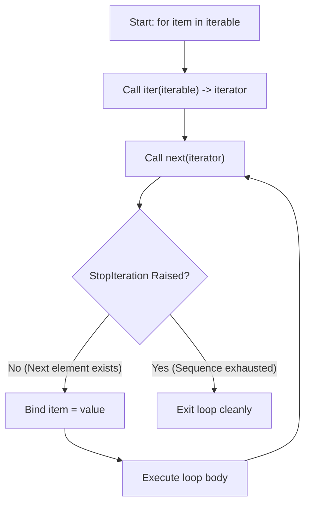
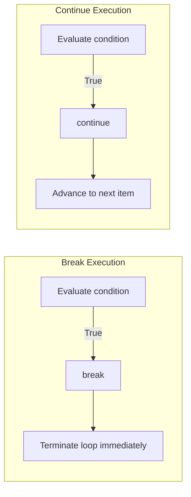
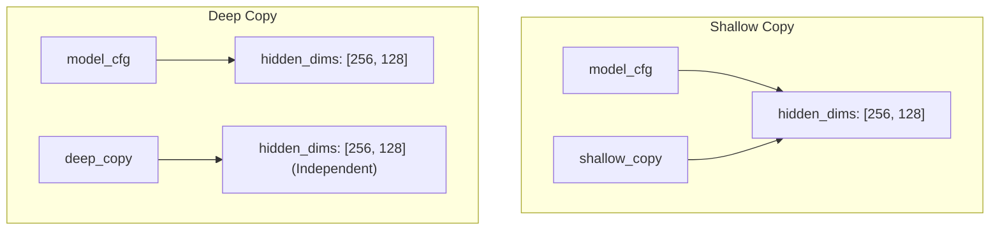

# For Loops, Dynamic Arrays, and Hash Maps: Algorithmic Iteration, Numerical Convergence, and Machine Learning Parameter Architectures

[Back to Module 02](../README.md) · [Back to the master roadmap](../../README.md)

**Session date:** 2026-11-04 · **Module:** 02 — Mathematics for Machine Learning (Calculus & Linear Algebra)  
**Format:** Comprehensive textbook-grade study guide, numerical convergence proofs, CPython data structure memory models, and executable practice notebooks

---

## Overview

In mathematical computing, numerical optimization, and applied artificial intelligence, foundational control flow and data structures are not merely syntactic conveniences—they dictate computational efficiency, algorithmic convergence, and numerical stability. Whether iteratively updating weight tensors in gradient descent, streaming mini-batches through custom data loaders, or maintaining hierarchical hyperparameter trees across distributed training clusters, proficient software design relies directly on loops, dynamic contiguous arrays, and hash tables.

Without a deep understanding of language-level execution models, developers encounter severe performance bottlenecks: quadratic memory reallocation during iterative list concatenation, subtle hyperparameter state corruption due to shallow copying, and floating-point overflow during activation computations. This session establishes a rigorous mathematical and software engineering foundation connecting core Python syntax directly to mathematical computing and machine learning workflows.

This study guide develops five foundational pillars:

1. **Iteration Protocols and Control Flow Semantics:** We formalize Python's iteration mechanics governed by the iterator protocol (`__iter__` and `__next__`), analyzing the $O(1)$ memory footprint of generator ranges (`range`) versus materializing lists in memory. We examine loop control invariants with `break` and `continue`, and explore iteration patterns with `enumerate` and strict `zip`.
2. **Numerical Series Approximations & Convergence Analysis:** We apply iterative loops to classical numerical methods. We implement and contrast the Gregory-Leibniz series ($\mathcal{O}(1/n)$ harmonic decay) and the Nilakantha series ($\mathcal{O}(1/n^3)$ cubic polynomial decay) for approximating $\pi$. We evaluate Euler's number ($e$) through the compound growth limit and the super-exponential Maclaurin/Taylor series. Furthermore, we derive the Babylonian square root algorithm from the Newton-Raphson formulation $f(x) = x^2 - N = 0$, proving its quadratic convergence rate $\epsilon_{n+1} \approx \frac{\epsilon_n^2}{2\sqrt{N}}$.
3. **Dynamic Array Architecture & List Mutation Mechanics:** We dissect CPython's `PyListObject`, exploring contiguous pointer storage, amortized $\mathcal{O}(1)$ dynamic growth via over-allocation, and the $\mathcal{O}(n)$ memory-shift cost of arbitrary insertions and deletions. We contrast in-place mutations (`.sort()`, `.reverse()`, `.pop()`) with pure functional transformations (`sorted()`, `reversed()`, slicing), and evaluate value filtering versus positional index filtering.
4. **List Comprehensions & Vectorized Activation Mapping:** We formalize list comprehension grammar, contrasting element-wise mapping, post-conditional filtering, and pre-conditional ternary branching. We bridge list comprehensions to neural network activation functions, implementing Sigmoid, ReLU, Leaky ReLU, and a numerically stable Softmax distribution that prevents exponential overflow via maximal logit shifting.
5. **Hash Tables & Machine Learning Parameter Containers:** We analyze dictionary internals, hash collisions, and open addressing in CPython. We contrast bracket indexing against defensive retrieval with `.get()` and `.setdefault()`. We explore dictionary merging (`|` and `{**d1, **d2}`), examine shallow versus deep copying hazards in nested configuration trees, and build an end-to-end hyperparameter grid search runner.

---

## Learning outcomes

By the end of this session, you should be able to:

- Formulate the execution mechanics of Python's iteration protocol, distinguishing formally between an `Iterable` (implementing `__iter__`) and an `Iterator` (implementing `__next__` and raising `StopIteration`).
- Explain the $\mathcal{O}(1)$ memory complexity of the `range(start, stop, step)` sequence type compared to explicitly materialized arrays.
- Implement early loop termination (`break`) and conditional cycle continuation (`continue`) while maintaining loop state invariants.
- Use `enumerate()` to avoid manual index tracking and use `zip(..., strict=True)` to traverse multi-sequence inputs without length mismatch silent truncation.
- Derive the Gregory-Leibniz series for $\pi$ from the Taylor expansion of $\arctan(x)$ at $x=1$, evaluating its alternating harmonic error bounds.
- Implement the Nilakantha series for $\pi$ and mathematically prove why its cubic denominator $\prod_{k=2}^4 (2i+k)$ achieves rapid $\mathcal{O}(1/n^3)$ error convergence.
- Contrast the compound interest limit definition of Euler's number $e = \lim_{n \to \infty} (1 + 1/n)^n$ with its Maclaurin series expansion $e = \sum_{k=0}^\infty \frac{1}{k!}$.
- Derive the Babylonian square root update rule $x_{n+1} = \frac{1}{2}(x_n + N/x_n)$ as a Newton-Raphson root-finding procedure on $f(x) = x^2 - N$, proving quadratic convergence.
- Analyze the internal memory layout of CPython `PyListObject` as a contiguous vector of `PyObject*` pointers, identifying amortized $\mathcal{O}(1)$ appends and $\mathcal{O}(n)$ middle insertions.
- Discriminate between in-place container mutations (`list.sort()`, `list.reverse()`, `list.pop()`) that return `None` and non-mutating constructors (`sorted()`, `reversed()`, slicing) that allocate new memory.
- Formulate the grammar of list comprehensions, distinguishing the mapping with filtering syntax `[f(x) for x in data if cond(x)]` from ternary branching `[f(x) if cond(x) else g(x) for x in data]`.
- Implement forward and derivative passes for fundamental deep learning activations (Sigmoid, ReLU, Leaky ReLU) over lists using list comprehensions.
- Implement numerically stable Softmax normalization over raw logits using the identity $\frac{e^{z_i}}{\sum_j e^{z_j}} = \frac{e^{z_i - M}}{\sum_j e^{z_j - M}}$ where $M = \max_j(z_j)$.
- Explain the hash table architecture of Python dictionaries, evaluating how key hashability (`__hash__` and `__eq__`) enables average $\mathcal{O}(1)$ key-value associations.
- Prevent runtime `KeyError` exceptions using defensive lookup idioms (`dict.get()`, `dict.setdefault()`).
- Implement dictionary merges using the unpack operator `{**d1, **d2}` and Python 3.9+ union operator `d1 | d2`.
- Diagnose and eliminate nested reference corruption hazards during hyperparameter tuning by enforcing deep copies (`copy.deepcopy()`) instead of shallow copies (`dict.copy()`).
- Architect a complete hyperparameter search and experiment runner that builds Cartesian configuration spaces, logs validation metrics, and serializes run reports.

---

## 1. Loop Execution Semantics and Iteration Mechanics

### The Python Iteration Protocol

Underlying every `for` loop in Python is the iterator protocol. When executing `for item in sequence:`, Python internally invokes the built-in `iter(sequence)`, which looks up the `__iter__()` dunder method on the container. This method returns an iterator object supporting `__next__()`.



If an iterable does not implement `__iter__()` but implements `__getitem__()` with sequential integer indices starting from 0, Python's iteration protocol provides backward compatibility by synthesizing an iterator over increasing indices until an `IndexError` is raised.

### Loop Control Flow: `break` vs. `continue`

Loop control statements alter normal sequential iteration:

1. **`break`:** Immediately terminates the enclosing loop, bypassing any remaining iterations and the optional `else` block attached to the loop.
2. **`continue`:** Immediately halts the current loop cycle, skipping all downstream statements within the body and advancing to the next iteration step.



### Lazy Evaluation with `range()`

In Python 3, `range(start, stop, step)` is an immutable sequence type rather than a list. It generates integers on demand using arithmetic progression arithmetic:

$$\text{range}(a, b, s) = \{ a + k \cdot s \mid k \in \mathbb{N}_0, \, a + k \cdot s < b \}$$

Because `range` calculates each element at runtime from index arithmetic ($x_k = \text{start} + k \cdot \text{step}$), its memory consumption is strictly $\mathcal{O}(1)$, regardless of whether the interval spans 10 or $10^9$ elements.

---

## 2. Numerical Series Approximations & Convergence Analysis

Mathematical computing relies on iterative series to evaluate transcendental constants and non-linear roots. The rate of error decay determines computational feasibility.

### Gregory-Leibniz Series for $\pi$

The Gregory-Leibniz series originates from the Maclaurin expansion of the arctangent function:

$$\arctan(x) = \sum_{k=0}^\infty \frac{(-1)^k x^{2k+1}}{2k+1} = x - \frac{x^3}{3} + \frac{x^5}{5} - \frac{x^7}{7} + \dots$$

Setting $x = 1$, since $\arctan(1) = \frac{\pi}{4}$:

$$\frac{\pi}{4} = \sum_{i=1}^\infty \frac{(-1)^{i+1}}{2i - 1} \implies \pi = 4 \sum_{i=1}^\infty \frac{(-1)^{i+1}}{2i - 1} = 4 \left( 1 - \frac{1}{3} + \frac{1}{5} - \frac{1}{7} + \frac{1}{9} - \dots \right)$$

By the Alternating Series Estimation Theorem, the truncation error after $n$ terms is bounded by the magnitude of the first neglected term:

$$|R_n| \le \frac{4}{2(n+1) - 1} \approx \frac{2}{n}$$

Because the error decays as $\mathcal{O}(1/n)$, achieving $d$ decimal digits of accuracy requires on the order of $10^d$ iterations. At $n = 1000$, the error is approximately $10^{-3}$.

### Nilakantha Accelerated Series for $\pi$

The Nilakantha series achieves significantly faster convergence through cubic denominator terms:

$$\pi = 3 + 4 \sum_{i=0}^\infty \frac{(-1)^i}{(2i+2)(2i+3)(2i+4)} = 3 + 4 \left( \frac{1}{2 \cdot 3 \cdot 4} - \frac{1}{4 \cdot 5 \cdot 6} + \frac{1}{6 \cdot 7 \cdot 8} - \dots \right)$$

Expanding the denominator polynomial:

$$D(i) = (2i+2)(2i+3)(2i+4) = 8i^3 + 36i^2 + 52i + 24$$

The terms decay as $\mathcal{O}(1/i^3)$. The truncation error after $n$ iterations satisfies:

$$|R_n| \le \frac{4}{D(n)} \approx \frac{1}{2n^3}$$

At $n = 1000$, the error is on the order of $\frac{1}{2 \times 10^9} = 5 \times 10^{-10}$, outperforming Gregory-Leibniz by over six orders of magnitude for the same number of loop iterations.

| Series Method | Formula Term $a_i$ | Asymptotic Term Decay | Truncation Error at $n=1000$ |
| :--- | :--- | :--- | :--- |
| **Gregory-Leibniz** | $\frac{4(-1)^{i+1}}{2i-1}$ | $\mathcal{O}(n^{-1})$ | $\approx 1.0 \times 10^{-3}$ |
| **Nilakantha** | $\frac{4(-1)^i}{(2i+2)(2i+3)(2i+4)}$ | $\mathcal{O}(n^{-3})$ | $\approx 2.5 \times 10^{-10}$ |

### Euler's Number ($e$): Limit vs. Maclaurin Series

Euler's number $e$ represents the base of natural logarithms. Two classical formulations demonstrate contrasting computational behavior:

#### 1. Compound Limit Definition
$$e = \lim_{n \to \infty} \left(1 + \frac{1}{n}\right)^n$$

Expanding using the Binomial Theorem:

$$\left(1 + \frac{1}{n}\right)^n = 1 + n \left(\frac{1}{n}\right) + \frac{n(n-1)}{2!} \left(\frac{1}{n^2}\right) + \dots = 1 + 1 + \frac{1 - 1/n}{2!} + \frac{(1 - 1/n)(1 - 2/n)}{3!} + \dots$$

The error decays as $\mathcal{O}(1/n)$ because $\left(1 + \frac{1}{n}\right)^n = e \left(1 - \frac{1}{2n} + \mathcal{O}\left(\frac{1}{n^2}\right)\right)$. For $n = 100{,}000$, the relative error is approximately $1.36 \times 10^{-5}$.

#### 2. Taylor/Maclaurin Series Expansion
The Taylor series of $f(x) = e^x$ centered at 0 evaluated at $x = 1$:

$$e = \sum_{k=0}^\infty \frac{1}{k!} = 1 + \frac{1}{1!} + \frac{1}{2!} + \frac{1}{3!} + \dots + \frac{1}{n!} + R_n$$

By Taylor's remainder theorem:

$$R_n = \frac{e^\xi}{(n+1)!} \quad \text{for some } \xi \in (0, 1) \implies R_n < \frac{3}{(n+1)!}$$

Because factorial growth $(n+1)!$ dominates exponential growth, the Taylor series converges super-exponentially. For $n = 10$:

$$R_{10} < \frac{3}{11!} = \frac{3}{39{,}916{,}800} \approx 7.5 \times 10^{-8}$$

Just 10 iterations achieve higher precision than $100{,}000$ iterations of the limit formulation.

### Newton's Method for Square Roots (Babylonian Algorithm)

Finding $\sqrt{N}$ is equivalent to finding the positive real root of the quadratic equation:

$$f(x) = x^2 - N = 0$$

Newton-Raphson's iterative formula for root finding is given by:

$$x_{n+1} = x_n - \frac{f(x_n)}{f'(x_n)}$$

Computing the derivative: $f'(x) = 2x$. Substituting:

$$x_{n+1} = x_n - \frac{x_n^2 - N}{2x_n} = \frac{2x_n^2 - x_n^2 + N}{2x_n} = \frac{x_n^2 + N}{2x_n} = \frac{1}{2} \left( x_n + \frac{N}{x_n} \right)$$

This is the classical Babylonian update rule.

#### Proof of Quadratic Convergence

Let $\alpha = \sqrt{N}$ be the exact root, and define the error at iteration $n$ as $\epsilon_n = x_n - \alpha$. Expressing $x_{n+1}$ in terms of $\epsilon_n$:

$$\epsilon_{n+1} = x_{n+1} - \alpha = \frac{1}{2}\left( (\alpha + \epsilon_n) + \frac{N}{\alpha + \epsilon_n} \right) - \alpha$$

Since $N = \alpha^2$:

$$\epsilon_{n+1} = \frac{1}{2}\left( \alpha + \epsilon_n + \frac{\alpha^2}{\alpha + \epsilon_n} \right) - \alpha = \frac{(\alpha + \epsilon_n)^2 + \alpha^2 - 2\alpha(\alpha + \epsilon_n)}{2(\alpha + \epsilon_n)} = \frac{\alpha^2 + 2\alpha\epsilon_n + \epsilon_n^2 + \alpha^2 - 2\alpha^2 - 2\alpha\epsilon_n}{2(\alpha + \epsilon_n)} = \frac{\epsilon_n^2}{2(\alpha + \epsilon_n)}$$

As $x_n \to \alpha$:

$$\epsilon_{n+1} \approx \frac{\epsilon_n^2}{2\sqrt{N}}$$

The error at step $n+1$ is proportional to the **square** of the error at step $n$. The number of accurate significant digits doubles with each iteration. For $N = 9$ starting at $x_0 = 4.5$, convergence to machine precision is reached in 5 iterations.

---

## 3. Python Lists: Memory Architecture, Mutations, and Complexity

### CPython Dynamic Array Model

In CPython, a list is implemented as a `PyListObject`, which wraps a variable-length contiguous array of pointers to `PyObject` instances:

```text
PyListObject
├── ob_refcnt (reference count)
├── ob_type   (&PyList_Type)
├── ob_size   (current number of elements in the list)
├── allocated (allocated memory capacity in items)
└── ob_item   --> [ PyObject*, PyObject*, PyObject*, ... ]
```

Because Python lists store pointers rather than raw primitive bytes:
1. Elements can be of heterogeneous types.
2. Fast random access $O(1)$ is guaranteed by pointer arithmetic: $\text{address}(i) = \text{base} + i \times \text{sizeof}(\text{pointer})$.
3. Cache locality is lower than contiguous C arrays (NumPy arrays) due to pointer indirection.

### Amortized $\mathcal{O}(1)$ Dynamic Resizing

To support efficient `append()` operations without reallocating memory on every insertion, CPython applies an over-allocation growth strategy:

$$\text{new\_allocated} = \text{newsize} + (\text{newsize} \gg 3) + (\text{newsize} < 9 \text{ ? } 3 : 6)$$

When the capacity is exhausted, a new contiguous memory block is allocated, pointers are copied, and the old block is released. Although a single reallocation takes $\mathcal{O}(n)$ time, it occurs so infrequently that the amortized cost per append is strictly $\mathcal{O}(1)$.

### Indexing and Slicing Algebra

Forward indexing ranges from $0$ to $n-1$. Negative indexing counts backwards from $-1$ to $-n$. Formally:

$$\text{index}_{\text{internal}} = \begin{cases} i & \text{if } i \ge 0 \\ n + i & \text{if } i < 0 \end{cases}$$

Slicing syntax `list[start:stop:step]` constructs a new list containing elements with indices:

$$k_j = \text{start} + j \cdot \text{step} \quad \text{for } j \ge 0 \text{ while } k_j < \text{stop}$$

Slicing always allocates a new list container, resulting in $\mathcal{O}(k)$ time and memory complexity, where $k$ is the slice length.

### Mutation vs. Pure Transformation Reference

| Operation | Syntax | In-Place? | Return Value | Time Complexity | Space Complexity |
| :--- | :--- | :--- | :--- | :--- | :--- |
| **Append** | `data.append(x)` | Yes | `None` | $\mathcal{O}(1)$ amortized | $\mathcal{O}(1)$ |
| **Insert** | `data.insert(idx, x)` | Yes | `None` | $\mathcal{O}(n)$ | $\mathcal{O}(1)$ |
| **Extend** | `data.extend(iterable)` | Yes | `None` | $\mathcal{O}(k)$ | $\mathcal{O}(k)$ amortized |
| **Pop End** | `data.pop()` | Yes | Element | $\mathcal{O}(1)$ | $\mathcal{O}(1)$ |
| **Pop Index** | `data.pop(idx)` | Yes | Element | $\mathcal{O}(n)$ | $\mathcal{O}(1)$ |
| **Remove Value** | `data.remove(val)` | Yes | `None` | $\mathcal{O}(n)$ | $\mathcal{O}(1)$ |
| **Clear** | `data.clear()` | Yes | `None` | $\mathcal{O}(n)$ cleanup | $\mathcal{O}(1)$ |
| **Sort** | `data.sort(reverse=False)` | Yes (Timsort) | `None` | $\mathcal{O}(n \log n)$ | $\mathcal{O}(n)$ |
| **Sorted** | `sorted(data)` | No | New `list` | $\mathcal{O}(n \log n)$ | $\mathcal{O}(n)$ |
| **Reverse** | `data.reverse()` | Yes | `None` | $\mathcal{O}(n)$ | $\mathcal{O}(1)$ |
| **Reversed** | `reversed(data)` | No | Iterator | $\mathcal{O}(1)$ | $\mathcal{O}(1)$ |

---

## 4. List Comprehensions & Vectorized Activation Functions

List comprehensions provide a concise syntax for transforming, filtering, and mapping sequences.

### Grammar Rules and Syntax Traps

There are two distinct positions for `if` conditions in list comprehensions:

1. **Filtering (Post-Condition):** Placed *after* the `for` clause. Evaluates whether the element is included in the output. No `else` branch is permitted.
   ```python
   # Correct: filters out negative numbers
   [x for x in data if x > 0]
   # SyntaxError: 'else' is invalid in a filter condition
   # [x for x in data if x > 0 else 0]
```

2. **Branching (Pre-Condition Ternary Expression):** Placed *before* the `for` clause as the expression to evaluate. Must include both `if` and `else` branches.
   ```python
   # Correct: replaces non-positive numbers with 0 (ReLU behavior)
   [x if x > 0 else 0 for x in data]
   # SyntaxError: missing required 'else' clause in ternary expression
   # [x if x > 0 for x in data]
```

### Applied Machine Learning: Neural Activations over Lists

#### 1. Logistic Sigmoid and Derivative
Maps real inputs to $(0, 1)$ probability values:

$$\sigma(x) = \frac{1}{1 + e^{-x}}, \quad \sigma'(x) = \sigma(x)(1 - \sigma(x))$$

To prevent floating-point underflow or overflow (`math.exp(-x)` when $x < -709$), values are clipped or clamped.

```python
import math


def sigmoid_list(values: list[float]) -> list[float]:
    return [1.0 / (1.0 + math.exp(-max(-700.0, min(700.0, x)))) for x in values]


def sigmoid_derivative_list(values: list[float]) -> list[float]:
    sig = sigmoid_list(values)
    return [s * (1.0 - s) for s in sig]
```

#### 2. Rectified Linear Unit (ReLU) and Leaky ReLU
The standard activation in deep learning, avoiding vanishing gradients on positive inputs:

$$\text{ReLU}(x) = \max(0, x), \quad \text{ReLU}'(x) = \begin{cases} 0 & x \le 0 \\ 1 & x > 0 \end{cases}$$

$$\text{LeakyReLU}(x, \alpha) = \begin{cases} \alpha x & x \le 0 \\ x & x > 0 \end{cases}$$

```python
def relu_list(values: list[float]) -> list[float]:
    return [x if x > 0 else 0.0 for x in values]


def relu_derivative_list(values: list[float]) -> list[float]:
    return [1.0 if x > 0 else 0.0 for x in values]


def leaky_relu_list(values: list[float], alpha: float = 0.01) -> list[float]:
    return [x if x > 0 else alpha * x for x in values]
```

#### 3. Softmax Distribution with Numerical Stability Shift
Converts a vector of real-valued logits $\mathbf{z} \in \mathbb{R}^K$ into a probability distribution $\mathbf{p} \in \Delta^K$:

$$p_i = \frac{e^{z_i}}{\sum_{j=1}^K e^{z_j}}$$

When $z_i \ge 710$, evaluating $e^{z_i}$ triggers an `OverflowError` in 64-bit IEEE-754 floating-point arithmetic. By leveraging shift invariance:

$$\frac{e^{z_i - M}}{\sum_{j=1}^K e^{z_j - M}} = \frac{e^{z_i} e^{-M}}{\sum_{j=1}^K e^{z_j} e^{-M}} = \frac{e^{z_i}}{\sum_{j=1}^K e^{z_j}} \quad \text{where } M = \max_{j} z_j$$

Because $z_i - M \le 0$ for all $i$, $e^{z_i - M} \in (0, 1]$, completely eliminating the risk of overflow.

```python
def softmax_list(logits: list[float]) -> list[float]:
    max_val = max(logits)
    shifted_exp = [math.exp(z - max_val) for z in logits]
    partition = sum(shifted_exp)
    return [val / partition for val in shifted_exp]
```

---

## 5. Dictionaries & Hash Tables in Machine Learning Workflows

### CPython Hash Map Architecture

Python's `dict` is an open-addressing hash table that uses an index array combined with an entry table. This design ensures:
- Key-value pairs preserve insertion order.
- Average time complexity for insertion, lookup, and deletion is $\mathcal{O}(1)$.
- Keys must be immutable and hashable (implementing `__hash__()` and `__eq__()`).

### Retrieval Semantics: Bracket vs. `.get()` vs. `.setdefault()`

```python
params = {"learning_rate": 0.01, "optimizer": "Adam"}

# 1. Bracket lookup: raises KeyError if absent
lr = params["learning_rate"]

# 2. .get(): returns default (or None) if absent without mutating
wd = params.get("weight_decay", 1e-4)  # returns 1e-4, params unchanged

# 3. .setdefault(): returns default AND inserts into dict if absent
bs = params.setdefault("batch_size", 64)  # inserts 'batch_size': 64 into params
```

### Merging and Deletion Operations

In Python 3.9+, dictionaries support the union operator `|` and in-place update `|=`:

```python
base_cfg = {"lr": 0.01, "batch_size": 32}
override_cfg = {"lr": 0.001, "epochs": 50}

# Union operator (right operand takes precedence on key collisions)
merged = base_cfg | override_cfg
# Equivalent unpack syntax:
merged_unpack = {**base_cfg, **override_cfg}
```

Deletion methods:
- `del d[k]`: Removes key `k`; raises `KeyError` if absent.
- `d.pop(k, default)`: Removes key `k` and returns its value; returns `default` if absent.
- `d.popitem()`: Removes and returns the last inserted `(key, value)` pair in LIFO order.
- `d.clear()`: Empties the dictionary in-place.

### Shallow vs. Deep Copying in Hyperparameter Trees

A shallow copy (`d.copy()`) creates a new dictionary container, but any nested objects (e.g., lists or sub-dictionaries) remain shared by reference. A deep copy (`copy.deepcopy()`) recursively clones all nested containers.



In hyperparameter optimization, modifying a shallow copy's nested list mutates the base configuration across all downstream trials, corrupting experiment tracking. Enforcing `copy.deepcopy()` ensures strict trial isolation.

---

## 6. Algorithmic Complexity and Convergence Comparison

### Data Structure Time & Space Complexity

| Operation | Python List | Python Dictionary | Python Set |
| :--- | :--- | :--- | :--- |
| **Lookup by Index / Key** | $\mathcal{O}(1)$ | $\mathcal{O}(1)$ average / $\mathcal{O}(n)$ worst | $\mathcal{O}(1)$ average (membership) |
| **Insertion at End** | $\mathcal{O}(1)$ amortized | $\mathcal{O}(1)$ average | $\mathcal{O}(1)$ average |
| **Arbitrary Insertion** | $\mathcal{O}(n)$ | $\mathcal{O}(1)$ average | $\mathcal{O}(1)$ average |
| **Deletion at End** | $\mathcal{O}(1)$ | $\mathcal{O}(1)$ average (`popitem`) | $\mathcal{O}(1)$ average (`pop`) |
| **Arbitrary Deletion** | $\mathcal{O}(n)$ | $\mathcal{O}(1)$ average | $\mathcal{O}(1)$ average |
| **Iteration over $n$ items**| $\mathcal{O}(n)$ | $\mathcal{O}(n)$ | $\mathcal{O}(n)$ |
| **Space Overhead** | Dynamic array padding | Sparse index table + compact array | Sparse hash table entries |

### Numerical Approximation Convergence Comparison

| Problem | Method | Recurrence / Summation | Convergence Order | Iterations for $10^{-8}$ Error |
| :--- | :--- | :--- | :--- | :--- |
| $\pi$ Estimation | Gregory-Leibniz | $4 \sum_{i=1}^n \frac{(-1)^{i+1}}{2i-1}$ | Linear ($\mathcal{O}(n^{-1})$) | $\sim 2 \times 10^8$ |
| $\pi$ Estimation | Nilakantha | $3 + 4 \sum_{i=0}^{n-1} \frac{(-1)^i}{(2i+2)(2i+3)(2i+4)}$ | Cubic ($\mathcal{O}(n^{-3})$) | $\sim 2{,}000$ |
| $e$ Estimation | Compound Limit | $(1 + 1/n)^n$ | Linear ($\mathcal{O}(n^{-1})$) | $\sim 1.3 \times 10^8$ |
| $e$ Estimation | Maclaurin Series | $\sum_{k=0}^n \frac{1}{k!}$ | Super-exponential ($\mathcal{O}((n!)^{-1})$) | $11$ |
| $\sqrt{N}$ Estimation | Newton-Raphson | $x_{n+1} = \frac{1}{2}(x_n + N/x_n)$ | Quadratic ($\epsilon_{n+1} \propto \epsilon_n^2$) | $5 \dots 7$ |

---

## Session Map

| Notebook | Focus | Key Topics |
| :--- | :--- | :--- |
| [01 · Loops & Numerical Methods](notebooks/01-loops-and-numerical-methods.ipynb) | Iteration Protocols & Series Approximation | `range`, `break`, `continue`, `enumerate`, `zip`, Gregory-Leibniz $\pi$, Nilakantha $\pi$, Euler's number ($e$), Newton's square root |
| [02 · List Architecture & Algorithms](notebooks/02-list-architecture-and-algorithms.ipynb) | Dynamic Arrays & In-Place Mutations | Indexing, slicing, `.append`, `.insert`, `.extend`, `.pop`, `.sort` vs `sorted`, `.reverse` vs `reversed`, sum even values vs even indices |
| [03 · List Comprehensions & ML Activations](notebooks/03-list-comprehensions-and-ml-activations.ipynb) | Vectorized Comprehensions & Neural Activations | Mapping vs filtering vs branching, syntax traps, Sigmoid & derivative, ReLU & derivative, Leaky ReLU, stable Softmax |
| [04 · Dictionary Mechanics & Hash Tables](notebooks/04-dictionary-mechanics-and-hash-tables.ipynb) | Hash Maps & Hyperparameter State | Dict comprehensions, `.get` vs `.setdefault`, `.pop` vs `.popitem`, union operator `\|`, shallow vs deepcopy memory hazards |
| [05 · Applied ML Pipeline Integration](notebooks/05-applied-ml-pipeline-integration.ipynb) | End-to-End Experiment Management | Cartesian product hyperparameter grid search, simulated training loops, metric sorting, JSON report serialization |

### Data Assets

- [`data/numerical_series_benchmarks.json`](data/numerical_series_benchmarks.json): Reference parameters, analytical formulas, and ground truth values for Pi series, Euler's number, and Newton-Raphson root finding.
- [`data/ml_hyperparameters.json`](data/ml_hyperparameters.json): Hierarchical machine learning experiment configuration schema used to demonstrate dictionary updates and deep copy validation.
- [`data/activation_inputs.csv`](data/activation_inputs.csv): Scalar input vectors spanning negative, zero, and positive real regimes with ground truth Sigmoid, ReLU, and Leaky ReLU activations.
- [`data/README.md`](data/README.md): Complete schema documentation for all session data fixtures.
