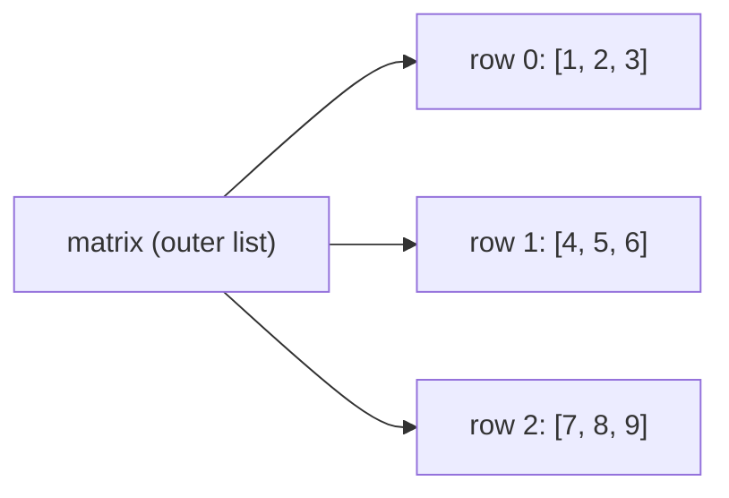

# Lists for 2D Data: Nested Memory Models, Matrix Operations, and Spatial Algorithms

[Back to Module 02](../README.md) · [Back to the master roadmap](../../README.md)

**Session date:** 2026-11-10 · **Module:** 02 — Mathematics for Machine Learning (Calculus & Linear Algebra)  
**Format:** Textbook-grade study guide, memory-architecture analysis, pure-Python matrix algorithms, and interactive notebooks

---

## Overview

Before transitioning to vectorized NumPy `ndarray` structures, it is essential to master how two-dimensional (2D) data—such as mathematical matrices, tabular feature grids, grayscale images, and dynamic programming tables—is represented and manipulated using Python's native nested lists (`list[list[T]]`). Every linear algebra operation, image convolution, and spatial transformation reduces to nested indexing invariants, row/column reductions, and memory-layout discipline.

A surprisingly common source of silent bugs in scientific Python code is misunderstanding how CPython allocates nested lists. Multiplying a list of lists (`[[0] * W] * H`) duplicates *references* to a single row object rather than allocating $H$ distinct rows, causing a single write at `(i, j)` to corrupt every row simultaneously. Conversely, building explicit list comprehensions (`[[0] * W for _ in range(H)]`) yields independent row containers whose aliasing, slicing, and copying semantics must be handled explicitly.

> **Curriculum note:** No raw slide archive was bundled for session `230530`; this study guide and its companion notebooks synthesize the complete Module 02 syllabus for **List for 2D data**, bridging pure-Python 2D structures directly to matrix calculus and image processing.

This guide develops five core pillars:

1. **Nested List Memory Architecture & Aliasing Hazards:** Dissecting CPython's pointer-to-pointer representation of 2D lists, diagnosing shallow-multiplication aliasing (`[[0] * cols] * rows`), and enforcing deep-copy isolation.
2. **Coordinate Systems, Indexing, and Traversal Patterns:** Formalizing $(i, j) \equiv (\text{row}, \text{col})$ conventions, row-major vs. column-major scans, diagonal and anti-diagonal extraction, and rectangular shape validation.
3. **Matrix Transformations & Linear Algebra from First Principles:** Implementing transpose ($A^\top$), row/column aggregations, sorting rows by aggregate keys, and general matrix multiplication ($C = AB$) with explicit shape invariants.
4. **Spatial Algorithms on 2D Grids:** Implementing zero-padding, valid 2D discrete convolution / correlation kernels, and 2D prefix sums (integral images) for $\mathcal{O}(1)$ rectangular patch queries.
5. **Transitioning from Nested Lists to Contiguous NumPy Arrays:** Contrasting pointer-chasing latency in `list[list[float]]` against contiguous stride-based buffers in `numpy.ndarray`.

---

## Learning outcomes

By the end of this session, you should be able to:

- Diagnose and eliminate the shallow list-multiplication aliasing bug (`[[0] * W] * H`) using `id()` inspection and list-comprehension row allocation (`[[0] * W for _ in range(H)]`).
- Explain the distinction between shallow copying (`matrix.copy()` or `matrix[:]`) and deep copying (`copy.deepcopy(matrix)` or `[row[:] for row in matrix]`) for 2D grids.
- Implement row-major, column-major, main-diagonal ($i = j$), and anti-diagonal ($i + j = n - 1$) traversals with explicit rectangular and square shape validation.
- Implement matrix transpose $A^\top_{j,i} = A_{i,j}$, 90-degree rotation, and row-wise key sorting (`sorted(matrix, key=sum)`).
- Derive and implement pure-Python matrix multiplication $(AB)_{i,j} = \sum_{k=0}^{K-1} A_{i,k} B_{k,j}$ for compatible shapes $(M \times K)$ and $(K \times N)$, verifying time complexity $\mathcal{O}(MKN)$.
- Implement 2D zero-padding and 2D discrete cross-correlation (sliding-window convolution) on grayscale image patches.
- Construct a 2D prefix-sum table (integral image) and compute arbitrary rectangular region sums in $\mathcal{O}(1)$ time via inclusion–exclusion.
- Convert cleanly between `list[list[T]]` and `numpy.ndarray`, articulating the memory-contiguity and vectorization trade-offs.

---

## 1. Nested List Memory Model & Aliasing Hazards

### 1.1 Pointer-of-Pointers Representation

Unlike a NumPy `ndarray`, which stores homogeneous numeric values in a single contiguous C-level byte buffer indexed by strides, a Python 2D list `matrix` of shape $(H, W)$ is an array of $H$ pointers, each pointing to a separate `PyListObject` row of $W$ element pointers:



Because each row is an independent `list` object on the heap, rows can theoretically even have different lengths (*jagged arrays*), though mathematical matrices and images require uniform row length $W$ across all $H$ rows.

### 1.2 The Shallow-Multiplication Trap

Consider two ways to initialize a $3 \times 4$ grid of zeros:

```python
# BUG: Shallow reference multiplication
bad_grid = [[0] * 4] * 3
bad_grid[0][1] = 99
print(bad_grid)
# [[0, 99, 0, 0], [0, 99, 0, 0], [0, 99, 0, 0]]
```

In `[[0] * 4] * 3`, Python evaluates `[0] * 4` **once**, creating a single inner list object at memory address `id_r`, and then repeats its reference three times in the outer list (`id(bad_grid[0]) == id(bad_grid[1]) == id(bad_grid[2])`).

The correct pattern uses a list comprehension so the inner expression `[0] * cols` executes independently on each iteration:

```python
rows, cols = 3, 4
good_grid = [[0] * cols for _ in range(rows)]
good_grid[0][1] = 99
# [[0, 99, 0, 0], [0, 0, 0, 0], [0, 0, 0, 0]]
```

Note that `[0] * cols` is safe for the inner dimension **only** because integers (`0`), floats, and strings are **immutable** in Python; reassigning `good_grid[0][1] = 99` rebinds that slot to a new `int` object rather than mutating `0`. If the elements themselves were mutable objects (such as empty lists `[]` or dicts `{}`), you would need nested comprehensions: `[[[] for _ in range(cols)] for _ in range(rows)]`.

### 1.3 Shallow vs. Deep Copy of 2D Matrices

Calling `matrix.copy()` or `matrix[:]` creates a new outer list, **but still shares the inner row lists**:

| Operation | Outer list new? | Inner rows new? | Safe for mutating `clone[i][j]`? |
| :--- | :---: | :---: | :---: |
| `clone = matrix` | No | No | No |
| `clone = matrix.copy()` | Yes | No | No |
| `clone = [row[:] for row in matrix]` | Yes | Yes | Yes (for immutable scalars) |
| `clone = copy.deepcopy(matrix)` | Yes | Yes | Yes (for arbitrary nesting) |

---

## 2. Coordinate Conventions, Shape Validation, and Traversals

### 2.1 Row-Major Matrix Coordinates

In Python, NumPy, and OpenCV, 2D arrays use **row-major $(i, j)$ indexing**:
- $i \in \{0, 1, \dots, H - 1\}$ indexes the **row** (vertical axis / height $H$, increasing downward).
- $j \in \{0, 1, \dots, W - 1\}$ indexes the **column** (horizontal axis / width $W$, increasing rightward).

Always validate rectangular invariants before running matrix algorithms:

```python
def matrix_shape(matrix: list[list[float]]) -> tuple[int, int]:
    """Validate that *matrix* is non-empty and rectangular, returning (rows, cols)."""
    if not matrix or not matrix[0]:
        raise ValueError("Matrix must be non-empty.")
    cols = len(matrix[0])
    if any(len(row) != cols for row in matrix):
        raise ValueError("All rows must have identical length.")
    return len(matrix), cols
```

### 2.2 Diagonals and Column Extraction

For a square matrix $A \in \mathbb{R}^{n \times n}$:
- **Main diagonal (trace elements):** $A_{i, i}$ for $i = 0, \dots, n - 1$. The trace is $\operatorname{tr}(A) = \sum_{i=0}^{n-1} A_{i, i}$.
- **Anti-diagonal (secondary diagonal):** $A_{i, n - 1 - i}$ for $i = 0, \dots, n - 1$.
- **Column slice $j$:** `[row[j] for row in matrix]`. Unlike row access `matrix[i]` ($\mathcal{O}(1)$), column extraction requires $\mathcal{O}(H)$ time because column elements are scattered across $H$ separate inner lists.

---

## 3. Matrix Transformations & Multiplication

### 3.1 Transpose and Rotation

Given $A \in \mathbb{R}^{H \times W}$, the transpose $A^\top \in \mathbb{R}^{W \times H}$ satisfies:

$$(A^\top)_{j, i} = A_{i, j} \quad \text{for } 0 \le i < H, \; 0 \le j < W$$

In Python, transpose can be written cleanly either with nested comprehensions or with `zip(*A)`:

```python
def transpose(matrix: list[list[float]]) -> list[list[float]]:
    rows, cols = matrix_shape(matrix)
    return [[matrix[i][j] for i in range(rows)] for j in range(cols)]
```

A $90^\circ$ clockwise rotation of a square or rectangular matrix is simply a **transpose followed by reversing each row** (`[row[::-1] for row in transpose(matrix)]`).

### 3.2 Matrix Multiplication

Given $A \in \mathbb{R}^{M \times K}$ and $B \in \mathbb{R}^{K \times N}$, their matrix product $C = A B \in \mathbb{R}^{M \times N}$ is defined element-wise as the inner product of row $i$ of $A$ with column $j$ of $B$:

$$C_{i, j} = \sum_{k=0}^{K-1} A_{i, k} B_{k, j}$$

Notice the strict inner-dimension contract: `cols(A) == rows(B) == K`. The naive triple-loop algorithm requires $\mathcal{O}(M K N)$ multiply–accumulate operations:

```python
def matmul(a: list[list[float]], b: list[list[float]]) -> list[list[float]]:
    m, k_a = matrix_shape(a)
    k_b, n = matrix_shape(b)
    if k_a != k_b:
        raise ValueError(f"Incompatible shapes ({m}, {k_a}) and ({k_b}, {n}).")

    c = [[0.0] * n for _ in range(m)]
    for i in range(m):
        for k in range(k_a):
            a_ik = a[i][k]
            for j in range(n):
                c[i][j] += a_ik * b[k][j]
    return c
```

Notice the loop order `i -> k -> j` instead of `i -> j -> k`: hoisting `a_ik = a[i][k]` and scanning `b[k]` sequentially improves spatial locality across row `b[k]` and row `c[i]`.

---

## 4. Spatial Algorithms: Padding, 2D Convolution, and Prefix Sums

### 4.1 Zero-Padding and Valid 2D Cross-Correlation

In computer vision and convolutional neural networks (CNNs), an image $I \in \mathbb{R}^{H \times W}$ is transformed by sliding a small kernel $K \in \mathbb{R}^{k_h \times k_w}$ across spatial locations:

$$(I \star K)_{i, j} = \sum_{u=0}^{k_h - 1} \sum_{v=0}^{k_w - 1} I_{i + u, \, j + v} \cdot K_{u, v}$$

Without padding, the valid output has dimensions $(H - k_h + 1) \times (W - k_w + 1)$. Adding $p$ layers of zeros around the border expands the padded grid to $(H + 2p) \times (W + 2p)$, preserving spatial resolution when $p = \lfloor k / 2 \rfloor$ for odd kernel size $k$.

### 4.2 2D Prefix Sums (Integral Image)

When computing many rectangular patch sums (e.g., Haar-like features or fast box blurs), recomputing $\sum_{r=r_1}^{r_2} \sum_{c=c_1}^{c_2} I_{r,c}$ takes $\mathcal{O}(HW)$ per query. By precomputing a $(H + 1) \times (W + 1)$ integral table $P$ with 1-indexed padding:

$$P_{i, j} = I_{i-1, j-1} + P_{i-1, j} + P_{i, j-1} - P_{i-1, j-1}$$

any submatrix sum over rows $[r_1, r_2]$ and columns $[c_1, c_2]$ (inclusive, 0-indexed) is answered in $\mathcal{O}(1)$ time:

$$\text{Sum}(r_1..r_2, c_1..c_2) = P_{r_2 + 1, c_2 + 1} - P_{r_1, c_2 + 1} - P_{r_2 + 1, c_1} + P_{r_1, c_1}$$

---

## 5. Bridging to NumPy

Converting a validated 2D Python list to a NumPy array (`arr = np.asarray(matrix, dtype=np.float64)`) packs all elements into a single contiguous C buffer. Operations like `arr @ arr_b` delegate to BLAS (`DGEMM`), typically achieving $50\times$–$500\times$ speedups over pure-Python triple loops for non-trivial matrix sizes while preserving identical mathematical semantics.

---

## Notebooks

| Notebook | Focus |
| :--- | :--- |
| [`01_2d_list_creation_and_memory_model.ipynb`](notebooks/01_2d_list_creation_and_memory_model.ipynb) | Heap layout, shallow-multiplication bug, shallow vs. deep copies, shape validation |
| [`02_matrix_traversal_and_transformations.ipynb`](notebooks/02_matrix_traversal_and_transformations.ipynb) | Diagonals, column extraction, transpose, 90° rotation, row-sum sorting |
| [`03_matrix_multiplication_and_2d_convolution.ipynb`](notebooks/03_matrix_multiplication_and_2d_convolution.ipynb) | Pure-Python `matmul`, zero-padding, 2D box filtering, 2D prefix sums, NumPy comparison |

---

## References

- Python Software Foundation, *Data Structures & Nested List Comprehensions*: <https://docs.python.org/3/tutorial/datastructures.html>
- Deisenroth, M. P., Faisal, A. A., & Ong, C. S., *Mathematics for Machine Learning*, Chapter 2 (Linear Algebra).
- Viola, P., & Jones, M. (2001), *Rapid Object Detection using a Boosted Cascade of Simple Features* (Integral Image / 2D Prefix Sum).
