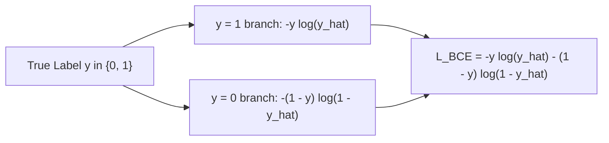

# Constructing Loss Functions for Different Targets: Exponentials, Logarithms, Cross-Entropy, and Focal Loss

[Back to Module 02](../README.md) · [Back to the master roadmap](../../README.md)

**Session date:** 2026-11-11 · **Module:** 02 — Mathematics for Machine Learning (Calculus & Linear Algebra)  
**Format:** Textbook-grade study guide, mathematical derivations, numerical stability analysis, and executable notebooks

---

## Overview

Loss functions translate a learning objective—predicting a continuous quantity, estimating a probability distribution, or separating rare hard examples from abundant easy ones—into a smooth, differentiable scalar penalty. Designing those objectives requires fluency with two inverse families of elementary functions: **exponentials** and **logarithms**. Exponentials convert unconstrained real logits into positive weights and valid probability distributions (via Sigmoid and Softmax), while logarithms convert products of likelihoods into additive sums, prevent floating-point underflow, and sharply penalize confident misclassifications.

This session progresses systematically from the algebraic laws of exponents and logarithms to the derivation of **Binary Cross-Entropy (BCE)** and **Focal Loss** for imbalanced classification:

1. **Exponential Functions & Continuous Modeling:** Exponent laws, compound growth limits defining Euler's number $e$, 1D/2D Gaussian densities, and bilateral spatial-range smoothing.
2. **Squashing & Normalization Functions:** Logistic Sigmoid, hyperbolic functions ($\sinh, \cosh, \tanh$), and Softmax normalization—including the Log-Sum-Exp / max-shift trick that eliminates exponential overflow.
3. **Logarithms, Complexity, & Maximum Likelihood:** Logarithm laws, change of base, $\mathcal{O}(\log_2 N)$ binary search complexity, and how $\log$-monotonicity turns likelihood products into concave sums.
4. **Designing Evaluation & Loss Functions:** Why discrete 0–1 classification accuracy fails as an optimization objective, and how combining $-\log(\hat{y})$ and $-\log(1 - \hat{y})$ yields Binary Cross-Entropy.
5. **Handling Severe Class Imbalance with Focal Loss:** Analyzing why easy majority-class signals overwhelm hard minority examples under BCE, and deriving the modulating factor $(1 - \hat{y})^\gamma$ and $\hat{y}^\gamma$ in Focal Loss.

---

## Learning outcomes

By the end of this session, you should be able to:

- State and prove the core laws of exponents ($a^x a^y = a^{x+y}$, $a^x/a^y = a^{x-y}$, $(a^x)^y = a^{xy}$, $a^{-x} = 1/a^x$, $a^{p/q} = \sqrt[q]{a^p}$) and apply them to exponential growth and continuous compounding ($A(t) = A e^{rt}$).
- Implement 1D Gaussian probability density functions and explain how Gaussian spatial and range kernels combine in edge-preserving bilateral filtering.
- Implement the logistic Sigmoid $\sigma(u) = \frac{1}{1 + e^{-u}}$ and hyperbolic tangent $\tanh(x)$, distinguishing their output intervals $(0, 1)$ and $(-1, 1)$.
- Explain why naive Softmax overflows floating-point precision on large logits (e.g., $[1000, 1001, 1002]$) and implement numerically stable max-shifted Softmax $\frac{e^{x_i - m}}{\sum_j e^{x_j - m}}$ with $m = \max(\mathbf{x})$.
- Prove the product, quotient, and power laws of logarithms and convert between arbitrary bases via $\log_a x = \frac{\log_b x}{\log_b a}$.
- Connect logarithms to algorithmic complexity ($\mathcal{O}(N)$ linear search vs. $\mathcal{O}(\log_2 N)$ binary search) and Maximum Likelihood Estimation (MLE) product-to-sum log-likelihood conversion.
- Derive Binary Cross-Entropy $\mathcal{L}_{\text{BCE}}(y, \hat{y}) = -y\log(\hat{y}) - (1-y)\log(1-\hat{y})$ from asymmetric log penalties and explain why 0–1 accuracy cannot guide gradient-based training.
- Quantify class-imbalance signal domination in BCE and derive Focal Loss $\mathcal{L}_{\text{Focal}}(y, \hat{y}, \gamma) = -y(1-\hat{y})^\gamma \log(\hat{y}) - (1-y)\hat{y}^\gamma \log(1-\hat{y})$, demonstrating how increasing $\gamma$ suppresses easy-example loss.

---

## 1. Exponential Functions and Laws of Exponents

### 1.1 Definition and Growth vs. Decay

An exponential function has the form $f(x) = a^x$ for a positive base $a > 0$ ($a \neq 1$). Unlike power functions ($x^n$), the variable sits in the exponent:

- **Exponential growth ($a > 1$):** e.g., $y = e^x$, $y = 2^x$, $y = 1.06^x$. A constant increment $\Delta x$ multiplies $y$ by a constant factor $a^{\Delta x}$.
- **Exponential decay ($0 < a < 1$):** e.g., $y = (1/2)^x = 2^{-x}$, $y = (1/6)^x$.

### 1.2 Algebraic Laws of Exponents

For any constants $a > 0, b > 0$, real numbers $x, y \in \mathbb{R}$, and integers $p, q \in \mathbb{Z}$ ($q \neq 0$):

| Law | Identity | Intuition / Proof Sketch |
| :--- | :--- | :--- |
| Product rule | $a^x a^y = a^{x+y}$ | Multiplying $x$ copies of $a$ by $y$ copies yields $x + y$ copies |
| Quotient rule | $\frac{a^x}{a^y} = a^{x-y}$ | Canceling $y$ factors of $a$ from $x$ factors |
| Power of a power | $(a^x)^y = a^{xy}$ | Multiplying $a^x$ by itself $y$ times |
| Power of a product | $(ab)^x = a^x b^x$ | Regrouping $x$ copies of $a$ and $b$ into $x$ pairs $(ab)$ |
| Power of a quotient | $\left(\frac{a}{b}\right)^x = \frac{a^x}{b^x}$ | Distributing the exponent across numerator and denominator |
| Zero & negative exponents | $a^0 = 1, \quad a^{-x} = \frac{1}{a^x}$ | Follows from $a^0 = a^{x-x} = a^x / a^x = 1$ |
| Rational exponents | $a^{p/q} = \sqrt[q]{a^p}$ | Since $(a^{1/q})^q = a$, $a^{1/q} = \sqrt[q]{a}$ |

### 1.3 Growth Models and Continuous Compounding ($e$)

1. **Annual population growth ($6\%$ rate):** Starting from $P_0$, $P_t = P_0 (1 + 0.06)^t = P_0 (1.06)^t$.
2. **Bacterial doubling every 4 hours:** Starting with $N_0 = 1000$, $N(t) = 1000 \cdot 2^{t/4}$. After $t = 6$ hours, $N(6) = 1000 \cdot 2^{6/4} \approx 2828$.
3. **Continuous compounding & Euler's number:** Compounding principal $A$ at annual rate $r$, $n$ times per year for $t$ years, gives $A(t) = A \left(1 + \frac{r}{n}\right)^{nt}$. Setting $m = n/r$:

$$A(t) = A \left[\left(1 + \frac{1}{m}\right)^m\right]^{rt} \xrightarrow{m \to \infty} A e^{rt}, \quad \text{where } e = \lim_{m \to \infty}\left(1 + \frac{1}{m}\right)^m \approx 2.71828$$

For example, investing $\$5{,}000$ at $r = 6\%$ compounded continuously for $30$ years yields $5000 e^{0.06 \times 30} \approx \$30{,}248$.

### 1.4 Gaussian Density and Bilateral Filtering

The 1D Gaussian probability density function with mean $\mu$ and variance $\sigma^2 > 0$ uses negative quadratic exponents to concentrate mass smoothly around $\mu$:

$$f(x) = \frac{1}{\sqrt{2\pi\sigma^2}} \exp\!\left(-\frac{(x - \mu)^2}{2\sigma^2}\right), \qquad -\infty < x < \infty$$

In 2D image processing, standard Gaussian smoothing weights neighbor pixels solely by spatial distance $\|p - q\|_2^2$. A **bilateral filter** multiplies the spatial Gaussian weight by an intensity/color-difference Gaussian weight $\exp\bigl(-\frac{(I(p) - I(q))^2}{2\sigma_r^2}\bigr)$, attenuating noise in flat regions without blurring across sharp intensity edges.

---

## 2. Squashing Functions and Numerically Stable Softmax

### 2.1 Sigmoid and Hyperbolic Functions

To map unbounded neural network outputs (logits) $u \in (-\infty, \infty)$ into bounded intervals:

- **Logistic Sigmoid:**
  $$\sigma(u) = \frac{1}{1 + e^{-u}} \in (0, 1)$$
  Sigmoid is monotonically non-decreasing ($u_1 \le u_2 \implies \sigma(u_1) \le \sigma(u_2)$) and naturally models binary class probabilities $\hat{y} = P(y = 1 \mid x)$.
- **Hyperbolic Functions:**
  $$\cosh(x) = \frac{e^x + e^{-x}}{2}, \qquad \sinh(x) = \frac{e^x - e^{-x}}{2}, \qquad \tanh(x) = \frac{\sinh(x)}{\cosh(x)} = \frac{e^x - e^{-x}}{e^x + e^{-x}} \in (-1, 1)$$

### 2.2 Softmax and Overflow Stabilization

For multi-class classification over $K$ classes, **Softmax** converts a logit vector $\mathbf{x} = (x_1, \dots, x_K)$ into a valid probability simplex vector:

$$f(x_i) = \frac{e^{x_i}}{\sum_{j=1}^K e^{x_j}}, \qquad 0 \le f(x_i) \le 1, \qquad \sum_{i=1}^K f(x_i) = 1$$

For $\mathbf{x} = [1.0, 2.0, 3.0]$, Softmax produces $[0.0900, 0.2447, 0.6652]$. However, because $e^x$ grows super-exponentially on $[0, \infty)$, computing `math.exp(1000.0)` directly overflows IEEE-754 double precision (`~1.8e308`), raising `OverflowError` or yielding `nan` (`inf / inf`).

To stabilize Softmax without altering its mathematical value, factor out $e^m$ where $m = \max_j x_j$:

$$f(x_i) = \frac{e^{x_i}}{\sum_j e^{x_j}} = \frac{e^{-m} e^{x_i}}{e^{-m} \sum_j e^{x_j}} = \frac{e^{x_i - m}}{\sum_{j=1}^K e^{x_j - m}}$$

Because $x_i - m \le 0$ for every $i$, every exponent satisfies $e^{x_i - m} \in (0, 1]$, completely eliminating overflow while guaranteeing at least one denominator term equals $e^0 = 1$ (preventing division by zero).

---

## 3. Logarithmic Functions, Complexity, and Optimization

### 3.1 Definition, Laws, and Change of Base

Because $f(y) = a^y$ ($a > 0, a \neq 1$) is strictly one-to-one, its inverse is the logarithm base $a$:

$$\log_a(x) = y \iff a^y = x, \qquad \text{Domain: } (0, \infty), \quad \text{Range: } (-\infty, \infty)$$

Key identities (for $a, b, c > 0$, $a \neq 1$, $r \in \mathbb{R}$):

- **Product rule:** $\log_a(bc) = \log_a b + \log_a c$
  *(Proof: let $m = \log_a b \implies a^m = b$ and $n = \log_a c \implies a^n = c$. Then $bc = a^{m+n} \implies \log_a(bc) = m + n = \log_a b + \log_a c$.)*
- **Quotient rule:** $\log_a\left(\frac{b}{c}\right) = \log_a b - \log_a c$
- **Power rule:** $\log_a(b^r) = r \log_a b$
  *(Proof: $b = a^m \implies b^r = a^{mr} \implies \log_a(b^r) = mr = r \log_a b$.)*
- **Inverse cancellations:** $\log_a(a^x) = x$ and $a^{\log_a x} = x$.
- **Natural logarithm:** $\ln x \equiv \log_e x$, with $\ln e = 1$, $\ln 1 = 0$, $\ln(e^5) = 5$.
- **Change of base ($a, b > 0; \, a, b \neq 1; \, x > 0$):**
  $$\log_a x = \frac{\log_b x}{\log_b a}$$

### 3.2 Logarithms in Algorithm Analysis

Logarithms answer: *"How many times must we multiply or divide by the base to reach $N$?"*
- **Linear Search ($\mathcal{O}(N)$):** Inspecting elements sequentially takes up to $N$ comparisons in the worst case.
- **Binary Search ($\mathcal{O}(\log_2 N)$):** Halving a sorted search space at every comparison reduces $N = 8$ items to at most $\log_2(8) = 3$ steps (in computer science, $\log$ without a subscript defaults to base $2$).

### 3.3 Monotonicity in Machine Learning & Maximum Likelihood Estimation

Because $\log$ is strictly monotonically increasing on $(0, \infty)$ ($0 < x_1 \le x_2 \implies \log x_1 \le \log x_2$), applying $\log$ preserves the relative ordering of positive numbers and **preserves the exact location of optima**:

$$\arg\max_\theta f(\theta) = \arg\max_\theta \log f(\theta)$$

In Maximum Likelihood Estimation (MLE) over i.i.d. training samples $x_1, \dots, x_n$:

$$\arg\max_\theta \prod_{i=1}^n P_\theta(x_i) = \arg\max_\theta \sum_{i=1}^n \log P_\theta(x_i)$$

Taking the logarithm accomplishes three critical goals simultaneously:
1. Converts products into sums, simplifying derivatives.
2. Prevents floating-point underflow when multiplying thousands of small probabilities ($P_\theta(x_i) \ll 1$).
3. Transforms bell-shaped exponential likelihoods (e.g., Gaussian $f(x)$) into concave quadratic objectives $\log f(x)$ that are much easier to optimize.

---

## 4. Designing Loss Functions for Binary Classification

### 4.1 Why 0–1 Accuracy Fails as a Training Loss

Consider a binary classification problem ($y \in \{0, 1\}$) where a model outputs a confidence score $\hat{y} \in (0, 1)$. A hard threshold metric:

$$f(\hat{y}, y) = \begin{cases} 1 & \text{if } (y = 0 \text{ and } \hat{y} \le 0.5) \text{ or } (y = 1 \text{ and } \hat{y} > 0.5) \\ 0 & \text{otherwise} \end{cases}$$

yields discrete accuracy (e.g., $5/8$), which has two fatal flaws for optimization:
1. **Zero gradient almost everywhere:** Small weight updates do not change the step function output unless a prediction crosses $0.5$.
2. **Insensitive to confidence:** A correct prediction with $\hat{y} = 0.51$ receives the same score as $\hat{y} = 0.99$, and a disastrous error ($\hat{y} = 0.99$ when $y = 0$) receives the same penalty as $\hat{y} = 0.51$.

### 4.2 Deriving Binary Cross-Entropy (BCE)

To penalize confident mistakes severely while rewarding confident correct predictions smoothly, we assign asymmetric log penalties per class:
- When $y = 1$: $\mathcal{L}(\hat{y}) = -\log(\hat{y})$ (approaches $0$ as $\hat{y} \to 1$, approaches $+\infty$ as $\hat{y} \to 0$).
- When $y = 0$: $\mathcal{L}(\hat{y}) = -\log(1 - \hat{y})$ (approaches $0$ as $\hat{y} \to 0$, approaches $+\infty$ as $\hat{y} \to 1$).

Using the binary indicator $y \in \{0, 1\}$ to eliminate conditional branching yields **Binary Cross-Entropy**:

$$\mathcal{L}_{\text{BCE}}(y, \hat{y}) = -y \log(\hat{y}) - (1 - y) \log(1 - \hat{y})$$

---

## 5. Class Imbalance and Focal Loss

### 5.1 Why Standard BCE Struggles Under Severe Class Imbalance

Suppose a dataset contains $100{,}000$ easy background samples (each with small BCE loss $0.1$) and $100$ hard foreground samples (each with high BCE loss $2.3$):
- Total easy-sample loss: $100{,}000 \times 0.1 = 10{,}000$
- Total hard-sample loss: $100 \times 2.3 = 230$

The easy examples overwhelm the hard examples by a ratio of $10{,}000 : 230 \approx 43 : 1$, dominating the gradient update and preventing the model from focusing on rare, difficult cases.

### 5.2 Deriving the Focal Loss Modulating Factor

To down-weight well-classified (easy) examples automatically, multiply each branch of BCE by a modulating factor $k^\gamma$ with focusing parameter $\gamma \ge 0$, where $k \in [0, 1]$ measures prediction error:
- For $y = 1$: $k = 1 - \hat{y}$. When $\hat{y} \to 1$ (easy), $k \to 0 \implies (1 - \hat{y})^\gamma$ shrinks the loss dramatically; when $\hat{y} \to 0$ (hard), $k \to 1 \implies (1 - \hat{y})^\gamma \approx 1$ preserves the penalty.
- For $y = 0$: $k = \hat{y}$. When $\hat{y} \to 0$ (easy), $\hat{y}^\gamma$ suppresses the loss; when $\hat{y} \to 1$ (hard), $\hat{y}^\gamma \approx 1$.

Combining both cases gives **Focal Loss** (Lin et al., *Focal Loss for Dense Object Detection*, ICCV 2017):

$$\mathcal{L}_{\text{Focal}}(y, \hat{y}, \gamma) = -y (1 - \hat{y})^\gamma \log(\hat{y}) - (1 - y) \hat{y}^\gamma \log(1 - \hat{y})$$

Notice that setting $\gamma = 0$ recovers standard Binary Cross-Entropy exactly. On a 10-sample imbalanced batch with 1 hard negative (`y=0, y_hat=0.7`) and 9 confident positives (`y=1, y_hat in [0.7, 0.9]`), increasing $\gamma$ from $0$ to $4$ drops the summed easy-positive loss from $2.040 \to 0.458 \to 0.111 \to 0.028 \to 0.008$, letting the hard example drive parameter updates.

---

## Notebooks

| Notebook | Focus |
| :--- | :--- |
| [`01_softmax_and_numerical_stability.ipynb`](notebooks/01_softmax_and_numerical_stability.ipynb) | Naive Softmax overflow failure vs. max-shifted numerically stable Softmax |
| [`02_logarithm_and_gaussian_visualization.ipynb`](notebooks/02_logarithm_and_gaussian_visualization.ipynb) | 1D Gaussian PDF, log-Gaussian concavity, and logarithmic transformation of quadratics |
| [`03_binary_cross_entropy_and_focal_loss.ipynb`](notebooks/03_binary_cross_entropy_and_focal_loss.ipynb) | Deriving BCE, plotting modulating curves $(1-\hat{y})^\gamma$ / $\hat{y}^\gamma$, and Focal Loss imbalance experiments |

---

## References

- Strang, G., & Herman, E., *Calculus Volume 1* (OpenStax), Chapter 1 (Exponential and Logarithmic Functions).
- Lin, T.-Y., Goyal, P., Girshick, R., He, K., & Dollár, P. (2017), *Focal Loss for Dense Object Detection*, ICCV 2017.
- Goodfellow, I., Bengio, Y., & Courville, A., *Deep Learning*, Chapter 4 (Numerical Computation: Overflow/Underflow & Softmax).
