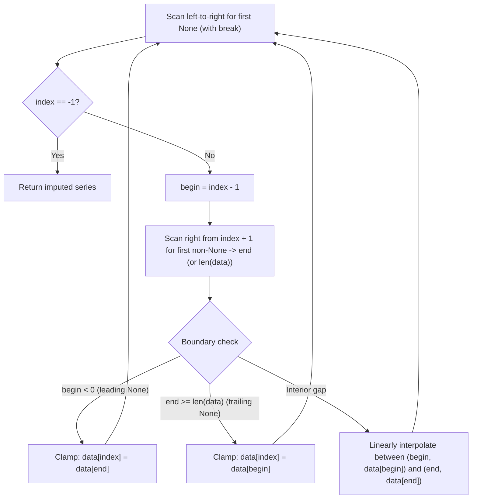

# Interpolation and Image Upsampling: 1D Linear Interpolation, Time-Series Imputation, and 2D Image Resizing

[Back to Module 02](../README.md) · [Back to the master roadmap](../../README.md)

**Session date:** 2026-11-13 · **Module:** 02 — Mathematics for Machine Learning (Calculus & Linear Algebra)  
**Format:** Textbook-grade study guide, mathematical derivations, missing-data imputation algorithms, and five interactive notebooks

---

## Overview

Discrete signals—whether 1D hourly temperature recordings with dropped sensor readings or 2D digital images sampled on an integer pixel grid—frequently require **interpolation**: estimating unknown values at intermediate or missing coordinates from surrounding observed samples. Without interpolation, upsampling a `(500, 1200)` image onto a `(1000, 2400)` canvas by uniform pixel copying leaves three-quarters of the target grid empty, and filling missing time-series entries with a global mean distorts local temporal trends (increasing forecasting error dramatically compared to linear interpolation).

This session builds interpolation from geometric first principles to production computer vision and time-series algorithms:

1. **Digital Image Representations & 2D List Manipulation:** Grayscale `(H, W)` vs. RGB `(H, W, 3)` tensors, `uint8` intensity bounds $[0, 255]$, saturation-clamped brightness transforms, and OpenCV ↔ pure-Python 2D list round-tripping.
2. **Mathematical Foundations of 1D Interpolation:** Contrasting Nearest Neighbor Interpolation (NNI) against 1D Linear Interpolation, deriving the convex-combination weight formula $y = \alpha y_1 + (1 - \alpha) y_2$ from the two-point line equation.
3. **Time-Series Missing-Data Imputation:** Designing an algorithmic pipeline to locate `None` gaps (`break`-terminated left-to-right scan), locate left/right valid anchors (`begin`, `end`), and clamp boundary gaps gracefully.
4. **Image Resizing via Nearest Neighbor & Separable Linear Passes:** Comparing two-step separable (row-then-column) vs. one-shot NNI coordinate mapping, and implementing separable 1D linear $2\times$ upsampling with boundary clamping.
5. **Extension to 2D Bilinear Interpolation:** Deriving the four-corner bilinear weighted average and verifying equivalence with OpenCV's `cv2.INTER_LINEAR`.

---

## Learning outcomes

By the end of this session, you should be able to:

- Distinguish grayscale `(Height, Width)` and color `(Height, Width, Channel)` image arrays, convert cleanly between `numpy.ndarray` and `list[list[int]]`, and apply saturation clamping (`min(255, ...)` / `max(0, ...)`).
- Explain why naive sparse grid copying (`copy[i * scale][j * scale] = image[i][j]`) fails to upsample images without interpolation.
- Derive the 1D linear interpolation formula $y = \frac{x_2 - x}{x_2 - x_1} y_1 + \frac{x - x_1}{x_2 - x_1} y_2 = \alpha y_1 + (1 - \alpha) y_2$ from two anchor points $(x_1, y_1)$ and $(x_2, y_2)$, interpreting $\alpha$ and $1 - \alpha$ as inverse-distance weights.
- Design and implement a complete 1D missing-value imputation algorithm that handles interior gaps, consecutive `None` runs, and leading/trailing boundary `None` values via nearest-valid clamping.
- Implement Nearest Neighbor image resizing in both two-step separable form and one-shot coordinate mapping ($y = \lfloor i H_s / H_t \rfloor, x = \lfloor j W_s / W_t \rfloor$).
- Implement separable 1D linear image upsampling (horizontal row interpolation followed by vertical column interpolation) with safe boundary index clamping.
- Derive the 2D **Bilinear Interpolation** formula over four surrounding pixel neighbors $Q_{11}, Q_{21}, Q_{12}, Q_{22}$ and compare custom implementations against `cv2.resize(..., interpolation=cv2.INTER_LINEAR)`.

---

## 1. Digital Image Representation and Basic Pixel Operations

### 1.1 Grayscale and RGB Color Tensors

A digital image is sampled on a discrete 2D spatial lattice of height $H$ (rows) and width $W$ (columns):

| Image Type | Array Shape | Pixel Value $p$ | Total Scalar Elements |
| :--- | :--- | :--- | :--- |
| **Grayscale** | `(H, W)` | Scalar $p \in [0, 255]$ (`uint8`) | $H \times W$ |
| **RGB Color** | `(H, W, 3)` | Vector $[r, g, b]^\top$, $r,g,b \in [0, 255]$ | $3 \times H \times W$ |

Note that OpenCV loads color images in **BGR** channel order by default, whereas Matplotlib expects **RGB**; converting with `cv2.cvtColor(img, cv2.COLOR_BGR2RGB)` ensures consistent visualization. Reading with `cv2.imread(path, cv2.IMREAD_GRAYSCALE)` (flag `0`) returns a 2D `(H, W)` array—for `nature.jpg`, shape `(500, 1200)`.

### 1.2 Brightness Adjustment & the Upsampling Problem

Increasing or decreasing brightness adds or subtracts a scalar offset $v$ per pixel while enforcing valid `uint8` bounds $[0, 255]$ via saturation clamping:

$$p'_{\text{bright}} = \min(255, \, p + v), \qquad p'_{\text{dark}} = \max(0, \, p - v)$$

When enlarging an image from $(500, 1200)$ to $(1000, 2400)$ (`scale = 2`), placing pixel $(i, j)$ at $(2i, 2j)$ leaves $75\%$ of the target coordinates unassigned (black `0` or white `255` holes). Filling those missing spatial samples smoothly requires **interpolation**.

---

## 2. 1D Interpolation: Nearest Neighbor vs. Linear

### 2.1 Motivation in Time-Series Forecasting

Suppose hourly temperature measurements feed a forecasting model predicting $T_{t+1}$ from the preceding 6 hours $[T_{t-5}, \dots, T_t]$. When historical records contain missing (`None` / `NaN`) readings:
- Replacing gaps with a global average (`fillna(mean)`) ignores local slope and continuity (producing MSE/MAE loss `15.3120` in the slide benchmark).
- Filling gaps with **linear interpolation** preserves local linear continuity between adjacent readings (dropping the loss to `3.1396`).

### 2.2 Derivation of 1D Linear Interpolation

Given two known points $A(x_1, y_1)$ and $B(x_2, y_2)$ with $x_1 \neq x_2$, fit the unique line $y = ax + b$:

1. Slope: $a = \frac{y_2 - y_1}{x_2 - x_1}$.
2. Intercept from $A$: $b = y_1 - \frac{y_2 - y_1}{x_2 - x_1} x_1$.
3. Substitute $a$ and $b$ at query $x \in [x_1, x_2]$:

$$y = \frac{y_2 - y_1}{x_2 - x_1} x + y_1 - \frac{y_2 - y_1}{x_2 - x_1} x_1 = \frac{(y_2 - y_1)x + y_1(x_2 - x_1) - x_1(y_2 - y_1)}{x_2 - x_1}$$

Grouping terms by $y_1$ and $y_2$ yields the symmetric **convex combination** form:

$$y = \underbrace{\left(\frac{x_2 - x}{x_2 - x_1}\right)}_{\alpha} y_1 + \underbrace{\left(\frac{x - x_1}{x_2 - x_1}\right)}_{1 - \alpha} y_2, \qquad \alpha + (1 - \alpha) = 1$$

**Geometric interpretation:** The closer $x$ is to $x_1$, the larger $\alpha = \frac{x_2 - x}{x_2 - x_1}$ becomes, weighting $y_1$ more heavily; as $x \to x_2$, $1 - \alpha \to 1$ and $y$ approaches $y_2$. For example, given $(1, 1)$ and $(3, 3)$:
- At $x = 1.1$: $\alpha = \frac{3 - 1.1}{3 - 1} = 0.95 \implies y = 0.95(1) + 0.05(3) = 1.1$.
- At $x = 2.9$: $\alpha = \frac{3 - 2.9}{3 - 1} = 0.05 \implies y = 0.05(1) + 0.95(3) = 2.9$.

---

## 3. Time-Series Missing-Value Imputation Algorithm

To impute all `None` entries in a 1D list `data` sequentially from left to right:

Two subtle invariants make this algorithm work cleanly:
1. **`break` on first `None`:** Scanning without `break` returns the *last* `None` index instead of the *first*, invalidating the assumption that `index - 1` is already populated.
2. **Handling consecutive `None` values:** Because each loop iteration replaces the leftmost `None` (`index`) with a valid float, the next iteration advances `begin` automatically while `end` stays anchored at the next observed number—linearly spacing intermediate points along the segment connecting the two valid endpoints!

---

## 4. Image Upsampling: Nearest Neighbor, Linear, and Bilinear

### 4.1 Nearest Neighbor Interpolation (NNI)

To resize an image from $(H_s, W_s)$ to $(H_t, W_t)$, define inverse scale factors $s_h = H_s / H_t$ and $s_w = W_s / W_t$:
- **Two-step separable NNI:** Expand horizontally to $(H_s, W_t)$ via $j_s = \lfloor j \cdot s_w \rfloor$, then expand vertically to $(H_t, W_t)$ via $i_s = \lfloor i \cdot s_h \rfloor$.
- **One-shot NNI:** Directly sample `target[i][j] = source[floor(i * s_h)][floor(j * s_w)]`.

Both produce identical results; NNI is fast and preserves sharp edges, but introduces visible "staircase" blockiness at high magnification.

### 4.2 Separable Linear Interpolation & 2D Bilinear Interpolation

Replacing `floor` snapping with linear interpolation produces smooth transitions:
1. **Separable 2-pass:** Interpolate along each row first using bounding columns $x_1 = \lfloor j / s_w \rfloor$ and $x_2 = \min(\lceil j / s_w \rceil, W_s - 1)$, then interpolate down each column using $y_1 = \lfloor i / s_h \rfloor$ and $y_2 = \min(\lceil i / s_h \rceil, H_s - 1)$.
2. **2D Bilinear Interpolation:** Given a continuous source coordinate $(x, y)$ surrounded by four integer lattice corners $Q_{11} = I(x_1, y_1)$, $Q_{21} = I(x_2, y_1)$, $Q_{12} = I(x_1, y_2)$, and $Q_{22} = I(x_2, y_2)$, bilinear interpolation evaluates the weighted sum of all four corners (with $w_x = x - x_1$, $w_y = y - y_1$ on a unit grid cell $x_2 - x_1 = y_2 - y_1 = 1$):

$$f(x, y) = (1 - w_x)(1 - w_y) Q_{11} + w_x(1 - w_y) Q_{21} + (1 - w_x) w_y Q_{12} + w_x w_y Q_{22}$$

Separable horizontal-then-vertical 1D linear interpolation computes the exact same bilinear surface algebraically, trading sharp blockiness for smoother gradients.

---

## Notebooks

| Notebook | Focus |
| :--- | :--- |
| [`01_read_write_images_and_2d_lists.ipynb`](notebooks/01_read_write_images_and_2d_lists.ipynb) | Reading/writing RGB & grayscale images and round-tripping `ndarray` ↔ 2D Python lists |
| [`02_synthetic_images_and_pixel_copying.ipynb`](notebooks/02_synthetic_images_and_pixel_copying.ipynb) | Black/noise synthesis, clamped brightness adjustments, and sparse grid copying |
| [`03_1d_interpolation_and_time_series_imputation.ipynb`](notebooks/03_1d_interpolation_and_time_series_imputation.ipynb) | 1D linear interpolation formula, `break` invariant, and full missing-value imputation |
| [`04_image_resizing_nearest_neighbor.ipynb`](notebooks/04_image_resizing_nearest_neighbor.ipynb) | Two-step vs. one-shot Nearest Neighbor 2x image upsampling |
| [`05_image_resizing_linear_and_bilinear.ipynb`](notebooks/05_image_resizing_linear_and_bilinear.ipynb) | Separable 1D linear upsampling, vectorized 2D bilinear interpolation, and `cv2.resize` comparison |

---

## References

- Gonzalez, R. C., & Woods, R. E., *Digital Image Processing* (Chapter 2: Image Interpolation & Resampling).
- Georgia Tech Interactive Linear Algebra: <https://textbooks.math.gatech.edu/ila/ila.pdf>
- Wikipedia, *Bilinear interpolation* and *Nearest-neighbor interpolation*.
