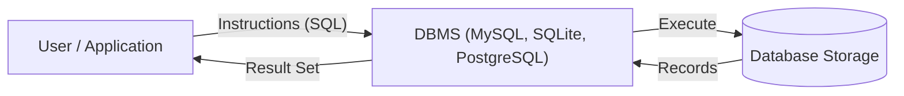
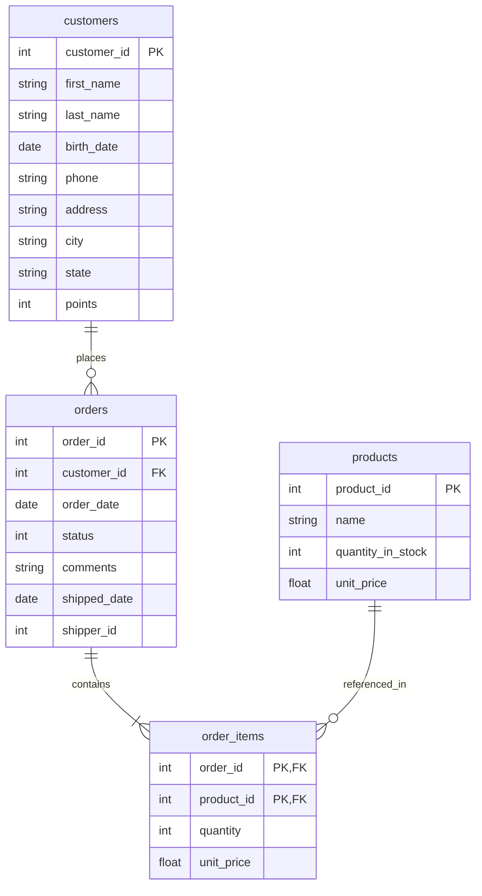
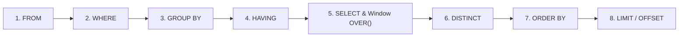

# Database — SQL (1): Relational Foundations and Single-Table Querying

[Back to Module 02](../README.md) · [Back to the master roadmap](../../README.md)

**Session date:** 2026-11-14 · **Module:** 02 — Mathematics for Machine Learning (Calculus & Linear Algebra)  
**Format:** Textbook-grade study guide, SQL syntax & regex reference tables, 23 worked quiz solutions, and three executable SQLite/Python notebooks

---

## Overview

Before machine learning models can extract patterns or compute gradients, data must be stored reliably, filtered accurately, and aggregated cleanly. **Relational databases** and **Structured Query Language (SQL)** form the standard persistence and retrieval backbone for production tabular data, feature stores, and analytical pipelines.

This session introduces relational database concepts and builds complete fluency in **single-table SQL querying**:

1. **Database & DBMS Architecture:** Understanding what a database is, how a Database Management System (DBMS) mediates between users and stored data, and how **Relational** vs. **Non-Relational** systems organize records.
2. **Relational Schema & Setup:** Modeling connected entities (`customers`, `orders`, `products`, `order_items`), understanding **CRUD** (Create, Read, Update, Delete) operations, configuring MySQL Server and MySQL Workbench, and running reproducible queries locally via Python's built-in `sqlite3` engine.
3. **Projection & Row Filtering:** Selecting columns, computing derived expressions with `AS` aliases, deduplicating with `DISTINCT`, filtering rows with `WHERE`, logical operators (`AND`, `OR`, `NOT` with De Morgan negation rules), `IN`, `BETWEEN`, and `IS NULL`.
4. **Sorting, Pagination & Pattern Matching:** Ordering results with `ORDER BY`, paginating with `LIMIT` / `OFFSET`, matching wildcard strings with `LIKE` (`%`, `_`), and matching regular expressions with `REGEXP`.
5. **Aggregation, Grouping & Window Functions:** Summarizing tables with aggregate functions (`COUNT`, `SUM`, `AVG`, `MIN`, `MAX`, variance/standard deviation), collapsing groups with `GROUP BY` and `HAVING`, and computing row-preserving partitioned/running aggregates via `OVER (PARTITION BY ... ORDER BY ...)`.

---

## Learning outcomes

By the end of this session, you should be able to:

- Define a **database** and explain the request–execution loop of a **Database Management System (DBMS)**.
- Distinguish **relational** databases (structured tables linked by keys, queried via SQL) from **non-relational** databases, and name major RDBMS engines (MySQL, Microsoft SQL Server, Oracle Database, SQLite).
- Write single-table `SELECT` queries using arithmetic expressions, column aliases (`AS`), and `DISTINCT`.
- Construct compound `WHERE` predicates using comparison operators (`=`, `!=`, `<>`, `<`, `<=`, `>`, `>=`), logical operators (`AND`, `OR`, `NOT`), set membership (`IN`), inclusive ranges (`BETWEEN`), and null checks (`IS NULL` / `IS NOT NULL`).
- Sort and paginate result sets with `ORDER BY ... ASC|DESC` and `LIMIT`.
- Filter text columns using `LIKE` wildcards (`%`, `_`) and regular expressions (`REGEXP`).
- Contrast `GROUP BY` + `HAVING` (which collapses rows per group) against window functions using `OVER (PARTITION BY ... ORDER BY ...)` (which preserve row granularity and support cumulative sums).
- Solve analytical SQL problems combining filtering, subqueries, date/math functions, grouping, and windowing.

---

## 1. Databases, DBMS, and Relational Modeling

### 1.1 What Is a Database?

A **database** is an organized collection of structured information or data—analogous to a phone book, shopping list, or social friend graph—stored in a format that can be **easily accessed, managed, updated, and retrieved**.

Users do not manipulate raw storage files directly. Instead, they interact with a **Database Management System (DBMS)**, a software layer that accepts instructions (queries), executes them against the underlying database, and returns structured results:



DBMS platforms fall into two broad families:
- **Relational DBMS (RDBMS):** Organizes data into two-dimensional tables (relations) of rows (records) and columns (attributes) connected by primary and foreign keys. Examples include **MySQL**, **Microsoft SQL Server**, **Oracle Database**, PostgreSQL, and SQLite.
- **Non-Relational (NoSQL) DBMS:** Stores semi-structured or unstructured data as documents, key-value pairs, wide-column tables, or graphs without fixed relational joins.

### 1.2 Relational Databases, CRUD, and the `sql_store` Schema

In a relational database, business entities are normalized into separate tables linked by shared identifiers rather than duplicating customer or product details in every order row. Every database workflow revolves around four fundamental **C.R.U.D.** operations:

| Operation | Meaning | Primary SQL Statement |
| :--- | :--- | :--- |
| **C** — Create | Insert new records or define tables | `INSERT INTO`, `CREATE TABLE` |
| **R** — Read | Query and retrieve existing records | `SELECT` |
| **U** — Update | Modify existing records | `UPDATE` |
| **D** — Delete | Remove existing records | `DELETE` |

Throughout this session, we work with the `sql_store` schema consisting of four interrelated tables:



---

## 2. Setting Up a Relational Environment

### 2.1 MySQL Community Server & MySQL Workbench

For client–server relational workflows, the standard local installation uses two components from [mysql.com](https://www.mysql.com/):
1. **MySQL Community Server:** The background database engine (`mysqld`) initialized with a password for the administrative `root` user.
2. **MySQL Workbench:** A graphical IDE providing:
   - **Navigation Panel (`Schemas` tab):** Browse databases, tables, and inspect row contents.
   - **Query Editor Window:** Write and execute SQL statements (the lightning bolt icon runs the selected statement, or the entire script when nothing is highlighted).
   - **Connection Manager:** Connect to the local MySQL instance (`localhost:3306`) as `root`.

When working across multiple databases in MySQL, you can either qualify table names explicitly (`SELECT * FROM sql_store.orders;`) or set the default active schema once with `USE`:

```sql
USE sql_store;
SELECT * FROM orders;
```

### 2.2 Portable Local Execution in Python (`sqlite3`)

To ensure every notebook in this repository runs out of the box without requiring an external MySQL daemon, the practice notebooks load `data/sql_store_seed.sql` into Python's built-in `sqlite3` engine. Dialect differences between MySQL (used in the lecture queries) and SQLite (used for local execution) are explicitly highlighted wherever functions like `REGEXP`, `YEAR()`, `DAYOFWEEK()`, or `LIMIT offset, count` appear.

---

## 3. Core Single-Table Queries: `SELECT`, Aliases, and `DISTINCT`

The `SELECT` clause defines **which columns or computed expressions** appear in the output table, while `FROM` specifies the source table.

### 3.1 Column Projection and Arithmetic Expressions

```sql
-- Retrieve all columns
SELECT * FROM customers;

-- Retrieve specific columns
SELECT first_name, last_name
FROM customers;

-- Arithmetic transformations on numeric columns
SELECT
    points,
    points + 10,
    points / 10
FROM customers;
```

### 3.2 Column Aliases (`AS`) and Deduplication (`DISTINCT`)

Use `AS <alias>` to assign readable names to computed columns, and `SELECT DISTINCT` to return only unique values of a column:

```sql
-- Compute a 10% price increase with an alias
SELECT
    name,
    unit_price,
    unit_price * 1.1 AS new_price
FROM products;

-- Return each unique state once
SELECT DISTINCT state
FROM customers;
```

> [!TIP]
> In SQLite and MySQL, string/identifier aliases with spaces should be quoted, whereas snake_case identifiers like `new_price` or `VAT` work unquoted across all SQL dialects.

---

## 4. Filtering Rows: `WHERE`, Logical Negation, `IN`, and `BETWEEN`

The `WHERE` clause evaluates a boolean predicate on each row and retains only rows for which the condition evaluates to `TRUE` (rows evaluating to `FALSE` or `UNKNOWN`/`NULL` are excluded).

### 4.1 Comparison Operators

SQL supports standard comparison operators: `<`, `>`, `<=`, `>=`, `=`, `!=`, and `<>` (both `!=` and `<>` mean "not equal"):

```sql
-- Numeric comparison
SELECT * FROM customers WHERE points > 3000;

-- Exact string match
SELECT * FROM customers WHERE state = 'VA';

-- Exclusion
SELECT * FROM customers WHERE state != 'VA';

-- ISO-8601 date comparison (lexicographical order matches chronological order)
SELECT * FROM orders WHERE order_date >= '2018-01-01';
```

### 4.2 Logical Operators (`AND`, `OR`, `NOT`) and De Morgan Negation

Compound predicates combine conditions with `AND`, `OR`, and `NOT`. Note that `AND` has higher operator precedence than `OR`, so use parentheses whenever mixing both.

When negating conditions with `NOT`, De Morgan's laws invert both comparisons and boolean connectives:

| Expression | Equivalent Negated Form (`NOT (...)`) |
| :--- | :--- |
| `a < b` | `a >= b` |
| `a > b` | `a <= b` |
| `a = b` | `a != b` (or `a <> b`) |
| `a <> b` | `a = b` |
| `P AND Q` | `(NOT P) OR (NOT Q)` |
| `P OR Q` | `(NOT P) AND (NOT Q)` |

Computed arithmetic expressions can also appear directly inside `WHERE`:

```sql
-- Retrieve line items from order #6 whose line total is strictly under 30
SELECT *, unit_price * quantity AS total_price
FROM order_items
WHERE order_id = 6 AND unit_price * quantity < 30;
```

### 4.3 Set Membership (`IN`) and Inclusive Ranges (`BETWEEN`)

Instead of chaining multiple `OR` equality checks on the same column, use `IN`:

```sql
-- Verbose OR chain
SELECT * FROM customers
WHERE state = 'VA' OR state = 'GA' OR state = 'FL';

-- Clean IN equivalent
SELECT * FROM customers
WHERE state IN ('VA', 'GA', 'FL');
```

Similarly, `BETWEEN low AND high` tests an **inclusive** interval `[low, high]` (equivalent to `col >= low AND col <= high`), which differs from strict inequalities (`>` and `<`):

```sql
-- Strictly inside (300, 2000)
SELECT * FROM customers
WHERE state IN ('VA', 'GA', 'FL')
  AND points > 300
  AND points < 2000;

-- Inclusive [300, 2000]
SELECT * FROM customers
WHERE state IN ('VA', 'GA', 'FL')
  AND points BETWEEN 300 AND 2000;
```

---

## 5. Missing Values, Sorting, and Pagination: `IS NULL`, `ORDER BY`, and `LIMIT`

### 5.1 Checking for Missing Values (`IS NULL` / `IS NOT NULL`)

In SQL's three-valued logic (`TRUE`, `FALSE`, `UNKNOWN`), `NULL` represents an unknown or missing value—not zero and not an empty string. Comparing `phone = NULL` yields `UNKNOWN`, never `TRUE`. Always use `IS NULL` or `IS NOT NULL`:

```sql
SELECT * FROM customers WHERE phone IS NULL;
SELECT * FROM customers WHERE phone IS NOT NULL;
```

### 5.2 Sorting (`ORDER BY`) and Pagination (`LIMIT`)

`ORDER BY` sorts rows ascending (`ASC`, the default) or descending (`DESC`). `LIMIT` caps the number of returned rows and optionally skips an offset:

```sql
-- Ascending sort by points
SELECT * FROM customers ORDER BY points;

-- Filtered descending sort
SELECT * FROM customers
WHERE points < 1000
ORDER BY points DESC;

-- Top 3 highest-point customers
SELECT * FROM customers
ORDER BY points DESC
LIMIT 3;

-- Skip the first 3 rows, then return the next 4 (ranks 4 through 7)
-- MySQL shorthand: LIMIT 3, 4
-- Portable SQL (works in both MySQL and SQLite):
SELECT * FROM customers
ORDER BY points DESC
LIMIT 4 OFFSET 3;
```

> [!IMPORTANT]
> Pay close attention to argument order in MySQL's comma syntax: `LIMIT offset, count` puts the **offset first** and the **row count second** (`LIMIT 3, 4` skips 3 and returns 4). The explicit `LIMIT 4 OFFSET 3` syntax avoids ambiguity and is portable across MySQL, PostgreSQL, and SQLite.

---

## 6. Pattern Matching: `LIKE` and Regular Expressions (`REGEXP`)

### 6.1 Wildcard Matching with `LIKE`

The `LIKE` operator matches string patterns using two wildcards:
- `%` matches **zero or more** arbitrary characters.
- `_` matches **exactly one** arbitrary character.

```sql
-- Last name starts with 'B'
SELECT * FROM customers WHERE last_name LIKE 'B%';

-- Last name contains 'B' (case-insensitive in default MySQL/SQLite LIKE)
SELECT * FROM customers WHERE last_name LIKE '%B%';

-- Last name is exactly 6 characters long and ends with 'y' (five underscores + 'y')
SELECT * FROM customers WHERE last_name LIKE '_____y';

-- Address contains 'TRAIL' or 'AVENUE'
SELECT * FROM customers
WHERE address LIKE '%trail%'
   OR address LIKE '%avenue%';

-- Phone number has '9' as the 4th-to-last character (e.g., '781-932-9754')
SELECT * FROM customers WHERE phone LIKE '%9___';
```

### 6.2 Regular Expression Matching with `REGEXP`

When `LIKE` wildcards are insufficient—such as matching alternatives, anchors, character classes, or quantifiers—`REGEXP` tests patterns anywhere inside the target string:

```sql
-- First name is ELKA or AMBUR (avoid spaces around '|' unless intentional!)
SELECT * FROM customers WHERE first_name REGEXP 'ELKA|AMBUR';

-- Last name ends with EY or ON
SELECT * FROM customers WHERE last_name REGEXP 'EY$|ON$';

-- Last name starts with MY or contains SE
SELECT * FROM customers WHERE last_name REGEXP '^MY|SE';

-- Last name contains B followed by R or U
SELECT * FROM customers WHERE last_name REGEXP 'B[RU]';
```

#### Regular Expression Quick Reference

| Syntax | Meaning | Example | Matches | Does Not Match |
| :--- | :--- | :--- | :--- | :--- |
| `.` | Any single character | `go.gle` | `google`, `goggle` | `gogle` |
| `[abc]` | Any character in the set | `analy[zs]e` | `analyse`, `analyze` | `analyxe` |
| `[a-z]` | Any character in range | `demo[2-4]` | `demo2`, `demo3` | `demo1`, `demo5` |
| `[^abc]` | Any character not in the set | `analy[^zs]e` | `analyxe` | `analyse`, `analyze` |
| `[^a-z]` | Any character not in range | `demo[^2-4]` | `demo1`, `demo5` | `demo2`, `demo3` |
| `\|` | Logical OR (alternation) | `demo\|example` | `demo`, `demos`, `example` | `test` |
| `^` | Start of string | `^demo` | `demos`, `demonstration` | `my demo` |
| `$` | End of string | `demo$` | `my demo` | `demonstration` |
| `?` | Zero or one times (greedy) | `demos?123` | `demo123`, `demos123` | `demoA123` |
| `??` | Zero or one times (lazy) | `demos??` | shortest optional match | — |
| `*` | Zero or more times (greedy) | `goo*gle` | `gogle`, `goooogle` | `goggle` |
| `*?` | Zero or more times (lazy) | `a.*?b` | shortest span `a...b` | — |
| `+` | One or more times (greedy) | `goo+gle` | `google`, `goooogle` | `gogle`, `goggle` |
| `+?` | One or more times (lazy) | `a.+?b` | shortest non-empty span | — |
| `{n}` | Exactly $n$ times | `w{3}` | `www` | `w`, `ww` |
| `{n,m}` | Between $n$ and $m$ times | `a{4,7}` | `aaaa` through `aaaaaaa` | `aaaaaaaa`, `aaa`, `a` |
| `{n,}` | At least $n$ times | `go{2,}gle` | `google`, `goooogle` | `ggle`, `gogle` |
| `()` | Capturing group | `^(demo\|example)[0-9]+` | `demo1`, `example4` | `demoexample2` |
| `(?:)` | Non-capturing (passive) group | `(?:demo\|test)[0-9]` | `demo1`, `test2` | `demo` |
| `\` | Escape special character | `AU\$10` | `AU$10`, `AU$100` | `AU10`, `10` |
| `\s` | Whitespace character | `\s+` | spaces, tabs | non-whitespace |
| `\S` | Non-whitespace character | `\S+` | non-space tokens | spaces |
| `\d` | Digit character (`[0-9]`) | `\d{4}` | `2026` | `abcd` |
| `\D` | Non-digit character | `\D+` | `abc` | `123` |
| `\w` | Word character (`[A-Za-z0-9_]`) | `\w+` | `sql_store` | `---` |
| `\W` | Non-word character | `\W+` | `!@#`, spaces | `abc123` |

---

## 7. Aggregation, Grouping, and Window Functions

### 7.1 Aggregate Functions Reference

Aggregate functions collapse multiple row values into a single summary value (ignoring `NULL` entries, except `COUNT(*)` which counts all rows):

| Function | Description | Function | Description |
| :--- | :--- | :--- | :--- |
| `AVG()` | Arithmetic mean of argument values | `MAX()` | Maximum value |
| `BIT_AND()` | Bitwise AND across group | `MIN()` | Minimum value |
| `BIT_OR()` | Bitwise OR across group | `STD()` | Population standard deviation (MySQL alias) |
| `BIT_XOR()` | Bitwise XOR across group | `STDDEV()` | Population standard deviation |
| `COUNT()` | Number of non-null values (or rows with `*`) | `STDDEV_POP()` | Population standard deviation |
| `COUNT(DISTINCT)` | Count of distinct non-null values | `STDDEV_SAMP()` | Sample standard deviation |
| `GROUP_CONCAT()` | Concatenated string of values in group | `SUM()` | Sum of values |
| `JSON_ARRAYAGG()` | Aggregate values into a JSON array | `VAR_POP()` | Population variance |
| `JSON_OBJECTAGG()` | Aggregate key-value pairs into JSON object | `VAR_SAMP()` | Sample variance |
| `VARIANCE()` | Population variance (MySQL alias) | — | — |

```sql
-- Whole-table summary statistics
SELECT AVG(points) AS average_point
FROM customers;

SELECT SUM(quantity_in_stock) AS total_quantity
FROM products;
```

### 7.2 `GROUP BY` and `HAVING` (Row-Collapsing Aggregation)

`GROUP BY` partitions rows into distinct groups and emits **one summary row per group**. Because `WHERE` runs *before* grouping, you must use `HAVING` to filter *after* aggregation:

```sql
-- Average points per state (one row per state)
SELECT state, AVG(points) AS average_state_point
FROM customers
GROUP BY state;

-- States whose combined customer points exceed 3000
SELECT state, SUM(points) AS total_state_point
FROM customers
GROUP BY state
HAVING total_state_point > 3000;
```

### 7.3 Window Functions (`OVER`) (Row-Preserving Aggregation)

Unlike `GROUP BY`, adding an `OVER (...)` clause turns an aggregate into a **window function**: it computes the aggregate across a window of rows while **preserving every individual row** in the output.

- `PARTITION BY col` defines independent groups (windows) without collapsing rows.
- `ORDER BY col` inside `OVER(...)` turns an aggregate like `SUM()` into a **running (cumulative) aggregate** up to the current row's peer group.

```sql
-- Attach each state's average points alongside every individual customer
SELECT
    customer_id,
    state,
    points,
    AVG(points) OVER (PARTITION BY state) AS average_state_point
FROM customers;

-- Compute a cumulative running sum of points within each state ordered by points
SELECT
    customer_id,
    state,
    points,
    SUM(points) OVER (PARTITION BY state ORDER BY points) AS cumulative_state_points
FROM customers;
```

### 7.4 Logical SQL Query Execution Order

Although queries are *written* starting with `SELECT`, the database engine logically evaluates clauses in this order—explaining why column aliases from `SELECT` cannot be used in `WHERE` (unless an engine extension permits them in `HAVING`/`ORDER BY`), and why `HAVING` filters groups created by `GROUP BY`:



---

## 8. Practice Quizzes and Worked Solutions (23 Exercises)

Below are all 23 single-table SQL practice exercises and their reference solutions (written in MySQL syntax; see Notebook 03 for live SQLite execution and dialect mappings).

1. **Customers with points greater than 1000:**
   ```sql
   SELECT first_name, last_name
   FROM customers
   WHERE points > 1000;
   ```
2. **Products with quantity in stock between 50 and 100 (inclusive):**
   ```sql
   SELECT name, unit_price
   FROM products
   WHERE quantity_in_stock BETWEEN 50 AND 100;
   ```
3. **Orders placed in calendar year 2018:**
   ```sql
   SELECT order_id, order_date
   FROM orders
   WHERE order_date BETWEEN '2018-01-01' AND '2018-12-31';
   ```
4. **Customers whose phone number is missing (`NULL`):**
   ```sql
   SELECT first_name, last_name
   FROM customers
   WHERE phone IS NULL;
   ```
5. **Customers whose first name starts with `'I'`:**
   ```sql
   SELECT customer_id, points
   FROM customers
   WHERE first_name LIKE 'I%';
   ```
6. **Latest 5 orders, ordered by `order_date` descending:**
   ```sql
   SELECT order_id, order_date
   FROM orders
   ORDER BY order_date DESC
   LIMIT 5;
   ```
7. **Top 3 most expensive products:**
   ```sql
   SELECT name, unit_price
   FROM products
   ORDER BY unit_price DESC
   LIMIT 3;
   ```
8. **Customers born in a leap year** (divisible by 4, and either not divisible by 100 or divisible by 400):
   ```sql
   SELECT first_name, last_name
   FROM customers
   WHERE YEAR(birth_date) % 4 = 0
     AND (YEAR(birth_date) % 100 != 0 OR YEAR(birth_date) % 400 = 0);
   ```
9. **Customer order counts, sorted descending:**
   ```sql
   SELECT customer_id, COUNT(order_id) AS order_count
   FROM orders
   GROUP BY customer_id
   ORDER BY order_count DESC;
   ```
10. **Products whose stock quantity is a multiple of 10:**
    ```sql
    SELECT name, quantity_in_stock
    FROM products
    WHERE quantity_in_stock % 10 = 0;
    ```
11. **Products whose name starts with a vowel (`A, E, I, O, U`):**
    ```sql
    SELECT name, unit_price
    FROM products
    WHERE name REGEXP '^[aeiouAEIOU]';
    ```
12. **Customers whose points exceed the overall average points:**
    ```sql
    SELECT customer_id, SUM(points) AS total_points
    FROM customers
    GROUP BY customer_id
    HAVING SUM(points) > (SELECT AVG(points) FROM customers);
    ```
    *(Since `customer_id` is unique in `customers`, `WHERE points > (SELECT AVG(points) FROM customers)` is equivalent and avoids grouping.)*
13. **5th to 10th orders, ordered by `order_date` ascending** (skip 4 rows, take 6 rows):
    ```sql
    SELECT order_id, order_date
    FROM orders
    ORDER BY order_date
    LIMIT 4, 6;
    ```
14. **Customer ID and total points of customers born in the same month (window function), sorted descending:**
    ```sql
    SELECT
        customer_id,
        SUM(points) OVER (PARTITION BY MONTH(birth_date)) AS total_points
    FROM customers
    ORDER BY total_points DESC;
    ```
15. **Products whose unit price is a whole number:**
    ```sql
    SELECT name, unit_price
    FROM products
    WHERE unit_price = FLOOR(unit_price);
    ```
16. **Customers who placed more than 3 orders:**
    ```sql
    SELECT customer_id, COUNT(order_id) AS order_count
    FROM orders
    GROUP BY customer_id
    HAVING order_count > 3;
    ```
17. **Products priced above the average unit price:**
    ```sql
    SELECT name, unit_price
    FROM products
    WHERE unit_price > (SELECT AVG(unit_price) FROM products);
    ```
18. **Oldest order for each customer (correlated subquery):**
    ```sql
    SELECT o.order_id, o.order_date
    FROM orders o
    WHERE o.order_date = (
        SELECT MIN(order_date)
        FROM orders
        WHERE customer_id = o.customer_id
    );
    ```
19. **Orders placed in the last 7 days:**
    ```sql
    SELECT order_id, order_date
    FROM orders
    WHERE order_date >= CURDATE() - INTERVAL 7 DAY;
    ```
20. **Customers whose first name contains `'a'` and last name contains `'b'`:**
    ```sql
    SELECT customer_id, points
    FROM customers
    WHERE first_name LIKE '%a%' AND last_name LIKE '%b%';
    ```
21. **Customer order counts, sorted ascending:**
    ```sql
    SELECT customer_id, COUNT(order_id) AS order_count
    FROM orders
    GROUP BY customer_id
    ORDER BY order_count;
    ```
22. **Products whose stock quantity is a power of 2** (guarding `quantity_in_stock > 0` because $\log_2(0)$ is undefined):
    ```sql
    SELECT name, quantity_in_stock
    FROM products
    WHERE quantity_in_stock > 0
      AND LOG2(quantity_in_stock) = FLOOR(LOG2(quantity_in_stock));
    ```
23. **Orders placed on weekends** (`DAYOFWEEK()` in MySQL returns `1` for Sunday and `7` for Saturday):
    ```sql
    SELECT order_id, order_date
    FROM orders
    WHERE DAYOFWEEK(order_date) IN (1, 7);
    ```

---

## Notebooks & Data

| Resource | Description | Link |
| :--- | :--- | :--- |
| **Data Schema & Seed** | DDL + sample records for `customers`, `products`, `orders`, and `order_items` | [data/README.md](data/README.md) |
| **Notebook 01** | `SELECT`, aliases, `DISTINCT`, `WHERE`, `IN`, `BETWEEN`, `IS NULL`, `ORDER BY`, and `LIMIT` | [01_select_filtering_and_sorting.ipynb](notebooks/01_select_filtering_and_sorting.ipynb) |
| **Notebook 02** | `LIKE`, `REGEXP`, aggregate functions, `GROUP BY`, `HAVING`, and `OVER()` windows | [02_pattern_matching_and_aggregation.ipynb](notebooks/02_pattern_matching_and_aggregation.ipynb) |
| **Notebook 03** | Interactive practice lab executing and asserting all 23 SQL quiz solutions | [03_sql_quizzes_practice_lab.ipynb](notebooks/03_sql_quizzes_practice_lab.ipynb) |

---

## References

1. Date, C. J. *An Introduction to Database Systems* (8th ed.). Addison-Wesley, 2003.
2. MySQL 8.0 Reference Manual — *Aggregate Functions, Regular Expressions, and Window Functions*, Oracle Corporation.
3. SQLite Documentation — *Query Language Understood by SQLite & Window Functions*, [sqlite.org](https://www.sqlite.org/lang.html).
