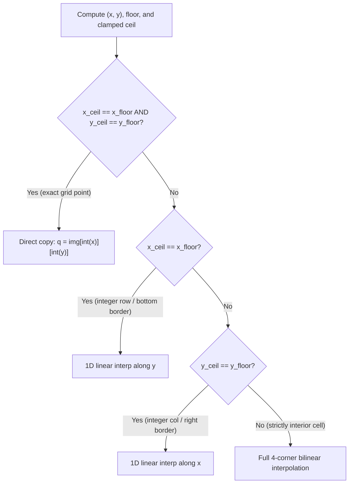

# Interpolation Practice Lab: 2D List Operations, Nearest-Neighbor, Linear, and Bilinear Image Resizing

[Back to Module 02](../README.md) · [Back to the master roadmap](../../README.md)

**Session date:** 2026-11-15 · **Module:** 02 — Mathematics for Machine Learning (Calculus & Linear Algebra)  
**Format:** Textbook-grade study guide, mathematical derivations, 8 worked algorithmic exercises, bilinear edge-case debugging, and three interactive notebooks

---

## Overview

Practical machine learning and computer vision pipelines routinely reshape discrete signals—from transposing 2D data tables and filling `NaN` gaps in hourly sensor logs to upsampling low-resolution images without leaving sparse holes or black grid artifacts. This practice lab consolidates 2D Python list mechanics and interpolation theory through eight progressively structured exercises and a real-world debugging case study on bilinear image resizing.

Starting from basic 2D list aggregations and matrix transposition, the lab develops **1D and 2D Nearest-Neighbor Interpolation (NNI)** using both coordinate-scaling (`floor(i * scale_factor)`) and separable axis-by-axis passes. It then derives **1D Linear Interpolation** and **2D Bilinear Interpolation** from first principles, culminating in a detailed diagnosis of why a naive four-corner bilinear implementation produces dark checkerboard/stripe artifacts at integer coordinates—and how a four-branch boundary-aware formulation resolves them cleanly for both grayscale and RGB images.

---

## Learning outcomes

By the end of this session, you should be able to:

- Load, inspect, and save grayscale `(Height, Width)` and color `(Height, Width, Channel)` images with OpenCV (`cv2.imread`, `cv2.imwrite`), and convert between `numpy.ndarray` and pure-Python 2D lists (`list[list[int]]`).
- Implement row-wise aggregation (`compute_sum`) and matrix transposition (`transpose`) for square and rectangular $M \times N$ 2D lists.
- Formulate 1D Nearest-Neighbor Interpolation (`nni_1d`) using inverse coordinate scaling $x_{\text{src}} = \lfloor i \cdot \frac{n}{n \cdot k} \rfloor = \lfloor i / k \rfloor$.
- Extend Nearest-Neighbor Interpolation to 2D arrays along the horizontal axis (`h_nni_2d`: $M \times N \to M \times Nk$), vertical axis (`v_nni_2d`: $M \times N \to Mk \times N$), and both axes simultaneously (`nni_2d`: $M \times N \to Mk \times Nk$), comparing separable composition against direct coordinate mapping.
- Derive 1D Linear Interpolation $y = \alpha y_1 + (1 - \alpha) y_2$ from the two-point line equation and implement `li_1d(data, k)` by mapping target indices onto fractional source coordinates $x = i / k$ between $\lfloor x \rfloor$ and $\lceil x \rceil$.
- Upsample real image data (`data/tree.jpg`, $400 \times 400 \to 1200 \times 1200$) with custom Nearest-Neighbor resizing (`resize_nni`) and validate output parity against OpenCV.
- Derive 2D Bilinear Interpolation over four surrounding corners $(x_{\text{floor}}, y_{\text{floor}})$, $(x_{\text{ceil}}, y_{\text{floor}})$, $(x_{\text{floor}}, y_{\text{ceil}})$, and $(x_{\text{ceil}}, y_{\text{ceil}})$.
- Diagnose why naive bilinear interpolation (`bl_resize_normalcase`) collapses to `0` whenever $x$ or $y$ is an integer (or clamped to the right/bottom image border), and fix the defect using a four-case branch structure (`bl_resize_special` and `bl_resize_color`).

---

## Session Map

| Notebook | Focus | Exercises Covered |
| :--- | :--- | :--- |
| [01 · 2D Lists & Nearest-Neighbor Interpolation](notebooks/01_2d_lists_and_nearest_neighbor_interpolation.ipynb) | 2D list manipulation, matrix transpose, 1D/2D Nearest-Neighbor upsampling | Problems 1–6 (`compute_sum`, `transpose`, `nni_1d`, `h_nni_2d`, `v_nni_2d`, `nni_2d`) |
| [02 · 1D Linear Interpolation & Image NNI](notebooks/02_1d_linear_interpolation_and_image_nni.ipynb) | 1D linear interpolation, fractional index mapping, $3\times$ image NNI on `tree.jpg` | Problems 7–8 (`linear_interpolation`, `li_1d`, `resize_nni`) |
| [03 · Bilinear Image Interpolation & Debugging](notebooks/03_bilinear_image_interpolation_and_debugging.ipynb) | Naive bilinear zeroing bug, 4-branch grayscale & RGB bilinear resizing, vectorized NumPy & OpenCV comparison | Problem 8 extension (`bl_resize_normalcase`, `bl_resize_special`, `bl_resize_color`) |

---

## 1. Digital Image Representation & the Upsampling Problem

### 1.1 Grayscale vs. Color Tensors in OpenCV

A digital image is sampled on a discrete 2D grid of height $H$ (rows) and width $W$ (columns), where pixel intensities are unsigned 8-bit integers (`uint8`) in $[0, 255]$:

| Image Type | OpenCV Load Call | Array Shape | Pixel Representation | Total Scalar Values |
| :--- | :--- | :--- | :--- | :--- |
| **Grayscale** | `cv2.imread(path, 0)` | `(H, W)` | Scalar $p \in [0, 255]$ | $H \times W$ |
| **Color (BGR/RGB)** | `cv2.imread(path, 1)` | `(H, W, 3)` | Vector $[c_1, c_2, c_3]^\top$, $c_i \in [0, 255]$ | $3 \times H \times W$ |

By default, `cv2.imread(path, 1)` returns channels in **BGR** order; convert to **RGB** with `cv2.cvtColor(img, cv2.COLOR_BGR2RGB)` before plotting with Matplotlib.

### 1.2 Why Simple Sparse Copying Fails

Suppose we enlarge a $5 \times 5$ image to $10 \times 10$ (or $500 \times 1200$ to $1000 \times 2400$) by placing source pixel $(i, j)$ at $(2i, 2j)$ in the target canvas. Three-quarters of the target pixels remain unassigned (`?` or `NaN`):

```text
Source (3x3)            Sparse Copy (6x6)              Needs Interpolation
[0, 2, 4]        -->    [0, ?, 2, ?, 4, ?]             Fill '?' via:
[1, 3, 5]               [?, ?, ?, ?, ?, ?]       -->   - Nearest-Neighbor (piecewise constant)
[0, 2, 4]               [1, ?, 3, ?, 5, ?]             - Linear / Bilinear (piecewise linear)
                        [?, ?, ?, ?, ?, ?]             - Cubic / Bicubic (smooth polynomial)
```

The same missing-value geometry appears in 1D time-series tables (e.g., hourly temperature logs containing `NaN` entries). Simply replacing `NaN` with a global column mean distorts local continuity, whereas **interpolation** reconstructs intermediate values from neighboring observations.

---

## 2. Mathematical Foundations of Interpolation

### 2.1 Nearest-Neighbor Interpolation (NNI)

Given an input grid of size $(H_{\text{old}}, W_{\text{old}})$ and a target grid of size $(H_{\text{new}}, W_{\text{new}})$, define the inverse scaling ratios:

$$w_{\text{scale}} = \frac{W_{\text{old}}}{W_{\text{new}}}, \qquad h_{\text{scale}} = \frac{H_{\text{old}}}{H_{\text{new}}}$$

Every target pixel $(i, j)$ maps backward to a fractional coordinate in the source grid:

$$y_{\text{src}} = i \cdot h_{\text{scale}}, \qquad x_{\text{src}} = j \cdot w_{\text{scale}}$$

Nearest-Neighbor Interpolation rounds (floors) each fractional coordinate to an integer index:

$$\text{target}[i][j] = \text{source}\!\left[\lfloor i \cdot h_{\text{scale}} \rfloor\right]\!\left[\lfloor j \cdot w_{\text{scale}} \rfloor\right]$$

For integer upsampling by factor $k$ ($W_{\text{new}} = k \cdot W_{\text{old}}$, $H_{\text{new}} = k \cdot H_{\text{old}}$), $w_{\text{scale}} = h_{\text{scale}} = \frac{1}{k}$, so $\lfloor i / k \rfloor$ maps each block of $k$ consecutive target indices back to the same source pixel via Python floor division `i // k`.

### 2.2 1D Linear Interpolation

Given two anchor points $A(x_1, y_1)$ and $B(x_2, y_2)$ with $x_1 \neq x_2$, fit the line $y = ax + b$:

$$a = \frac{y_2 - y_1}{x_2 - x_1}, \qquad b = y_1 - \frac{y_2 - y_1}{x_2 - x_1} x_1$$

Substituting $a$ and $b$ at query $x \in [x_1, x_2]$ and grouping by $y_1$ and $y_2$:

$$y = \frac{x_2 - x}{x_2 - x_1} y_1 + \frac{x - x_1}{x_2 - x_1} y_2 = \alpha y_1 + (1 - \alpha) y_2, \qquad \alpha = \frac{x_2 - x}{x_2 - x_1} \in [0, 1]$$

Equivalently, in incremental slope-offset form:

$$y = y_1 + \frac{(x - x_1)(y_2 - y_1)}{x_2 - x_1}$$

**Numerical sanity checks:**
- For $A(1, 1)$ and $B(3, 3)$:
  - At $x = 2.0$: $\alpha = \frac{3 - 2}{3 - 1} = 0.5 \implies y = 0.5(1) + 0.5(3) = 2.0$.
  - At $x = 1.1$: $\alpha = 0.95 \implies y = 0.95(1) + 0.05(3) = 1.1$ (closer to $x_1$, weighted heavily toward $y_1$).
  - At $x = 2.9$: $\alpha = 0.05 \implies y = 0.05(1) + 0.95(3) = 2.9$ (closer to $x_2$, weighted heavily toward $y_2$).
- For $A(0, 0)$ and $B(4, 2)$ at $x = 1$: $\alpha = \frac{4 - 1}{4 - 0} = 0.75 \implies y = 0.75(0) + 0.25(2) = 0.5$.

### 2.3 2D Bilinear Interpolation

Bilinear interpolation applies 1D linear interpolation **twice**: first along one axis across two opposite edges of the surrounding $2 \times 2$ cell, then along the orthogonal axis between those two intermediate results.

Given four surrounding pixel corners $Q_{11} = (x_1, y_1)$, $Q_{21} = (x_2, y_1)$, $Q_{12} = (x_1, y_2)$, and $Q_{22} = (x_2, y_2)$ enclosing query $P = (x, y)$:

1. **Horizontal linear passes** at $y_1$ and $y_2$:
   $$f(R_1) = \frac{x_2 - x}{x_2 - x_1} f(Q_{11}) + \frac{x - x_1}{x_2 - x_1} f(Q_{21})$$
   $$f(R_2) = \frac{x_2 - x}{x_2 - x_1} f(Q_{12}) + \frac{x - x_1}{x_2 - x_1} f(Q_{22})$$
2. **Vertical linear pass** between $R_1$ and $R_2$:
   $$f(P) = \frac{y_2 - y}{y_2 - y_1} f(R_1) + \frac{y - y_1}{y_2 - y_1} f(R_2)$$

**Worked example (Wikipedia benchmark from slides):**  
With $Q_{11}=(14,21) \mapsto 162$, $Q_{21}=(15,21) \mapsto 95$, $Q_{12}=(14,20) \mapsto 91$, $Q_{22}=(15,20) \mapsto 210$, and query $P=(14.5, 20.2)$:
- $f(R_1) = 0.5(162) + 0.5(95) = 128.5$
- $f(R_2) = 0.5(91) + 0.5(210) = 150.5$
- $f(P) = \frac{20 - 20.2}{20 - 21}(128.5) + \frac{20.2 - 21}{20 - 21}(150.5) = 0.2(128.5) + 0.8(150.5) = 146.1$.

On a unit pixel cell where $x_{\text{ceil}} - x_{\text{floor}} = 1$ and $y_{\text{ceil}} - y_{\text{floor}} = 1$, the denominators equal $1$ and the equations simplify to:

$$q_1 = v_1 (x_{\text{ceil}} - x) + v_2 (x - x_{\text{floor}}), \qquad q_2 = v_3 (x_{\text{ceil}} - x) + v_4 (x - x_{\text{floor}})$$

$$q = q_1 (y_{\text{ceil}} - y) + q_2 (y - y_{\text{floor}})$$

**Crucial caveat:** This simplified unit-cell form *assumes* $x_{\text{ceil}} - x_{\text{floor}} = 1$ and $y_{\text{ceil}} - y_{\text{floor}} = 1$. Whenever $x$ or $y$ lands on an integer (or at the clamped boundary `old_h - 1` / `old_w - 1`), `ceil - floor == 0`, causing the simplified product to collapse to `0`! Section 4 explains how to fix this cleanly.

---

## 3. Practice Problems & Algorithmic Walkthroughs (Problems 1–8)

### Problem 1: Row-Wise Sum of a 2D List (`compute_sum`)

**Task:** Given an $m \times n$ 2D list `data`, return a 1D list of length $m$ containing the sum of each row.

```python
def compute_sum(data: list[list[int | float]]) -> list[int | float]:
    return [sum(row) for row in data]


assert compute_sum([[1, 2, 3], [4, 5, 6], [7, 8, 9]]) == [6, 15, 24]
assert compute_sum([[1, 2], [3, 4], [5, 6]]) == [3, 7, 11]
```

**Complexity:** $O(m \cdot n)$ time, $O(m)$ auxiliary output space.

---

### Problem 2: Matrix Transpose (`transpose`)

**Task:** Swap rows and columns of a 2D list (`data[i][j]` moves to `result[j][i]`), turning an $m \times n$ grid into an $n \times m$ grid.

```python
def transpose(data: list[list[int | float]]) -> list[list[int | float]]:
    if not data:
        return []
    rows, cols = len(data), len(data[0])
    return [[data[i][j] for i in range(rows)] for j in range(cols)]


assert transpose([[1, 2, 3], [4, 5, 6], [7, 8, 9]]) == [[1, 4, 7], [2, 5, 8], [3, 6, 9]]
assert transpose([[1, 2], [4, 5]]) == [[1, 4], [2, 5]]
```

**Complexity:** $O(m \cdot n)$ time and $O(m \cdot n)$ space.

---

### Problem 3: 1D Nearest-Neighbor Interpolation (`nni_1d`)

**Task:** Upsample a 1D list `data` of length $n$ to length $n \cdot k$ using Nearest-Neighbor Interpolation.

Because the inverse scale ratio is $\frac{n}{n \cdot k} = \frac{1}{k}$, target index $i \in \{0, \dots, nk - 1\}$ maps to $\lfloor i / k \rfloor = \text{i // k}$:

```python
import math


def nni_1d(data: list[int | float], k: int) -> list[int | float]:
    n = len(data)
    new_n = n * k
    scale = n / new_n  # equals 1 / k
    return [data[math.floor(i * scale)] for i in range(new_n)]


assert nni_1d([1, 2, 3], 2) == [1, 1, 2, 2, 3, 3]
assert nni_1d([1, 2, 3], 3) == [1, 1, 1, 2, 2, 2, 3, 3, 3]
```

*Note on floating-point precision:* For arbitrary non-integer target sizes, `math.floor(i * (n / new_n))` is general; for exact integer factor $k$, `i // k` avoids any floating-point rounding edge cases (e.g., `3 * (1/3) = 0.9999999999999999`).

---

### Problem 4: 2D Horizontal Nearest-Neighbor Interpolation (`h_nni_2d`)

**Task:** Expand an $m \times n$ 2D list horizontally to $m \times (n \cdot k)$ by repeating/interpolating along columns.

- **Approach A (Column index matrix):** Compute `col_idx = math.floor(j * (n / (n * k)))` for each `j` in `range(n * k)` and set `result[i][j] = data[i][col_idx]`.
- **Approach B (Simpler separable composition):** Apply `nni_1d(row, k)` independently to every row!

```python
def h_nni_2d(data: list[list[int | float]], k: int) -> list[list[int | float]]:
    return [nni_1d(row, k) for row in data]


assert h_nni_2d([[1, 2, 3], [4, 5, 6], [7, 8, 9]], 2) == [
    [1, 1, 2, 2, 3, 3],
    [4, 4, 5, 5, 6, 6],
    [7, 7, 8, 8, 9, 9],
]
```

---

### Problem 5: 2D Vertical Nearest-Neighbor Interpolation (`v_nni_2d`)

**Task:** Expand an $m \times n$ 2D list vertically to $(m \cdot k) \times n$ by interpolating along rows.

- **Approach A (Row index matrix):** For `i` in `range(m * k)`, map `row_idx = i // k` and copy `data[row_idx][j]`.
- **Approach B (Transpose trick):** `transpose(h_nni_2d(transpose(data), k))`, or simply replicate each row `k` times (`[row.copy() for row in data for _ in range(k)]`).

```python
def v_nni_2d(data: list[list[int | float]], k: int) -> list[list[int | float]]:
    return [row[:] for row in data for _ in range(k)]


assert v_nni_2d([[1, 2, 3], [4, 5, 6], [7, 8, 9]], 2) == [
    [1, 2, 3],
    [1, 2, 3],
    [4, 5, 6],
    [4, 5, 6],
    [7, 8, 9],
    [7, 8, 9],
]
```

---

### Problem 6: Full 2D Nearest-Neighbor Interpolation (`nni_2d`)

**Task:** Expand an $m \times n$ 2D list to $(m \cdot k) \times (n \cdot k)$.

- **Separable composition:** First expand horizontally (`h_nni_2d`), then vertically (`v_nni_2d`).
- **One-shot coordinate mapping:** `result[i][j] = data[i // k][j // k]`.

Both produce identical output in $O(m \cdot n \cdot k^2)$ time:

```python
def nni_2d(data: list[list[int | float]], k: int) -> list[list[int | float]]:
    return v_nni_2d(h_nni_2d(data, k), k)
```

---

### Problem 7: 1D Linear Interpolation (`linear_interpolation` and `li_1d`)

**Task:** Given a list `data` of length $n$ and integer scale $k$, produce a new list of length $n \cdot k$ via 1D linear interpolation. For simplicity, the trailing $k - 1$ extrapolated positions beyond the last anchor $(n - 1)$ may take a placeholder or clamped value (`x` in the slide spec).

**Coordinate mapping:**
- Place source element `data[m]` at output index `m * k`, or equivalently map output index `i` to fractional source coordinate `x = i / k`.
- For example, with `data = [1, 4, 7]` and `k = 3`:
  - `i = 0 -> x = 0/3 = 0.0 -> 1`
  - `i = 1 -> x = 1/3 ->` interpolate between `(0, 1)` and `(1, 4)` $\implies 2.0$
  - `i = 2 -> x = 2/3 ->` interpolate between `(0, 1)` and `(1, 4)` $\implies 3.0$
  - `i = 3 -> x = 3/3 = 1.0 -> 4`
  - `i = 4 -> x = 4/3 ->` interpolate between `(1, 4)` and `(2, 7)` $\implies 5.0$
  - `i = 5 -> x = 5/3 ->` interpolate between `(1, 4)` and `(2, 7)` $\implies 6.0$
  - `i = 6 -> x = 6/3 = 2.0 -> 7`
  - `i = 7, 8` (`x = 7/3, 8/3 > 2`): trailing `k - 1 = 2` elements beyond the final anchor (either clamped to `data[-1]` or set to `0`).

```python
import math


def linear_interpolation(p1: tuple[float, float], p2: tuple[float, float], x: float) -> float:
    x1, y1 = p1
    x2, y2 = p2
    if x1 != x2:
        return ((x2 - x) / (x2 - x1)) * y1 + ((x - x1) / (x2 - x1)) * y2
    return float(y1)


def li_1d(data: list[float], k: int) -> list[float]:
    n = len(data)
    result = [0.0] * (n * k)
    for i in range(n * k - (k - 1)):
        x = i / k
        x1 = math.floor(x)
        x2 = min(math.ceil(x), n - 1)
        result[i] = linear_interpolation((x1, data[x1]), (x2, data[x2]), x)
    return result


assert li_1d([1, 2, 3], 2)[:-1] == [1.0, 1.5, 2.0, 2.5, 3.0]
```

---

### Problem 8: Applied Image Resizing & Debugging Bilinear Degeneracy

#### Part A — Nearest-Neighbor Image Resizing (`resize_nni`)

Using `data/tree.jpg` ($400 \times 400$ grayscale), resize to $1200 \times 1200$ (`scale = 3`) using inverse scaling factors `w_scale_factor = source_w / target_w` and `h_scale_factor = source_h / target_h`:

```python
def resize_nni(
    source: list[list[int]],
    source_h: int,
    source_w: int,
    target_h: int,
    target_w: int,
) -> list[list[int]]:
    new_data = [[0] * target_w for _ in range(target_h)]
    w_scale = source_w / target_w
    h_scale = source_h / target_h
    for i in range(target_h):
        src_i = min(source_h - 1, math.floor(i * h_scale))
        for j in range(target_w):
            src_j = min(source_w - 1, math.floor(j * w_scale))
            new_data[i][j] = source[src_i][src_j]
    return new_data
```

#### Part B — Why Naive Bilinear Resizing Produces Black Grid Artifacts

Consider the naive bilinear implementation (`bl_resize_normalcase`):

```python
x = i * h_scale_factor
y = j * w_scale_factor
x_floor = math.floor(x)
x_ceil = min(old_h - 1, math.ceil(x))
y_floor = math.floor(y)
y_ceil = min(old_w - 1, math.ceil(y))

q1 = v1 * (x_ceil - x) + v2 * (x - x_floor)
q2 = v3 * (x_ceil - x) + v4 * (x - x_floor)
q = q1 * (y_ceil - y) + q2 * (y - y_floor)
```

When upsampling `tree.jpg` by $2\times$, **every even target row/column produces an integer coordinate** ($x \in \mathbb{Z}$ or $y \in \mathbb{Z}$), triggering a severe degeneracy:

1. **Case 1 — $x$ is an integer** (e.g., $x = 2.0$):  
   $x_{\text{floor}} = x_{\text{ceil}} = x = 2$, so $(x_{\text{ceil}} - x) = 0$ and $(x - x_{\text{floor}}) = 0$. Therefore $q_1 = 0$, $q_2 = 0$, and **$q = 0$** (every even row turns pitch black!).
2. **Case 2 — $y$ is an integer** (e.g., $y = 4.0$):  
   $y_{\text{floor}} = y_{\text{ceil}} = y = 4$, so $(y_{\text{ceil}} - y) = 0$ and $(y - y_{\text{floor}}) = 0$. Even though $q_1, q_2 \neq 0$, **$q = 0$** (every even column turns pitch black!).
3. **Case 3 — Clamped border pixel** ($x \in (H-1, H)$ or $y \in (W-1, W)$):  
   `math.floor(x) == old_h - 1` and `min(old_h - 1, math.ceil(x)) == old_h - 1`. Again $x_{\text{floor}} = x_{\text{ceil}}$, so `x_ceil - x` and `x - x_floor` have opposite signs and cancel or clamp incorrectly if not handled by an equality check.

Resulting visual artifact: a black grid covering 75% of the upsampled image!

#### Part C — The Four-Branch Fix (`bl_resize_special` & `bl_resize_color`)



Note one subtle boundary refinement when clamping at the far border ($x > \text{old\_h} - 1$, where $x_{\text{floor}} = x_{\text{ceil}} = \text{old\_h} - 1$): in the `elif y_ceil == y_floor` or `elif x_ceil == x_floor` branches, `int(x)` safely indexes `old_h - 1`, and for the strictly interior branch `x_ceil - x_floor == 1` and `y_ceil - y_floor == 1`, guaranteeing convex weights in $[0, 1]$. For color images of shape `(H, W, C)`, simply slice `original_img[row, col, :]` so NumPy broadcasts all `C` channels simultaneously (`bl_resize_color`).

---

## 4. References

- **Nearest-Neighbor Interpolation:** <https://en.wikipedia.org/wiki/Nearest-neighbor_interpolation>
- **Bilinear Interpolation:** <https://en.wikipedia.org/wiki/Bilinear_interpolation>
- **OpenCV Image Resizing (`cv2.resize`):** <https://docs.opencv.org/4.x/da/d54/group__imgproc__transform.html>
- **Related Session:** [Interpolation and Image Upsampling (2026-11-13)](../2026-11-13-interpolation-and-image-upsampling/)
