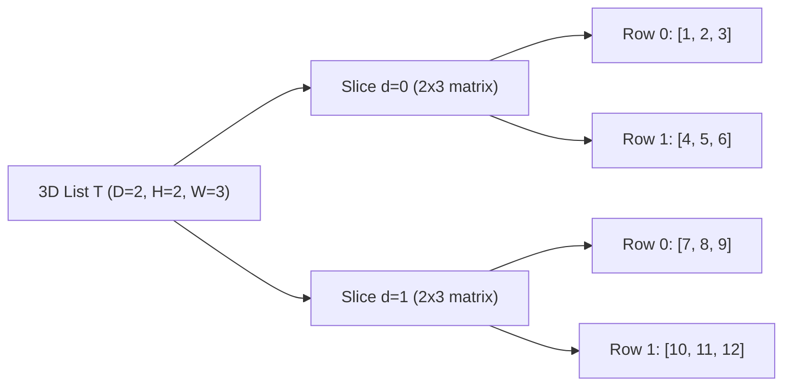

# Lists for 3D Data: Nested Tensors, Structural Transformations, and NumPy Array Foundations

[Back to Module 02](../README.md) · [Back to the master roadmap](../../README.md)

**Session date:** 2026-11-16 · **Module:** 02 — Mathematics for Machine Learning (Calculus & Linear Algebra)  
**Format:** Textbook-grade study guide, axis-geometry analysis, pure-Python 2D/3D list algorithms, NumPy array foundations, and three interactive notebooks

---

## Overview

Real-world machine learning data rarely lives in a single flat vector. Tabular datasets and grayscale images occupy **two-dimensional (2D)** grids of shape $(H, W)$, while RGB color images, volumetric medical scans, and mini-batches of sequential frames occupy **three-dimensional (3D)** tensors of shape $(D, H, W)$ or $(H, W, C)$. Understanding how nested Python lists model 1D, 2D, and 3D structures—and how those coordinate axes map directly onto contiguous `numpy.ndarray` axes (`axis=0`, `axis=1`, `axis=2`)—is the bridge between imperative Python programming and vectorized linear algebra.

This session moves systematically from **2D list consolidation** (square-matrix validation, diagonal reductions, row-sum sorting, and structured inventory matrices) to **3D list traversal and tensor rotation** (3D maximum reduction, flattening to 1D, and $90^\circ$ clockwise slice rotation with `zip` and `reversed`), and finally to **1D and 2D NumPy array foundations** (aggregations, sorting, strided indexing, Boolean masking, element-wise `np.vectorize` filtering, duplicate removal, axis-wise reductions, and flattened-to-coordinate index unraveling).

---

## Learning outcomes

By the end of this session, you should be able to:

- Validate square-matrix invariants ($\text{rows} = \text{cols}$) and compute the main-diagonal trace $\sum_{i=0}^{n-1} A_{i,i}$ in $\mathcal{O}(n)$ time.
- Sort 2D matrix rows by aggregate row sums using both explicit `(row_sum, row)` key-tuples and `sorted(..., key=sum)`, explaining tie-breaking differences between the two approaches.
- Model heterogeneous tabular records as an $n \times 3$ nested list and compute column aggregations and element-wise row products.
- Traverse 3D nested lists `list[list[list[T]]]` along axes `(depth, row, col)` to compute global extrema (`find_max`) and flatten 3D tensors into 1D sequences (`flatten_3d_list`) in row-major order.
- Rotate a 3D nested list $90^\circ$ clockwise across its outer `(axis 0, axis 1)` plane using `zip(*list_3d)` and `reversed`, and verify equivalence with `np.rot90(arr, k=-1, axes=(0, 1))`.
- Construct 1D and 2D NumPy arrays from Python lists and perform fast vectorized reductions (`np.sum`, `np.min`, `np.max`, `np.mean`, `np.prod`), sorting (`np.sort`), and deduplication (`np.unique`).
- Distinguish **0-based index parity** slicing (`arr[::2]` vs. `arr[1::2]`) from **value parity** Boolean masking (`arr[arr % 2 == 0]`), and apply custom predicate functions across arrays with `np.vectorize`.
- Perform axis-specific 2D reductions (`axis=1` across columns per row, `axis=0` across rows per column) and recover multi-dimensional coordinates `(row, col)` from flat argmax indices using `np.unravel_index(np.argmax(arr), arr.shape)`.

---

## Session Map

| Notebook | Focus | Exercises Covered |
| :--- | :--- | :--- |
| [01 · 2D List Review & Inventory Matrix](notebooks/01_2d_list_review_and_inventory.ipynb) | Diagonal trace, row-sum sorting, tie-breaking semantics, and $n \times 3$ inventory valuation | Part 1 · Problems 1–3 (`sum_main_diagonal`, `sort_by_row_sum`, inventory summary) |
| [02 · 3D Lists & Tensor Operations](notebooks/02_3d_lists_and_tensor_operations.ipynb) | 3D coordinate geometry, global max search, 3D-to-1D flattening, and $90^\circ$ clockwise slice rotation | Part 2 · Problems 1–3 (`find_max`, `flatten_3d_list`, `rotate_3d_clockwise`) |
| [03 · NumPy 1D & 2D Array Foundations](notebooks/03_numpy_1d_and_2d_arrays.ipynb) | Vectorized 1D/2D reductions, strided slicing, Boolean masks, `np.vectorize`, `np.unique`, axis sums, and `np.unravel_index` | Part 3 · 1D Basic (6), 1D Advanced (4), 2D Basic (4), 2D Advanced (3) |

---

## 1. Axis Geometry: From 1D Vectors to 3D Tensors

Every multi-dimensional container—whether nested Python lists or a NumPy `ndarray`—orders its dimensions from **outermost** (`axis 0`) to **innermost** (`axis k-1`):

| Rank | Mathematical Object | Shape | Index Order | Typical AI / Data Example |
| :---: | :--- | :--- | :--- | :--- |
| **1D** | Vector $x \in \mathbb{R}^N$ | `(N,)` | `x[i]` | Feature vector, 1D time series |
| **2D** | Matrix $A \in \mathbb{R}^{H \times W}$ | `(H, W)` | `A[i][j]` / `A[i, j]` | Tabular dataset, grayscale image |
| **3D** | Tensor $\mathcal{T} \in \mathbb{R}^{D \times H \times W}$ | `(D, H, W)` | `T[d][i][j]` / `T[d, i, j]` | RGB image `(H, W, 3)`, batch of 2D slices, video frames |



In nested Python lists, accessing `T[d][i][j]` performs **three pointer dereferences**: `T` holds references to $D$ 2D matrices, each 2D matrix holds references to $H$ 1D row lists, and each 1D row list holds references to $W$ scalar objects. In NumPy, all $D \times H \times W$ values reside in one contiguous C buffer, and `T[d, i, j]` computes a single linear byte offset:

$$\text{offset}(d, i, j) = d \cdot s_0 + i \cdot s_1 + j \cdot s_2$$

where $(s_0, s_1, s_2)$ are the byte strides of axes `0`, `1`, and `2`.

---

## 2. 2D List Consolidation

### 2.1 Main Diagonal Sum (Matrix Trace)

For a square matrix $A \in \mathbb{R}^{n \times n}$, the **main diagonal** consists of entries where the row index equals the column index ($i = j$). Its sum is the **matrix trace**:

$$\operatorname{tr}(A) = \sum_{i=0}^{n-1} A_{i, i}$$

Before summing, verify both **rectangularity** (every row has identical length) and **squareness** ($H = W$):

```python
def sum_main_diagonal(matrix: list[list[float]]) -> float:
    """Return the trace (main diagonal sum) of a non-empty square matrix."""
    if not matrix or not matrix[0]:
        raise ValueError("Matrix must be non-empty.")
    num_rows = len(matrix)
    if any(len(row) != num_rows for row in matrix):
        raise ValueError("Matrix must be square (rows == cols for every row).")
    return sum(matrix[i][i] for i in range(num_rows))
```

- **Time complexity:** $\mathcal{O}(n)$ to sum diagonal elements (plus $\mathcal{O}(n)$ to validate row lengths).
- **Auxiliary space:** $\mathcal{O}(1)$.

### 2.2 Sorting Rows by Row Sum & Tie-Breaking Semantics

Suppose we want to sort the rows of $A \in \mathbb{R}^{H \times W}$ in ascending order of $S_i = \sum_{j=0}^{W-1} A_{i, j}$. There are two common implementations:

1. **Schwartzian transform (explicit `(sum, row)` pairs):**
   ```python
   row_sums = [(sum(row), row) for row in matrix]
   sorted_rows = sorted(row_sums, key=lambda pair: pair[0])
   return [row for _, row in sorted_rows]
   ```
2. **Direct key function:**
   ```python
   return sorted(matrix, key=sum)
   ```

Both run in $\mathcal{O}(H W + H \log H)$ time because `sum(row)` is computed once per row. Because Python's `sorted()` uses **Timsort**, which is **stable**, ties in `row_sum` preserve the original input order in both variants (provided `key=lambda pair: pair[0]` only compares the sum, not the tuple's second element). Note that `sorted(row_sums)` *without* a `key` would break ties lexicographically by comparing `row` lists element-by-element.

For example, on `[[4, 2, 7], [1, 5, 6], [3, 8, 2]]`, the row sums are $13, 12, 13$. Stable sorting places `[1, 5, 6]` (sum $12$) first, followed by `[4, 2, 7]` and `[3, 8, 2]` (both sum $13$) in their original relative order.

### 2.3 Tabular $n \times 3$ Records in Nested Lists

A heterogeneous table of $n$ products with columns `[name, quantity, unit_price]` can be represented as an $n \times 3$ nested list:

| Index `0` (`name`) | Index `1` (`quantity`) | Index `2` (`unit_price`) | Row Value (`quantity * unit_price`) |
| :--- | :---: | :---: | :---: |
| `"Product 1"` | `10` | `5.0` | `50.0` |
| `"Product 2"` | `5` | `2.5` | `12.5` |
| `"Product 3"` | `3` | `8.0` | `24.0` |

Aggregations map directly to column-indexed comprehensions:
- Total quantity: `sum(item[1] for item in inventory)` $\to 18$
- Per-product valuation: `[item[1] * item[2] for item in inventory]` $\to [50.0, 12.5, 24.0]$
- Total inventory value: `sum(item[1] * item[2] for item in inventory)` $\to 86.5$

Unlike a homogeneous NumPy array (which would coerce `10` and `5.0` to strings if mixed with `"Product 1"`), Python's native `list` stores mixed types cleanly—a key reason why structured tabular workflows later adopt `pandas.DataFrame` or separate numeric feature matrices from metadata columns.

---

## 3. 3D Nested List Algorithms

### 3.1 Global Maximum in a 3D List (`find_max`)

To find $\max_{d, i, j} \mathcal{T}_{d, i, j}$ in a 3D nested list $\mathcal{T}$ of shape $(D, H, W)$:

1. Validate that $\mathcal{T}$, $\mathcal{T}[0]$, and $\mathcal{T}[0][0]$ are non-empty, and initialize `max_value = list_3d[0][0][0]`.
2. Iterate with three nested loops (`for plane in list_3d` $\to$ `for row in plane` $\to$ `for value in row`).
3. Update `max_value = value` whenever `value > max_value`.

```python
def find_max(list_3d: list[list[list[float]]]) -> float:
    """Return the maximum scalar value inside a non-empty 3D list."""
    if not list_3d or not list_3d[0] or not list_3d[0][0]:
        raise ValueError("3D list must contain at least one element.")
    max_value = list_3d[0][0][0]
    for list_2d in list_3d:
        for list_1d in list_2d:
            for value in list_1d:
                if value > max_value:
                    max_value = value
    return max_value
```

- **Time complexity:** $\mathcal{O}(D \cdot H \cdot W)$ — every scalar is visited exactly once.
- **Auxiliary space:** $\mathcal{O}(1)$.

### 3.2 Flattening a 3D List to 1D (`flatten_3d_list`)

Flattening maps a rank-3 tensor $\mathcal{T} \in \mathbb{R}^{D \times H \times W}$ to a 1D vector $v \in \mathbb{R}^{D \cdot H \cdot W}$ in **row-major (C-contiguous) order**:

$$\mathcal{T}_{d, i, j} \longmapsto v_{\, d \cdot (H W) + i \cdot W + j}$$

Both explicit nested loops and a nested list comprehension produce the exact same order:

```python
def flatten_3d_list(list_3d: list[list[list[float]]]) -> list[float]:
    """Flatten a 3D nested list into a 1D list in row-major order."""
    return [value for list_2d in list_3d for list_1d in list_2d for value in list_1d]
```

> **Comprehension ordering rule:** In a nested list comprehension, `for` clauses appear in the **exact left-to-right order** that you would write them as nested `for` loops (`outer` $\to$ `middle` $\to$ `inner`).

### 3.3 Rotating a 3D List $90^\circ$ Clockwise (`rotate_3d_clockwise`)

Consider a 3D list of shape $(D, H, W) = (2, 2, 3)$:

$$\mathcal{T} = \Big[\big[[1,2,3],\, [4,5,6]\big],\; \big[[7,8,9],\, [10,11,12]\big]\Big]$$

Viewing $\mathcal{T}$ as a $2 \times 2$ grid whose entries are 3-element vectors ($v_{00}=[1,2,3]$, $v_{01}=[4,5,6]$, $v_{10}=[7,8,9]$, $v_{11}=[10,11,12]$):

$$\begin{bmatrix} v_{00} & v_{01} \\ v_{10} & v_{11} \end{bmatrix} \xrightarrow{\text{transpose axes }(0,1)} \begin{bmatrix} v_{00} & v_{10} \\ v_{01} & v_{11} \end{bmatrix} \xrightarrow{\text{reverse each row}} \begin{bmatrix} v_{10} & v_{00} \\ v_{11} & v_{01} \end{bmatrix}$$

In Python, `zip(*list_3d)` transposes the outer two dimensions (axis 0 and axis 1), and `list(reversed(x))` reverses the columns within each transposed row:

```python
def rotate_3d_clockwise(list_3d: list[list[list[int]]]) -> list[list[list[int]]]:
    """Rotate a uniform 3D list 90 degrees clockwise across axes (0, 1)."""
    return [list(reversed(plane)) for plane in zip(*list_3d, strict=True)]
```

Result on the example input:
```python
[
    [[7, 8, 9], [1, 2, 3]],
    [[10, 11, 12], [4, 5, 6]],
]
```

This pure-Python idiom is mathematically identical to `np.rot90(np.array(list_3d), k=-1, axes=(0, 1))`, where `k=-1` indicates one $90^\circ$ clockwise rotation in the `(axis 0, axis 1)` plane while leaving the innermost `axis 2` vectors intact.

---

## 4. Transitioning to NumPy: 1D & 2D Array Operations

### 4.1 Core Aggregations, Sorting, and Reductions

| Operation | Pure Python (`list`) | NumPy (`ndarray`) | Notes |
| :--- | :--- | :--- | :--- |
| Creation | `[1, 2, 3, 4, 5]` | `np.array([1, 2, 3, 4, 5])` | Contiguous typed buffer |
| Sum | `sum(arr)` | `np.sum(arr)` | Supports `axis=` for N-D |
| Extrema | `min(arr)`, `max(arr)` | `np.min(arr)`, `np.max(arr)` | Works across all axes or per axis |
| Mean | `sum(arr) / len(arr)` | `np.mean(arr)` | Returns `float64` |
| Product | `math.prod(arr)` | `np.prod(arr)` | Replaces deprecated `np.product` |
| Ascending sort | `sorted(arr)` | `np.sort(arr, axis=-1)` | Sorts along last axis by default |
| Descending sort | `sorted(arr, reverse=True)` | `np.sort(arr)[::-1]` or `-np.sort(-arr, axis=1)` | Sign-flip trick works on numeric arrays |
| Deduplicate | `sorted(set(arr))` | `np.unique(arr)` | Returns sorted unique values |

> **API modernization note:** Older NumPy 1.x code occasionally used `np.product(...)`, which was deprecated and removed in NumPy 2.0. Always use `np.prod(...)`.

### 4.2 Index-Parity Slicing vs. Value-Parity Boolean Masking

A subtle distinction arises when problems ask about "even" and "odd" elements:

1. **Position (index) parity via slicing:**
   - `arr[::2]` selects elements at **0-based even indices** ($0, 2, 4, \dots$). For `my_array = np.array([1, 2, 3, 4, 5])`, `arr[::2]` yields `[1, 3, 5]` with sum `9`.
   - `arr[1::2]` selects elements at **0-based odd indices** ($1, 3, \dots$), yielding `[2, 4]` with sum `6`.
   *(Note: If indices were counted 1-based instead of 0-based, the labels swap; always state whether index parity is 0-based.)*

2. **Value parity via Boolean masking:**
   - `arr % 2 == 0` evaluates element-wise to a Boolean mask `[False, True, False, True, ...]`.
   - `arr[arr % 2 == 0]` returns only the **even-valued elements** regardless of their position.
   - Compound conditions such as `arr[arr > 0]` and `arr[arr < 0]` partition positive and negative entries cleanly without explicit `for` loops.

### 4.3 Custom Element-Wise Predicates with `np.vectorize`

When a predicate cannot be written as a single built-in ufunc—for example, primality testing `is_prime(n)`—`np.vectorize(is_prime)(arr)` wraps the Python scalar function so it broadcasts over an array and returns a Boolean mask:

```python
def is_prime(n: int) -> bool:
    if n < 2:
        return False
    return all(n % d != 0 for d in range(2, int(np.sqrt(n)) + 1))


primes = arr[np.vectorize(is_prime)(arr)]
```

Note that `np.vectorize` is a **convenience wrapper** (a C-level loop calling a Python function) rather than a true SIMD vectorization; for large numeric arrays, pure ufunc expressions or Numba/Cython are preferred.

### 4.4 2D Axis Reductions and Coordinate Unraveling

In a 2D array `A` of shape `(H, W)`:

- `np.sum(A, axis=1)` collapses **axis 1 (columns)**, producing $H$ **row sums**.
- `np.sum(A, axis=0)` collapses **axis 0 (rows)**, producing $W$ **column sums**.
- `np.argmax(A)` flattens `A` in row-major order and returns a single 1D index $k \in [0, H W - 1]$ of the first maximum entry.
- `np.unravel_index(k, A.shape)` inverts the row-major flattening formula to recover $(i, j) = (\lfloor k / W \rfloor,\; k \bmod W)$:

```python
flat_idx = int(np.argmax(A))
max_row, max_col = np.unravel_index(flat_idx, A.shape)
```

For `A = np.array([[1, 2, 3], [4, 9, 6], [7, 8, 5]])`, the maximum value `9` sits at flat index `4`, which unravels under shape `(3, 3)` to `(1, 1)`.

---

## References

- NumPy Developers. *Array indexing, broadcasting, and routines (`numpy.sort`, `numpy.unique`, `numpy.unravel_index`, `numpy.rot90`)*. NumPy Reference Documentation: <https://numpy.org/doc/stable/>
- Python Software Foundation. *Sorting HOW TO (Timsort stability and Schwartzian transform)* and *Built-in `zip`*: <https://docs.python.org/3/howto/sorting.html>
- Deisenroth, M. P., Faisal, A. A., & Ong, C. S. *Mathematics for Machine Learning*, Chapter 2 (Linear Algebra).
