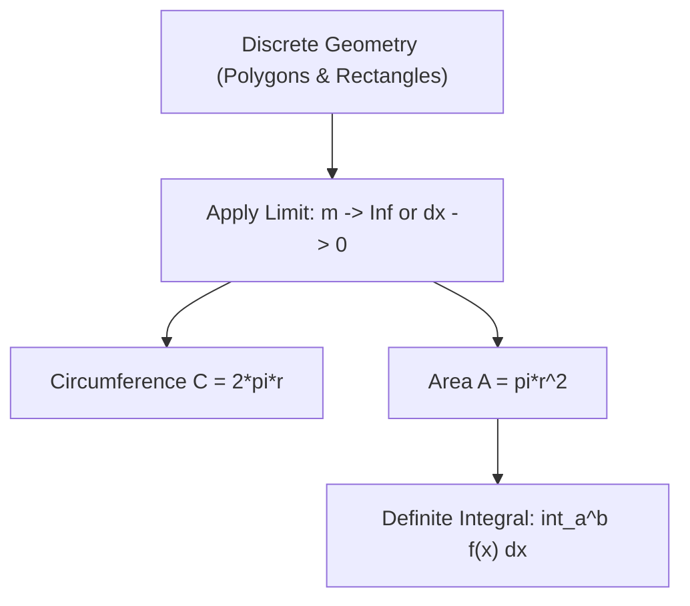

# Understanding Derivative and Gradient: Limits, Numerical Differentiation, and Newton's Optimization

[Back to Module 02](../README.md) · [Back to the master roadmap](../../README.md)

**Session date:** 2026-11-17 · **Module:** 02 — Mathematics for Machine Learning (Calculus & Linear Algebra)  
**Format:** Textbook-grade study guide, first-principles mathematical derivations, numerical differentiation error analysis, Newton-Raphson root-finding, and four interactive notebooks

---

## Overview

Calculus is the mathematical foundation of machine learning. Almost every supervised learning algorithm—from linear regression and logistic regression to multi-billion parameter foundation models—frames model learning as the optimization of an objective function $\mathcal{L}(\theta)$. To iteratively adjust parameters toward minimum loss, optimization algorithms require information about how the loss changes when parameters undergo infinitesimal perturbations. That information is provided by **derivatives** in one dimension and **gradients** and **Hessians** in multi-dimensional vector spaces.

However, derivatives cannot be properly understood or safely implemented without mastering the mathematical concepts from which they emerge:
1. **Limits:** The mathematical mechanism that handles indeterminate expressions ($\frac{0}{0}$) and defines instantaneous rates of change, continuity, and definite integrals.
2. **Geometric Limits & Riemann Integration:** How summing infinitesimal rectangular or annular elements enables exact calculation of non-polygonal geometries (such as unit circle circumference and area $\pi$).
3. **Finite Differences:** How analytical limits are approximated in discrete digital computers using single-sided (forward) and symmetric (central) differences, and why floating-point cancellation imposes a fundamental lower bound on step sizes.
4. **Newton's Method (Newton-Raphson):** How local linearizations (tangent lines) enable rapid quadratic root-finding, and how this generalizes to second-order optimization for finding stationary points $\nabla \mathcal{L}(\theta) = 0$.

This study guide provides a rigorous, first-principles treatment of these topics, bridging analytical calculus, numerical floating-point stability, and machine learning optimization.

---

## Learning outcomes

By the end of this session, you should be able to:

- Formulate the mathematical definition of a two-sided limit $\lim_{x \to c} f(x) = L$ and determine the existence of limits via directional limits $\lim_{x \to c^-} f(x)$ and $\lim_{x \to c^+} f(x)$.
- Classify function discontinuities into **removable discontinuities**, **jump discontinuities**, and **infinite poles**, and analyze their behavior under numerical evaluation.
- Compute geometric limits approximating circle circumference ($2\pi$) and circle area ($\pi$) via regular polygon partitioning, Cartesian Riemann rectangle summation, and concentric annular ring integration.
- Derive analytical derivatives from first principles using the difference quotient limit for monomials ($x^2, x^3$), linear terms ($kx$), rational functions ($1/x$), and radicals ($\sqrt{x}$).
- Implement **forward difference** and **central difference** approximations in Python, proving via Taylor series why central difference achieves second-order $\mathcal{O}(h^2)$ truncation accuracy compared to first-order $\mathcal{O}(h)$ forward difference.
- Explain the fundamental numerical trade-off between **truncation error** and **catastrophic cancellation (round-off error)**, and identify the optimal step size $h \approx 10^{-5}$ to $10^{-8}$ for IEEE 754 double precision.
- Derive the **Newton-Raphson update** $x_{n+1} = x_n - \frac{f(x_n)}{f'(x_n)}$ geometrically from tangent line intersections, and specialize it to the Babylonian algorithm for square roots $x_{n+1} = \frac{1}{2}(x_n + N/x_n)$.
- Implement a robust Newton-Raphson root finder with convergence tolerance, zero-derivative detection, and quadratic convergence tracking.
- Generalize Newton's root-finding method to objective function optimization in machine learning: solving $\mathcal{L}'(\theta) = 0$ via the second-order update $\theta_{n+1} = \theta_n - \frac{\mathcal{L}'(\theta_n)}{\mathcal{L}''(\theta_n)}$.

---

## Session Map

| Notebook | Focus | Key Topics & Implementations |
| :--- | :--- | :--- |
| [01 · Function Limits & Numerical Approximations](notebooks/01_function_limits_and_numerical_approximation.ipynb) | Limit definitions, directional continuity, and discontinuities | `sinc(x)`, removable hole $\frac{x^2-4}{x-2}$, jump $\frac{\|x-2\|}{x-2}$, asymptote $\frac{1}{(x-2)^2}$, Euler's $e$ |
| [02 · Geometric Limits & Riemann Sums](notebooks/02_geometric_limits_unit_circle_and_riemann_sums.ipynb) | Approximating $\pi$, polygons, and integral calculus | Polygon circumference $m \sin(2\pi/m)$, polygon area $m \frac{1}{2}\sin\alpha\cos\alpha$, semicircle Riemann sum, annular ring unwrapping |
| [03 · Single-Sided & Central Differences](notebooks/03_derivatives_single_sided_and_central_differences.ipynb) | Derivative derivations, finite difference schemes, and error analysis | Analytical derivations, forward vs central difference, Taylor series error cancellation, catastrophic cancellation curve, gradient checker |
| [04 · Newton's Method & 1D Optimization](notebooks/04_newton_method_root_finding_and_optimization.ipynb) | Tangent line root-finding, Babylonian algorithm, and ML optimization | Tangent line geometry, Babylonian square root $\sqrt{N}$, quadratic convergence, robust solver, Newton optimization vs Gradient Descent |

---

## 1. Limits as the Foundation of Calculus

### 1.1 The Formal Concept of a Limit

Calculus deals with quantities undergoing continuous change. In standard algebra, evaluating an expression at a specific input $c$ requires direct substitution $f(c)$. However, in rate calculations, evaluating $\frac{\Delta y}{\Delta x}$ at an instantaneous point ($\Delta x = 0$) results in the undefined indeterminate form $\frac{0}{0}$.

The **limit** formalizes the value that a function approaches as its input gets arbitrarily close to a target value, without requiring the function to be defined at that exact point.

```
       f(x)
        ^            o (c, L)   <--- Limit L exists, even if f(c) is undefined!
        |           /
        |          /
      L | - - - - o
        |        /
        |       /
        +------+------+-------> x
              c-t     c     c+t
               -->    |    <--
```

Formally, in the Cauchy-Weierstrass $(\epsilon, \delta)$-definition:
$$\lim_{x \to c} f(x) = L \iff \forall \epsilon > 0, \; \exists \delta > 0 \text{ such that } 0 < |x - c| < \delta \implies |f(x) - L| < \epsilon$$

### 1.2 One-Sided Limits and Existence Criteria

A function $f(x)$ approaches a target $c$ from two directions:
1. **Left-hand limit:** $x$ approaches $c$ from values strictly less than $c$ ($x \to c^-$):
   $$\lim_{x \to c^-} f(x) = L^-$$
2. **Right-hand limit:** $x$ approaches $c$ from values strictly greater than $c$ ($x \to c^+$):
   $$\lim_{x \to c^+} f(x) = L^+$$

> [!IMPORTANT]
> **Fundamental Theorem of Limit Existence:** The two-sided limit $\lim_{x \to c} f(x) = L$ exists if and only if both one-sided limits exist and are equal:
> $$\lim_{x \to c} f(x) = L \iff \lim_{x \to c^-} f(x) = \lim_{x \to c^+} f(x) = L$$

### 1.3 Taxonomy of Discontinuities

| Discontinuity Type | Mathematical Definition | Canonical Example | Limit Existence |
| :--- | :--- | :--- | :--- |
| **Removable Discontinuity** | $\lim_{x \to c} f(x) = L$ exists, but $f(c) \neq L$ or $f(c)$ is undefined | $f(x) = \frac{x^2 - 4}{x - 2}$ at $c = 2$ | Limit exists ($L = 4$) |
| **Jump Discontinuity** | $\lim_{x \to c^-} f(x) = L_1 \neq \lim_{x \to c^+} f(x) = L_2$ | $f(x) = \frac{\|x - 2\|}{x - 2}$ at $c = 2$ | Limit does **not** exist |
| **Infinite Discontinuity (Pole)** | $\lim_{x \to c} \|f(x)\| = \infty$ | $f(x) = \frac{1}{(x - 2)^2}$ at $c = 2$ | Limit does not exist in $\mathbb{R}$ |
| **Essential / Oscillating** | $f(x)$ oscillates infinitely as $x \to c$ | $f(x) = \sin(1/x)$ at $c = 0$ | Limit does **not** exist |

### 1.4 Fundamental Limits in Applied Mathematics

Two limits play a prominent role in calculus and machine learning:

1. **The Sinc Limit:**
   $$\lim_{x \to 0} \frac{\sin x}{x} = 1$$
   *Significance:* Directly establishes the derivative of trigonometric functions: $\frac{d}{dx}\sin(x) = \cos(x)$.

2. **Euler's Constant & Compound Growth:**
   $$\lim_{n \to \infty} \left(1 + \frac{1}{n}\right)^n = e \approx 2.718281828459$$
   *Significance:* Establishes natural base exponentials $e^x$, whose derivative equals itself: $\frac{d}{dx} e^x = e^x$. This property makes natural exponentials the standard choice for activation functions (e.g., sigmoid $\sigma(z) = \frac{1}{1 + e^{-z}}$) and softmax normalizations.

---

## 2. Geometric Limits and Area Computation

The transition from discrete summations to continuous integrals is illustrated by approximating the circumference and area of a unit circle ($r = 1$).



### 2.1 Inscribed Polygon Circumference Limit

Consider a regular polygon with $m$ sides inscribed in a unit circle of radius $r = 1$. The angle subtended at the center by each side is $\alpha = \frac{2\pi}{m}$ radians ($\frac{360^\circ}{m}$).
The length of each chord segment is:
$$s_m = 2 \sin\left(\frac{\alpha}{2}\right) = 2 \sin\left(\frac{\pi}{m}\right)$$

Total polygon perimeter $P_m$:
$$P_m = m \cdot 2 \sin\left(\frac{\pi}{m}\right) = 2\pi \cdot \frac{\sin(\pi / m)}{\pi / m}$$

Let $u = \frac{\pi}{m}$. As $m \to \infty$, $u \to 0$. Using the fundamental limit $\lim_{u \to 0} \frac{\sin u}{u} = 1$:
$$\lim_{m \to \infty} P_m = 2\pi \lim_{u \to 0} \frac{\sin u}{u} = 2\pi(1) = 2\pi$$

### 2.2 Circle Area via Triangular Wedges

Decomposing the polygon into $m$ isosceles triangles from the center, each triangle has base $b = \cos(\alpha)$ and height $h = \sin(\alpha)$ for angular step $\alpha = \frac{2\pi}{m}$:
$$A_\alpha = \frac{1}{2} b h = \frac{1}{2} \sin(\alpha) \cos(\alpha) = \frac{1}{4} \sin(2\alpha)$$

Summing across all $m$ sectors:
$$A_m = m \cdot \frac{1}{2} \sin\left(\frac{2\pi}{m}\right) \cos\left(\frac{2\pi}{m}\right) \xrightarrow{m \to \infty} \pi$$

### 2.3 Cartesian Riemann Sum of Semicircles

In Cartesian coordinates, a circle is described by $x^2 + y^2 = 1 \implies y = \pm \sqrt{1 - x^2}$.
The total area is twice the area under the positive semicircle:
$$A = 2 \int_{-1}^1 \sqrt{1 - x^2} \, dx$$

Discretizing the interval $[-1, 1]$ into $n$ subintervals of width $\Delta x = \frac{2}{n}$:
$$A_{\text{est}} = 2 \sum_{i=1}^n \sqrt{1 - x_i^2} \, \Delta x \xrightarrow{\Delta x \to 0} \pi$$

### 2.4 Annular Ring "Unwrapping" Method

Instead of vertical Cartesian slices, partition the circle into concentric circular rings of radius $r \in [0, 1]$ and radial thickness $dr$.
"Unwrapping" a ring of radius $r$ produces a thin rectangular strip:
- **Length:** Circumference $= 2\pi r$
- **Width:** Radial increment $= dr$
- **Differential Area:** $dA = 2\pi r \, dr$

Integrating over all radii from the center ($r = 0$) to the boundary ($r = 1$):
$$A = \int_0^1 2\pi r \, dr = 2\pi \left[ \frac{r^2}{2} \right]_0^1 = \pi(1)^2 - \pi(0)^2 = \pi$$

This demonstrates how a curved 2D area problem transforms into finding the area under a 1D linear function $f(r) = 2\pi r$.

---

## 3. Derivatives from First Principles

### 3.1 Physical and Geometric Interpretation

The **derivative** represents the instantaneous rate of change of a function. Geometrically, it is the slope of the line tangent to the graph of $f$ at point $x$.

```
    f(x) ^                                      / (Secant line slope -> Tangent)
         |                                     /
         |                                   * (x + h, f(x + h))
         |                                  /|
         |                           *     / | Delta y = f(x + h) - f(x)
         |            (x, f(x))     /|    /  |
         |                  * - - -/ - - + - |
         |                 /|     /      |
         |                / |    /       |
         +---------------+--+---+--------+---> x
                         x      x + h
                         <--h-->
```

The average rate of change between $x$ and $x + h$ is the slope of the secant line:
$$\frac{\Delta y}{\Delta x} = \frac{f(x + h) - f(x)}{h}$$

Taking the limit as $h \to 0$ collapses the secant line into the tangent line:
$$f'(x) = \frac{df}{dx} = \lim_{h \to 0} \frac{f(x + h) - f(x)}{h}$$

### 3.2 First-Principles Analytical Derivations

#### 1. Monomial $f(x) = x^2$:
$$f'(x) = \lim_{h \to 0} \frac{(x + h)^2 - x^2}{h} = \lim_{h \to 0} \frac{x^2 + 2xh + h^2 - x^2}{h} = \lim_{h \to 0} \frac{h(2x + h)}{h} = \lim_{h \to 0} (2x + h) = 2x$$

#### 2. General Polynomial $f(x) = x^2 + 2x$:
$$f'(x) = \lim_{h \to 0} \frac{[(x + h)^2 + 2(x + h)] - [x^2 + 2x]}{h} = \lim_{h \to 0} \frac{2xh + h^2 + 2h}{h} = 2x + 2$$

#### 3. Cubic $f(x) = x^3$:
$$f'(x) = \lim_{h \to 0} \frac{(x + h)^3 - x^3}{h} = \lim_{h \to 0} \frac{x^3 + 3x^2h + 3xh^2 + h^3 - x^3}{h} = \lim_{h \to 0} (3x^2 + 3xh + h^2) = 3x^2$$

#### 4. Reciprocal $f(x) = \frac{1}{x}$ ($x \neq 0$):
$$f'(x) = \lim_{h \to 0} \frac{\frac{1}{x+h} - \frac{1}{x}}{h} = \lim_{h \to 0} \frac{\frac{x - (x+h)}{x(x+h)}}{h} = \lim_{h \to 0} \frac{-h}{h \cdot x(x+h)} = \lim_{h \to 0} \frac{-1}{x(x+h)} = -\frac{1}{x^2}$$

#### 5. Square Root $f(x) = \sqrt{x}$ ($x > 0$):
Rationalizing the numerator by multiplying by conjugate $\sqrt{x+h} + \sqrt{x}$:
$$f'(x) = \lim_{h \to 0} \frac{\sqrt{x+h} - \sqrt{x}}{h} \cdot \frac{\sqrt{x+h} + \sqrt{x}}{\sqrt{x+h} + \sqrt{x}} = \lim_{h \to 0} \frac{(x+h) - x}{h(\sqrt{x+h} + \sqrt{x})} = \lim_{h \to 0} \frac{1}{\sqrt{x+h} + \sqrt{x}} = \frac{1}{2\sqrt{x}}$$

---

## 4. Numerical Differentiation: Forward vs. Central Differences

In machine learning libraries, gradients are typically calculated via symbolic differentiation or reverse-mode automatic differentiation (`torch.autograd`). However, **numerical differentiation** is critical for:
- Writing automated gradient tests (**gradient checks**) to verify custom C++/CUDA backpropagation kernels.
- Black-box optimization where analytical equations are unknown or non-differentiable.
- Estimating directional derivatives in evolutionary strategies and reinforcement learning.

### 4.1 Formulations

1. **Forward Difference (One-Sided):**
   $$D_{\text{forward}}(f, x, h) = \frac{f(x + h) - f(x)}{h}$$

2. **Backward Difference (One-Sided):**
   $$D_{\text{backward}}(f, x, h) = \frac{f(x) - f(x - h)}{h}$$

3. **Central Difference (Symmetric):**
   $$D_{\text{central}}(f, x, h) = \frac{f(x + h/2) - f(x - h/2)}{h} \quad \text{or} \quad \frac{f(x + h) - f(x - h)}{2h}$$

### 4.2 Taylor Series Derivation of Truncation Errors

To analyze why central difference is vastly superior, expand $f(x \pm h)$ in a Taylor series about $x$:

$$f(x + h) = f(x) + h f'(x) + \frac{h^2}{2!} f''(x) + \frac{h^3}{3!} f'''(x) + \mathcal{O}(h^4)$$
$$f(x - h) = f(x) - h f'(x) + \frac{h^2}{2!} f''(x) - \frac{h^3}{3!} f'''(x) + \mathcal{O}(h^4)$$

#### Forward Difference Error:
$$\frac{f(x + h) - f(x)}{h} = f'(x) + \frac{h}{2} f''(x) + \mathcal{O}(h^2) = f'(x) + \mathcal{O}(h)$$
The leading error term is proportional to $h$ ($\mathcal{O}(h)$—first-order accurate). Reducing $h$ by $10\times$ reduces error by $10\times$.

#### Central Difference Error:
Subtracting $f(x - h)$ from $f(x + h)$:
$$f(x + h) - f(x - h) = 2h f'(x) + \frac{2h^3}{6} f'''(x) + \mathcal{O}(h^5)$$
Dividing by $2h$:
$$\frac{f(x + h) - f(x - h)}{2h} = f'(x) + \frac{h^2}{6} f'''(x) + \mathcal{O}(h^4) = f'(x) + \mathcal{O}(h^2)$$

> [!NOTE]
> **Symmetric Error Cancellation:** Because the central difference is symmetric around $x$, all **even-order Taylor terms** ($f''(x), f^{(4)}(x), \dots$) cancel completely. The leading error term is proportional to $h^2$ ($\mathcal{O}(h^2)$—second-order accurate). Reducing $h$ by $10\times$ reduces error by $100\times$!

### 4.3 The Step Size Dilemma: Truncation vs. Catastrophic Cancellation

In pure mathematics, $h \to 0$ always improves accuracy. In floating-point arithmetic on computers, choosing $h$ too small leads to **catastrophic cancellation**.

```
    Total Error
        ^
        |   \                                 /  Roundoff Error O(eps_mach / h)
        |    \                               /   (Catastrophic cancellation)
        |     \                             /
        |      \                           /
        |       \                         /
        |        \                       /
        |         \                     /
        |          * Optimal h         /
        |           \                 /
        |            \               /
        |             ' - - - - - - '
        |            Truncation Error O(h^2)
        +----------------------------------------> Step size h
          Small h < 1e-15                   Large h > 1e-2
```

In IEEE 754 64-bit floating point (`float64`), machine epsilon is $\epsilon_{\text{mach}} \approx 2.22 \times 10^{-16}$ ($\sim 15\text{--}17$ significant decimal digits).
When evaluating $f(x + h) - f(x - h)$ for $h < 10^{-14}$:
1. The numbers $f(x + h)$ and $f(x - h)$ share almost all significant digits.
2. Subtraction discards leading digits, leaving only numerical round-off noise.
3. Dividing that noise by the tiny value $2h$ amplifies the error to $\mathcal{O}(1)$ or division by zero.

The total error is bounded by:
$$E_{\text{total}}(h) \approx \underbrace{\frac{h^2}{6} |f'''(x)|}_{\text{Truncation Error}} + \underbrace{\frac{\epsilon_{\text{mach}}}{h} |f(x)|}_{\text{Roundoff Cancellation}}$$

Differentiating with respect to $h$ and setting to zero yields the optimal step size:
$$h^* \approx \left( \frac{3 \epsilon_{\text{mach}} |f(x)|}{|f'''(x)|} \right)^{1/3} \approx \sqrt[3]{\epsilon_{\text{mach}}} \approx 10^{-5} \text{ to } 10^{-6}$$

For forward difference, $h^* \approx \sqrt{\epsilon_{\text{mach}}} \approx 10^{-8}$.

---

## 5. Newton's Method (Newton-Raphson)

The **Newton-Raphson method** is a classical iterative algorithm for finding roots of real-valued functions ($f(x) = 0$). In machine learning, it forms the mathematical basis for **second-order optimization** methods (Newton-CG, L-BFGS).

```
       f(x) ^                                       f(x)
            |                                      /
            |                                     / 
            |                                    /  * (x_0, f(x_0))
            |                                   /  /
            |                       Root       /  / Tangent at x_0
            |            -----------*---------/--/-----------------> x
            |                      /         /  * x_1
            |                     /         /
            |                    /         /
```

### 5.1 Geometric Derivation

Given an initial guess $x_0$ reasonably close to a root:
1. Construct the tangent line to the curve $y = f(x)$ at $(x_n, f(x_n))$:
   $$y - f(x_n) = f'(x_n)(x - x_n)$$
2. Set $y = 0$ to find the $x$-intercept of this tangent line, and define it as the next estimate $x_{n+1}$:
   $$0 - f(x_n) = f'(x_n)(x_{n+1} - x_n)$$
3. Rearranging for $x_{n+1}$:
   $$x_{n+1} = x_n - \frac{f(x_n)}{f'(x_n)}$$

### 5.2 Case Study: Calculating $\sqrt{N}$ (The Babylonian Algorithm)

To compute $\sqrt{N}$ without an analytical square root operator:
1. Formulate as a root-finding problem: $f(x) = x^2 - N = 0$.
2. Compute derivative: $f'(x) = 2x$.
3. Apply Newton's update:
   $$x_{n+1} = x_n - \frac{x_n^2 - N}{2x_n} = \frac{2x_n^2 - x_n^2 + N}{2x_n} = \frac{x_n^2 + N}{2x_n} = \frac{1}{2}\left(x_n + \frac{N}{x_n}\right)$$

This is the historic **Babylonian method** (or Heron's method). Notice its intuitive meaning: if $x_n$ is an overestimate of $\sqrt{N}$, then $N / x_n$ is an underestimate. Their arithmetic mean $\frac{1}{2}(x_n + N / x_n)$ produces a superior estimate.

### 5.3 Quadratic Convergence

Newton's method exhibits **quadratic convergence** when $f'(x^*) \neq 0$ and $f''(x)$ is continuous near root $x^*$:
$$|x_{n+1} - x^*| \le M |x_n - x^*|^2$$

This property means that near the root, the number of accurate decimal places **doubles with every iteration**:
- Iteration 1: 1 correct digit
- Iteration 2: 2 correct digits
- Iteration 3: 5 correct digits
- Iteration 4: 11 correct digits
- Iteration 5: 16 correct digits (machine precision reached!)

### 5.4 From Root-Finding to Machine Learning Optimization

In machine learning, we do not want to find where a loss equals zero ($\mathcal{L}(\theta) = 0$ is rarely achievable or desirable). Instead, we want to find where the loss is **minimized**.

By Fermat's theorem on stationary points, local extrema occur where the gradient is zero:
$$\mathcal{L}'(\theta) = 0$$

Applying Newton-Raphson to solve for the root of $g(\theta) = \mathcal{L}'(\theta) = 0$:
$$\theta_{n+1} = \theta_n - \frac{g(\theta_n)}{g'(\theta_n)} = \theta_n - \frac{\mathcal{L}'(\theta_n)}{\mathcal{L}''(\theta_n)}$$

In multiple dimensions $\theta \in \mathbb{R}^D$:
$$\theta_{n+1} = \theta_n - \left[\mathbf{H}(\theta_n)\right]^{-1} \nabla \mathcal{L}(\theta_n)$$
where $\nabla \mathcal{L} \in \mathbb{R}^D$ is the gradient vector and $\mathbf{H} \in \mathbb{R}^{D \times D}$ is the symmetric **Hessian matrix** of second-order partial derivatives ($H_{ij} = \frac{\partial^2 \mathcal{L}}{\partial \theta_i \partial \theta_j}$).

#### First-Order vs. Second-Order Comparison

| Dimension | First-Order: Gradient Descent | Second-Order: Newton's Method |
| :--- | :--- | :--- |
| **Update equation** | $\theta_{n+1} = \theta_n - \eta \nabla \mathcal{L}(\theta_n)$ | $\theta_{n+1} = \theta_n - [\mathbf{H}]^{-1} \nabla \mathcal{L}(\theta_n)$ |
| **Curvature awareness** | Ignores curvature (spherical assumption) | Explicitly scales step by inverse local curvature |
| **Learning rate** | Requires delicate hyperparameter tuning | Scale-free; optimal step length is intrinsic ($\eta = 1$) |
| **Convergence rate** | Linear ($\mathcal{O}(1/k)$ or $\mathcal{O}(e^{-ck})$) | Quadratic ($\|e_{k+1}\| \le M \|e_k\|^2$) |
| **Computational cost** | $\mathcal{O}(D)$ per step | $\mathcal{O}(D^3)$ to invert Hessian $\mathbf{H} \in \mathbb{R}^{D \times D}$ |
| **Saddle point behavior** | Escapes saddles or follows negative gradient | Attracted to local maxima/saddles if $\mathbf{H}$ is not positive-definite |

---

## 6. Algorithmic Implementations

### 6.1 Central Difference Numerical Gradient

```python
from collections.abc import Callable


def central_difference(
    f: Callable[[float], float],
    x: float,
    h: float = 1e-5,
) -> float:
    """Compute the second-order central difference approximation of f'(x).

    Args:
        f: Scalar real-valued function.
        x: Evaluation coordinate.
        h: Finite step size (default 1e-5 balances truncation and round-off).

    Returns:
        Approximated derivative f'(x).
    """
    return (f(x + 0.5 * h) - f(x - 0.5 * h)) / h
```

### 6.2 Relative Error Gradient Checker

```python
def check_gradient(
    f: Callable[[float], float],
    df_analytic: Callable[[float], float],
    x: float,
    h: float = 1e-5,
    tol: float = 1e-6,
) -> bool:
    """Validate an analytic derivative against high-precision central differences."""
    g_num = (f(x + h) - f(x - h)) / (2.0 * h)
    g_ana = df_analytic(x)
    rel_error = abs(g_ana - g_num) / (max(abs(g_ana), abs(g_num)) + 1e-12)
    return rel_error < tol
```

### 6.3 Robust Newton-Raphson Solver

```python
def newton_raphson(
    f: Callable[[float], float],
    df: Callable[[float], float],
    x0: float,
    tol: float = 1e-10,
    max_iter: int = 100,
) -> tuple[float, list[float]]:
    """Find a root f(x) = 0 using Newton's method with convergence guards.

    Args:
        f: Objective function whose root is sought.
        df: First derivative function f'(x).
        x0: Initial estimate.
        tol: Convergence tolerance for step size and residual.
        max_iter: Guard against infinite loops or oscillations.

    Returns:
        (root, history): Converged root and trajectory of iterates.
    """
    history = [x0]
    x_curr = x0
    for _ in range(max_iter):
        f_val = f(x_curr)
        df_val = df(x_curr)
        if abs(df_val) < 1e-14:
            raise ZeroDivisionError(f"Vanishing derivative at x = {x_curr}")
        x_next = x_curr - f_val / df_val
        history.append(x_next)
        if abs(x_next - x_curr) < tol and abs(f(x_next)) < tol:
            return x_next, history
        x_curr = x_next
    return x_curr, history
```

---

## 7. Exercises and Self-Assessment

1. **Analytical Limits:** Evaluate $\lim_{x \to 0} \frac{\sqrt{1 + x} - 1}{x}$ by rationalizing the numerator. Verify your answer numerically in Python with step sizes $10^{-1}, 10^{-3}, 10^{-6}$.
2. **Derivative from First Principles:** Use the limit definition of the derivative to prove that $\frac{d}{dx} \cos(x) = -\sin(x)$, using the addition identity $\cos(a + b) = \cos(a)\cos(b) - \sin(a)\sin(b)$ and the fundamental limits $\lim_{h \to 0} \frac{\sin h}{h} = 1$ and $\lim_{h \to 0} \frac{\cos h - 1}{h} = 0$.
3. **Step Size Exploration:** Modify the central difference formula to approximate $f''(x)$ (the second derivative) as $\frac{f(x + h) - 2f(x) + f(x - h)}{h^2}$. What is the optimal step size $h^*$ for this second-derivative approximation in float64?
4. **Newton's Method Pathology:** Try running Newton's method on $f(x) = \arctan(x)$ starting from $x_0 = 1.5$. Explain mathematically why the iterates oscillate and diverge to $\pm \infty$.

---

## 8. References and Further Reading

- **James Stewart**, *Calculus: Early Transcendentals* (8th Edition), Cengage Learning. Chapters 2 (Limits and Derivatives) and 4 (Applications of Differentiation).
- **Marc Peter Deisenroth, A. Aldo Faisal, Cheng Soon Ong**, *Mathematics for Machine Learning*, Cambridge University Press. Chapter 5: Vector Calculus.
- **Gilbert Strang**, *Calculus*, Wellesley-Cambridge Press. Open-access text: <https://ocw.mit.edu/resources/res-18-001-calculus-fall-2010/>
- **Ian Goodfellow, Yoshua Bengio, Aaron Courville**, *Deep Learning*, MIT Press. Chapter 4: Numerical Computation (Gradient-Based Optimization, Jacobian and Hessian Matrices).
- **3Blue1Brown**, *Essence of Calculus* video playlist: Geometric and intuitive explorations of limits, derivatives, and integration: <https://www.3blue1brown.com/topics/calculus>
