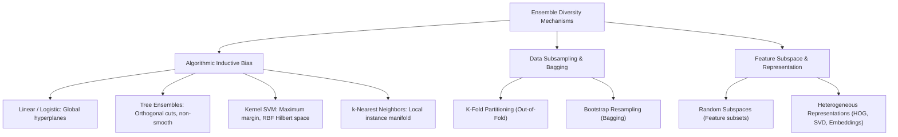
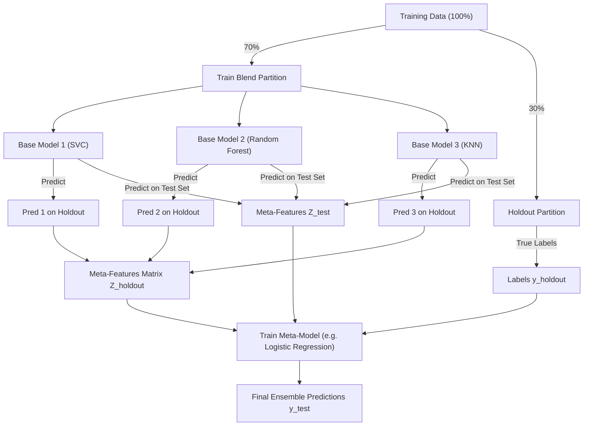

# Ensembling: Voting Mechanics, Correlation Dynamics, Probability Averaging, Rank Calibration, and Blending

[Back to Module 02](../README.md) · [Back to the master roadmap](../../README.md)

**Session date:** 2026-11-18 · **Module:** 02 — Mathematics for Machine Learning (Calculus & Linear Algebra)  
**Format:** Textbook-grade study guide, binomial probability derivations, error covariance decomposition, calibration analysis, and five interactive notebooks

---

## Overview

In machine learning, no single model family possesses an inductive bias that is optimal across all data distributions. A linear model may suffer from high bias when encountering complex nonlinear manifolds; a high-capacity decision tree or deep network may suffer from excessive variance and overfit to idiosyncratic sample noise; and an instance-based estimator may struggle in high-dimensional feature spaces.

**Ensemble learning** solves this fundamental trade-off by combining multiple hypothesis functions into a single composite predictor. Rather than attempting to find a single universally optimal model, ensembling constructs an aggregate decision boundary whose variance and generalization error are strictly lower than those of its constituent base estimators—provided the base models exhibit **diversity** and perform better than random guessing.

From a mathematical perspective, ensembling leverages principles from:
1. **Condorcet's Jury Theorem and Probability Theory:** How aggregating independent binary decisions reduces the cumulative probability of majority error at an exponential rate.
2. **The Bias-Variance-Covariance Decomposition:** How the expected squared error of an ensemble depends not only on individual model variances, but crucially on the pairwise covariance between model errors.
3. **Statistical Correlation & Error Orthogonality:** How Pearson linear correlation, Spearman rank correlation, and error overlap quantify hypothesis independence.
4. **Calibration & Rank Invariance:** Why uncalibrated probabilities distort naive arithmetic averages on rank-based metrics (such as ROC-AUC), and how rank averaging and min-max scaling restore optimal ordinal ordering.
5. **Meta-Learning & Stacking/Blending:** How to train Level-1 meta-estimators on holdout predictions to learn optimal weighting functions across Level-0 predictors.

This guide provides a rigorous mathematical and algorithmic analysis of ensembling techniques, establishing both the theoretical proofs and the practical engineering pipelines required to implement them effectively.

---

## Learning outcomes

By the end of this session, you should be able to:

- Derive **Condorcet's Jury Theorem** using the binomial distribution $\sum_{k=\lceil M/2 \rceil}^M \binom{M}{k} p^k (1-p)^{M-k}$, and calculate the exact theoretical gain of majority voting over individual classifiers.
- Formulate the **Bias-Variance-Covariance decomposition** for regression ensembles, demonstrating mathematically why reducing pairwise error covariance $\overline{\text{Cov}}$ is necessary to achieve the theoretical $1/M$ variance reduction.
- Explain the role of **model diversity** and quantify prediction alignment using Pearson correlation ($r$), Spearman rank correlation ($\rho$), and Kendall's tau ($\tau$).
- Contrast **hard voting** (majority vote) and **soft voting** (probability aggregation), deriving how weighted voting assigns confidence weights $w_m$ based on validation log-loss or accuracy.
- Implement **arithmetic, geometric, and harmonic probability averaging** in multi-model cross-validation pipelines, explaining their respective sensitivities to outlier predictions.
- Diagnose **probability miscalibration** across heterogeneous models (e.g., Platt-scaled SVMs vs. uncalibrated Random Forests) and explain why naive averaging degrades rank-based evaluation metrics like ROC-AUC.
- Implement **rank averaging** and **min-max rank normalization**, proving mathematically why monotonic rank transformations preserve ROC-AUC invariance while preventing overconfident models from dominating the ensemble.
- Design a leak-free **blending architecture** with holdout validation splits, meta-feature generation, and Level-1 meta-learners (e.g., Logistic Regression or non-negative constrained Ridge).
- Construct production-grade ensembling pipelines that parse, align, weight, and combine multi-model prediction submissions from disk.

---

## Session Map

| Notebook | Focus | Key Topics & Implementations |
| :--- | :--- | :--- |
| [01 · Voting Ensembles & Diversity](notebooks/01_voting_ensembles_and_diversity.ipynb) | Majority voting, binomial probability, and correlation analysis | Condorcet jury theorem simulation, hard vs soft voting, Pearson/Spearman/Kendall correlation matrix, error disagreement |
| [02 · Probability Averaging & Cross-Validation](notebooks/02_probability_averaging_and_cv.ipynb) | Continuous aggregation schemes and out-of-fold validation | Arithmetic, geometric, and harmonic averaging; 5-fold cross-validation with SVC, Random Forest, and KNN; OOF evaluation |
| [03 · Rank Averaging & Calibration Correction](notebooks/03_rank_averaging_and_calibration.ipynb) | Probability miscalibration and rank-based metrics | Uncalibrated probabilities, Platt scaling vs tree output, rank transformation, Min-Max scaling, ROC-AUC comparison |
| [04 · Linear & Meta Blending](notebooks/04_linear_and_meta_blending.ipynb) | Two-stage meta-learning on holdout partitions | Holdout split design, meta-feature extraction, Level-1 Logistic Regression / Ridge meta-learners, blending vs averaging |
| [05 · Ensemble Submission Pipeline](notebooks/05_ensemble_submission_pipeline.ipynb) | End-to-end file-based ensembling from disk | Multi-model CSV alignment, regex-based weight parsing (`_w2_`, `_w3_`), uniform vs weighted voting, rank averaging pipeline |

---

## 1. Mathematical Foundations of Ensembling & Error Reduction

### 1.1 Condorcet's Jury Theorem

The fundamental theoretical justification for voting ensembles traces back to the Marquis de Condorcet (1785). In the context of binary classification, consider a jury or ensemble composed of $M$ independent base classifiers:
$$h_1(x), h_2(x), \dots, h_M(x) \quad \text{where } h_m(x) \in \{0, 1\}$$

Assume that:
1. Each classifier has an identical probability $p$ of predicting the true label $y \in \{0, 1\}$:
   $$P(h_m(x) = y) = p > 0.5$$
2. The classification errors of the $M$ models are mutually independent:
   $$P(h_i(x) = y \mid h_j(x) = y) = P(h_i(x) = y) \quad \forall i \neq j$$

Under a simple majority voting rule, the ensemble decision $H_M(x)$ predicts the class that receives the majority of votes:
$$H_M(x) = \mathbb{I}\left(\sum_{m=1}^M h_m(x) \ge \left\lceil \frac{M+1}{2} \right\rceil\right)$$

The number of correct base predictions $K = \sum_{m=1}^M \mathbb{I}(h_m(x) = y)$ follows a **binomial distribution**:
$$K \sim \text{Binomial}(M, p)$$

The probability that the majority vote is correct, denoted $P(H_M(x) = y)$, is the cumulative probability that at least $k^* = \lceil M/2 \rceil$ models are correct (assuming odd $M = 2k - 1$):
$$P_{\text{ens}}(M, p) = \sum_{k=\lceil M/2 \rceil}^M \binom{M}{k} p^k (1-p)^{M-k}$$

#### Proof of Convergence ($M \to \infty$)
By the Weak Law of Large Numbers, the sample mean $\frac{1}{M} \sum_{m=1}^M \mathbb{I}(h_m(x) = y)$ converges in probability to its expected value $p$:
$$\lim_{M \to \infty} P\left(\left|\frac{1}{M}\sum_{m=1}^M \mathbb{I}(h_m(x) = y) - p\right| \ge \epsilon\right) = 0 \quad \forall \epsilon > 0$$

Since $p > 0.5$, we choose $\epsilon = p - 0.5 > 0$. As $M \to \infty$, the probability that the sample proportion exceeds $0.5$ approaches unity:
$$\lim_{M \to \infty} P_{\text{ens}}(M, p) = 1.0 \quad \text{if } p > 0.5$$

Conversely, if $p < 0.5$ (base models are worse than random guessing), the ensemble error amplifies toward certainty:
$$\lim_{M \to \infty} P_{\text{ens}}(M, p) = 0.0 \quad \text{if } p < 0.5$$

#### Numerical Example: $M = 3$ Classifiers with $p = 0.70$
For an ensemble of three models each with individual accuracy $p = 0.70$ and error rate $q = 1 - p = 0.30$:

| Outcome | Combinations | Probability Formula | Value |
| :--- | :--- | :--- | :--- |
| **All 3 correct** | $\binom{3}{3} = 1$ | $p^3 = (0.70)^3$ | $0.343$ |
| **Exactly 2 correct** | $\binom{3}{2} = 3$ | $3 \cdot p^2(1-p) = 3 \cdot (0.49) \cdot (0.30)$ | $0.441$ |
| **Exactly 1 correct** | $\binom{3}{1} = 3$ | $3 \cdot p(1-p)^2 = 3 \cdot (0.70) \cdot (0.09)$ | $0.189$ |
| **All 3 incorrect** | $\binom{3}{0} = 1$ | $(1-p)^3 = (0.30)^3$ | $0.027$ |

The majority vote succeeds when either 3 or 2 models are correct:
$$P_{\text{ens}} = P(\text{3 correct}) + P(\text{2 correct}) = 0.343 + 0.441 = \mathbf{0.784} \; (78.4\%)$$

The ensemble reduces the error rate from $30.0\%$ to $21.6\%$, achieving an **$8.4\%$ absolute gain in accuracy** simply through aggregation of independent decisions.

---

### 1.2 The Bias-Variance-Covariance Decomposition

For continuous prediction tasks (regression or class probability estimation), ensembling works through variance reduction. Let $y = f(x) + \epsilon$ be the true data-generating process with $\mathbb{E}[\epsilon] = 0$ and $\text{Var}(\epsilon) = \sigma^2$.

Let $\hat{f}_1(x), \dots, \hat{f}_M(x)$ be $M$ trained estimators. The simple average ensemble estimator is:
$$\bar{f}(x) = \frac{1}{M}\sum_{m=1}^M \hat{f}_m(x)$$

The expected mean squared error of a single estimator $\hat{f}_m(x)$ decomposes into bias, variance, and irreducible noise:
$$\mathbb{E}[(y - \hat{f}_m(x))^2] = \text{Bias}(\hat{f}_m(x))^2 + \text{Var}(\hat{f}_m(x)) + \sigma^2$$
where $\text{Bias}(\hat{f}_m(x)) = \mathbb{E}[\hat{f}_m(x)] - f(x)$ and $\text{Var}(\hat{f}_m(x)) = \mathbb{E}[(\hat{f}_m(x) - \mathbb{E}[\hat{f}_m(x)])^2]$.

Now examine the variance of the ensemble predictor $\bar{f}(x)$:
$$\text{Var}(\bar{f}(x)) = \text{Var}\left(\frac{1}{M}\sum_{m=1}^M \hat{f}_m(x)\right) = \frac{1}{M^2} \sum_{i=1}^M \sum_{j=1}^M \text{Cov}(\hat{f}_i(x), \hat{f}_j(x))$$

Splitting the double summation into diagonal variance terms ($i = j$) and off-diagonal covariance terms ($i \neq j$):
$$\text{Var}(\bar{f}(x)) = \frac{1}{M^2}\left[\sum_{m=1}^M \text{Var}(\hat{f}_m(x)) + \sum_{i \neq j} \text{Cov}(\hat{f}_i(x), \hat{f}_j(x))\right]$$

Let $\overline{\text{Var}} = \frac{1}{M}\sum_{m=1}^M \text{Var}(\hat{f}_m(x))$ denote the average variance, and let $\overline{\text{Cov}} = \frac{1}{M(M-1)}\sum_{i \neq j} \text{Cov}(\hat{f}_i(x), \hat{f}_j(x))$ denote the average pairwise covariance:
$$\text{Var}(\bar{f}(x)) = \frac{1}{M} \overline{\text{Var}} + \frac{M - 1}{M} \overline{\text{Cov}}$$

```
Variance of Ensemble:
  +-----------------------------------------------------------+
  |  Var(f_bar) = (1/M) * Var_avg  +  ((M-1)/M) * Cov_avg     |
  +-----------------------------------------------------------+
         |                                   |
         v                                   v
   Vanishes as M -> inf               Persists as M -> inf !
   (Decays at rate 1/M)               (Lower bound on ensemble error)
```

> [!IMPORTANT]
> **Implications of the Covariance Lower Bound:**
> 1. **Completely Independent Models ($\overline{\text{Cov}} = 0$):**
>    $$\text{Var}(\bar{f}(x)) = \frac{1}{M} \overline{\text{Var}} \xrightarrow{M \to \infty} 0$$
>    The ensemble variance decays inversely with ensemble size $M$.
> 2. **Identical / Perfectly Correlated Models ($\overline{\text{Cov}} = \overline{\text{Var}}$):**
>    $$\text{Var}(\bar{f}(x)) = \frac{1}{M} \overline{\text{Var}} + \frac{M-1}{M}\overline{\text{Var}} = \overline{\text{Var}}$$
>    Ensembling identical models yields exactly zero variance reduction!
> 3. **Negatively Correlated Models ($\overline{\text{Cov}} < 0$):**
>    The ensemble variance drops below $\frac{1}{M}\overline{\text{Var}}$. Model errors actively cancel each other out.

This proves that **reducing error correlation $\overline{\text{Cov}}$ is just as critical as training accurate individual models $\overline{\text{Var}}$**.

---

## 2. Model Diversity and Correlation Dynamics

### 2.1 The Requirement of Diversity

An ensemble of highly correlated models cannot correct systematic errors. Consider three models predicting on ten test cases where the true label is all `1`s:

```
True Label:  [1, 1, 1, 1, 1, 1, 1, 1, 1, 1]

Scenario A: Highly Correlated Errors (r ≈ 1.0)
Model 1:     [1, 1, 1, 1, 1, 1, 1, 1, 0, 0]  (80% accuracy)
Model 2:     [1, 1, 1, 1, 1, 1, 1, 1, 0, 0]  (80% accuracy)
Model 3:     [1, 0, 1, 1, 1, 1, 1, 1, 0, 0]  (70% accuracy)
Majority:    [1, 1, 1, 1, 1, 1, 1, 1, 0, 0]  ===> 80% (NO IMPROVEMENT!)

Scenario B: Diverse / Uncorrelated Errors (r ≈ 0.0)
Model A:     [1, 1, 1, 1, 1, 1, 1, 1, 0, 0]  (80% accuracy)
Model B:     [0, 1, 1, 1, 0, 1, 1, 1, 1, 1]  (80% accuracy)
Model C:     [1, 0, 0, 1, 1, 1, 1, 1, 1, 1]  (80% accuracy)
Majority:    [1, 1, 1, 1, 1, 1, 1, 1, 1, 1]  ===> 100% (PERFECT RECOVERY!)
```

In Scenario B, the errors are distributed across different instances. Because no single instance has errors from more than one model, the majority vote eliminates every erroneous prediction.

---

### 2.2 Quantifying Prediction Correlation

To assess whether a candidate model will add value to an existing ensemble, we evaluate its correlation with existing models across three metrics:

#### 1. Pearson Linear Correlation ($r$)
Measures the linear association between continuous predictions or probability outputs $u$ and $v$:
$$r_{u, v} = \frac{\sum_{i=1}^N (u_i - \bar{u})(v_i - \bar{v})}{\sqrt{\sum_{i=1}^N (u_i - \bar{u})^2} \sqrt{\sum_{i=1}^N (v_i - \bar{v})^2}}$$

#### 2. Spearman Rank-Order Correlation ($\rho$)
Measures the monotonic association between predictions, independent of their absolute scales or linear calibration. Let $R(u)$ and $R(v)$ be the integer ranks:
$$\rho_{u, v} = 1 - \frac{6 \sum_{i=1}^N d_i^2}{N(N^2 - 1)}, \quad \text{where } d_i = R(u_i) - R(v_i)$$

#### 3. Kendall's Tau ($\tau$)
Measures the relative concordance of pairwise orderings between predictions:
$$\tau = \frac{C - D}{\frac{1}{2} N(N - 1)}$$
where $C$ is the count of concordant pairs ($(u_i - u_j)(v_i - v_j) > 0$) and $D$ is the count of discordant pairs ($(u_i - u_j)(v_i - v_j) < 0$).

#### 4. Disagreement Rate for Discrete Classifiers
For discrete predictions $\hat{y}_A$ and $\hat{y}_B$:
$$\text{Disagreement}(A, B) = \frac{1}{N}\sum_{i=1}^N \mathbb{I}(\hat{y}_{A, i} \neq \hat{y}_{B, i})$$

A strong ensembling candidate typically achieves high individual accuracy while maintaining a pairwise correlation of $r < 0.85$ or a disagreement rate of $\ge 10\%$ against other ensemble members.

---

### 2.3 Mechanisms for Generating Model Diversity



1. **Heterogeneous Inductive Biases:** Combining algorithms that formulate decision surfaces differently (e.g., hyperplane-based Logistic Regression, margin-based Support Vector Machines, decision-tree axis-aligned cuts, and local metric-based k-Nearest Neighbors).
2. **Data Partitioning (Bagging & K-Fold):** Training instances on distinct subsets of data so that individual models develop different blind spots.
3. **Feature Representations:** Providing distinct feature transformations (e.g., raw tabular columns, standardized features, PCA/SVD projections, or computer vision descriptors like HOG).

---

## 3. Voting Ensembles: Hard vs. Soft and Uniform vs. Weighted

### 3.1 Hard (Majority) Voting

In **hard voting**, each base model outputs a discrete class prediction $\hat{y}_m \in \{1, \dots, C\}$. The ensemble selects the class receiving the plurality of votes:
$$\hat{y}_{\text{hard}} = \arg\max_{c \in \{1, \dots, C\}} \sum_{m=1}^M \mathbb{I}(\hat{y}_m = c)$$

#### Weighted Hard Voting
When base models differ in predictive capability, uniform voting can allow weak models to outvote a superior model. Weighted hard voting assigns each model an explicit credibility weight $w_m > 0$:
$$\hat{y}_{\text{weighted\_hard}} = \arg\max_{c \in \{1, \dots, C\}} \sum_{m=1}^M w_m \mathbb{I}(\hat{y}_m = c)$$

Weights can be determined by:
- Validation accuracy: $w_m = \frac{\text{Acc}_m}{\sum \text{Acc}_j}$
- Odds ratio / log-odds: $w_m = \ln\left(\frac{p_m}{1 - p_m}\right)$
- Heuristic naming conventions in submission pipelines (e.g., files marked `_w2_` or `_w3_` receive integer multipliers $w_m = 2$ or $3$).

---

### 3.2 Soft (Confidence) Voting

In **soft voting**, models output continuous probability distributions $\hat{P}_m(Y = c \mid x)$ for each class $c$. The ensemble computes the weighted average predicted probability across all models:
$$\hat{P}_{\text{ens}}(Y = c \mid x) = \frac{\sum_{m=1}^M w_m \hat{P}_m(Y = c \mid x)}{\sum_{m=1}^M w_m}$$

The predicted class is then:
$$\hat{y}_{\text{soft}} = \arg\max_{c \in \{1, \dots, C\}} \hat{P}_{\text{ens}}(Y = c \mid x)$$

#### Why Soft Voting Outperforms Hard Voting
Hard voting discards confidence information: a prediction with $P(Y=1) = 0.51$ is treated identically to one with $P(Y=1) = 0.99$. Soft voting preserves this continuous margin, allowing highly confident models to overrule marginally split votes:

```
Case Study:
Model A: P(Class 1) = 0.95 -> Vote: 1 (Very high confidence)
Model B: P(Class 1) = 0.48 -> Vote: 0 (Borderline decision)
Model C: P(Class 1) = 0.49 -> Vote: 0 (Borderline decision)

Hard Voting:  Votes = {1, 0, 0}  ===> Winner: Class 0 (Incorrect!)
Soft Voting:  P_avg = (0.95 + 0.48 + 0.49) / 3 = 1.92 / 3 = 0.64 ===> Winner: Class 1 (Correct!)
```

---

## 4. Probability Averaging & Cross-Validation Ensembling

### 4.1 Averaging Schemes: Arithmetic, Geometric, and Harmonic

When ensembling probability outputs $\hat{p}_1, \hat{p}_2, \dots, \hat{p}_M \in (0, 1)$ for a binary task:

| Method | Mathematical Definition | Characterization | Optimal Use Case |
| :--- | :--- | :--- | :--- |
| **Arithmetic Mean** | $\bar{p}_{\text{arith}} = \frac{1}{M}\sum_{m=1}^M \hat{p}_m$ | Minimizes Euclidean squared error; standard default | Well-calibrated probabilities; general tabular tasks |
| **Geometric Mean** | $\bar{p}_{\text{geom}} = \left(\prod_{m=1}^M \hat{p}_m\right)^{1/M}$ | Equivalent to arithmetic mean in log-probability space; severely penalizes low probabilities | Conservative consensus; multi-class log-loss optimization |
| **Harmonic Mean** | $\bar{p}_{\text{harm}} = \frac{M}{\sum_{m=1}^M \frac{1}{\hat{p}_m}}$ | Strongly dominated by the smallest probability; high resistance to overconfident false positives | High-precision screening tasks (e.g. rare fraud detection) |

By the **AM-GM-HM Inequality**:
$$\bar{p}_{\text{arith}} \ge \bar{p}_{\text{geom}} \ge \bar{p}_{\text{harm}}$$
with equality holding if and only if $\hat{p}_1 = \hat{p}_2 = \dots = \hat{p}_M$.

---

### 4.2 Cross-Validation Ensembling (K-Fold Bag of Models)

In standard training, a model is trained once on the training set and evaluated on the test set. In **K-Fold Cross-Validation Ensembling**:
1. The training dataset $\mathcal{D}_{\text{train}}$ is partitioned into $K$ disjoint stratified folds: $\mathcal{D}_1, \dots, \mathcal{D}_K$.
2. For each fold $k \in \{1, \dots, K\}$, each model architecture is trained on the remaining $K-1$ folds ($\mathcal{D}_{(-k)}$).
3. The model generates **out-of-fold (OOF)** predictions on the held-out fold $\mathcal{D}_k$. Concatenating all OOF predictions produces an unbiased, leak-free validation prediction vector spanning the entire training set.
4. For test-set inference, each of the $K$ trained instances evaluates the test set $\mathcal{D}_{\text{test}}$. The test predictions are averaged:
   $$\hat{y}_{\text{test}} = \frac{1}{K}\sum_{k=1}^K \hat{f}^{(-k)}(\mathcal{D}_{\text{test}})$$

```
Fold 1: [ Test Fold 1 ] [ Train Fold 2 ] [ Train Fold 3 ] [ Train Fold 4 ] [ Train Fold 5 ] -> Model 1 -> OOF_1 & Test_1
Fold 2: [ Train Fold 1 ] [ Test Fold 2 ] [ Train Fold 3 ] [ Train Fold 4 ] [ Train Fold 5 ] -> Model 2 -> OOF_2 & Test_2
Fold 3: [ Train Fold 1 ] [ Train Fold 2 ] [ Test Fold 3 ] [ Train Fold 4 ] [ Train Fold 5 ] -> Model 3 -> OOF_3 & Test_3
Fold 4: [ Train Fold 1 ] [ Train Fold 2 ] [ Train Fold 3 ] [ Test Fold 4 ] [ Train Fold 5 ] -> Model 4 -> OOF_4 & Test_4
Fold 5: [ Train Fold 1 ] [ Train Fold 2 ] [ Train Fold 3 ] [ Train Fold 4 ] [ Test Fold 5 ] -> Model 5 -> OOF_5 & Test_5

Concat(OOF_1 ... OOF_5) ===> Full Unbiased OOF Validation Score
Mean(Test_1 ... Test_5) ===> Robust Test Ensemble Prediction (Fold Bagging)
```

This procedure eliminates fold-specific sample variance and guards against overfitting to the training distribution.

---

## 5. Rank Averaging & Calibration Correction for ROC-AUC

### 5.1 The Calibration Dilemma in Heterogeneous Ensembles

When combining predictions from diverse algorithms (e.g., Logistic Regression, Support Vector Machines with Platt scaling, Random Forests, and Gradient Boosting), their output values frequently occupy vastly different numerical ranges:

```
Sample Predictions for Four Test Instances:
Instance | True Label | Model A (Platt-scaled SVM) | Model B (Random Forest)
   1     |     0      |        0.35000002          |          0.04
   2     |     0      |        0.35000056          |          0.57
   3     |     1      |        0.35000098          |          0.96
   4     |     1      |        0.35000111          |          0.99
```

Notice:
- Model A has excellent internal discrimination: its predictions strictly order the instances correctly ($1 < 2 < 3 < 4$). Its individual ROC-AUC is $1.00$.
- However, Model A's outputs are tightly compressed into the range $[0.35000002, 0.35000111]$ (a spread of only $\approx 10^{-6}$).
- Model B outputs probabilities spanning the broad range $[0.04, 0.99]$.

If we compute a naive arithmetic mean $\hat{p}_{\text{ens}} = \frac{1}{2}(\hat{p}_A + \hat{p}_B)$:
- For Instance 1: $\frac{0.35000002 + 0.04}{2} = 0.195000$
- For Instance 2: $\frac{0.35000056 + 0.57}{2} = \mathbf{0.460000}$
- For Instance 3: $\frac{0.35000098 + 0.96}{2} = 0.655000$
- For Instance 4: $\frac{0.35000111 + 0.99}{2} = 0.670001$

Model B's variance completely dominates the sum. If Model B makes a misclassification on Instance 2 ($0.57$ on class 0), Model A's fine-grained ranking is obliterated because its entire variation ($\Delta \approx 10^{-6}$) is drowned out by Model B's numerical magnitude.

---

### 5.2 Rank Transformation & Invariance of ROC-AUC

For ranking and threshold-based metrics such as **Area Under the Receiver Operating Characteristic curve (ROC-AUC)**, the absolute values of the predictions do not affect the metric. The ROC-AUC is mathematically equivalent to the **Mann-Whitney $U$ statistic**:
$$\text{ROC-AUC} = \frac{1}{N_1 N_0} \sum_{i: y_i = 1} \sum_{j: y_j = 0} \left[ \mathbb{I}(\hat{p}_i > \hat{p}_j) + \frac{1}{2}\mathbb{I}(\hat{p}_i = \hat{p}_j) \right]$$
where $N_1$ is the number of positive samples and $N_0$ is the number of negative samples.

Because the Mann-Whitney $U$ statistic depends exclusively on the binary indicator $\mathbb{I}(\hat{p}_i > \hat{p}_j)$, **any strictly monotonic increasing transformation $g(\cdot)$ leaves individual model ROC-AUC completely invariant**:
$$\text{ROC-AUC}(g(\hat{p})) = \text{ROC-AUC}(\hat{p}) \quad \forall g \text{ with } g'(x) > 0$$

#### The Rank Averaging Algorithm
To ensemble models on rank-sensitive metrics without calibration distortions:
1. For each model $m \in \{1, \dots, M\}$, convert predictions $\hat{\mathbf{p}}_m = [\hat{p}_{1, m}, \dots, \hat{p}_{N, m}]$ into ordinal ranks:
   $$r_{i, m} = \text{rank}(\hat{p}_{i, m}) \in \{0, 1, \dots, N-1\}$$
2. Normalize ranks to the continuous interval $[0, 1]$:
   $$\tilde{r}_{i, m} = \frac{r_{i, m}}{N - 1}$$
3. Average the normalized ranks across all models:
   $$\bar{r}_i = \frac{1}{M}\sum_{m=1}^M \tilde{r}_{i, m}$$

```
Model A raw:  [0.35000002, 0.35000056, 0.35000098, 0.35000111]
Model A rank: [    0.0,         0.333,       0.667,       1.000   ]  <-- Normalized to [0, 1]

Model B raw:  [   0.04,         0.57,        0.96,        0.99    ]
Model B rank: [    0.0,         0.333,       0.667,       1.000   ]  <-- Normalized to [0, 1]

Rank Ensemble:[    0.0,         0.333,       0.667,       1.000   ]  <-- Equal weight, preserved order!
```

#### Min-Max Scaling Alternative
As an efficient continuous approximation, Min-Max scaling rescales probabilities to $[0, 1]$:
$$\hat{p}'_{i, m} = \frac{\hat{p}_{i, m} - \min(\hat{\mathbf{p}}_m)}{\max(\hat{\mathbf{p}}_m) - \min(\hat{\mathbf{p}}_m)}$$
$$\hat{p}_{\text{minmax\_ens}} = \frac{1}{M}\sum_{m=1}^M \hat{p}'_{i, m}$$

This equalizes the variance and range across heterogeneous models while preserving linear relative distances within each model.

---

## 6. Blending vs. Stacking (Meta-Learners)

### 6.1 Architecture of Blending

**Blending** is a meta-learning ensembling technique that uses a dedicated holdout dataset to learn optimal combination weights via a Level-1 meta-estimator:



#### Step-by-Step Blending Protocol:
1. **Partitioning:** Split the available training set into a training partition $\mathcal{D}_{\text{blend}}$ (typically 70–80%) and an independent holdout partition $\mathcal{D}_{\text{holdout}}$ (typically 20–30%).
2. **Base Model Training (Level-0):** Train each base model $h_1, \dots, h_M$ exclusively on $\mathcal{D}_{\text{blend}}$.
3. **Meta-Feature Construction:** Generate prediction matrices on the holdout partition and the test partition:
   $$\mathbf{Z}_{\text{holdout}} = [\hat{\mathbf{p}}_1(\mathcal{D}_{\text{holdout}}), \dots, \hat{\mathbf{p}}_M(\mathcal{D}_{\text{holdout}})] \in \mathbb{R}^{N_{\text{holdout}} \times M}$$
   $$\mathbf{Z}_{\text{test}} = [\hat{\mathbf{p}}_1(\mathcal{D}_{\text{test}}), \dots, \hat{\mathbf{p}}_M(\mathcal{D}_{\text{test}})] \in \mathbb{R}^{N_{\text{test}} \times M}$$
4. **Meta-Learner Training (Level-1):** Train a meta-model $g_{\text{meta}}$ (e.g., Logistic Regression or Ridge Regression) using $\mathbf{Z}_{\text{holdout}}$ as input features and $\mathbf{y}_{\text{holdout}}$ as targets:
   $$\min_{\mathbf{w}, b} \sum_{i=1}^{N_{\text{holdout}}} \ell\left(y_{\text{holdout}, i}, \, g_{\text{meta}}(\mathbf{z}_i; \mathbf{w}, b)\right) + \lambda \|\mathbf{w}\|_2^2$$
5. **Final Inference:** Predict on the test meta-features:
   $$\hat{\mathbf{y}}_{\text{test}} = g_{\text{meta}}(\mathbf{Z}_{\text{test}})$$

---

### 6.2 Blending vs. Stacking Comparison

| Dimension | Blending | Stacking (Stacked Generalization) |
| :--- | :--- | :--- |
| **Meta-Feature Source** | Generated from a single disjoint holdout partition ($\sim 20\text{--}30\%$) | Generated via $K$-Fold cross-validation out-of-fold (OOF) predictions |
| **Data Efficiency** | Lower: Base models only see $70\text{--}80\%$ of training data | Higher: Base models utilize $100\%$ of data across $K$ folds |
| **Information Leakage Risk** | Minimal: strict separation between blend and holdout sets | Requires disciplined out-of-fold partitioning to prevent leakage |
| **Computational Overhead** | Low: Each base model is trained exactly once | Higher: Each base model is trained $K$ times ($K \times M$ fits) |
| **Meta-Model Complexity** | Best suited for simple linear models (Logistic Regression, Ridge) | Can support nonlinear meta-models (GBDT, small MLPs) with sufficient data |

---

## 7. Practical Implementation Guide & Submission Pipelines

When managing ensemble submissions in competitive machine learning or production batch inference, predictions from various models are often stored as individual CSV files. A production pipeline must handle:

1. **Alignment Verification:** Ensuring all submission files contain identical sample identifiers in the exact same sorted order before combining.
2. **Automated Weight Extraction:** Parsing filename patterns (e.g., `_w2_method2.csv` indicating a weight of $2$) using regular expressions:
   ```python
   pattern = re.compile(r".*_[wW](\d+)_.*")
   ```
3. **Handling Disparate Scales:** Automatically detecting whether to apply hard plurality voting, weighted averaging, or rank normalization based on task evaluation criteria (Log-Loss vs. ROC-AUC).
4. **Deterministic Tie-Breaking:** Ensuring reproducibility when integer vote counts produce ties in hard voting ensembles.

---

## References & Further Reading

- Condorcet, N. (1785). *Essai sur l'application de l'analyse à la probabilité des décisions rendues à la pluralité des voix*. Paris: Imprimerie Royale.
- Schapire, R. E. (1990). *The strength of weak learnability*. Machine Learning, 5(2), 197–227.
- Wolpert, D. H. (1992). *Stacked generalization*. Neural Networks, 5(2), 241–259.
- Breiman, L. (1996). *Bagging predictors*. Machine Learning, 24(2), 123–140.
- Krogh, A., & Vedelsby, J. (1995). *Neural network ensembles, cross validation, and active learning*. Advances in Neural Information Processing Systems (NeurIPS), 7, 231–238.
- Caruana, R., Niculescu-Mizil, A., Crew, G., & Ksikes, A. (2004). *Ensemble selection from libraries of models*. International Conference on Machine Learning (ICML), 18.
- Fawcett, T. (2006). *An introduction to ROC analysis*. Pattern Recognition Letters, 27(8), 861–874.
