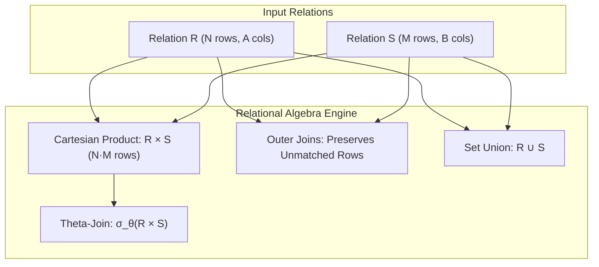
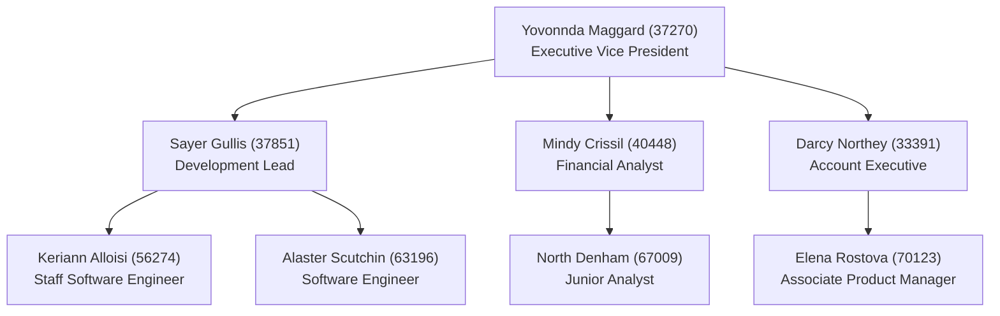
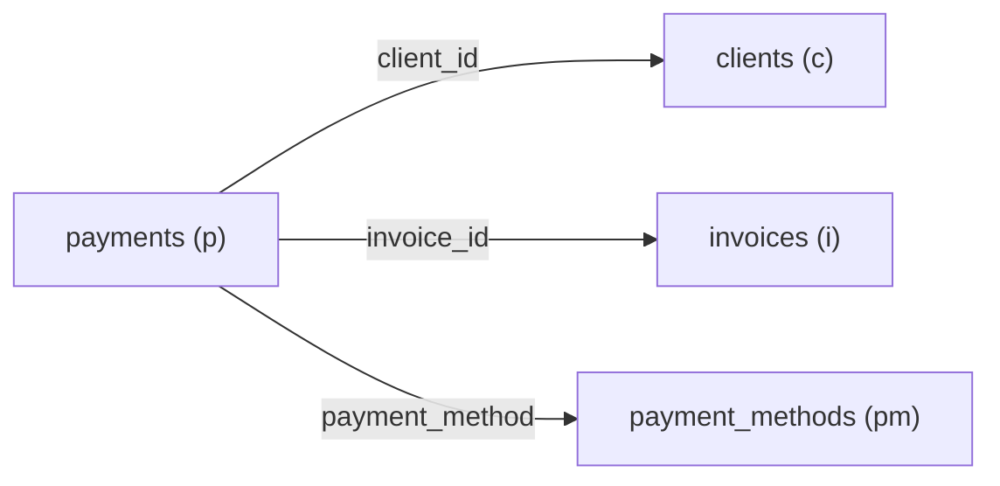
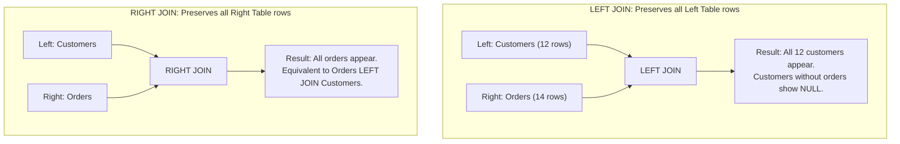
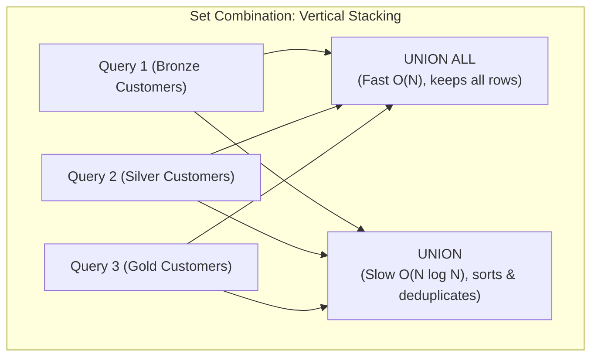
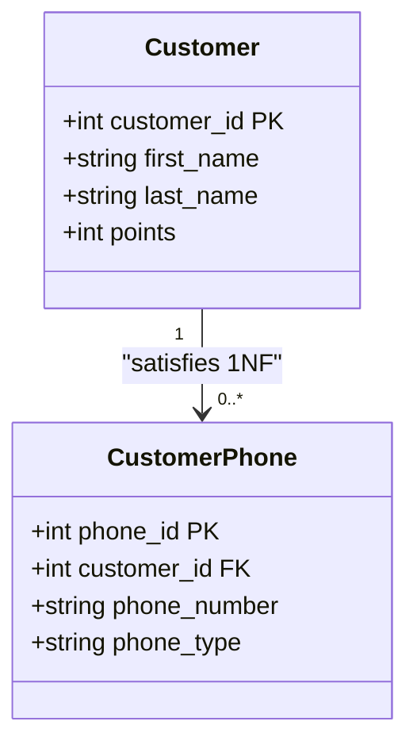
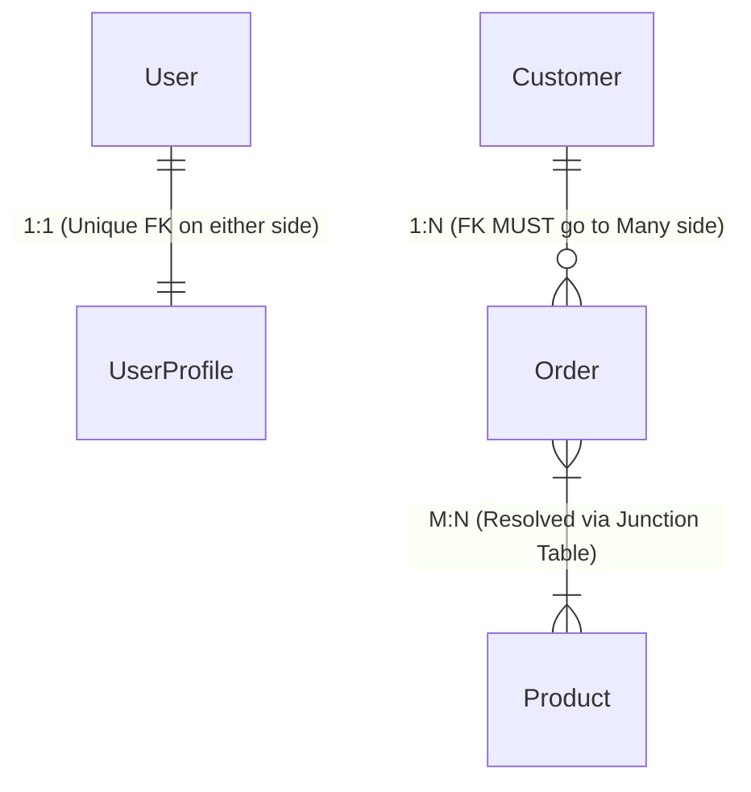
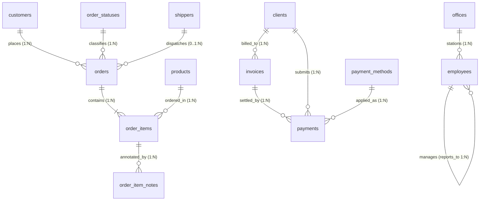
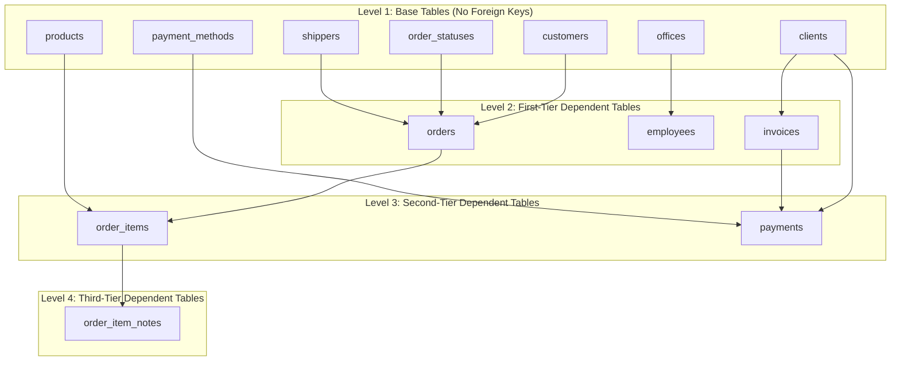
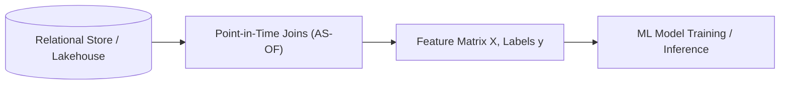

# Database — SQL (2): Multi-Table Queries, Relational Joins, and Entity-Relationship Modeling

[Back to Module 02](../README.md) · [Back to the master roadmap](../../README.md)

**Session date:** 2026-11-20 · **Module:** 02 — Mathematics for Machine Learning (Calculus & Linear Algebra)  
**Format:** Textbook-grade study guide, relational algebra formulations, Mermaid entity-relationship diagrams, SQL query references, and three executable SQLite/Python notebooks.

---

## Overview

In real-world data science, machine learning feature stores, and enterprise analytics, data rarely resides in an isolated flat table. Normalization distributes operational entities—such as users, orders, line items, catalog products, and invoices—across interconnected relations to eliminate redundant storage and prevent update anomalies. To extract meaningful datasets, construct predictive features, and train models, practitioners must master **multi-table querying**, understand the formal mathematics of **relational algebra**, and design robust schemas using **Entity-Relationship (ER) modeling**.

This session builds complete mastery of multi-table database operations and relational schema design:

1. **Relational Algebra Foundations:** Formulating joins as constrained Cartesian products ($\sigma_\theta(R \times S)$), equi-joins, natural joins, semi-joins, anti-joins, outer joins, and set-theoretic operations ($\cup, \cap, \setminus$).
2. **Multi-Table Querying with `INNER JOIN`:** Explicit join semantics with `ON` predicates, table aliasing, column disambiguation, and computing line-item totals across joined catalog tables.
3. **Hierarchical Relationships via `SELF JOIN`:** Modeling tree- and graph-structured entities—such as corporate employee-to-manager hierarchies—by joining a relation back onto itself with distinct aliases.
4. **N-Way Complex Joins:** Chaining three or more tables across transactional pipelines (such as order fulfillment and client invoicing) and inspecting query execution plans.
5. **Compound Join Conditions:** Joining entities governed by composite primary and foreign keys using multi-attribute matching (`ON A.id1 = B.id1 AND A.id2 = B.id2`).
6. **Explicit vs. Implicit Joins and Cross Join Pitfalls:** Comparing modern ANSI SQL-92 explicit syntax with legacy SQL-89 comma syntax, and dissecting the accidental Cartesian disaster ($O(N \cdot M)$ row explosions) caused by omitted `WHERE` clauses.
7. **Outer Joins and Set Operations:** Unilateral row preservation with `LEFT JOIN` and `RIGHT JOIN`, anti-joins for churn/unmatched detection, multi-table outer chains, syntactic brevity with `USING (...)`, and vertical set unioning with `UNION` and `UNION ALL` for loyalty segmentation.
8. **Entity-Relationship (ER) Modeling & Normalization:** Translating business requirements into entities, attributes (simple, composite, derived, multi-valued), cardinalities (1:1, 1:N, M:N), participation constraints, resolving M:N relationships via junction tables, and foreign key placement rules.
9. **Implementing ER Diagrams in DBMS (DDL & DML):** Topological execution ordering for table creation, referential integrity with cascading updates/deletes, and flexible `INSERT INTO` batch ingestion.
10. **Machine Learning & Data Engineering Connections:** Feature store entity graphs, point-in-time ("as-of") joins to prevent temporal data leakage, and dimensional star versus snowflake schemas in analytical data lakes.

---

## Learning outcomes

By the end of this session, you should be able to:

- State the formal definitions of Cartesian product, theta-join, equi-join, natural join, and outer joins in relational algebra.
- Write multi-table `INNER JOIN` queries using explicit `ON` conditions and concise table aliases.
- Implement `SELF JOIN` queries on recursive foreign key relationships (such as organizational hierarchies) and explain why table aliasing is strictly mandatory.
- Construct compound join conditions to connect tables with multi-column composite primary and foreign keys.
- Explain the behavioral and performance hazards of legacy implicit comma-join syntax and distinguish intentional `CROSS JOIN` operations from accidental Cartesian products.
- Apply `LEFT JOIN` and `RIGHT JOIN` to preserve non-matching rows, formulate anti-joins (`WHERE right_key IS NULL`) to detect zero-activity records, and chain multiple outer joins correctly.
- Simplify join predicates using the `USING (...)` clause and identify engine dialect constraints.
- Combine heterogeneous result sets vertically with `UNION` and `UNION ALL`, enforce column alignment and type compatibility, and implement customer tier classification.
- Design an Entity-Relationship Diagram (ERD) adhering to First Normal Form (1NF), decomposing multi-valued attributes and resolving many-to-many (M:N) relationships using junction tables.
- Establish the topological dependency sequence for Data Definition Language (`CREATE TABLE`) scripts and enforce referential integrity with `ON UPDATE CASCADE`.

---

## 1. Relational Algebra Foundations of Table Operations

Relational databases implement the mathematical principles introduced by E.F. Codd in 1970. Under the relational model, a **relation** $R$ is a mathematical subset of the Cartesian product of $k$ attribute domains:

$$R \subseteq D_1 \times D_2 \times \dots \times D_k$$

Each element of $R$ is a **tuple** (row), and each component is an **attribute** (column value). Relational operations take one or more relations as input and output a new relation.



### 1.1 The Cartesian Product ($R \times S$)

The **Cartesian product** (or cross product) combines every tuple of relation $R$ with every tuple of relation $S$:

$$R \times S = \{ (r_1, \dots, r_p, s_1, \dots, s_q) \mid (r_1, \dots, r_p) \in R \land (s_1, \dots, s_q) \in S \}$$

If $|R| = N$ and $|S| = M$, then the cardinality of the product is $|R \times S| = N \cdot M$. If $R$ has $p$ attributes and $S$ has $q$ attributes, the resulting relation has degree $p + q$.

> [!WARNING]
> Unconstrained Cartesian products grow quadratically. If table $R$ has $10^6$ customer records and table $S$ has $10^7$ transaction records, $R \times S$ evaluates to $10^{13}$ tuples, instantly causing out-of-memory crashes on modern database instances.

### 1.2 Theta-Join ($R \bowtie_\theta S$) and Equi-Join

A **theta-join** is defined as a selection operation ($\sigma$) applied over the Cartesian product of two relations:

$$R \bowtie_\theta S = \sigma_\theta(R \times S)$$

where $\theta$ is a propositional condition involving comparison operators ($=, \neq, <, \le, >, \ge$).

When the comparison operator is exclusively equality ($=$), the operation is termed an **equi-join**:

$$R \bowtie_{R.k = S.k} S = \{ (r, s) \mid r \in R, s \in S, r.k = s.k \}$$

In standard SQL, the equi-join is expressed directly through the `INNER JOIN ... ON` clause.

### 1.3 Natural Join ($R \bowtie S$)

The **natural join** is a specialized equi-join over all attributes that share the same identifier in both schemas. It performs equality matching on shared attributes and projects away duplicate attribute columns:

$$R \bowtie S = \pi_{Attr(R) \cup Attr(S)}(\sigma_{R.A_1 = S.A_1 \land \dots \land R.A_m = S.A_m}(R \times S))$$

While mathematically concise, production engineering typically avoids natural joins because altering column names in upstream tables silently alters the join condition, causing breaking schema drift.

### 1.4 Outer Joins ($R \mathbin{\text{⟕}} S$, $R \mathbin{\text{⟖}} S$, $R \mathbin{\text{⟗}} S$)

Standard inner joins discard tuples that fail the join predicate. In business reporting, however, we often need to retain all rows from one or both tables, padding missing attributes with `NULL` ($\omega$):

- **Left Outer Join ($R \mathbin{\text{⟕}} S$):** Preserves every tuple in $R$. If no matching tuple exists in $S$, attributes of $S$ are filled with $\omega$:

  $$R \mathbin{\text{⟕}} S = (R \bowtie S) \cup ((R \setminus \pi_{Attr(R)}(R \bowtie S)) \times \{ \omega_S \})$$

- **Right Outer Join ($R \mathbin{\text{⟖}} S$):** Symmetrically preserves every tuple in $S$.
- **Full Outer Join ($R \mathbin{\text{⟗}} S$):** Preserves all tuples from both $R$ and $S$:

  $$R \mathbin{\text{⟗}} S = (R \mathbin{\text{⟕}} S) \cup (R \mathbin{\text{⟖}} S)$$

### 1.5 Set-Theoretic Operations ($R \cup S$, $R \setminus S$, $R \cap S$)

Relational tables can be combined vertically using standard set operations, provided they are **union-compatible**:
1. $R$ and $S$ must possess the exact same number of attributes (identical degree).
2. Corresponding attributes in both relations must share compatible data types.

The standard operations include:
- **Set Union ($R \cup S$):** Yields all tuples appearing in $R$, $S$, or both, with duplicates eliminated.
- **Multiset Union ($R \cup_{\text{bag}} S$):** Preserves duplicate tuples (`UNION ALL` in SQL).
- **Set Difference ($R \setminus S$):** Yields tuples present in $R$ but absent from $S$ (`EXCEPT` in SQL).
- **Set Intersection ($R \cap S$):** Yields tuples present in both $R$ and $S$ (`INTERSECT` in SQL).

---

## 2. Multi-Table Querying with `INNER JOIN`

### 2.1 Explicit Join Syntax and Table Aliasing

The `INNER JOIN` statement evaluates the Cartesian product of two tables and retains only rows satisfying the `ON` condition. In production SQL, explicit table aliasing is essential for readability and disambiguation:

```sql
SELECT 
    o.order_id,
    o.order_date,
    c.first_name,
    c.last_name
FROM orders AS o
INNER JOIN customers AS c
    ON o.customer_id = c.customer_id;
```

Here:
- `orders AS o` binds the alias `o` to `orders`. (The `AS` keyword is optional; `orders o` is equivalent).
- `ON o.customer_id = c.customer_id` specifies the equi-join condition linking the foreign key to the primary key.
- Projection resolves unambiguous column references without repeating long table names.

| `order_id` | `order_date` | `first_name` | `last_name` |
| :---: | :---: | :--- | :--- |
| `1` | `2019-01-30` | Elka | Twiddell |
| `2` | `2018-08-02` | Ilene | Dowson |
| `3` | `2017-12-01` | Thacher | Naseby |
| `4` | `2017-01-22` | Ines | Brushfield |
| `5` | `2017-08-25` | Clemmie | Betchley |

### 2.2 Projection and Derived Calculations Across Relations

Joins allow computing values that combine attributes from different entities. For instance, calculating line-item values requires attributes from both `order_items` (`quantity`, `unit_price`) and `products` (`name`):

```sql
SELECT 
    oi.order_id,
    p.product_id,
    p.name AS product_name,
    oi.quantity,
    oi.unit_price,
    ROUND(oi.quantity * oi.unit_price, 2) AS total_item_price
FROM order_items oi
JOIN products p
    ON oi.product_id = p.product_id
ORDER BY oi.order_id, total_item_price DESC;
```

### 2.3 Hierarchical and Graph Data: The `SELF JOIN`

In many business domains, a single entity contains recursive self-references. In a corporate staff roster, an employee reports to a manager, but the manager is also an employee residing in the very same table:



To reconstruct this hierarchy, we perform a **self-join** by referencing `employees` twice with distinct aliases:

```sql
SELECT 
    e.employee_id,
    e.first_name || ' ' || e.last_name AS employee_name,
    e.job_title,
    m.employee_id AS manager_id,
    m.first_name || ' ' || m.last_name AS manager_name
FROM employees e
JOIN employees m
    ON e.reports_to = m.employee_id
ORDER BY m.employee_id, e.employee_id;
```

> [!IMPORTANT]
> In a self-join, distinct aliases (`e` for employee and `m` for manager) are mandatory. Omitting aliases causes ambiguous identifier errors because the engine cannot distinguish the source of `reports_to` and `employee_id`.
> 
> Furthermore, an `INNER JOIN` automatically drops the top executive (whose `reports_to` is `NULL`). To include the CEO/President, a `LEFT JOIN` must be used instead.

### 2.4 Chaining Multiple Tables (N-Way Joins)

Database queries frequently traverse multiple foreign key relationships in a single pipeline.

#### Case A: Three-Table Order Tracking (`sql_store`)

To report an order's ID, placement date, customer full name, and human-readable fulfillment status:

```sql
SELECT 
    o.order_id,
    o.order_date,
    c.first_name || ' ' || c.last_name AS customer_name,
    os.name AS order_status
FROM orders o
JOIN customers c
    ON o.customer_id = c.customer_id
JOIN order_statuses os
    ON o.status = os.order_status_id
ORDER BY o.order_id;
```

#### Case B: Four-Table Invoicing Settlement Pipeline (`sql_invoicing`)

In commercial accounting, tracking client payments requires joining `payments`, `clients`, `invoices`, and `payment_methods`:

```sql
SELECT 
    p.payment_id,
    p.date AS payment_date,
    p.amount,
    c.name AS client_name,
    c.phone AS client_phone,
    i.number AS invoice_number,
    i.invoice_total,
    i.payment_total,
    pm.name AS payment_method
FROM payments p
JOIN clients c
    ON p.client_id = c.client_id
JOIN invoices i
    ON p.invoice_id = i.invoice_id
JOIN payment_methods pm
    ON p.payment_method = pm.payment_method_id
ORDER BY p.payment_id;
```



### 2.5 Compound Join Conditions (Composite Keys)

When a table is indexed by a composite primary key—such as `order_items`, which is keyed by `(order_id, product_id)`—joining to a related child table requires matching across **all composite components**:

```sql
SELECT 
    oi.order_id,
    oi.product_id,
    oi.quantity,
    oi.unit_price,
    oin.note AS packaging_note
FROM order_items oi
JOIN order_item_notes oin
    ON oi.order_id = oin.order_id
   AND oi.product_id = oin.product_id
ORDER BY oi.order_id, oi.product_id;
```

Matching on only one key attribute (e.g. `oi.order_id = oin.order_id`) would produce a partial Cartesian product, corrupting notes across distinct products within the same order.

### 2.6 Explicit vs. Implicit Joins and the Cartesian Disaster

SQL provides two syntaxes for expressing joins:

1. **Explicit ANSI SQL-92 Syntax (Recommended):**
   ```sql
   SELECT *
   FROM orders o
   JOIN customers c
       ON o.customer_id = c.customer_id;
   ```

2. **Implicit ANSI SQL-89 Syntax (Legacy):**
   ```sql
   SELECT *
   FROM orders o, customers c
   WHERE o.customer_id = c.customer_id;
   ```

While mathematically equivalent when correctly written, the implicit syntax carries a dangerous vulnerability: **if the developer forgets the `WHERE` clause, the query executes an unintentional `CROSS JOIN`**.

```sql
-- DANGER: Omitted WHERE condition produces an accidental Cartesian Product!
SELECT c.first_name, p.name
FROM customers c, products p;
```

If `customers` has $100{,}000$ rows and `products` has $50{,}000$ rows, omitting `WHERE` generates $5{,}000{,}000{,}000$ rows, exhausting disk temp space and CPU resources.

When a Cartesian product is genuinely intended (such as generating all combinations of product SKUs and regional distribution centers), write `CROSS JOIN` explicitly:

```sql
-- Legitimate Cross Join: Generating complete test coverage matrix
SELECT 
    p.name AS product_name,
    s.name AS shipper_name
FROM products p
CROSS JOIN shippers s
ORDER BY p.name, s.name;
```

---

## 3. Outer Joins, the `USING` Clause, and Set Operations

### 3.1 Unilateral Row Preservation: `LEFT JOIN` and `RIGHT JOIN`

Consider querying all registered customers alongside their orders:
- Under an `INNER JOIN`, customers who have never placed an order are silently excluded.
- Under an **outer join**, all rows from the designated relation are preserved, padding missing attributes with `NULL`.



```sql
SELECT 
    c.customer_id,
    c.first_name,
    c.last_name,
    o.order_id,
    o.order_date
FROM customers c
LEFT JOIN orders o
    ON c.customer_id = o.customer_id
ORDER BY c.customer_id, o.order_id;
```

| `customer_id` | `first_name` | `last_name` | `order_id` | `order_date` |
| :---: | :--- | :--- | :---: | :---: |
| `1` | Babara | MacCaffrey | *NULL* | *NULL* |
| `2` | Ines | Brushfield | `4` | `2017-01-22` |
| `2` | Ines | Brushfield | `7` | `2018-09-22` |
| `3` | Freddi | Boagey | *NULL* | *NULL* |
| `4` | Ambur | Roseburgh | *NULL* | *NULL* |
| `5` | Clemmie | Betchley | `5` | `2017-08-25` |

#### Detecting Inactive Entities: The Anti-Join Pattern

A classic data engineering use case for `LEFT JOIN` is the **anti-join**—identifying records in table $A$ that have no matching activity in table $B$:

```sql
-- Identify churned / zero-order customers
SELECT 
    c.customer_id,
    c.first_name,
    c.last_name,
    c.phone,
    c.points
FROM customers c
LEFT JOIN orders o
    ON c.customer_id = o.customer_id
WHERE o.order_id IS NULL
ORDER BY c.customer_id;
```

### 3.2 Chaining Multiple Outer Joins

When tracking an order from customer placement to carrier dispatch, both relationships may be optional:
1. Some customers have no orders (`customers LEFT JOIN orders`).
2. Some orders have not yet been assigned a carrier or shipped (`orders LEFT JOIN shippers`).

```sql
SELECT 
    c.customer_id,
    c.first_name || ' ' || c.last_name AS customer_name,
    o.order_id,
    o.order_date,
    sh.name AS shipper_name
FROM customers c
LEFT JOIN orders o
    ON c.customer_id = o.customer_id
LEFT JOIN shippers sh
    ON o.shipper_id = sh.shipper_id
ORDER BY c.customer_id, o.order_id;
```

> [!CAUTION]
> Avoid following a `LEFT JOIN` with an `INNER JOIN` on the optional relation. For example:
> ```sql
> FROM customers c
> LEFT JOIN orders o ON c.customer_id = o.customer_id
> JOIN shippers sh ON o.shipper_id = sh.shipper_id -- BUG: Re-filters non-order rows!
> ```
> Because `o.shipper_id` is `NULL` for customers without orders, the second `INNER JOIN` discards them, converting the entire query back into an inner join. Always chain consecutive outer joins with `LEFT JOIN`.

### 3.3 The `USING (...)` Clause

When foreign key and primary key columns share the identical column name across both tables, the `USING` clause provides a clean shorthand:

```sql
-- Single-attribute USING
SELECT 
    c.customer_id,
    c.first_name,
    o.order_id
FROM customers c
JOIN orders o
    USING (customer_id);

-- Composite-attribute USING
SELECT 
    oi.order_id,
    oi.product_id,
    oi.quantity,
    oin.note
FROM order_items oi
JOIN order_item_notes oin
    USING (order_id, product_id);
```

In standard SQL, `USING (col)` has a distinct advantage over `ON A.col = B.col`: `SELECT *` collapses the shared column into a single output column rather than producing duplicate columns.

### 3.4 Combining Query Results with `UNION` and `UNION ALL`

While joins connect relations **horizontally** (expanding attributes), set operations combine relations **vertically** (appending tuples).



| Criterion | `UNION` | `UNION ALL` |
| :--- | :--- | :--- |
| **Duplicate Handling** | Deduplicates identical rows | Retains all duplicate rows |
| **Computational Complexity** | $O(N \log N)$ (requires sorting / hash table) | $O(N)$ (pure streaming concatenation) |
| **Memory Footprint** | Higher (buffers rows to detect duplicates) | Minimal (streams directly to client) |
| **Standard Recommendation** | Use only when deduplication is required | Default choice for non-overlapping subsets |

#### Analytical Application: Customer Loyalty Tier Classification

When complex categorization logic exceeds the readability of nested scalar expressions, `UNION` cleanly partitions records into labeled segments:

```sql
SELECT customer_id, first_name, last_name, points, 'Bronze' AS tier
FROM customers
WHERE points < 2000

UNION

SELECT customer_id, first_name, last_name, points, 'Silver' AS tier
FROM customers
WHERE points BETWEEN 2000 AND 3000

UNION

SELECT customer_id, first_name, last_name, points, 'Gold' AS tier
FROM customers
WHERE points > 3000

ORDER BY points DESC;
```

---

## 4. Entity-Relationship (ER) Modeling and Schema Architecture

### 4.1 The Data Modeling Lifecycle

Building high-performance production databases requires transforming loose business requirements into formal conceptual models, followed by logical relational schemas:


### 4.2 Core ER Primitives

1. **Entity:** An object, event, or concept about which data is captured (e.g. `Customer`, `Product`, `Order`).
2. **Attribute:** A property or characteristic describing an entity:
   - **Simple / Atomic Attribute:** Indivisible unit of data (e.g. `points`, `unit_price`).
   - **Composite Attribute:** Can be logically decomposed into sub-attributes (e.g. `name` into `first_name` and `last_name`; `address` into `street`, `city`, `state`).
   - **Derived Attribute:** Can be calculated on the fly from other stored attributes (e.g. `age` derived from `birth_date`; `total_price` derived from `quantity * unit_price`).
   - **Multi-Valued Attribute:** An attribute that can hold multiple simultaneous values for a single entity instance (e.g. multiple phone numbers, multiple product items in an order).

### 4.3 Why Multi-Valued Attributes Violate Normalization (1NF)

Storing multi-valued attributes directly within an entity table—such as comma-separated lists (`"804-427-9456, 804-555-1212"`) or indexed columns (`item_1`, `item_2`, `item_3`)—creates severe design pathologies:
- **Index Impairment:** Searching for a single value requires full table scans with substring searches (`LIKE '%val%'`), bypassing B-tree indices.
- **Update Anomalies:** Modifying or deleting an item requires parsing and updating string blocks.
- **First Normal Form (1NF) Violation:** Relational theory requires all attribute values to be strictly **atomic**.

To satisfy 1NF, every multi-valued attribute must be extracted into its own separate table connected by a foreign key.



### 4.4 Relationship Cardinalities and Foreign Key Placement Rules

A **cardinality ratio** specifies the maximum number of relationship instances in which an entity can participate:



1. **One-to-One (1:1):** Each instance of Entity A relates to at most one instance of Entity B.
   - *Placement Rule:* The foreign key can be placed in either table, decorated with a `UNIQUE` constraint.
2. **One-to-Many (1:N):** One customer places many orders; each order belongs to exactly one customer.
   - *Placement Rule:* **The foreign key MUST reside in the table on the "Many" side** (`orders.customer_id`). Placing the foreign key on the "One" side would require multi-valued attributes, violating 1NF.
3. **Many-to-Many (M:N):** An order contains many products; a product appears in many orders.
   - *Resolution Rule:* An M:N relationship **cannot be implemented directly** with foreign keys in either table. It must be decomposed into two 1:N relationships via an intermediate **associative / junction table** (`order_items`) whose primary key is the composite pair `(order_id, product_id)`.

### 4.5 Participation Constraints

- **Total Participation (Mandatory):** Every instance of an entity *must* participate in the relationship (e.g. every `order` must be associated with an existing `customer`). Represented by a non-nullable foreign key (`customer_id INT NOT NULL`).
- **Partial Participation (Optional):** An entity instance *may* exist without participating in the relationship (e.g. a customer might not yet have placed an order; an order might not yet have a designated `shipper_id`). Represented by a nullable foreign key (`shipper_id INT DEFAULT NULL`).

### 4.6 Enterprise Architecture ERD

The complete architecture of our operational dataset spans retail fulfillment, personnel management, and corporate accounts receivable:



---

## 5. Implementing ER Diagrams in SQL (DDL & DML)

### 5.1 DDL Execution Order and Foreign Key Dependency Graphs

When executing `CREATE TABLE` statements, the DBMS validates that every referenced table and primary key already exists. Therefore, tables must be declared in **topological order** based on their dependency graph:



When dropping tables, the order must be strictly reversed (`DROP TABLE IF EXISTS ...` child tables first, then parent tables) to avoid foreign key violation errors.

### 5.2 Referential Integrity and Cascade Actions

A foreign key constraint ensures referential integrity: no record can reference a non-existent parent primary key. Furthermore, the engine defines policies when a parent key is updated or deleted:

```sql
CONSTRAINT fk_orders_customers
    FOREIGN KEY (customer_id) 
    REFERENCES customers(customer_id) 
    ON UPDATE CASCADE 
    ON DELETE RESTRICT
```

| Action | Behavior on Parent Record Modification |
| :--- | :--- |
| `CASCADE` | Automatically propagates the modification/deletion to all child records. |
| `RESTRICT` / `NO ACTION` | Rejects the operation if matching child records exist. |
| `SET NULL` | Sets the foreign key column in all child records to `NULL`. |
| `SET DEFAULT` | Sets the foreign key column in all child records to its defined default value. |

### 5.3 Data Manipulation Language (DML) Ingestion

SQL supports multiple syntaxes for inserting records into normalized tables:

```sql
-- 1. Positional Insert (Assumes all columns provided in strict physical schema order)
INSERT INTO shippers VALUES (6, 'Global Cargo Express');

-- 2. Explicit Column Listing (Safe against schema migrations, allows omissions of nullables/defaults)
INSERT INTO customers (first_name, last_name, birth_date, address, city, state, points)
VALUES ('Daphne', 'Vance', '1995-12-04', '742 Evergreen Terrace', 'Springfield', 'OR', 1250);

-- 3. Multi-Row Bulk Insert (High-throughput batch insertion in a single round-trip)
INSERT INTO products (name, quantity_in_stock, unit_price)
VALUES 
    ('Organic Matcha Powder', 45, 14.50),
    ('Stainless Steel Whisk', 120, 6.25),
    ('Ceramic Tea Bowl', 30, 18.00);
```

---

## 6. Connection to Machine Learning and Data Engineering

Relational database joins and schema designs directly impact downstream machine learning pipelines:



### 6.1 Point-in-Time ("AS-OF") Joins to Prevent Data Leakage

In predictive modeling (e.g. churn forecasting, fraud detection), training data requires joining user metadata with transactional event streams. If an engineer performs a naive `LEFT JOIN` on customer loyalty points without temporal bounding, the query leaks **future points** into historical observations:

$$\text{Observation Timestamp: } t_{\text{event}} \implies \text{Features must strictly satisfy: } t_{\text{feature}} \le t_{\text{event}}$$

In modern feature stores (Feast, Hopsworks, BigQuery), temporal joins evaluate:

```sql
SELECT 
    e.event_id,
    e.user_id,
    e.event_timestamp,
    f.feature_value
FROM events e
ASOF JOIN user_features f
    ON e.user_id = f.user_id
   AND f.feature_timestamp <= e.event_timestamp;
```

### 6.2 Dimensional Modeling: Star vs. Snowflake Schemas in AI Data Lakes

| Criterion | Star Schema | Snowflake Schema |
| :--- | :--- | :--- |
| **Normalization Level** | Denormalized dimension tables (2NF) | Fully normalized dimension tables (3NF) |
| **Join Complexity** | Lower (single hop from Fact to Dimension) | Higher (multiple hops across normalized hierarchy) |
| **Query Performance** | Fast aggregations for BI and model training | Slower query throughput due to multi-way joins |
| **Data Redundancy** | Higher (dimension attributes repeated) | Minimal (strictly normalized) |
| **ML Data Lake Role** | Gold analytical tables for feature ingestion | Silver operational audit layer |

---

## 7. Comprehensive Worked Practice Problems

The following ten analytical exercises validate end-to-end fluency with multi-table queries, self-joins, composite keys, outer joins, and set operations against `sql_store_seed.sql`.

### Problem 1: Basic Two-Table Inner Join with Projection

**Question:** Write a query to return the `order_id`, `order_date`, and customer `first_name` and `last_name` for all orders placed in the year 2018.

```sql
SELECT 
    o.order_id,
    o.order_date,
    c.first_name,
    c.last_name
FROM orders o
JOIN customers c
    ON o.customer_id = c.customer_id
WHERE o.order_date >= '2018-01-01' 
  AND o.order_date <= '2018-12-31'
ORDER BY o.order_id;
```

*Result:* 5 rows (`order_id` 2, 6, 7, 8, 10).

---

### Problem 2: Computed Line-Item Value Join

**Question:** Retrieve all line items for `order_id = 2`. Return the `product_id`, product `name`, `quantity`, `unit_price`, and calculated `item_total` (`quantity * unit_price`), ordered by `item_total` descending.

```sql
SELECT 
    oi.product_id,
    p.name,
    oi.quantity,
    oi.unit_price,
    ROUND(oi.quantity * oi.unit_price, 2) AS item_total
FROM order_items oi
JOIN products p
    ON oi.product_id = p.product_id
WHERE oi.order_id = 2
ORDER BY item_total DESC;
```

*Result:* 3 rows:
1. `product_id = 1` (Foam Dinner Plate), qty 2, price 9.10 $\implies 18.20$
2. `product_id = 4` (Brocolinni), qty 4, price 1.66 $\implies 6.64$
3. `product_id = 6` (Petit Baguette), qty 2, price 2.94 $\implies 5.88$

---

### Problem 3: Self-Join on Employee Management Hierarchy

**Question:** Return every employee's full name, job title, and their direct manager's full name and job title.

```sql
SELECT 
    e.first_name || ' ' || e.last_name AS employee_name,
    e.job_title AS employee_title,
    m.first_name || ' ' || m.last_name AS manager_name,
    m.job_title AS manager_title
FROM employees e
JOIN employees m
    ON e.reports_to = m.employee_id
ORDER BY manager_name, employee_name;
```

*Result:* 7 rows. Yovonnda Maggard is excluded from this result because her `reports_to` is `NULL`.

---

### Problem 4: Three-Table Join (Orders, Customers, Statuses)

**Question:** Generate an order fulfillment summary displaying `order_id`, customer full name, `order_date`, and the textual status name for all orders whose status is not `'Delivered'`.

```sql
SELECT 
    o.order_id,
    c.first_name || ' ' || c.last_name AS customer_name,
    o.order_date,
    s.name AS status_name
FROM orders o
JOIN customers c
    ON o.customer_id = c.customer_id
JOIN order_statuses s
    ON o.status = s.order_status_id
WHERE s.name != 'Delivered'
ORDER BY o.order_id;
```

*Result:* 14 rows (statuses `'Processed'` and `'Shipped'`).

---

### Problem 5: Four-Table Invoicing Settlement Audit

**Question:** For every payment received, list the `payment_id`, payment `date`, payment `amount`, client `name`, invoice `number`, and the payment method `name`.

```sql
SELECT 
    p.payment_id,
    p.date,
    p.amount,
    c.name AS client_name,
    i.number AS invoice_number,
    pm.name AS payment_method
FROM payments p
JOIN clients c
    ON p.client_id = c.client_id
JOIN invoices i
    ON p.invoice_id = i.invoice_id
JOIN payment_methods pm
    ON p.payment_method = pm.payment_method_id
ORDER BY p.payment_id;
```

*Result:* 8 rows representing all payment records.

---

### Problem 6: Compound Key Join with Annotations

**Question:** Retrieve all order line items that have a special packaging note. Include `order_id`, product `name`, `quantity`, and the `note`.

```sql
SELECT 
    oi.order_id,
    p.name AS product_name,
    oi.quantity,
    oin.note AS packing_instructions
FROM order_items oi
JOIN products p
    ON oi.product_id = p.product_id
JOIN order_item_notes oin
    ON oi.order_id = oin.order_id
   AND oi.product_id = oin.product_id
ORDER BY oi.order_id, oi.product_id;
```

*Result:* 8 annotated line items.

---

### Problem 7: Left Outer Join for Customer Order Auditing

**Question:** Produce a list of all customers. For customers who have placed orders, display the `order_id`. If a customer has never placed an order, `order_id` must show `NULL`. Sort by `customer_id`.

```sql
SELECT 
    c.customer_id,
    c.first_name,
    c.last_name,
    o.order_id
FROM customers c
LEFT JOIN orders o
    ON c.customer_id = o.customer_id
ORDER BY c.customer_id, o.order_id;
```

*Result:* 19 rows. Demonstrates that customers 1, 3, 4, 9, and 11 have no orders.

---

### Problem 8: Multi-Level Outer Join (Customers -> Orders -> Shippers)

**Question:** Write a query that shows all customers, their orders (if any), and the shipping carrier assigned to that order (if any). Display customer full name, `order_id`, and shipper `name`.

```sql
SELECT 
    c.first_name || ' ' || c.last_name AS customer,
    o.order_id,
    sh.name AS carrier
FROM customers c
LEFT JOIN orders o
    ON c.customer_id = o.customer_id
LEFT JOIN shippers sh
    ON o.shipper_id = sh.shipper_id
ORDER BY c.customer_id, o.order_id;
```

*Result:* 19 rows preserving non-ordering customers and unshipped orders.

---

### Problem 9: Anti-Join for Unsold Inventory

**Question:** Write an anti-join query to identify all products in the catalog that have never been purchased in any order.

```sql
SELECT 
    p.product_id,
    p.name,
    p.quantity_in_stock,
    p.unit_price
FROM products p
LEFT JOIN order_items oi
    ON p.product_id = oi.product_id
WHERE oi.order_id IS NULL
ORDER BY p.product_id;
```

*Result:* 2 products (`product_id = 7` Sweet Pea Sprouts, `product_id = 12` Olive Oil - Extra Virgin).

---

### Problem 10: Set Union Loyalty Segmentation

**Question:** Categorize all customers into loyalty tiers (`Bronze`: $< 1500$, `Silver`: $1500 \le \text{pts} \le 2500$, `Gold`: $> 2500$). Return `customer_id`, customer full name, `points`, and `tier`, sorted by points descending.

```sql
SELECT 
    customer_id,
    first_name || ' ' || last_name AS customer_name,
    points,
    'Bronze' AS loyalty_tier
FROM customers
WHERE points < 1500

UNION

SELECT 
    customer_id,
    first_name || ' ' || last_name AS customer_name,
    points,
    'Silver' AS loyalty_tier
FROM customers
WHERE points BETWEEN 1500 AND 2500

UNION

SELECT 
    customer_id,
    first_name || ' ' || last_name AS customer_name,
    points,
    'Gold' AS loyalty_tier
FROM customers
WHERE points > 2500

ORDER BY points DESC;
```

*Result:* 12 rows cleanly categorized.

---

## 8. Summary, Key Takeaways & Cheat Sheet

### Relational Join & Set Operation Reference Table

| SQL Clause | Mathematical Operation | Rows Returned | Handling of Unmatched Rows |
| :--- | :--- | :--- | :--- |
| `INNER JOIN` | Equi-join $\sigma_{R.k = S.k}(R \times S)$ | Only pairs where $R.k = S.k$ | Dropped from both relations |
| `LEFT JOIN` | Left Outer Join $R \mathbin{\text{⟕}} S$ | All tuples of $R$ + matched $S$ | $S$ attributes set to `NULL` |
| `RIGHT JOIN` | Right Outer Join $R \mathbin{\text{⟖}} S$ | All tuples of $S$ + matched $R$ | $R$ attributes set to `NULL` |
| `FULL JOIN` | Full Outer Join $R \mathbin{\text{⟗}} S$ | All tuples from both relations | Missing attributes set to `NULL` |
| `CROSS JOIN` | Cartesian Product $R \times S$ | $|R| \cdot |S|$ tuples | Every tuple paired unconditionally |
| `UNION` | Set Union $R \cup S$ | Distinct tuples from both queries | Automatically deduplicates |
| `UNION ALL` | Multiset Union $R \cup_{\text{bag}} S$ | All tuples from both queries | Retains duplicates; $O(N)$ streaming |

### Relational Design Rules of Thumb

1. **Enforce 1NF:** Disallow multi-valued attributes and composite attributes; split them into independent columns or separate tables.
2. **Foreign Key Rule for 1:N:** The foreign key **must** be placed in the table on the "Many" side.
3. **Resolve M:N via Junction Tables:** Never attempt to link many-to-many relationships directly; create an associative entity with a composite primary key.
4. **Use Explicit Join Syntax:** Never use comma-joins (`FROM A, B WHERE ...`) in production to prevent catastrophic accidental Cartesian explosions.
5. **Topological Order for DDL:** Create independent lookup tables first, then dependent transactional tables. Drop in exact reverse order.

---

## References & Further Reading

- Codd, E. F. (1970). *A Relational Model of Data for Large Shared Data Banks*. Communications of the ACM, 13(6), 377–387.
- Garcia-Molina, H., Ullman, J. D., & Widom, J. (2008). *Database Systems: The Complete Book* (2nd ed.). Prentice Hall.
- Silberschatz, A., Korth, H. F., & Sudarshan, S. (2020). *Database System Concepts* (7th ed.). McGraw-Hill.
- SQLite Documentation. *Query Language Understood by SQLite — Joins*: <https://www.sqlite.org/optoverview.html>
- ANSI SQL-92 Specification (ISO/IEC 9075:1992).
