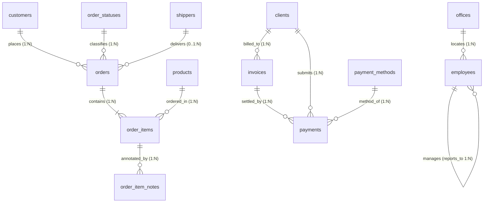

# Session Data Schema — Enterprise Relational Multi-Table Database

This directory contains the reproducible relational dataset used across the `Database - SQL (2)` notebooks, exercises, and practice labs.

## Overview

The database models three interrelated operational domains of a retail enterprise:
1. **Retail Order Fulfillment (`sql_store`):** Customers, catalog products, orders, statuses, shipping carriers, order line-items, and packaging notes.
2. **Human Resources Hierarchy (`sql_hr`):** Offices and employees with recursive manager-report relationships (for self-join practice).
3. **Invoicing & Accounts Receivable (`sql_invoicing`):** Clients, invoices, payment methods, and payment transactions (for 4-way join practice).

All tables are defined in `sql_store_seed.sql` with foreign key constraints, cascade rules (`ON UPDATE CASCADE`), and composite primary keys.

## Files

| File | Format | Description |
| :--- | :--- | :--- |
| `sql_store_seed.sql` | SQL DDL + DML | Full DDL schema creation and DML seed records for all 13 enterprise tables, compatible with SQLite, MySQL, and PostgreSQL. |

---

## Table Schemas

### Domain 1: Retail Order Fulfillment

#### 1. `customers` (12 rows)
Stores customer profiles, contact information, regional geography, and loyalty points balance.

| Column | Type | Constraints | Description |
| :--- | :--- | :--- | :--- |
| `customer_id` | `INTEGER` | `PRIMARY KEY` | Unique customer identifier |
| `first_name` | `TEXT` | `NOT NULL` | Customer first name |
| `last_name` | `TEXT` | `NOT NULL` | Customer last name |
| `birth_date` | `TEXT` | `NOT NULL` | ISO-8601 birth date (`YYYY-MM-DD`) |
| `phone` | `TEXT` | Nullable | Primary contact phone number |
| `address` | `TEXT` | `NOT NULL` | Street billing / shipping address |
| `city` | `TEXT` | `NOT NULL` | City name |
| `state` | `TEXT` | `NOT NULL` | Two-letter state code (`CA`, `FL`, `MA`, etc.) |
| `points` | `INTEGER` | `NOT NULL` | Customer loyalty reward points balance |

#### 2. `products` (13 rows)
Stores catalog merchandise, inventory on hand, and current unit list price.

| Column | Type | Constraints | Description |
| :--- | :--- | :--- | :--- |
| `product_id` | `INTEGER` | `PRIMARY KEY` | Unique SKU product identifier |
| `name` | `TEXT` | `NOT NULL` | Product descriptive name |
| `quantity_in_stock` | `INTEGER` | `NOT NULL` | Current units available in warehouse |
| `unit_price` | `REAL` | `NOT NULL` | Unit list price in USD |

#### 3. `shippers` (5 rows)
Stores third-party logistics and carrier freight partners.

| Column | Type | Constraints | Description |
| :--- | :--- | :--- | :--- |
| `shipper_id` | `INTEGER` | `PRIMARY KEY` | Unique carrier identifier |
| `name` | `TEXT` | `NOT NULL` | Logistics company name |

#### 4. `order_statuses` (3 rows)
Stores fulfillment lifecycle status lookups (`1` = Processed, `2` = Shipped, `3` = Delivered).

| Column | Type | Constraints | Description |
| :--- | :--- | :--- | :--- |
| `order_status_id` | `INTEGER` | `PRIMARY KEY` | Unique status code |
| `name` | `TEXT` | `NOT NULL` | Status label |

#### 5. `orders` (14 rows)
Header records capturing customer order placements, fulfillment timestamps, and delivery references.

| Column | Type | Constraints | Description |
| :--- | :--- | :--- | :--- |
| `order_id` | `INTEGER` | `PRIMARY KEY` | Unique order identifier |
| `customer_id` | `INTEGER` | `NOT NULL`, `FK -> customers(customer_id)` | Customer placing the order |
| `order_date` | `TEXT` | `NOT NULL` | Date order placed (`YYYY-MM-DD`) |
| `status` | `INTEGER` | `NOT NULL`, `FK -> order_statuses(order_status_id)` | Current order status |
| `comments` | `TEXT` | Nullable | Delivery notes or special instructions |
| `shipped_date` | `TEXT` | Nullable | Dispatch date (`YYYY-MM-DD`) or NULL if unshipped |
| `shipper_id` | `INTEGER` | Nullable, `FK -> shippers(shipper_id)` | Carrier handling fulfillment |

#### 6. `order_items` (22 rows)
Associative/junction table capturing line items with composite primary key `(order_id, product_id)`.

| Column | Type | Constraints | Description |
| :--- | :--- | :--- | :--- |
| `order_id` | `INTEGER` | `NOT NULL`, `PRIMARY KEY (1/2)`, `FK -> orders(order_id)` | Parent order |
| `product_id` | `INTEGER` | `NOT NULL`, `PRIMARY KEY (2/2)`, `FK -> products(product_id)` | Purchased product |
| `quantity` | `INTEGER` | `NOT NULL` | Units ordered |
| `unit_price` | `REAL` | `NOT NULL` | Unit price at transaction time |

#### 7. `order_item_notes` (8 rows)
Supplemental packing instructions referencing the composite key `(order_id, product_id)`.

| Column | Type | Constraints | Description |
| :--- | :--- | :--- | :--- |
| `note_id` | `INTEGER` | `PRIMARY KEY` | Unique note identifier |
| `order_id` | `INTEGER` | `NOT NULL`, `FK -> order_items(order_id, product_id)` | Parent order |
| `product_id` | `INTEGER` | `NOT NULL`, `FK -> order_items(order_id, product_id)` | Referenced line item |
| `note` | `TEXT` | `NOT NULL` | Handling/packing instruction |

---

### Domain 2: Human Resources Hierarchy

#### 8. `offices` (4 rows)
Corporate office physical locations.

| Column | Type | Constraints | Description |
| :--- | :--- | :--- | :--- |
| `office_id` | `INTEGER` | `PRIMARY KEY` | Unique office identifier |
| `address` | `TEXT` | `NOT NULL` | Street address |
| `city` | `TEXT` | `NOT NULL` | Office city |
| `state` | `TEXT` | `NOT NULL` | Two-letter state code |

#### 9. `employees` (8 rows)
Corporate staff directory with recursive manager hierarchy (`reports_to` self-referencing `employee_id`).

| Column | Type | Constraints | Description |
| :--- | :--- | :--- | :--- |
| `employee_id` | `INTEGER` | `PRIMARY KEY` | Unique employee badge number |
| `first_name` | `TEXT` | `NOT NULL` | Employee first name |
| `last_name` | `TEXT` | `NOT NULL` | Employee surname |
| `job_title` | `TEXT` | `NOT NULL` | Position title |
| `salary` | `INTEGER` | `NOT NULL` | Annual compensation (USD) |
| `reports_to` | `INTEGER` | Nullable, `FK -> employees(employee_id)` | Direct manager's ID (NULL for CEO/EVP) |
| `office_id` | `INTEGER` | `NOT NULL`, `FK -> offices(office_id)` | Base office location |

---

### Domain 3: Invoicing & Accounts Receivable

#### 10. `payment_methods` (4 rows)
Tender type dictionary (`Credit Card`, `Cash`, `PayPal`, `Wire Transfer`).

| Column | Type | Constraints | Description |
| :--- | :--- | :--- | :--- |
| `payment_method_id` | `INTEGER` | `PRIMARY KEY` | Method code |
| `name` | `TEXT` | `NOT NULL` | Method label |

#### 11. `clients` (6 rows)
B2B commercial accounts receiving invoiced services.

| Column | Type | Constraints | Description |
| :--- | :--- | :--- | :--- |
| `client_id` | `INTEGER` | `PRIMARY KEY` | Client corporate identifier |
| `name` | `TEXT` | `NOT NULL` | Company name |
| `address` | `TEXT` | `NOT NULL` | Corporate billing address |
| `city` | `TEXT` | `NOT NULL` | Billing city |
| `state` | `TEXT` | `NOT NULL` | Two-letter state code |
| `phone` | `TEXT` | `NOT NULL` | Accounts payable phone |

#### 12. `invoices` (10 rows)
Invoiced amounts, balances, and due dates issued to commercial clients.

| Column | Type | Constraints | Description |
| :--- | :--- | :--- | :--- |
| `invoice_id` | `INTEGER` | `PRIMARY KEY` | Unique invoice identifier |
| `number` | `TEXT` | `NOT NULL` | Official invoice serial number |
| `client_id` | `INTEGER` | `NOT NULL`, `FK -> clients(client_id)` | Billed client |
| `invoice_total` | `REAL` | `NOT NULL` | Total amount billed |
| `payment_total` | `REAL` | `NOT NULL DEFAULT 0.00` | Cumulative amount paid to date |
| `invoice_date` | `TEXT` | `NOT NULL` | Issue date (`YYYY-MM-DD`) |
| `due_date` | `TEXT` | `NOT NULL` | Due date (`YYYY-MM-DD`) |
| `payment_date` | `TEXT` | Nullable | Date paid in full or NULL if balance open |

#### 13. `payments` (8 rows)
Payment ledger recording receipts applied against client invoices.

| Column | Type | Constraints | Description |
| :--- | :--- | :--- | :--- |
| `payment_id` | `INTEGER` | `PRIMARY KEY` | Unique receipt identifier |
| `client_id` | `INTEGER` | `NOT NULL`, `FK -> clients(client_id)` | Remitting client |
| `invoice_id` | `INTEGER` | `NOT NULL`, `FK -> invoices(invoice_id)` | Applied invoice |
| `date` | `TEXT` | `NOT NULL` | Remittance date (`YYYY-MM-DD`) |
| `amount` | `REAL` | `NOT NULL` | Payment amount in USD |
| `payment_method` | `INTEGER` | `NOT NULL`, `FK -> payment_methods(payment_method_id)` | Tender method used |

---

## Entity-Relationship Topology

