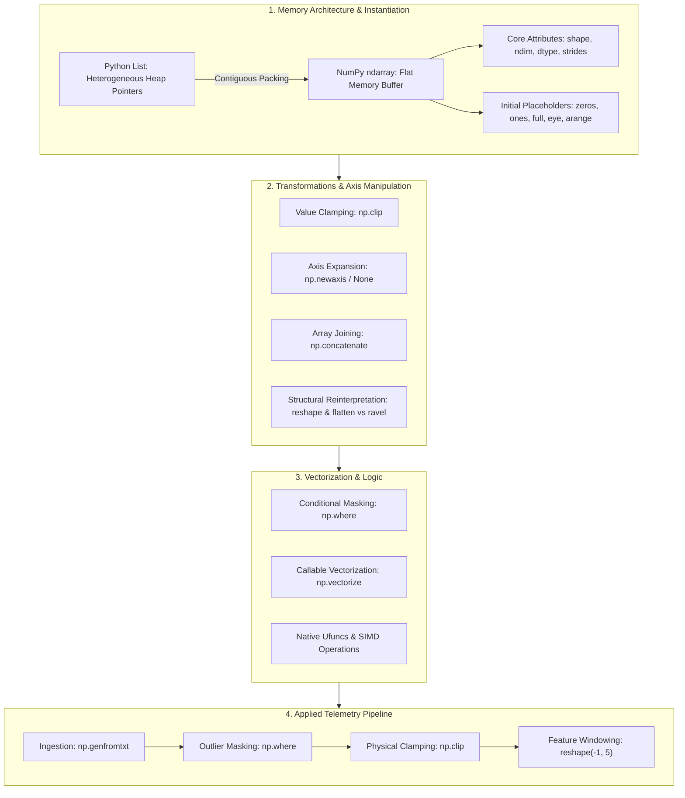
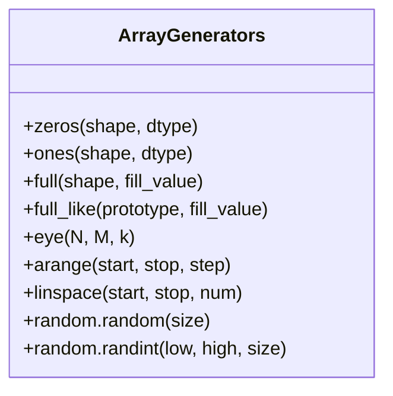
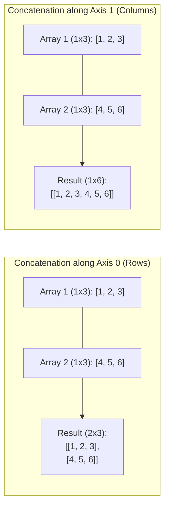
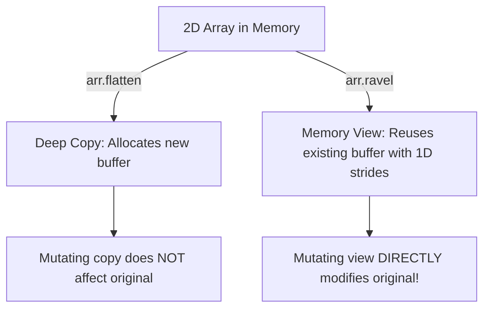

# Array 1D Using NumPy: Memory Architecture, Vectorized Operations, and Dimension Manipulation

[Back to Module 02](../README.md) · [Back to the master roadmap](../../README.md)

**Session date:** 2026-11-22 · **Module:** 02 — Mathematics for Machine Learning (Calculus & Linear Algebra)  
**Format:** Textbook-grade study guide, C-memory layout diagrams, stride mathematics, NumPy vectorization formulations, executable code examples, and three executable Jupyter notebooks.

---

## Overview

In modern scientific computing, data science, and deep learning architectures (e.g., PyTorch, TensorFlow, JAX), high-throughput numerical computation cannot rely on standard Python object models. Standard Python lists are heterogeneous dynamic arrays storing 64-bit heap memory addresses (pointers) to disparate `PyObject` structures. While highly versatile, this design introduces substantial pointer-chasing overhead, CPU cache invalidation, and severe computational latency.

The **NumPy** library (`numpy.ndarray`) solves this computational bottleneck by introducing homogeneous, contiguous memory buffers managed directly in C. An `ndarray` encapsulates primitive numerical types (e.g., `int32`, `float64`) packed sequentially in system RAM, enabling Single Instruction, Multiple Data (**SIMD**) CPU vectorization, hardware cache line alignment, and $O(1)$ strided coordinate transformations.

This session establishes the foundational mathematics, internal memory mechanics, and operational toolkit for one-dimensional and multi-dimensional NumPy arrays:

1. **The `ndarray` Memory Model & Strided Addressing:** Internal memory anatomy (data pointer, shape, strides, flags), comparing Python list pointer graphs with contiguous memory blocks, and deriving strided byte offset algebra.
2. **Array Creation & Architectural Attributes:** Constructing arrays from Python sequences, diagnosing ragged/jagged list failures, inspecting `ndim`, `shape`, `dtype`, `size`, `itemsize`, `nbytes`, and `strides`, and executing in-place element mutations.
3. **Specialized Initialization Placeholders:** High-performance memory allocation using `zeros`, `ones`, `full`, `full_like`, identity matrices with `eye`, arithmetic progressions via `arange` (numeric and `datetime64`), and uniform/discrete random generators.
4. **Value Bounding & Numerical Stability (`np.clip`):** Formal piecewise bounding functions, safeguarding deep neural network backpropagation against exploding gradients, and preventing logarithmic underflow in cross-entropy loss.
5. **Concatenation & Multi-Axis Assembly (`np.concatenate`):** Tensor concatenation rules along arbitrary axes, horizontal vs. vertical stacking, and diagnosing dimension mismatch errors (`AxisError`).
6. **Dimension Expansion & Rank Modification (`np.newaxis`):** Promoting rank-1 vectors to formal row vectors $(1, N)$ and column vectors $(N, 1)$, broadcasting preparation, and outer product generation.
7. **Vectorization Paradigms (`np.vectorize` vs. Native Ufuncs):** The anatomy of Universal Functions (`ufunc`), loop lifting mechanics in `np.vectorize`, performance benchmarks, and custom mathematical functions (e.g., circle area calculations and binary comparison predicates).
8. **Branchless Conditional Selection (`np.where`):** Vector ternary operators, dynamic thresholding, outlier imputation, and implementing piecewise activation functions (such as ReLU and Leaky ReLU).
9. **Structural Reshaping & Memory Flattening:** Invariant element conservation constraints ($\prod d_i = N$), automatic dimension inference via `-1`, and deep copy semantics (`flatten()`) versus strided memory views (`ravel()`).
10. **Industrial Case Study:** End-to-end signal processing and feature extraction on an industrial IoT telemetry sequence (`data/sensor_readings_1d.csv`).

---

## Learning outcomes

By the end of this session, you should be able to:

- Contrast the internal memory representations of Python `list` objects with NumPy `ndarray` buffers, identifying cache locality and pointer chasing differences.
- Calculate the precise physical byte offset in system RAM for an arbitrary multi-dimensional index tuple $(i_0, i_1, \dots, i_{k-1})$ using stride arithmetic:
  $$\text{Offset} = \sum_{j=0}^{k-1} i_j \cdot s_j$$
- Instantiate NumPy arrays from nested Python iterables and diagnose ragged sequence dimensional errors.
- Query and interpret core ndarray attributes: `shape`, `ndim`, `dtype`, `size`, `itemsize`, `nbytes`, and `strides`.
- Initialize pre-allocated arrays using `np.zeros`, `np.ones`, `np.full`, `np.full_like`, `np.eye`, and `np.arange` (including temporal `datetime64` sequences).
- Apply `np.clip` to enforce upper and lower numerical bounds, explaining its mathematical necessity in gradient explosion prevention and cross-entropy stability.
- Concatenate 1D and multi-dimensional arrays along specified axes, predicting valid output shapes and avoiding `AxisError` violations.
- Reshape arrays between rank-1 tensors and multi-dimensional matrices, utilizing `-1` for automatic dimension inference.
- Distinguish between memory views and deep copies in structural operations, predicting the side effects of mutating `ravel()` views versus `flatten()` copies.
- Employ `np.where` for branchless vector ternary conditional selection, outlier filtering, and piecewise activation implementations.
- Wrap custom scalar Python callables with `np.vectorize` and describe its execution characteristics relative to compiled C-level ufuncs.

---

## Session Map



---

## 1. The `ndarray` Memory Model & Strided Addressing

### 1.1 Python Lists vs. NumPy `ndarray`

In standard Python (CPython), a `list` is an array of 64-bit pointers pointing to individual Python objects scattered throughout heap memory:

```text
Python List (Array of Pointers):
[ Pointer 0 ] ---> PyLongObject (Value: 1, RefCount: 1, Type: &PyLong_Type, Ob_Size: 1, Digits: [1])
[ Pointer 1 ] ---> PyLongObject (Value: 2, RefCount: 1, Type: &PyLong_Type, Ob_Size: 1, Digits: [2])
[ Pointer 2 ] ---> PyLongObject (Value: 3, RefCount: 1, Type: &PyLong_Type, Ob_Size: 1, Digits: [3])
```

Each element lookup requires dereferencing a pointer, loading the `PyObject` struct, inspecting its type descriptor, and extracting the payload. Because consecutive elements are located at arbitrary memory addresses, CPU hardware prefetchers fail, leading to frequent cache misses.

In contrast, a NumPy `ndarray` consists of a single contiguous memory segment (data buffer) accompanied by a lightweight metadata descriptor:

```text
NumPy ndarray Architecture:
+-------------------------------------------------------------+
| Header Descriptor (PyArrayObject)                           |
| - data pointer: 0x7ffd9a00                                  |
| - ndim:         2                                           |
| - shape:        (2, 3)                                      |
| - strides:      (24, 8)                                     |
| - dtype:        int64 (8 bytes, little-endian)              |
| - flags:        C_CONTIGUOUS, OWNDATA, WRITEABLE            |
+-------------------------------------------------------------+
                           |
                           v
Contiguous Raw Memory Buffer (0x7ffd9a00):
+----------+----------+----------+----------+----------+----------+
|    1     |    2     |    3     |    4     |    5     |    6     |
| [8 bytes]| [8 bytes]| [8 bytes]| [8 bytes]| [8 bytes]| [8 bytes]|
+----------+----------+----------+----------+----------+----------+
Byte 0     Byte 8     Byte 16    Byte 24    Byte 32    Byte 40
```

### 1.2 Mathematical Derivation of Strided Coordinate Addressing

An $n$-dimensional array has a shape tuple $(d_0, d_1, \dots, d_{n-1})$ and a strides tuple $(s_0, s_1, \dots, s_{n-1})$. The stride $s_k$ represents the exact number of bytes in physical memory one must jump to advance by one index unit along axis $k$.

For a standard C-contiguous (row-major) array of itemsize $b$ bytes:
- The last dimension $n-1$ advances consecutively:
  $$s_{n-1} = b$$
- For every preceding axis $k \in \{n-2, n-3, \dots, 0\}$, the stride is the product of the subsequent axis length and its stride:
  $$s_k = s_{k+1} \cdot d_{k+1} = b \cdot \prod_{m=k+1}^{n-1} d_m$$

Given an index coordinate tuple $(i_0, i_1, \dots, i_{n-1})$, the exact byte memory address is given by:

$$\text{Address}(i_0, i_1, \dots, i_{n-1}) = \text{BaseAddress} + \sum_{k=0}^{n-1} i_k \cdot s_k$$

#### Concrete Example:

Consider a 3D tensor of shape $(2, 2, 3)$ with `dtype=int64` ($b = 8$ bytes):
1. Axis 2 length $= 3 \implies s_2 = 8$ bytes.
2. Axis 1 length $= 2 \implies s_1 = 3 \times 8 = 24$ bytes.
3. Axis 0 length $= 2 \implies s_0 = 2 \times 24 = 48$ bytes.

The strides tuple is therefore `(48, 24, 8)`. To access element $(1, 0, 2)$:
$$\text{Offset} = 1 \cdot 48 + 0 \cdot 24 + 2 \cdot 8 = 48 + 0 + 16 = 64 \text{ bytes}$$

The CPU accesses this item instantly via pointer addition `BaseAddress + 64` without traversing nested pointers.

---

## 2. Array Instantiation and Fundamental Attributes

### 2.1 Instantiation from Python Sequences

Arrays are constructed using `np.array(sequence, dtype=...)`. Sequences can be nested lists or tuples.

```python
import numpy as np

# 1D Array (Rank-1 Tensor)
arr_1d = np.array([1, 2, 3, 4, 5])

# 2D Array (Matrix: 2 rows, 3 columns)
arr_2d = np.array([[1, 2, 3], [4, 5, 6]])

# 3D Array (Tensor: 2 blocks, 2 rows, 3 columns)
arr_3d = np.array([[[1, 2, 3], [4, 5, 6]], [[7, 8, 9], [10, 11, 12]]])
```

### 2.2 Inhomogeneous (Ragged) Lists

When nested sub-lists have inconsistent lengths, NumPy cannot construct a rectangular multidimensional buffer:

```python
# Mismatched row lengths: Row 0 has 3 elements, Row 2 has 2 elements
ragged_list = [[1, 2, 3], [4, 5, 6], [1, 2]]

# Modern NumPy raises: ValueError: setting an array element with a sequence.
# or requires explicit dtype=object
```

### 2.3 Inspection Attributes

| Attribute | Data Type | Description | Example (arr_3d) |
| :--- | :--- | :--- | :--- |
| `arr.ndim` | `int` | Number of array dimensions (axes) | `3` |
| `arr.shape` | `tuple[int]` | Dimensions of the array | `(2, 2, 3)` |
| `arr.dtype` | `np.dtype` | Primitive data type of the elements | `int64` |
| `arr.size` | `int` | Total number of elements across all axes | $2 \times 2 \times 3 = 12$ |
| `arr.itemsize` | `int` | Memory size of each single element in bytes | `8` bytes |
| `arr.nbytes` | `int` | Total physical buffer size in bytes (`size * itemsize`) | $12 \times 8 = 96$ bytes |
| `arr.strides` | `tuple[int]` | Bytes to step along each axis in memory | `(48, 24, 8)` |

### 2.4 In-Place Mutation and Numerical Type Truncation

NumPy arrays are mutable. Element assignment updates the underlying memory buffer in-place:

```python
data_1d = np.array([1, 2, 3, 4, 5])
data_1d[0] = 8  # data_1d is now [8, 2, 3, 4, 5]

data_3d = np.array([[[1, 2, 3], [4, 5, 6]], [[7, 8, 9], [10, 11, 12]]])
data_3d[0, 1, 1] = 4
data_3d[1, 1, 1] = 4
```

> [!WARNING]
> Assigning a floating-point value to an integer `ndarray` results in silent truncation of the fractional part:
> ```python
> arr = np.array([10, 20, 30], dtype=np.int64)
> arr[0] = 99.85  # Stores 99, dropping 0.85 without warning!
> ```

---

## 3. Specialized Array Initialization Placeholders

Allocating arrays using purpose-built generator routines avoids creating intermediate Python list objects in memory:



### 3.1 Static Pre-Allocations

1. `np.zeros(shape, dtype=float)`: Allocates zeroed memory buffer.
   ```python
   arr_zeros = np.zeros((3, 4), dtype=float)
   ```
2. `np.ones(shape, dtype=float)`: Allocates memory filled with ones ($1.0$).
   ```python
   arr_ones = np.ones((3, 4))
   ```
3. `np.full(shape, fill_value, dtype=...)`: Allocates constant value.
   ```python
   arr_full = np.full((2, 3, 2), 7)
   ```
4. `np.full_like(prototype, fill_value)`: Clones shape and dtype of existing array.
   ```python
   arr_full_like = np.full_like(arr_full, 9)
   ```
5. `np.eye(N)`: Generates an $N \times N$ identity matrix with Kronecker delta $\delta_{ij}$:
   $$\delta_{ij} = \begin{cases} 1 & \text{if } i = j \\ 0 & \text{if } i \neq j \end{cases}$$
   ```python
   arr_eye = np.eye(4)
   ```

### 3.2 Sequence and Temporal Generators

1. **Arithmetic Progression:**
   `np.arange([start,] stop[, step], dtype=...)` generates half-open intervals $[\text{start}, \text{stop})$:
   ```python
   arr_arange = np.arange(1, 11, 1)  # array([ 1,  2,  3,  4,  5,  6,  7,  8,  9, 10])
   arr_float = np.arange(2.0, 4.0, 0.5)  # array([2. , 2.5, 3. , 3.5])
   ```

2. **Datetime Sequences:**
   NumPy natively supports ISO-8601 temporal sequences via `np.datetime64` and `np.timedelta64`:
   ```python
   time_array = np.arange("2026-11-01", "2026-11-15", np.timedelta64(1, "D"), dtype="datetime64[D]")
   ```

3. **Uniform and Discrete Stochastic Generation:**
   ```python
   # Continuous Uniform distribution in [0.0, 1.0)
   arr_uniform = np.random.random(size=(3, 3))

   # Discrete Uniform integers in [low, high)
   arr_discrete = np.random.randint(1, 5, size=(3, 3))
   ```

---

## 4. Value Bounding & Clipping (`np.clip`)

### 4.1 Formal Mathematical Formulation

The clipping function $f: \mathbb{R} \to \mathbb{R}$ projects an unbounded variable $x$ into a closed interval $[a, b]$ where $a \le b$:

$$\text{clip}(x, a, b) = \begin{cases} 
a & \text{if } x < a \\ 
x & \text{if } a \le x \le b \\ 
b & \text{if } x > b 
\end{cases}$$

Equivalently, it can be expressed via standard lattice operations:

$$\text{clip}(x, a, b) = \min(\max(x, a), b)$$

The subgradient of the clipping operation is piece-wise constant:

$$\frac{\partial}{\partial x} \text{clip}(x, a, b) = \begin{cases} 
1 & \text{if } a < x < b \\ 
0 & \text{if } x < a \text{ or } x > b 
\end{cases}$$

```python
import numpy as np

arr = np.array([1, 5, 8, 10, 3, 6])
clipped_arr = np.clip(arr, a_min=3, a_max=8)
# Result: array([3, 5, 8, 8, 3, 6])
```

### 4.2 Critical Applications in Machine Learning

1. **Gradient Clipping in Deep Networks:**
   In recurrent neural networks (RNNs) and deep transformers, backpropagating through long sequences causes exponential gradient growth:
   $$\mathbf{g} \leftarrow \text{clip}(\mathbf{g}, -\gamma, \gamma)$$
   This bounds updates and prevents parameter destabilization (`NaN` weights).

2. **Log-Loss / Cross-Entropy Numerical Regularization:**
   Evaluating binary cross-entropy:
   $$L(y, \hat{y}) = - \left[ y \log(\hat{y}) + (1-y) \log(1 - \hat{y}) \right]$$
   If $\hat{y} \to 0$, $\log(0) \to -\infty$. Applying $\text{clip}(\hat{y}, \epsilon, 1-\epsilon)$ with $\epsilon = 10^{-15}$ avoids arithmetic overflow.

3. **Color Space & Sensor Signal Boundaries:**
   Restricting dynamic ranges of normalized imagery to $[0, 255]$ or $[0.0, 1.0]$ after convolution filtering.

---

## 5. Concatenation & Multi-Axis Assembly (`np.concatenate`)

### 5.1 Formulation and Shape Compatibility Rules

Given $M$ tensors $A_1, A_2, \dots, A_M$ of identical rank $R$, concatenation along axis $k$ ($0 \le k < R$) is defined if and only if all other dimensions are identical:

$$\text{shape}(A_m) = (d_0, \dots, d_{k}^{(m)}, \dots, d_{R-1}) \quad \forall m \in \{1, \dots, M\}$$

The resulting concatenated tensor has shape:

$$\text{shape}(C) = \left( d_0, \dots, \sum_{m=1}^{M} d_{k}^{(m)}, \dots, d_{R-1} \right)$$



### 5.2 1D vs. 2D Concatenation Mechanics

```python
# 1D Concatenation: Joins along the single existing axis (axis=0)
arr1 = np.array([1, 2, 3])
arr2 = np.array([4, 5, 6])
cat_1d = np.concatenate((arr1, arr2), axis=0)  # Shape: (6,)

# 2D Matrices
mat1 = np.array([[1, 2, 3]])  # Shape: (1, 3)
mat2 = np.array([[4, 5, 6]])  # Shape: (1, 3)

# Vertical join along axis 0
cat_rows = np.concatenate((mat1, mat2), axis=0)  # Shape: (2, 3)

# Horizontal join along axis 1
cat_cols = np.concatenate((mat1, mat2), axis=1)  # Shape: (1, 6)
```

> [!CAUTION]
> Calling `np.concatenate((arr1, arr2), axis=1)` on 1D arrays raises `AxisError: axis 1 is out of bounds for array of dimension 1`. A rank-1 tensor possesses only axis 0. To concatenate horizontally as columns, arrays must first be promoted to 2D matrices via `np.newaxis`.

---

## 6. Dimension Expansion & Rank Modification (`np.newaxis`)

### 6.1 The Role of `np.newaxis`

`np.newaxis` is an alias for Python's `None`. When used inside array indexing brackets, it instructs NumPy to create a new dimension of length 1 at that axis location:

```python
arr = np.array([1, 2, 3, 4, 5])  # Shape: (5,) - Rank-1 vector

# Promoting to 2D Row Vector (1 row, 5 columns)
arr_row = arr[np.newaxis, :]  # Shape: (1, 5)

# Promoting to 2D Column Vector (5 rows, 1 column)
arr_col = arr[:, np.newaxis]  # Shape: (5, 1)

# Adding multiple axes
arr_4d = arr[:, np.newaxis, np.newaxis, np.newaxis]  # Shape: (5, 1, 1, 1)
```

### 6.2 Matrix Multiplication and Outer Product Generation

In linear algebra, the outer product of two vectors $\mathbf{u} \in \mathbb{R}^N$ and $\mathbf{v} \in \mathbb{R}^M$ produces a rank-1 matrix $P \in \mathbb{R}^{N \times M}$:

$$P = \mathbf{u} \mathbf{v}^T = \begin{bmatrix} 
u_1 v_1 & u_1 v_2 & \dots & u_1 v_M \\ 
u_2 v_1 & u_2 v_2 & \dots & u_2 v_M \\ 
\vdots & \vdots & \ddots & \vdots \\ 
u_N v_1 & u_N v_2 & \dots & u_N v_M 
\end{bmatrix}$$

Using `np.newaxis` and NumPy's broadcasting rules, outer products are computed cleanly without nested loops:

```python
u = np.array([1, 2, 3])[:, np.newaxis]  # Shape: (3, 1)
v = np.array([10, 20, 30, 40])[np.newaxis, :]  # Shape: (1, 4)

# Broadcasting expands (3, 1) and (1, 4) to (3, 4)
outer_product = u * v
```

---

## 7. Vectorization Paradigms (`np.vectorize` vs. Native Ufuncs)

### 7.1 Universal Functions (`ufunc`)

A NumPy `ufunc` is a compiled C-routine that operates element-by-element on `ndarray` inputs. Ufuncs support broadcasting, type coercion, and execution across CPU vector registers without acquiring Python's Global Interpreter Lock (GIL) per element.

### 7.2 Mechanics of `np.vectorize`

`np.vectorize(pyfunc)` is a convenience class that lifts a standard scalar Python function to accept array arguments. 

```python
# Example from slides: Circle area computation
def calculate_circle_area(radius: float) -> float:
    return np.pi * (radius**2)


# Vectorizing the function
vectorized_circle_area = np.vectorize(calculate_circle_area, otypes=[np.float64])

radius_values = np.array([1, 2, 3, 4])
areas = vectorized_circle_area(radius_values)
# Result: array([ 3.14159265, 12.56637061, 28.27433388, 50.26548246])
```

```python
# Custom comparison predicate
def compare(a: float, b: float) -> int:
    return 1 if a < b else 0


vectorized_compare = np.vectorize(compare, otypes=[np.int32])
arr1 = np.array([1, 2, 3, 4, 5])
arr2 = np.array([2, 3, 0, 1, 4])

result = vectorized_compare(arr1, arr2)
# Result: array([1, 1, 0, 0, 0])
```

### 7.3 Performance Comparison

| Vectorization Strategy | Execution Engine | GIL Bypassed? | Relative Speed | Recommended Usage |
| :--- | :--- | :--- | :--- | :--- |
| **Native Ufunc** (`np.pi * r**2`) | Compiled C / SIMD | Yes | $\mathbf{1.0\times}$ (Fastest) | Core numerical math, linear algebra |
| **List Comprehension** | CPython bytecode | No | $\sim 15\times - 25\times$ slower | Small sequences ($N < 1000$) |
| **`np.vectorize`** | CPython loop-lifting | No | $\sim 12\times - 20\times$ slower | Wrapping external scalar libraries / complex branching |

> [!NOTE]
> `np.vectorize` is provided primarily for convenience, not performance. It executes a Python `for`-loop internally under the hood. Whenever mathematical equivalents exist in pure NumPy (e.g. `(arr1 < arr2).astype(int)`), native operations should be preferred.

---

## 8. Branchless Conditional Selection (`np.where`)

### 8.1 Vector Ternary Semantics

`np.where(condition, [x, y])` implements vector branchless selection:

$$\text{out}_i = \begin{cases} x_i & \text{if } \text{condition}_i \text{ is True} \\ y_i & \text{if } \text{condition}_i \text{ is False} \end{cases}$$

```python
# Exercise 5 from slides:
# Replace elements > 3 with 0, keeping others unchanged
arr = np.array([1, 2, 3, 4, 5])
new_arr = np.where(arr > 3, 0, arr)
# Result: array([1, 2, 3, 0, 0])
```

### 8.2 Activation Functions via `np.where`

Neural network activations with non-linear regimes are cleanly formulated using `np.where`:

1. **Rectified Linear Unit (ReLU):**
   $$\text{ReLU}(z) = \max(0, z) = \text{np.where}(z > 0, z, 0.0)$$
2. **Leaky ReLU (parameter $\alpha = 0.01$):**
   $$\text{LeakyReLU}(z) = \begin{cases} z & \text{if } z > 0 \\ \alpha z & \text{if } z \le 0 \end{cases} = \text{np.where}(z > 0, z, \alpha \cdot z)$$

---

## 9. Structural Reshaping & Memory Flattening

### 9.1 The Element Conservation Invariant

When calling `arr.reshape(new_shape)`, the product of the target dimensions must match the total element count $N$:

$$\prod_{j=0}^{K-1} d_j^{\text{new}} = N = \prod_{i=0}^{D-1} d_i^{\text{old}}$$

If one dimension is unknown, specifying `-1` directs NumPy to compute the missing dimension automatically:

$$d_{\text{inferred}} = \frac{N}{\prod_{j \neq \text{inferred}} d_j}$$

```python
seq = np.array([1, 2, 3, 4, 5, 6])  # N = 6

mat_2x3 = seq.reshape((2, 3))
mat_3x2 = seq.reshape((3, 2))
mat_auto = seq.reshape((-1, 3))  # Inferred as (2, 3)
```

### 9.2 Memory Semantics: `flatten()` vs. `ravel()`



```python
arr = np.array([[1, 2, 3], [4, 5, 6]])

# 1. flatten() allocates a completely new memory buffer (Deep Copy)
flat = arr.flatten()
flat[0] = 999
assert arr[0, 0] == 1  # Original remains intact!

# 2. ravel() reuses the existing buffer with revised strides (Memory View)
view = arr.ravel()
view[0] = 999
assert arr[0, 0] == 999  # Original has been modified!
```

---

## 10. Complete Lecture Slide Exercise Solutions

| Slide Exercise | Description | Mathematical Operation | NumPy Implementation |
| :--- | :--- | :--- | :--- |
| **Slide 4 Review** | Matrix reductions on $(4, 3)$ matrix | $\sum_{ij} A_{ij}, \max_{ij} A_{ij}, \min_{ij} A_{ij}$ | `arr.sum()`, `arr.max()`, `arr.min()` |
| **Slide 8 Ex 1** | Instantiation of 1D, 2D, 3D arrays | Nested sequence translation | `np.array([1, 2, 3, 4, 5])` |
| **Slide 15 Ex 2** | Initial placeholders | Memory allocation | `np.zeros`, `np.ones`, `np.arange`, `np.full`, `np.eye`, `np.random` |
| **Slide 19 Ex 1** | Value clipping | $\min(\max(x, 3), 8)$ | `np.clip(arr, 3, 8)` |
| **Slide 22 Ex 2** | Horizontal concatenation | Stacking along axis 0 | `np.concatenate((arr1, arr2))` |
| **Slide 24 Ex 3** | Adding axes | Dimension promotion $(N,) \to (N, 1)$ | `arr[:, np.newaxis]` |
| **Slide 26 Ex 4** | Vectorized circle area | $A = \pi r^2$ | `np.vectorize(calc_area)(r)` |
| **Slide 28 Ex 5** | Conditional replacement | $x > 3 \implies 0 \text{ else } x$ | `np.where(arr > 3, 0, arr)` |
| **Slide 29 Ex 6** | Flattening 2D to 1D | Row-major unrolling | `arr.flatten()` |
| **Slide 31 Ex 7** | Reshaping 1D to $(2, 3)$ | Stride transformation | `arr.reshape((2, 3))` |

---

## 11. Practice Exercises and Self-Assessment

### Exercise 1: Strided Address Verification
A 2D array of `dtype=float64` has shape $(100, 50)$ stored in standard C-contiguous order.
1. Determine the stride values $(s_0, s_1)$ in bytes.
2. Calculate the exact physical memory offset in bytes from `BaseAddress` for index $(42, 17)$.

*Solution:*
1. $s_1 = 8$ bytes (`float64`). $s_0 = 50 \times 8 = 400$ bytes. Strides $= (400, 8)$.
2. $\text{Offset} = 42 \times 400 + 17 \times 8 = 16800 + 136 = 16936$ bytes.

### Exercise 2: Implementing a Vectorized Hard-Sigmoid
The Hard-Sigmoid activation is used in low-power embedded neural networks:

$$\sigma_{\text{hard}}(x) = \text{clip}\left( \frac{x + 3}{6}, 0.0, 1.0 \right)$$

Write a pure vectorized NumPy expression implementing $\sigma_{\text{hard}}(x)$:

```python
def hard_sigmoid(x: np.ndarray) -> np.ndarray:
    return np.clip((x + 3.0) / 6.0, 0.0, 1.0)
```

---

## 12. References and Further Reading

- Harris, C. R., et al. (2020). *Array programming with NumPy*. **Nature**, 585(7825), 357–362.
- Van der Walt, S., Colbert, S. C., & Varoquaux, G. (2011). *The NumPy array: a structure for efficient numerical computation*. **Computing in Science & Engineering**, 13(2), 22–30.
- Oliphant, T. E. (2006). *A Guide to NumPy*. Trelgol Publishing.
- NumPy Documentation: *Internal Memory Layout of an ndarray* (<https://numpy.org/doc/stable/reference/arrays.ndarray.html>).
- NumPy Documentation: *Broadcasting Principles* (<https://numpy.org/doc/stable/user/basics.broadcasting.html>).
