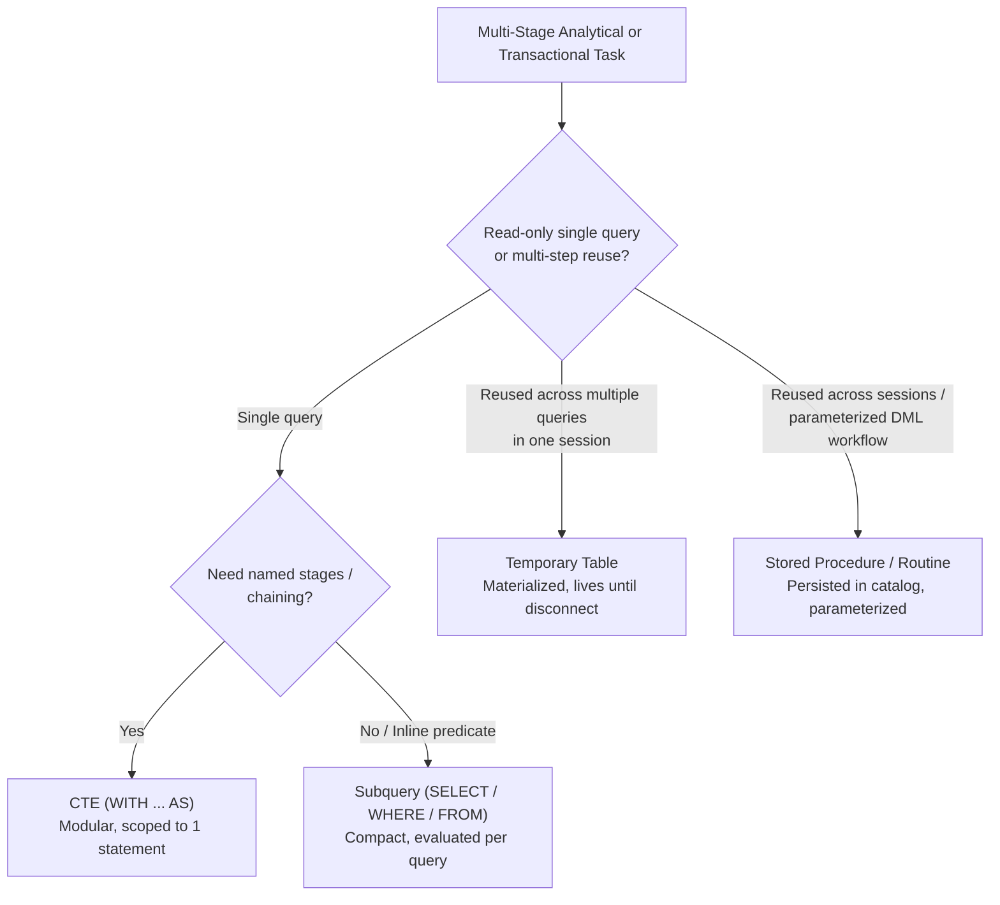
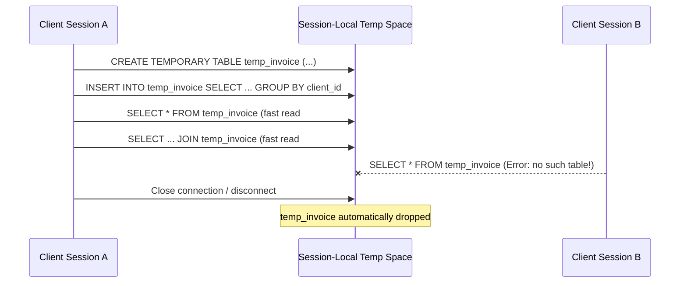

# Database — SQL (3): Common Table Expressions, Subqueries, Temporary Tables, and Stored Procedures

[Back to Module 02](../README.md) · [Back to the master roadmap](../../README.md)

**Session date:** 2026-11-26 · **Module:** 02 — Mathematics for Machine Learning (Calculus & Linear Algebra)  
**Format:** Textbook-grade study guide, relational composition semantics, SQL dialect comparisons, 25 worked analytical exercises, and three executable SQLite/Python notebooks.

---

## Overview

Single-pass `SELECT ... JOIN ... GROUP BY` queries become brittle when analytical questions require **multi-stage aggregation**, **row-by-row comparative filtering**, **intermediate result reuse**, or **reusable transactional routines**. For instance, finding orders whose total exceeds the global average order value requires aggregating line items per order first, averaging those order totals second, and filtering the `orders` relation third. Similarly, updating a payment ledger alongside its parent invoice balance must execute atomically as a single reusable unit of work.

This session completes the SQL trilogy by introducing **composable and programmable SQL**:

1. **Common Table Expressions (CTEs):** Naming intermediate relational expressions with `WITH ... AS (...)` to decompose complex queries into readable, modular stages.
2. **Subqueries:** Nesting queries inside `SELECT`, `FROM` (derived tables), and `WHERE`/`HAVING` predicates; distinguishing non-correlated from correlated subqueries; avoiding the `NOT IN` three-valued logic (`NULL`) trap; and expressing relational division.
3. **Temporary Tables:** Materializing intermediate query results in session-scoped storage (`CREATE TEMPORARY TABLE`) to eliminate redundant recomputation across repeated downstream queries.
4. **Stored Procedures & Transactional Routines:** Persisting parameterized multi-statement workflows (`CREATE PROCEDURE`, `DELIMITER`, `IN` parameters, cursors, and ACID transactions) on the server—and mapping them cleanly to parameterized Python/SQLite transactional routines.
5. **Cross-Engine Dialect & Performance Trade-offs:** Comparing MySQL, PostgreSQL, and SQLite execution behavior, query-plan flattening vs. materialization, and multi-stage feature engineering in ML pipelines.
6. **25-Quiz Comprehensive Lab:** Applying CTEs, subqueries, temporary tables, and stored procedures across the retail (`sql_store`), HR (`sql_hr`), and invoicing (`sql_invoicing`) schemas.

---

## Learning outcomes

By the end of this session, you should be able to:

- Decompose multi-step aggregations and joins into modular **Common Table Expressions (CTEs)** using `WITH ... AS (...)`.
- Distinguish **non-correlated subqueries** (evaluated once) from **correlated subqueries** (logically evaluated per outer tuple) and rewrite expensive correlated filters as joins or CTEs when needed.
- Select safely among scalar subqueries, derived tables (`FROM (...) AS alias`), `IN`/`NOT IN`, and `EXISTS`/`NOT EXISTS`, explaining why `NULL` values break `NOT IN`.
- Express **universal quantification (relational division)** in SQL using `GROUP BY ... HAVING COUNT(DISTINCT ...) = (SELECT COUNT(*) ...)`.
- Materialize expensive intermediate aggregations into **temporary tables** (`CREATE TEMPORARY TABLE ... AS SELECT` and schema-first `INSERT INTO ... SELECT`) and explain their session-scoped lifecycle.
- Write **stored procedures** with input parameters, multi-statement DML (`INSERT` + `UPDATE`), and cursor iteration, and explain how stored procedures differ from temporary tables in persistence.
- Translate MySQL-specific constructs (`DELIMITER`, `IFNULL`, `DATE_SUB`, `CREATE PROCEDURE`) into portable SQLite/PostgreSQL equivalents and ACID-safe Python transactions.

---

## 1. Query Composition Architecture: Choosing the Right Tool

When a query requires intermediate transformations before producing its final output, SQL offers four primary composition mechanisms that trade off **readability**, **recomputational cost**, **session persistence**, and **cross-session reusability**:



| Mechanism | Scope & Lifetime | Materialization | Primary Strength | Key Limitation |
| :--- | :--- | :--- | :--- | :--- |
| **CTE (`WITH`)** | Single SQL statement | Optimizer-dependent (inlined or materialized) | Linear top-to-bottom readability; easy multi-step chaining | Re-evaluated on every separate query execution |
| **Subquery** | Single expression inside one query | Rarely persisted; often rewritten as semi-join/hash join | Concise inline scalar/set filtering (`WHERE`, `SELECT`) | Deep nesting hurts readability; correlated form can be slow |
| **Temporary Table** | Current database connection/session | Physically materialized in temp memory/disk | Computes heavy aggregations once for repeated queries | Vanishes when session closes; consumes temp storage |
| **Stored Procedure** | Persisted in database schema catalog | Code persisted; can create/populate temp or base tables | Encapsulates business logic, parameters, and transactions | Dialect-specific syntax; not supported natively in SQLite |

---

## 2. Common Table Expressions (CTEs)

### 2.1 Motivation: From Nested Logic to Linear Pipelines

Suppose we want to find the client in `sql_invoicing` who has the **highest total invoice amount**, returning their `client_id`, `name`, and total billed amount.

Using a direct join and aggregation works for simple cases:

```sql
SELECT
    c.client_id,
    c.name,
    SUM(i.invoice_total) AS invoice_amount
FROM clients c
JOIN invoices i
    USING (client_id)
GROUP BY c.client_id, c.name
ORDER BY invoice_amount DESC
LIMIT 1;
```

However, when the aggregation itself is complex—or when multiple aggregations must be joined together—writing everything inside a single `SELECT` forces the reader to parse inside-out. A **Common Table Expression (CTE)** defines a named temporary result set scoped strictly to the statement immediately following it:

$$T_{\text{cte}} = \gamma_{\text{client\_id}, \text{SUM}(\text{invoice\_total})}(\text{invoices}), \qquad \text{Result} = \pi_{\text{client\_id}, \text{name}, \text{invoice\_amount}}(\text{clients} \bowtie T_{\text{cte}})$$

```sql
WITH invoice_amount AS (
    SELECT
        client_id,
        SUM(invoice_total) AS invoice_amount
    FROM invoices
    GROUP BY client_id
    ORDER BY invoice_amount DESC
    LIMIT 1
)
SELECT
    c.client_id,
    c.name,
    ia.invoice_amount
FROM clients c
JOIN invoice_amount ia
    ON c.client_id = ia.client_id;
```

On the seed dataset (`sql_store_seed.sql`), `Topico Systems` (`client_id = 5`) leads with `175.32 + 169.36 = 344.68`.

### 2.2 Chaining Multiple CTEs

Multiple CTEs can be chained in a single `WITH` clause separated by commas. Each subsequent CTE can reference any earlier CTE:

```sql
WITH order_totals AS (
    SELECT
        order_id,
        SUM(quantity * unit_price) AS order_total
    FROM order_items
    GROUP BY order_id
),
global_stats AS (
    SELECT AVG(order_total) AS avg_order_total
    FROM order_totals
)
SELECT
    ot.order_id,
    ROUND(ot.order_total, 2) AS order_total,
    ROUND(gs.avg_order_total, 2) AS avg_order_total
FROM order_totals ot
CROSS JOIN global_stats gs
WHERE ot.order_total > gs.avg_order_total
ORDER BY ot.order_total DESC;
```

> [!TIP]
> Notice how chaining `order_totals` $\rightarrow$ `global_stats` eliminates duplicate expressions and makes every intermediate step independently testable by simply running `SELECT * FROM order_totals;`.

### 2.3 Finding Extremes Per Group via CTEs

A classic analytical pattern is finding the minimum or maximum row **within each group** (for example, the lowest-paid employee in every office). Because `GROUP BY office_id` cannot directly project non-aggregated columns like `first_name` reliably in standard SQL, we compute the per-office minimum first in a CTE and join back to `employees`:

```sql
WITH min_salary_office AS (
    SELECT
        office_id,
        MIN(salary) AS min_salary
    FROM employees
    GROUP BY office_id
)
SELECT
    e.first_name,
    e.last_name,
    e.office_id,
    e.salary
FROM employees e
JOIN min_salary_office mso
    ON e.office_id = mso.office_id
   AND e.salary = mso.min_salary
ORDER BY e.office_id, e.employee_id;
```

Joining on both `(office_id, salary)` automatically handles ties if two employees in the same office share the lowest salary.

---

## 3. Subqueries

A **subquery** is a `SELECT` statement nested inside another SQL statement (`SELECT`, `FROM`, `WHERE`, `HAVING`, or `INSERT`/`UPDATE`/`DELETE`).

### 3.1 Classification by Output Shape

| Subquery Type | Returns | Valid Contexts | Example |
| :--- | :--- | :--- | :--- |
| **Scalar Subquery** | Exactly 1 row, 1 column (or `NULL` if empty) | `SELECT` list, `WHERE col > (...)`, `HAVING` | `(SELECT AVG(salary) FROM employees)` |
| **Column / List Subquery** | Multiple rows, 1 column | `IN (...)`, `NOT IN (...)`, `ANY`, `ALL` | `WHERE product_id NOT IN (SELECT product_id FROM order_items)` |
| **Row Subquery** | 1 row, multiple columns | Tuple equality `WHERE (a, b) = (...)` | `WHERE (office_id, salary) = (SELECT ...)` |
| **Derived Table (Inline View)** | Multi-row, multi-column relation | `FROM (...) AS alias`, `JOIN (...) AS alias` | `FROM (SELECT order_id, SUM(...) FROM ...) AS t` |

### 3.2 Non-Correlated vs. Correlated Subqueries

Understanding whether a subquery depends on the outer query is critical for both **correctness** and **asymptotic complexity**.

#### Non-Correlated Subquery

A **non-correlated subquery** is self-contained: it references no columns from the outer query, executes **once**, and feeds its constant scalar or set result to the outer filter:

```sql
-- Products never ordered (Non-correlated)
SELECT product_id, name
FROM products
WHERE product_id NOT IN (
    SELECT product_id
    FROM order_items
);
```

Time complexity with a hash set or B-tree index is roughly $O(|P| + |OI|)$.

#### Correlated Subquery

A **correlated subquery** references one or more columns from the outer table alias. Conceptually, it is re-evaluated **for each candidate row** of the outer query:

```sql
-- Average invoice total per client (Correlated subquery in SELECT list)
SELECT
    c.client_id,
    c.name,
    (
        SELECT ROUND(AVG(i.invoice_total), 2)
        FROM invoices i
        WHERE i.client_id = c.client_id
    ) AS avg_invoice
FROM clients c
ORDER BY c.client_id;
```

```sql
-- Employees earning more than their own office's average salary (Correlated in WHERE)
SELECT
    e.employee_id,
    e.first_name,
    e.last_name,
    e.office_id,
    e.salary
FROM employees e
WHERE e.salary > (
    SELECT AVG(e2.salary)
    FROM employees e2
    WHERE e2.office_id = e.office_id
);
```

> [!WARNING]
> Without query decorrelation or an index on `e2.office_id`, a correlated subquery can degrade into a nested loop of complexity $O(N^2)$. Modern optimizers (PostgreSQL, MySQL 8, SQLite with indexes) often decorrelate simple predicates, but rewriting complex correlated subqueries as a `CTE` + `JOIN` guarantees linear hash/merge behavior across all engines.

### 3.3 The `NOT IN` vs. `NOT EXISTS` Three-Valued Logic Trap

In SQL's three-valued logic (`TRUE`, `FALSE`, `UNKNOWN`), `x NOT IN (a, b, NULL)` expands to:

$$x \neq a \;\land\; x \neq b \;\land\; x \neq \text{NULL} \;\equiv\; \text{UNKNOWN}$$

Because `WHERE UNKNOWN` discards the row, **if a subquery inside `NOT IN (...)` returns even a single `NULL` value, the entire outer query returns zero rows!**

By contrast, `NOT EXISTS` tests tuple membership directly and never suffers from `NULL` poisoning:

```sql
-- Safe anti-join alternative to NOT IN
SELECT p.product_id, p.name
FROM products p
WHERE NOT EXISTS (
    SELECT 1
    FROM order_items oi
    WHERE oi.product_id = p.product_id
);
```

> [!CAUTION]
> Whenever the subquery column is nullable (for instance, `orders.shipper_id` or `employees.reports_to`), **never** use `NOT IN` without filtering `WHERE col IS NOT NULL` inside the subquery—or prefer `NOT EXISTS` / `LEFT JOIN ... WHERE right_key IS NULL`.

### 3.4 Relational Division with Subqueries (`FOR ALL`)

In relational algebra, **relational division** ($R \div S$) answers "find every entity in $A$ that is associated with **all** entities in $B$"—for example, *customers who have ordered every product in the catalog at least once*:

```sql
SELECT
    c.customer_id,
    c.first_name,
    c.last_name
FROM customers c
JOIN orders o
    ON c.customer_id = o.customer_id
JOIN order_items oi
    ON o.order_id = oi.order_id
GROUP BY c.customer_id, c.first_name, c.last_name
HAVING COUNT(DISTINCT oi.product_id) = (
    SELECT COUNT(*)
    FROM products
);
```

Notice why `COUNT(DISTINCT oi.product_id)` is essential: ordering the same product twice in two separate orders must count as **1** distinct product toward the catalog total (13 products in `sql_store_seed.sql`).

---

## 4. Temporary Tables (`CREATE TEMPORARY TABLE`)

### 4.1 Why Materialize?

As noted in the lecture slides, both CTEs and subqueries share a key constraint: **their results are ephemeral and recomputed each time a new query runs**. If an analytical workflow runs five separate downstream queries against a heavy multi-million-row invoice aggregation, executing the subquery five times wastes $5\times$ the CPU and I/O.

A **temporary table** materializes the intermediate result once inside session-local storage:



### 4.2 Two Creation Patterns

#### Pattern A: Explicit Schema + `INSERT INTO ... SELECT` (MySQL & SQLite)

```sql
DROP TABLE IF EXISTS temp_invoice;

CREATE TEMPORARY TABLE temp_invoice (
    client_id INT,
    invoice_sum DECIMAL(10, 2),
    invoice_avg DECIMAL(10, 2)
);

INSERT INTO temp_invoice
SELECT
    client_id,
    SUM(invoice_total) AS invoice_sum,
    AVG(invoice_total) AS invoice_avg
FROM invoices
GROUP BY client_id;
```

#### Pattern B: `CREATE TEMPORARY TABLE ... AS SELECT` (CTAS)

```sql
CREATE TEMPORARY TABLE temp_customer_totals AS
SELECT
    o.customer_id,
    SUM(oi.quantity) AS total_quantity,
    ROUND(SUM(oi.quantity * oi.unit_price), 2) AS total_spent
FROM orders o
JOIN order_items oi
    ON o.order_id = oi.order_id
GROUP BY o.customer_id;
```

### 4.3 Session Lifecycle and Isolation Guarantees

1. **Session-scoped visibility:** Two concurrent connections can both create `temp_invoice` without naming collisions; each session sees only its own private copy.
2. **Automatic cleanup:** When the database session closes, all temporary tables are automatically dropped.
3. **Indexability:** Unlike CTEs in most dialects, you can attach `CREATE INDEX` to a temporary table (`CREATE INDEX idx_temp_client ON temp_invoice(client_id)`) when running many downstream joins against it.

---

## 5. Stored Procedures and Transactional Routines

### 5.1 Persistence Beyond the Session

While temporary tables solve **within-session recomputation**, they disappear at disconnect. A **stored procedure** is a named, pre-compiled SQL program saved permanently in the database schema catalog (`SHOW PROCEDURE STATUS` in MySQL, `pg_proc` in PostgreSQL).

Key capabilities of stored procedures:
- **Reusability across sessions and clients:** Any authorized user or application can invoke `CALL procedure_name(...)`.
- **Parameterization (`IN`, `OUT`, `INOUT`):** Accepts typed arguments, reducing round-trips and preventing SQL injection when bound safely.
- **Multi-statement atomicity:** Bundles `INSERT`, `UPDATE`, `DELETE`, temporary table creation, and control flow (`IF`, `LOOP`, `CURSOR`) into a single server-side call.

### 5.2 MySQL Stored Procedure Syntax (`DELIMITER`)

In MySQL, individual statements end with `;`. Because a stored procedure body contains multiple `;`-terminated statements, clients must temporarily change the statement delimiter (`DELIMITER //`) so the parser submits the entire `CREATE PROCEDURE ... END //` block at once:

```sql
DROP PROCEDURE IF EXISTS create_temp_invoice;
DELIMITER //
CREATE PROCEDURE create_temp_invoice()
BEGIN
    DROP TABLE IF EXISTS temp_invoice;
    CREATE TEMPORARY TABLE temp_invoice (
        client_id INT,
        invoice_sum DECIMAL(10, 2),
        invoice_avg DECIMAL(10, 2)
    );
    INSERT INTO temp_invoice
    SELECT
        client_id,
        SUM(invoice_total) AS invoice_sum,
        AVG(invoice_total) AS invoice_avg
    FROM invoices
    GROUP BY client_id;
END //
DELIMITER ;

CALL create_temp_invoice();
SELECT * FROM temp_invoice;
```

### 5.3 Parameterized Transactional Procedures

When recording a client payment (`payments`) and updating the outstanding balance (`invoices.payment_total`), both writes must succeed together or fail together:

```sql
DROP PROCEDURE IF EXISTS update_payment_invoice;
DELIMITER //
CREATE PROCEDURE update_payment_invoice(
    IN new_payment_id INT,
    IN new_client_id INT,
    IN new_invoice_id INT,
    IN new_date DATE,
    IN new_amount DECIMAL(10, 2),
    IN new_payment_method INT
)
BEGIN
    INSERT INTO payments (payment_id, client_id, invoice_id, date, amount, payment_method)
    VALUES (new_payment_id, new_client_id, new_invoice_id, new_date, new_amount, new_payment_method);

    UPDATE invoices
    SET payment_total = payment_total + new_amount
    WHERE invoice_id = new_invoice_id;
END //
DELIMITER ;
```

### 5.4 Cursors and Iterative Processing (`Quiz 16` Pattern)

Stored procedures can iterate row-by-row over a query result using a **cursor** (`DECLARE CURSOR` + `CONTINUE HANDLER FOR NOT FOUND`):

```sql
DROP PROCEDURE IF EXISTS calculate_office_salaries;
DELIMITER //
CREATE PROCEDURE calculate_office_salaries()
BEGIN
    DECLARE done INT DEFAULT FALSE;
    DECLARE o_id INT;
    DECLARE total_salary DECIMAL(10, 2);
    DECLARE office_cursor CURSOR FOR SELECT office_id FROM offices;
    DECLARE CONTINUE HANDLER FOR NOT FOUND SET done = TRUE;

    DROP TEMPORARY TABLE IF EXISTS office_salaries;
    CREATE TEMPORARY TABLE office_salaries (
        office_id INT,
        total_salary DECIMAL(10, 2)
    );

    OPEN office_cursor;
    read_loop: LOOP
        FETCH office_cursor INTO o_id;
        IF done THEN
            LEAVE read_loop;
        END IF;

        SELECT COALESCE(SUM(salary), 0) INTO total_salary
        FROM employees
        WHERE office_id = o_id;

        INSERT INTO office_salaries VALUES (o_id, total_salary);
    END LOOP;
    CLOSE office_cursor;
END //
DELIMITER ;
```

> [!IMPORTANT]
> **Set-Based vs. Cursor Processing:** Cursors process $N$ groups via $N$ separate `SELECT` queries ($O(N)$ SQL engine round-trips). Whenever possible in analytical SQL, replace cursor loops with a single set-based aggregation: `SELECT office_id, COALESCE(SUM(salary), 0) FROM offices LEFT JOIN employees USING (office_id) GROUP BY office_id`.

### 5.5 Cross-Engine Dialect Matrix (MySQL vs. PostgreSQL vs. SQLite)

Because embedded analytics and Python notebooks frequently run on **SQLite**, note the exact dialect mappings:

| Feature | MySQL 8.0 | PostgreSQL | SQLite 3 (Embedded / Python) |
| :--- | :--- | :--- | :--- |
| **CTEs (`WITH`)** | Supported (8.0+) | Supported | Supported (3.8.3+) |
| **Temp Tables** | `CREATE TEMPORARY TABLE` | `CREATE TEMPORARY TABLE` | `CREATE TEMPORARY TABLE` |
| **Null Coalesce** | `IFNULL(a, b)` or `COALESCE(a, b)` | `COALESCE(a, b)` | `COALESCE(a, b)` (also supports `IFNULL`) |
| **Date Arithmetic** | `DATE_SUB(CURRENT_DATE, INTERVAL 1 YEAR)` | `CURRENT_DATE - INTERVAL '1 year'` | `date('now', '-1 year')` |
| **Stored Procedures** | `CREATE PROCEDURE ... CALL` | `CREATE PROCEDURE` / `FUNCTION` (PL/pgSQL) | Not supported in SQL; implement as parameterized Python transactional functions (`with conn:`) |

---

## 6. Connection to Machine Learning and Data Engineering

1. **Multi-Stage Feature Engineering with Chained CTEs:** Production feature pipelines (BigQuery, Snowflake, DuckDB, Spark SQL) build customer behavioral matrices using stacked CTEs: `raw_events` $\rightarrow$ `session_aggregates` $\rightarrow$ `rolling_30d_features` $\rightarrow$ `final_training_table`.
2. **Preventing Duplicate Compute with Temp Tables / Materialized Views:** When training multiple models (e.g., baseline linear regression, gradient boosted trees, and neural networks) against the same heavy cohort join, materializing the intermediate feature table avoids re-scanning terabytes of raw logs.
3. **Transactional Integrity in MLOps Metadata:** Logging an experiment artifact and updating the model registry pointer mimics the two-step `update_payment_invoice` procedure—requiring atomic `COMMIT`/`ROLLBACK` semantics so metadata never ends up half-written.

---

## 7. Complete Reference of the 25 Practice Quizzes

All 25 quizzes below are solved and verified with automated assertions in [`notebooks/03_all_25_sql_practice_quizzes.ipynb`](notebooks/03_all_25_sql_practice_quizzes.ipynb).

### Part A — Subqueries and CTEs (Analytical Queries)

| # | Domain | Task Summary | Primary Technique |
| :---: | :--- | :--- | :--- |
| **1** | `sql_hr` | Employees earning more than their direct manager | Correlated scalar subquery |
| **5** | `sql_store` | Orders with total amount above average order amount | Scalar + derived-table subquery |
| **6** | `sql_store` | Most frequently ordered product | CTE + `ORDER BY ... LIMIT 1` |
| **8** | `sql_hr` | Lowest-paid employee in each office | CTE + composite join `(office_id, salary)` |
| **10** | `sql_invoicing` | Top 5 clients by unpaid invoice balance | Derived-table subquery + `COALESCE` |
| **11** | `sql_store` | Total revenue per product | Derived-table subquery + `GROUP BY` |
| **14** | `sql_store` | Order with the highest total amount | CTE + `ORDER BY ... LIMIT 1` |
| **18** | `sql_store` | Products never ordered | `NOT IN` / `NOT EXISTS` subquery |
| **19** | `sql_store` | Customers who never placed an order | `NOT IN` / `NOT EXISTS` subquery |
| **20** | `sql_hr` | Employees earning above their office average | Correlated subquery in `WHERE` |
| **21** | `sql_store` | Customers who ordered every product at least once | Relational division (`HAVING COUNT(DISTINCT ...)`) |
| **23** | `sql_store` | Customer who ordered the most distinct products | `JOIN` + `COUNT(DISTINCT)` + `LIMIT 1` |
| **24** | `sql_hr` | Offices with more employees than the office average | `HAVING` + nested derived-table subquery |
| **25** | `sql_store` | Shipper that has shipped the most orders | `JOIN` + `COUNT` + `ORDER BY ... LIMIT 1` |

### Part B — Temporary Tables (Session Materialization)

| # | Domain | Table Name | Columns Materialized |
| :---: | :--- | :--- | :--- |
| **2** | `sql_hr` | `temp_employee_office` | `first_name`, `last_name`, `office_address` |
| **7** | `sql_store` | `temp_customer_totals` | `customer_id`, `total_quantity`, `total_spent` |
| **15** | `sql_store` | `product_sales` | `product_id`, `total_quantity_sold`, `total_revenue` |
| **17** | `sql_hr` | `manager_salaries` | `manager_id`, `manager_first_name`, `manager_last_name`, `total_salary` |

### Part C — Stored Procedures (Transactional & Parameterized Routines)

| # | Domain | Procedure Name | Purpose |
| :---: | :--- | :--- | :--- |
| **3** | `sql_invoicing` | `update_payment_invoice` | Insert new payment and increment `invoices.payment_total` atomically |
| **4** | `sql_invoicing` | `top_paying_client_last_year` | Find client with most payments in the trailing 1-year window |
| **9** | `sql_invoicing` | `calculate_unpaid_amount` | Compute total unpaid balance per client across all invoices and payments |
| **12** | `sql_hr` | `promote_to_manager` | Update an employee's `salary` and `reports_to` manager reference |
| **13** | `sql_invoicing` | `apply_discount` | Apply a fractional discount to invoices exceeding a threshold |
| **16** | `sql_hr` | `calculate_office_salaries` | Cursor-based aggregation of total salary expense into `office_salaries` |
| **22** | `sql_hr` | `RaiseSalary` | Increase an employee's salary by a percentage parameter |

#### Example: Quiz 10 (Top Unpaid Clients) vs. Quiz 21 (Relational Division)

```sql
-- Quiz 10: Top 5 clients by unpaid invoice balance
SELECT
    c.client_id,
    c.name,
    ROUND(unpaid_amounts.unpaid_amount, 2) AS unpaid_amount
FROM clients c
JOIN (
    SELECT
        client_id,
        SUM(invoice_total) - COALESCE(SUM(payment_total), 0) AS unpaid_amount
    FROM invoices
    GROUP BY client_id
) AS unpaid_amounts
    ON c.client_id = unpaid_amounts.client_id
ORDER BY unpaid_amounts.unpaid_amount DESC
LIMIT 5;

-- Quiz 21: Customers who have ordered EVERY product in the catalog
SELECT
    c.customer_id,
    c.first_name,
    c.last_name
FROM customers c
JOIN orders o
    ON c.customer_id = o.customer_id
JOIN order_items oi
    ON o.order_id = oi.order_id
GROUP BY c.customer_id, c.first_name, c.last_name
HAVING COUNT(DISTINCT oi.product_id) = (SELECT COUNT(*) FROM products);
```

---

## References

- E. F. Codd, *A Relational Model of Data for Large Shared Data Banks*, Communications of the ACM (1970).
- MySQL 8.0 Reference Manual — *WITH (Common Table Expressions)*, *Temporary Tables*, and *Stored Routines*.
- SQLite Documentation — *The WITH Clause* and *Query Planning / Subquery Flattening*: <https://sqlite.org/lang_with.html>
- PostgreSQL Documentation — *WITH Queries (Common Table Expressions)*: <https://www.postgresql.org/docs/current/queries-with.html>
