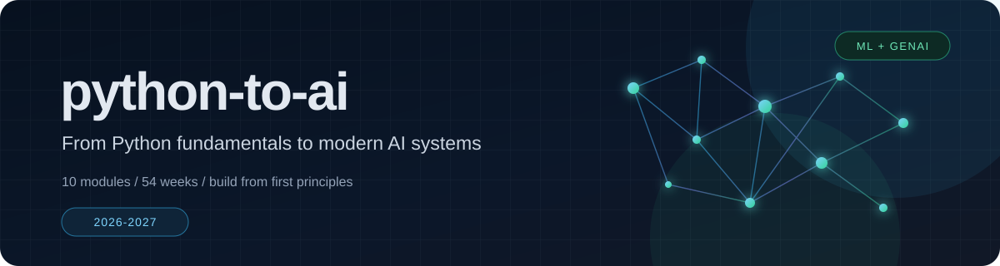

<div align="center">
  
</div>

# python-to-ai

**A structured, hands-on, 54-week journey from Python fundamentals to modern machine learning and generative AI.**

[](LICENSE)


`python-to-ai` is an independent, project-driven curriculum for learning Python, mathematics, classical machine learning, deep learning, computer vision, natural language processing, generative AI, graph neural networks, and large language models. Every topic is learned twice: first from first principles, then with modern production libraries.

The repository is intentionally sequenced. Each module builds on the previous one, each week produces a concrete artifact, and each module ends with a milestone project that can become part of a public portfolio.

## What You Will Build

- Fluent, tested Python for data processing, algorithms, and small applications.
- A from-scratch foundation in the calculus, linear algebra, probability, and optimization used by machine learning.
- Classical machine learning pipelines with disciplined evaluation and feature engineering.
- Neural networks implemented in NumPy and PyTorch, with reproducible training and experiment tracking.
- Computer vision systems for classification, segmentation, detection, tracking, and image restoration.
- NLP systems for sequence labeling, question answering, translation, and text generation.
- Generative models including VAEs, GANs, diffusion models, and parameter-efficient LLM fine-tuning.
- An applied AI capstone that combines retrieval, agents, graphs, multimodal models, and deployment.

## Curriculum at a Glance

| # | Module | Weeks | Target Window | Core Topics | Milestone | Directory |
| :---: | :--- | :---: | :--- | :--- | :--- | :--- |
| 01 | **Python Fundamentals & Algorithmic Thinking** | 1–4 | Nov 2–29, 2026 | Python, OOP, data structures, pandas, APIs, testing | Python Data Toolkit | [Explore](01-python-fundamentals/) |
| 02 | **Mathematics for Machine Learning (Calculus & Linear Algebra)** | 5–11 | Nov 30, 2026–Jan 17, 2027 | NumPy, gradients, optimization, linear algebra, SVD | Math-for-ML Toolkit | [Explore](02-calculus-and-linear-algebra/) |
| 03 | **Probability & Mathematical Statistics for Data Science** | 12–17 | Jan 18–Feb 28, 2027 | Probability, inference, Bayes, simulation, EDA | Statistical Analysis Report | [Explore](03-probability-and-statistics/) |
| 04 | **Classical Machine Learning & Feature Engineering** | 18–22 | Mar 1–Apr 4, 2027 | KNN, trees, ensembles, SVM, imbalance, tuning | Tabular ML Challenge | [Explore](04-classical-machine-learning/) |
| 05 | **Foundations of Deep Learning (NumPy & PyTorch)** | 23–27 | Apr 5–May 9, 2027 | Autograd, MLPs, optimizers, training loops | Neural Network Laboratory | [Explore](05-deep-learning-foundations/) |
| 06 | **Deep Learning for Multi-Modal Data (CNNs, RNNs & LSTMs)** | 28–33 | May 10–Jun 20, 2027 | CNNs, transfer learning, RNNs, transformers | Multi-Modal Classification Capstone | [Explore](06-deep-learning-multimodal/) |
| 07 | **Computer Vision & Deep Learning Applications** | 34–39 | Jun 21–Aug 1, 2027 | Restoration, segmentation, detection, tracking | Vision Application | [Explore](07-computer-vision/) |
| 08 | **Advanced Architectures & Natural Language Processing** | 40–44 | Aug 2–Sep 5, 2027 | NER, QA, translation, generation, DPO, quantization | End-to-End NLP System | [Explore](08-advanced-architectures-nlp/) |
| 09 | **Generative AI, GANs & Diffusion Models** | 45–50 | Sep 6–Oct 17, 2027 | VAEs, GANs, diffusion, Stable Diffusion, LoRA | Generative AI Studio | [Explore](09-generative-ai/) |
| 10 | **Advanced AI, Graph Neural Networks & Large Language Models** | 51–54 | Oct 18–Nov 14, 2027 | Reinforcement learning, GNNs, multimodal LLMs, RAG, agents | Applied AI Capstone | [Explore](10-advanced-deep-learning-and-llms/) |

## Master Roadmap

- **Start:** Monday, November 2, 2026
- **Finish:** Sunday, November 14, 2027
- **Pace:** 8–12 focused hours per week
- **Completion rule:** a week is complete only when its lab runs end-to-end and its output is documented.

The dates below are review checkpoints, not a race. If a week slips, use the next consolidation window to catch up and shift the remaining schedule rather than skipping a milestone. Check off weekly items and the module completion item as you progress.

### Phase I — Foundations (Weeks 1–11)

#### Module 01 — [Python Fundamentals & Algorithmic Thinking](01-python-fundamentals/)

**Weeks 1–4 · November 2–29, 2026 · Milestone: Python Data Toolkit**

**Published sessions**

- [x] **2026-10-21 · Basic Python (Part 1)** — [study guide and notebooks](01-python-fundamentals/2026-10-21-basic-python-part-1/)

- [x] **2026-10-22 · Basic Python (Part 2)** — [study guide and notebooks](01-python-fundamentals/2026-10-22-basic-python-part-2/)

- [x] **2026-10-23 · Big-O (Time Analysis)** — [study guide and notebooks](01-python-fundamentals/2026-10-23-big-o-time-analysis/)

- [x] **2026-10-24 · Basic Python Practice Lab** — [study guide and notebooks](01-python-fundamentals/2026-10-24-basic-python-practice-lab/)

- [ ] **Module complete** — all weekly labs and the milestone are finished.
- [ ] **Week 01** · Nov 2–8, 2026 — Environment setup, Python syntax, control flow, functions, and Big-O. *Output:* verified environment and algorithm exercises.
- [ ] **Week 02** · Nov 9–15, 2026 — Lists, dictionaries, sets, tuples, comprehensions, iterators, files, and exceptions. *Output:* data-structure lab.
- [ ] **Week 03** · Nov 16–22, 2026 — OOP, dataclasses, typing, recursion, two pointers, testing, and debugging. *Output:* tested OOP mini-library.
- [ ] **Week 04** · Nov 23–29, 2026 — pandas, APIs, web parsing, dynamic programming, and CLI design. *Output:* Python Data Toolkit milestone.
- [ ] **Milestone review** — tests pass, README is complete, and the project is reproducible.

*Optional deep dives:* recursive backtracking, dynamic programming patterns, clean architecture, profiling.

#### Module 02 — [Mathematics for Machine Learning (Calculus & Linear Algebra)](02-calculus-and-linear-algebra/)

**Weeks 5–11 · November 30, 2026–January 17, 2027 · Milestone: Math-for-ML Toolkit**

- [ ] **Module complete** — all weekly labs and the milestone are finished.
- [ ] **Week 05** · Nov 30–Dec 6, 2026 — NumPy arrays, broadcasting, vectorization, and numerical stability. *Output:* NumPy warm-up.
- [ ] **Week 06** · Dec 7–13, 2026 — Derivatives, gradients, the chain rule, and gradient descent from scratch. *Output:* optimization notebook.
- [ ] **Week 07** · Dec 14–20, 2026 — Linear regression, MSE, MAE, Huber loss, and closed-form solutions. *Output:* loss-function experiments.
- [ ] **Week 08** · Dec 21–27, 2026 — Matrix calculus and vectorized regression. *Output:* vectorized implementation.
- [ ] **Week 09** · Dec 28, 2026–Jan 3, 2027 — Consolidation, eigenvalues, SVD, and PCA foundations. *Output:* linear-algebra drills and a concept map.
- [ ] **Week 10** · Jan 4–10, 2027 — Cosine similarity, retrieval, interpolation, upsampling, and edge operators. *Output:* retrieval and image-operator lab.
- [ ] **Week 11** · Jan 11–17, 2027 — Integration week for regression, SVD, and image operators. *Output:* Math-for-ML Toolkit milestone.
- [ ] **Milestone review** — mathematical derivations, implementation, plots, and limitations are documented.

*Optional deep dives:* PCA, eigenfaces, image interpolation, convolution as a linear operator.

### Phase II — Data Science & Classical Machine Learning (Weeks 12–22)

#### Module 03 — [Probability & Mathematical Statistics for Data Science](03-probability-and-statistics/)

**Weeks 12–17 · January 18–February 28, 2027 · Milestone: Statistical Analysis Report**

- [ ] **Module complete** — all weekly labs and the milestone are finished.
- [ ] **Week 12** · Jan 18–24, 2027 — Probability axioms, conditional probability, Bayes' theorem, and distributions. *Output:* probability lab.
- [ ] **Week 13** · Jan 25–31, 2027 — Random variables, expectation, variance, covariance, and sampling. *Output:* distribution and sampling notebook.
- [ ] **Week 14** · Feb 1–7, 2027 — Estimation, confidence intervals, hypothesis testing, and A/B testing. *Output:* inference report.
- [ ] **Week 15** · Feb 8–14, 2027 — Naive Bayes, generative versus discriminative models, and text baselines. *Output:* Naive Bayes classifier.
- [ ] **Week 16** · Feb 15–21, 2027 — Monte Carlo, bootstrap, genetic algorithms, and exploratory data analysis. *Output:* simulation and EDA notebook.
- [ ] **Week 17** · Feb 22–28, 2027 — Integration week for inference, visualization, and baselines. *Output:* Statistical Analysis Report milestone.
- [ ] **Milestone review** — assumptions, uncertainty, and limitations are explicit.

*Optional deep dives:* information theory, statistical language models, experiment design, calibration.

#### Module 04 — [Classical Machine Learning & Feature Engineering](04-classical-machine-learning/)

**Weeks 18–22 · March 1–April 4, 2027 · Milestone: Tabular ML Challenge**

- [ ] **Module complete** — all weekly labs and the milestone are finished.
- [ ] **Week 18** · Mar 1–7, 2027 — ML workflow, data leakage, metrics, KNN, pipelines, and cross-validation. *Output:* baseline pipeline.
- [ ] **Week 19** · Mar 8–14, 2027 — Decision trees for classification and regression, pruning, and feature engineering. *Output:* tree-model lab.
- [ ] **Week 20** · Mar 15–21, 2027 — Bagging, random forests, boosting, gradient boosting, and hyperparameter search. *Output:* ensemble tuning experiment.
- [ ] **Week 21** · Mar 22–28, 2027 — SVMs, kernels, imbalanced learning, calibration, and interpretability. *Output:* SVM and imbalance lab.
- [ ] **Week 22** · Mar 29–Apr 4, 2027 — Integration week with held-out evaluation and model documentation. *Output:* Tabular ML Challenge milestone.
- [ ] **Milestone review** — no leakage, reproducible splits, and a complete model card.

*Optional deep dives:* stacking, SHAP, probability calibration, model risk and fairness.

### Phase III — Deep Learning (Weeks 23–33)

#### Module 05 — [Foundations of Deep Learning (NumPy & PyTorch)](05-deep-learning-foundations/)

**Weeks 23–27 · April 5–May 9, 2027 · Milestone: Neural Network Laboratory**

- [ ] **Module complete** — all weekly labs and the milestone are finished.
- [ ] **Week 23** · Apr 5–11, 2027 — Logistic regression, cross-entropy, tensors, and automatic differentiation. *Output:* autograd exercises.
- [ ] **Week 24** · Apr 12–18, 2027 — Softmax regression, multiclass evaluation, datasets, and training loops. *Output:* PyTorch classification pipeline.
- [ ] **Week 25** · Apr 19–25, 2027 — MLPs, activations, initialization, normalization, and regularization. *Output:* MLP experiment suite.
- [ ] **Week 26** · Apr 26–May 2, 2027 — SGD, momentum, AdamW, learning-rate schedules, and debugging. *Output:* optimizer benchmark.
- [ ] **Week 27** · May 3–9, 2027 — Integration week with a NumPy implementation and a PyTorch counterpart. *Output:* Neural Network Laboratory milestone.
- [ ] **Milestone review** — training curves, seeds, and failure cases are documented.

*Optional deep dives:* vanishing and exploding gradients, initialization theory, mixed precision, experiment tracking.

#### Module 06 — [Deep Learning for Multi-Modal Data (CNNs, RNNs & LSTMs)](06-deep-learning-multimodal/)

**Weeks 28–33 · May 10–June 20, 2027 · Milestone: Multi-Modal Classification Capstone**

- [ ] **Module complete** — all weekly labs and the milestone are finished.
- [ ] **Week 28** · May 10–16, 2027 — Convolution arithmetic, pooling, receptive fields, and CNNs from scratch. *Output:* CNN image classifier.
- [ ] **Week 29** · May 17–23, 2027 — Augmentation, batch normalization, regularization, and generalization. *Output:* regularization study.
- [ ] **Week 30** · May 24–30, 2027 — Transfer learning with ResNet, EfficientNet, ConvNeXt, and `timm`. *Output:* fine-tuning benchmark.
- [ ] **Week 31** · May 31–Jun 6, 2027 — RNNs, LSTMs, GRUs, sequence data, and time-series forecasting. *Output:* sequence-model lab.
- [ ] **Week 32** · Jun 7–13, 2027 — Attention, transformers, and fine-tuning for text classification. *Output:* transformer fine-tuning lab.
- [ ] **Week 33** · Jun 14–20, 2027 — Integration week for image, text, and sequence models. *Output:* Multi-Modal Classification Capstone milestone.
- [ ] **Milestone review** — compute budget, evaluation protocol, and limitations are reported.

*Optional deep dives:* attention internals, sequence-to-sequence models, multimodal fusion, model interpretability.

### Phase IV — Applied AI (Weeks 34–44)

#### Module 07 — [Computer Vision & Deep Learning Applications](07-computer-vision/)

**Weeks 34–39 · June 21–August 1, 2027 · Milestone: Vision Application**

- [ ] **Module complete** — all weekly labs and the milestone are finished.
- [ ] **Week 34** · Jun 21–27, 2027 — Denoising, super-resolution, colorization, autoencoders, and U-Net foundations. *Output:* image-restoration lab.
- [ ] **Week 35** · Jun 28–Jul 4, 2027 — Semantic segmentation, IoU, Dice, and medical-image workflows. *Output:* segmentation lab.
- [ ] **Week 36** · Jul 5–11, 2027 — Object detection foundations: anchors, IoU, NMS, and the YOLO family. *Output:* detection foundations lab.
- [ ] **Week 37** · Jul 12–18, 2027 — Modern detectors, fine-tuning, evaluation, and inference optimization. *Output:* detector fine-tuning experiment.
- [ ] **Week 38** · Jul 19–25, 2027 — Object tracking, tracking-by-detection, and video understanding. *Output:* tracking and video lab.
- [ ] **Week 39** · Jul 26–Aug 1, 2027 — Integration week for a complete vision application. *Output:* Vision Application milestone.
- [ ] **Milestone review** — dataset license, metrics, failure modes, and deployment path are documented.

*Optional deep dives:* self-supervised learning, semi-supervised learning, knowledge distillation, imbalanced vision data.

#### Module 08 — [Advanced Architectures & Natural Language Processing](08-advanced-architectures-nlp/)

**Weeks 40–44 · August 2–September 5, 2027 · Milestone: End-to-End NLP System**

- [ ] **Module complete** — all weekly labs and the milestone are finished.
- [ ] **Week 40** · Aug 2–8, 2027 — NLP pipelines, tokenization, embeddings, POS tagging, and named entity recognition. *Output:* sequence-labeling lab.
- [ ] **Week 41** · Aug 9–15, 2027 — Transformer fine-tuning, aspect-based sentiment, and question answering. *Output:* transformer NLP lab.
- [ ] **Week 42** · Aug 16–22, 2027 — Machine translation, text generation, decoding strategies, and evaluation. *Output:* generation and translation lab.
- [ ] **Week 43** · Aug 23–29, 2027 — Direct preference optimization, quantization, and efficient state-space models. *Output:* efficient adaptation lab.
- [ ] **Week 44** · Aug 30–Sep 5, 2027 — Integration week for an end-to-end NLP application. *Output:* End-to-End NLP System milestone.
- [ ] **Milestone review** — task metrics, error analysis, bias, and safety notes are included.

*Optional deep dives:* PEFT, model quantization, Mamba-style models, evaluation methodology.

### Phase V — Generative and Advanced AI (Weeks 45–54)

#### Module 09 — [Generative AI, GANs & Diffusion Models](09-generative-ai/)

**Weeks 45–50 · September 6–October 17, 2027 · Milestone: Generative AI Studio**

- [ ] **Module complete** — all weekly labs and the milestone are finished.
- [ ] **Week 45** · Sep 6–12, 2027 — Generative modeling foundations, VAEs, and neural style transfer. *Output:* VAE and style-transfer lab.
- [ ] **Week 46** · Sep 13–19, 2027 — GANs, DCGAN, training stability, Pix2Pix, and CycleGAN. *Output:* conditional GAN lab.
- [ ] **Week 47** · Sep 20–26, 2027 — DDPM, denoising score matching, samplers, and image inpainting. *Output:* diffusion-model lab.
- [ ] **Week 48** · Sep 27–Oct 3, 2027 — Latent diffusion, Stable Diffusion, ControlNet, and generative evaluation. *Output:* controllable generation lab.
- [ ] **Week 49** · Oct 4–10, 2027 — LoRA, QLoRA, instruction tuning, DPO, XAI, and video diffusion. *Output:* LLM adaptation lab.
- [ ] **Week 50** · Oct 11–17, 2027 — Integration week for a generative AI application and demo. *Output:* Generative AI Studio milestone.
- [ ] **Milestone review** — evaluation, licensing, consent, bias, and misuse risks are documented.

*Optional deep dives:* neural style transfer, video diffusion, explainable AI, preference optimization.

#### Module 10 — [Advanced AI, Graph Neural Networks & Large Language Models](10-advanced-deep-learning-and-llms/)

**Weeks 51–54 · October 18–November 14, 2027 · Milestone: Applied AI Capstone**

- [ ] **Module complete** — all weekly labs and the capstone are finished.
- [ ] **Week 51** · Oct 18–24, 2027 — Reinforcement learning, MDPs, Q-learning, policy gradients, and DDPG. *Output:* RL and point-cloud lab.
- [ ] **Week 52** · Oct 25–31, 2027 — Graph neural networks, molecular property prediction, and multimodal LLMs. *Output:* graph and multimodal lab.
- [ ] **Week 53** · Nov 1–7, 2027 — RAG, tool use, agents, multi-agent systems, and deployment. *Output:* retrieval and agent lab.
- [ ] **Week 54** · Nov 8–14, 2027 — Capstone integration, evaluation, documentation, portfolio, and retrospective. *Output:* Applied AI Capstone milestone.
- [ ] **Milestone review** — the system is reproducible, tested, documented, and publicly demonstrable.

*Optional deep dives:* deep deterministic policy gradients, point-cloud learning, multi-task learning, agent evaluation.

## Repository Structure

```text
python-to-ai/
├── .github/                         # Contribution and issue templates
├── 01-python-fundamentals/          # Weeks 1–4
│   ├── notebooks/
│   ├── exercises/
│   └── projects/
├── 02-calculus-and-linear-algebra/  # Weeks 5–11
├── 03-probability-and-statistics/   # Weeks 12–17
├── 04-classical-machine-learning/   # Weeks 18–22
├── 05-deep-learning-foundations/    # Weeks 23–27
├── 06-deep-learning-multimodal/     # Weeks 28–33
├── 07-computer-vision/              # Weeks 34–39
├── 08-advanced-architectures-nlp/   # Weeks 40–44
├── 09-generative-ai/                # Weeks 45–50
├── 10-advanced-deep-learning-and-llms/  # Weeks 51–54
├── assets/                          # Banner and repository visuals
├── data/                            # Local datasets; contents ignored by Git
├── docs/                            # Setup and study guides
├── scripts/                         # Environment and maintenance utilities
├── templates/                       # Notebook, project, and experiment templates
├── .editorconfig
├── .gitattributes
├── .gitignore
├── LICENSE
├── README.md
├── pyproject.toml
└── requirements.txt
```

Every module follows the same workspace convention:

- `notebooks/` contains guided lessons and exploratory work.
- `exercises/` contains focused practice and short problem sets.
- `projects/` contains the module milestone and any extensions.

## Getting Started

### Prerequisites

- Python 3.10 or newer. Python 3.12 is a conservative choice for the full stack.
- Git and a terminal.
- 8 GB of RAM minimum; 16 GB or more is recommended for deep learning.
- A CUDA-capable GPU is optional. All required labs can run on CPU with smaller datasets.
- At least 15 GB of free disk space for the full dependency stack, datasets, and model caches.

### Quick Start on Windows PowerShell

```powershell
git clone https://github.com/idewithasmile/python-to-ai.git
Set-Location python-to-ai
python -m venv .venv
.\.venv\Scripts\Activate.ps1
python -m pip install --upgrade pip
python -m pip install -r requirements.txt
python scripts/verify_environment.py
python -m jupyter lab
```

If PowerShell blocks virtual-environment activation, use a process-scoped policy for the current terminal:

```powershell
Set-ExecutionPolicy -Scope Process -ExecutionPolicy Bypass
.\.venv\Scripts\Activate.ps1
```

### Quick Start on macOS or Linux

```bash
git clone https://github.com/idewithasmile/python-to-ai.git
cd python-to-ai
python3 -m venv .venv
source .venv/bin/activate
python -m pip install --upgrade pip
python -m pip install -r requirements.txt
python scripts/verify_environment.py
python -m jupyter lab
```

For a lighter Module 01-only setup, install `numpy pandas matplotlib seaborn scikit-learn jupyterlab requests beautifulsoup4 pytest ruff` first and add the remaining tracks as you reach them. The complete setup, GPU notes, Jupyter kernel registration, and troubleshooting steps are in [`docs/setup.md`](docs/setup.md).

## How the Program Works

Each week follows a three-pass learning loop:

1. **Understand:** read the module notes, derive the core idea, and write a short explanation in your own words.
2. **Build:** complete the guided notebook and at least one exercise without copying a finished solution.
3. **Explain:** document results, errors, and trade-offs in a lab note or project README.

Each module ends with a milestone project. A milestone is complete only when it includes a reproducible environment, a clear evaluation protocol, an error analysis, and a short written reflection. The project review rubric is in [`docs/study-guide.md`](docs/study-guide.md).

Progress is tracked directly in the [Master Roadmap](#master-roadmap). Check weekly items as you finish them, then check the module completion item after the milestone review. Commit your work regularly so the Git history tells the story of the journey.

## Standards and Policies

- **Language:** all repository content, code, comments, docstrings, commit messages, and issues are written in professional English.
- **Vendor neutrality:** the curriculum is independent and does not include private course material, instructor names, cohort dates, private links, or enrollment information.
- **Reproducibility:** every experiment records seeds, dependency versions, data splits, and the exact command used to reproduce the result.
- **Data and models:** datasets larger than 50 MB and model weights are never committed. Use download scripts, dataset cards, and local ignored directories.
- **Modern APIs:** examples target Python 3.10+, PyTorch 2.x, and current Hugging Face libraries. Deprecated APIs are upgraded rather than preserved.
- **Responsible AI:** projects involving people, generated media, or sensitive data must document consent, licensing, bias, privacy, and misuse risks.

## Contributing

Contributions that improve explanations, fix broken links, add tests, or modernize examples are welcome. Read [`CONTRIBUTING.md`](CONTRIBUTING.md) before opening a pull request. Use the issue templates for bugs, content improvements, and learning questions.

## License

Released under the [MIT License](LICENSE). You may use, adapt, and share the curriculum with attribution.

---

**Last updated:** October 21, 2026
